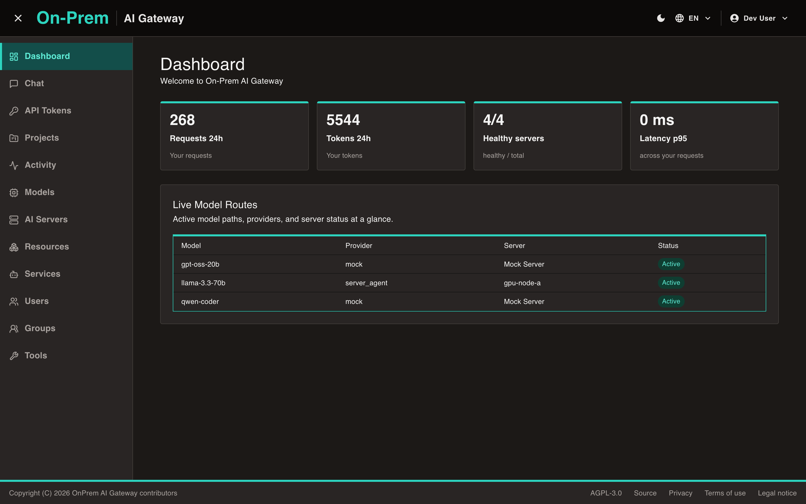
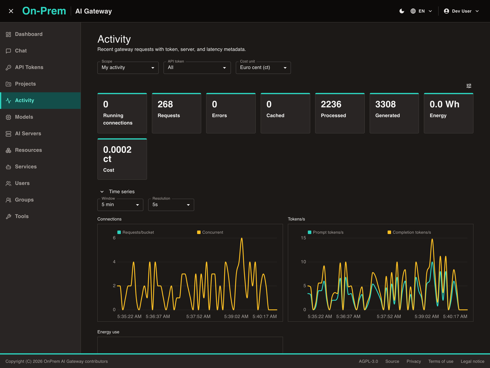
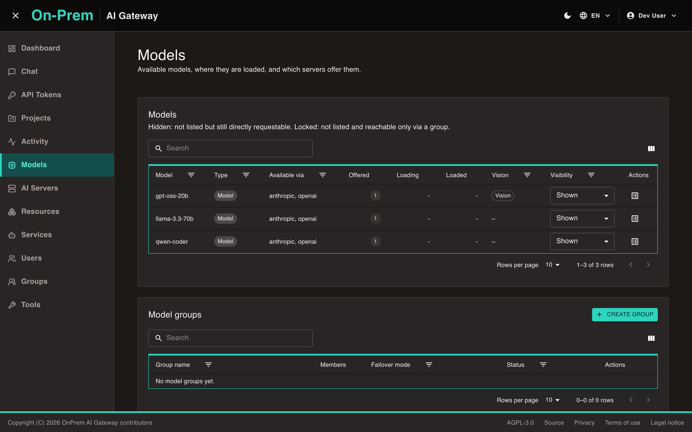
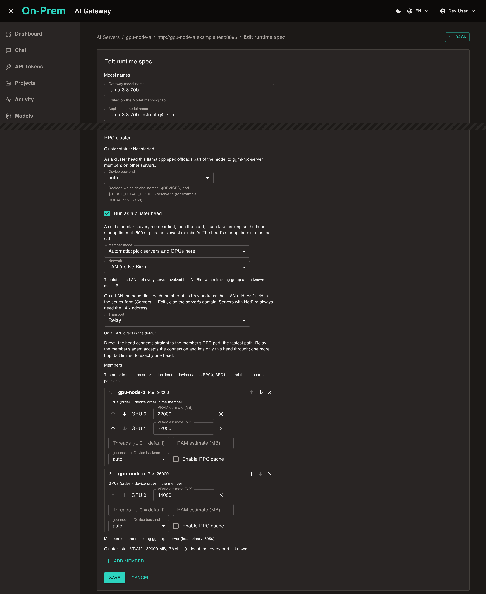
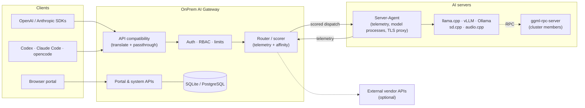

<div align="center">

# OnPrem AI Gateway

**Run your own AI fleet behind one gateway.**

A self-hostable AI gateway and management portal for servers running
**llama.cpp**, **vLLM**, **Ollama**, **stable-diffusion.cpp** or
**audio.cpp** — with drop-in **OpenAI-** and **Anthropic-compatible** APIs,
load-aware routing, agent-managed model processes (including llama.cpp RPC
clusters across several servers), usage/cost/energy analytics, and an
optional private mesh.

[](https://github.com/JLor08/op-ai-gateway/actions/workflows/ci.yml)
[](LICENSE)
[](gateway/backend)
[](gateway/frontend)



</div>

---

Point your existing tools — OpenAI/Anthropic SDKs, **Codex**, **Claude Code**,
**opencode**, anything speaking those APIs — at one URL. The gateway
authenticates the caller, picks the best server for the requested model from
**live host telemetry**, starts the model on demand when an agent manages it,
dispatches (translating between API flavors when needed), and records who used
which model, where, at what cost, and with how much energy. Operators manage
servers, models, launch specifications, users, and policies in a bilingual
(English/German), themable web portal.

## Features

**Drop-in client APIs**

- OpenAI-compatible **Chat Completions** and **Responses** APIs and an
  **Anthropic-compatible Messages** API (plus `count_tokens`) — streaming, tool
  calling, and image input included; unified model discovery (`/v1/models`,
  `/anthropic/v1/models`, and an LM Studio-shaped `/api/v1/models`) that
  reports a model's context window when it is known.
- **Image generation and editing** (`/v1/images/generations`,
  `/v1/images/edits`) relayed to stable-diffusion.cpp's `sd-server`.
- **Text-to-speech** (`/v1/audio/speech`, WAV or PCM, also streamed; voice discovery
  via `/v1/audio/voices`), **speech-to-text** (`/v1/audio/transcriptions`,
  multipart in, JSON or streamed out), **diarized transcription**
  (`/v1/audio/transcriptions/details`, who spoke when) and **live
  transcription** (`/v1/audio/transcriptions/live`) relayed to audio.cpp. A
  model serves these endpoints only once it is marked as capable of the task.
- One gateway model name can map to different backend model names per server;
  requests are translated between flavors when client and backend differ.
- Works as the backend for coding agents: Codex (Responses API) and
  Claude Code (Messages API) run against it unchanged; per API token, the
  gateway can also offer Claude-compatible alias names for local models and
  pass Claude Code's effort setting on to llama.cpp and vLLM.

**Portal chat**

- Streaming chat that runs each turn server-side, so it survives page reloads
  and disconnects.
- Image generation and editing, spoken answers (text-to-speech), transcription
  of uploaded audio, live transcription from the microphone, and a hands-free
  **Voice Chat** mode (live speech recognition → model → speech synthesis) —
  each offered for the models that can do it.

**Load-aware routing**

- Operator-managed **model mappings** tie gateway models to applications
  (inference endpoints) on registered AI servers.
- The resolver scores candidates by live telemetry (load, health, queue) plus
  per-application priority/weight, with **route affinity** keeping
  context-heavy clients on the same server while it stays suitable. When every
  instance of a model is busy, requests wait in a bounded admission queue
  instead of failing.
- **Model groups** with failover; built-in **benchmarks** (speed, capacity,
  VRAM, and audio real-time throughput) to compare routes.

**Identity, access & limits**

- Local users with **invite-based provisioning** (no self-registration),
  server-side sessions + CSRF for browsers, scoped **API tokens** for
  programs, three roles (`user < admin < system_admin`) with a step-up
  system-admin mode, optional **TOTP 2FA**.
- Groups, projects, services (service accounts), and resource groups for
  fleet-scale organization; per-model visibility (hidden/locked models).
- Optional per-user/per-service **rate limits, request/token quotas, and cost
  budgets** — hard admission gates in front of routing.

**External vendor accounts** (optional, off by default)

- Users can connect their own accounts at **OpenAI** and **Anthropic** (API
  key, or an experimental, ToS-restricted subscription login), **x.ai**,
  **OpenRouter**, the **Kilo Gateway**, **Google Gemini** (through its
  OpenAI-compatible endpoint or its native API), or any custom
  OpenAI-compatible endpoint, and route their requests through them alongside
  the self-hosted servers.
- Accounts are personal by default; when sharing is enabled, an admin owner
  can share one through resource groups, and each API token opts in to the
  accounts it may use.

**Observability**

- Per-request usage with **token counts, cost, and energy attribution**;
  time-series charts, group-by analytics, and a live running-connections
  panel (SSE) with live time-to-first-token and tokens/s.
- Per-server performance history, an availability timeline, hardware
  inventory, and an energy panel.
- Optional **payload capture** for debugging — opt-in per token (with an
  explicit system-admin override to force capture globally), encrypted at
  rest (AES-256-GCM) or volatile in RAM, with sensitive headers redacted.
- Live log view with runtime log-level switching; OpenTelemetry tracing.

**Fleet & mesh**

- A standalone, CGO-free **Server-Agent** (Linux/Windows/macOS) reports host,
  GPU, power, temperature, and hardware-inventory telemetry over
  HTTP/WebSocket; agent binaries and ready-to-use configs are downloadable
  through the gateway (portal, or the agent-token endpoint over the mesh).
- Optional **NetBird mesh** integration with gateway-managed peers and access
  policies, and certificates issued and rotated by the gateway (ACME or its
  own internal CA) for the edge and the mesh, including a TLS-terminating
  agent proxy in front of the AI server.

**Agent-managed model runtime** (replaces llama-swap)

- Model server **processes** are started and stopped on demand by the agent: a
  request for a model that is not loaded starts it, waits for it to become
  healthy, and proxies — behind **one** router port per AI server, with the
  child processes bound to loopback.
- Launch specifications (type, binary, arguments, environment, config files,
  GPUs, timeouts) are maintained in the portal for llama.cpp, vLLM, TGI,
  Ollama, stable-diffusion.cpp, audio.cpp or a custom server, while the AI
  server's own operator keeps a **binary allowlist** that decides what may
  execute at all. Model secrets never enter the gateway: a spec's environment
  values are `${AGENT_ENV:NAME}` references resolved on the AI server. A spec's
  GPU selection is enforced through the vendor's visibility variable or
  rendered into the command line through device placeholders.
- **Admission control before every start:** co-residency rules (open by
  default on a new server, with forbidden pairs carved out), a per-server
  process limit, per-GPU **VRAM budgets** and a host-wide **RAM pool** — both
  detected from the hardware by default, with measured usage fed back from the
  agent. When room is needed, an idle model of the same role is evicted first,
  never one used within a grace window, and eviction drains in-flight
  responses instead of aborting them.
- **Instances and autoscaling:** a replicable spec can run several instances
  (with a minimum and a maximum); the gateway adds one when requests wait, the
  agent decides whether it fits and retires idle instances on its own.
- Live per-instance status in the portal (state, PID, port, in-flight,
  restarts, the last load error with a stderr tail), transient Start/Stop, a
  persistent **Pin**, live process logs per instance, and an optional
  **local-file mode** where the AI server's operator owns the configuration
  and the portal is read-only.

**llama.cpp RPC clusters**

- One model can run across several AI servers: a `llama_cpp` spec, the
  **head**, runs `llama-server --rpc …` and offloads part of the model to
  **members**, `ggml-rpc-server` processes on other AI servers. The gateway
  configures, orders, holds and accounts for the cluster; it never sits on the
  RPC data path.
- Members are either **manual** (an operator-created `rpc_server` spec on the
  member server) or **automatic** (the head picks a server, its GPUs and
  settings, and the gateway derives the member). Each cluster runs on a
  `mesh` (NetBird, with a managed access policy per member server) or `lan`
  network, with a `direct` or `relay` transport.
- A per-server **Binaries** tab lists the server's binaries (reported by its
  agent or entered by hand) with their llama.cpp versions; automatic members
  get the `ggml-rpc-server` whose version matches the head's `llama-server`.
- `${RPC_SERVERS}`, `${RPC_DEVICES}`, `${DEVICES}` and `${FIRST_LOCAL_DEVICE}`
  render the member endpoints and the RPC and local device names into the
  head's command line.
- A cold cluster starts members first, then the head; requests wait while it
  forms. A watchdog stops the cluster when a member is lost, and a failed
  cluster answers with its own stable error code.
- Energy is attributed per host: each member's share of its host's power is
  stored as a separate part of the request and priced at that member server's
  own electricity price.

**Operations**

- Three storage drivers: in-memory (dev), **SQLite**, **PostgreSQL** —
  versioned, auto-applied migrations.
- Docker Compose and Kubernetes deployments: distroless backend, nginx-baked
  frontend; **external data-only themes** deployable without a rebuild.

## Screenshots

| Usage analytics | Model management |
| :---: | :---: |
|  |  |

| llama.cpp RPC cluster head (editor header, then its RPC cluster section) |
| :---: |
|  |

## How it works



A **model mapping** ties a gateway model name to an application (a running
inference endpoint, or a Server-Agent that starts the model on demand) on an
AI server. For each request the resolver builds the candidate
`(server, application, mapping)` set, scores it by live server telemetry and
the application's routing tuning, and dispatches — honoring route affinity so
conversational clients keep hitting the same backend. The full design is
documented in [`docs/architecture/`](docs/architecture/README.md) (arc42, with
diagrams); start with
[Routing & Model Selection](docs/architecture/cross-cutting/routing-and-model-selection.md)
and [Agent-Managed Model Runtime](docs/architecture/cross-cutting/agent-runtime-manager.md).

## Quick start (Docker)

Requires Docker with the Compose plugin.

```bash
git clone https://github.com/JLor08/op-ai-gateway.git
cd op-ai-gateway/gateway/deploy
cp .env.example .env      # set OP_AI_GATEWAY_BOOTSTRAP_API_TOKEN, e.g. via: openssl rand -hex 32
docker compose -f docker-compose.no-netbird.yml up --build
```

Open `http://localhost:8080/` (redirects to `/portal/`) and log in with the
one-time set-password link printed in the backend logs:

```bash
docker compose -f docker-compose.no-netbird.yml logs backend | grep set-password
```

This stack runs the distroless gateway, the nginx-served portal, and
PostgreSQL with automatic schema migration. The default
`docker-compose.yml` additionally runs the gateway as a **NetBird mesh peer**
(a sidecar sharing the backend's network namespace); Compose and Kubernetes
variants with and without the mesh are provided — see the full runbook in
[`gateway/deploy/README.md`](gateway/deploy/README.md), including certificates
and the mesh setup. To add an AI server, create it in the portal, generate its
agent token, and install the Server-Agent next to it
([`server-agent/README.md`](server-agent/README.md)).

## Point your clients at it

Create an API token in the portal (**API Tokens**), then:

| Client | Base URL / endpoint |
|---|---|
| OpenAI SDKs & tools | `http://<gateway>/openai/v1` (Chat Completions, Responses, Images, Speech, Transcriptions, Models) |
| Anthropic SDKs | `http://<gateway>/anthropic/v1` (Messages, Models) |
| Codex | Responses API at `/v1/responses` |
| Claude Code | Messages API at `/v1/messages` |
| opencode | `scripts/gen-opencode-config.sh --url http://<gateway> --token <api-token>` writes an `opencode.json` with each model's context window |
| Generic / mixed | Unprefixed `/v1/*` accepts both flavors' inference calls |

```bash
curl -s http://localhost:8080/openai/v1/chat/completions \
  -H 'Authorization: Bearer <your-api-token>' \
  -H 'Content-Type: application/json' \
  -d '{"model":"qwen-coder","messages":[{"role":"user","content":"hello"}]}'
```

Browsers authenticate with a session cookie + `X-OP-CSRF` header instead.
`/v1/chat/completions` additionally accepts that session; the image and audio
endpoints additionally accept the gateway's own internal loopback pair (the
portal's background runs) — never a browser session; every other inference
endpoint, including `/v1/responses` and `/v1/messages`, is bearer-only. The
portal's chat runs each turn as a server-side run and streams it to the
browser over SSE. The complete endpoint reference is in
[HTTP API Surface](docs/architecture/reference/api-surface.md).

## Local development

Requires **Go 1.26+** and **Node.js 22+**.

```bash
make dev
```

starts a disposable full stack (gateway in in-memory mode on
`127.0.0.1:8091` + Vite dev server) and serves the portal at
`http://127.0.0.1:4173/portal/`. Log in as the seeded dev user
`dev@example.test` / `dev-secret` (a `system_admin`; a mock server with two
mock models is pre-wired so routing, chat, and analytics work without a real
AI server). Memory mode is ephemeral — for persistent local state run the
gateway with the SQLite driver:

```bash
export OP_AI_GATEWAY_BOOTSTRAP_API_TOKEN="$(openssl rand -hex 32)"

OP_AI_GATEWAY_DB_DRIVER=sqlite \
OP_AI_GATEWAY_SQLITE_PATH=./data/op-ai-gateway.db \
OP_AI_GATEWAY_BOOTSTRAP_ADMIN_EMAIL=admin@example.test \
OP_AI_GATEWAY_BOOTSTRAP_ADMIN_NAME="Admin User" \
make run-gateway
```

The Server-Agent is its own Go module: build and test it with
`go build ./...` / `go test ./...` from `server-agent/`.

### Tests & quality gates

```bash
make test        # both Go modules (gateway + server-agent) and the frontend unit tests
```

```bash
make lint        # golangci-lint on both Go modules + the docs consistency check (make fmt to format)
```

```bash
make test-e2e    # the base Playwright end-to-end suite (real gateway + built portal)
```

`make hooks` installs a pre-commit hook that runs the docs check for staged
Markdown and the Go format check and lint for staged Go files.
Store changes are also tested against PostgreSQL when
`OP_AI_GATEWAY_TEST_POSTGRES_DSN` is set.

Scenario e2e suites (certificates, capture, TOTP, SMTP, limits, speech and
transcription, the agent-managed model runtime, the llama.cpp RPC cluster, …)
live in `gateway/e2e` as npm scripts. CI runs two of them: `e2e:runtime`
(a real Server-Agent starting real child processes) and `e2e:rpc-cluster` (a
real llama.cpp cluster: a `llama-server` head and a `ggml-rpc-server` member,
each behind its own Server-Agent); every other suite, including the base
suite, is a local-only gate. Besides those two e2e jobs, CI runs the Go job
(format, lint, tests for both modules), the frontend job (format, lint, build,
tests), the docs consistency check, and the offline tests of the Sonar scripts
and of the opencode config generator. Architecture tests (frozen dependency
rules for both Go modules and the frontend) run inside the normal test
suites, and a local, headless **SonarQube quality gate** is available via
`make sonar-up` / `make sonar-gate`, with `make sonar-findings` /
`make sonar-branch-findings` naming the findings a branch introduced. The full
tooling reference is
[Development Tooling & Quality Gates](docs/architecture/cross-cutting/development-and-quality.md).

## Configuration

Everything is configured through `OP_AI_GATEWAY_*` environment variables
(driver selection, listeners, TLS, capture, mesh, SMTP, theming directory,
…) and system settings in the portal (certificates, NetBird, vendor accounts,
…) — the complete reference is
[Configuration & Environment Variables](docs/architecture/reference/config-env.md).

## Repository layout

| Component | Path | What it is |
|---|---|---|
| **Gateway** | `gateway/backend/` (Go module `op-ai-gateway`) | Terminates client/inference APIs, routes and dispatches inference, serves portal/system/agent APIs, orchestrates managed runtimes and RPC clusters, runs background reconcilers. |
| **Portal** | `gateway/frontend/` (React + TypeScript + Vite + MUI) | Administration, server/model/runtime management, analytics, and the chat (text, image, speech, transcription, Voice Chat). Served under `/portal/`. |
| **E2E tests** | `gateway/e2e/` (Playwright) | The end-to-end suites against a real gateway and the built portal. |
| **Server-Agent** | `server-agent/` (Go module `op-ai-server-agent`) | Standalone binary installed next to an AI server; reports host/GPU/power/temperature/hardware telemetry, can terminate mesh TLS in front of the local server, and starts/stops the local model server processes (and RPC cluster members) on demand. See [`server-agent/README.md`](server-agent/README.md). |
| **Deploy** | `gateway/deploy/` | Dockerfiles, `docker-compose*.yml`, `k8s/`, `k8s-no-netbird/`, `nginx/`, deployable `themes/`, and operator runbooks. See [`gateway/deploy/README.md`](gateway/deploy/README.md). |
| **Docs** | `docs/architecture/` | arc42 architecture documentation — the reference for how the system is built and why. |
| **Scripts** | `scripts/` | The dev stack, the docs consistency check, the opencode config generator, the Sonar gate, git hooks. |

## Documentation

- [Architecture overview](docs/architecture/README.md) — arc42 index (goals,
  constraints, building blocks, runtime views, deployment, ADRs)
- [Security, Authentication & Authorization](docs/architecture/cross-cutting/security-auth-rbac.md)
- [Routing & Model Selection](docs/architecture/cross-cutting/routing-and-model-selection.md)
- [API Compatibility & Inference](docs/architecture/cross-cutting/compatibility-and-inference.md)
- [Agent-Managed Model Runtime](docs/architecture/cross-cutting/agent-runtime-manager.md)
  (including llama.cpp RPC clusters)
- [Telemetry, Usage Analytics & Observability](docs/architecture/cross-cutting/telemetry-usage-observability.md)
- [External Vendor Accounts](docs/architecture/cross-cutting/external-vendor-accounts.md)
- [Persistence](docs/architecture/cross-cutting/persistence.md) ·
  [Networking & Mesh](docs/architecture/cross-cutting/networking-mesh.md) ·
  [Certificates & TLS](docs/architecture/cross-cutting/certificates-tls.md)
- [HTTP API Surface](docs/architecture/reference/api-surface.md) ·
  [Configuration Reference](docs/architecture/reference/config-env.md) ·
  [Data Model](docs/architecture/reference/data-model.md)

## Contributing

Issues and pull requests are welcome. Before submitting, please run
`make lint` and `make test` (CI enforces format, lint, build, and tests for
both Go modules and the frontend). Repository conventions, test suites, and
the quality gates are documented in
[Development Tooling & Quality Gates](docs/architecture/cross-cutting/development-and-quality.md).

Please read [CONTRIBUTING.md](CONTRIBUTING.md) and follow the security process
in [SECURITY.md](SECURITY.md). Voluntary contributor recognition is maintained
in [CONTRIBUTORS.md](CONTRIBUTORS.md).

## License

OnPrem AI Gateway is free software licensed under the **GNU Affero General
Public License, version 3 only (`AGPL-3.0-only`)**. See [LICENSE](LICENSE) for
the full text. Copyright (C) 2026 OnPrem AI Gateway contributors.

The canonical source repository is <https://github.com/JLor08/op-ai-gateway>.

Because the gateway is a network service, the AGPL's section 13 applies: if
you run a **modified** version and let users interact with it over a network,
you must offer those users access to the corresponding source of your modified
version. The unmodified upstream source is always available at the repository
link above.

Third-party dependencies keep their own licenses; see
[THIRD-PARTY-NOTICES.md](THIRD-PARTY-NOTICES.md) for attributions and
[Licensing](docs/architecture/cross-cutting/licensing.md) for the dependency
policy.
