# 6. Runtime View

Key runtime scenarios as sequence diagrams. Details of each subsystem are in the
[cross-cutting concepts](README.md#8-cross-cutting-concepts).

## 6.1 Inference request (routing, dispatch, streaming)

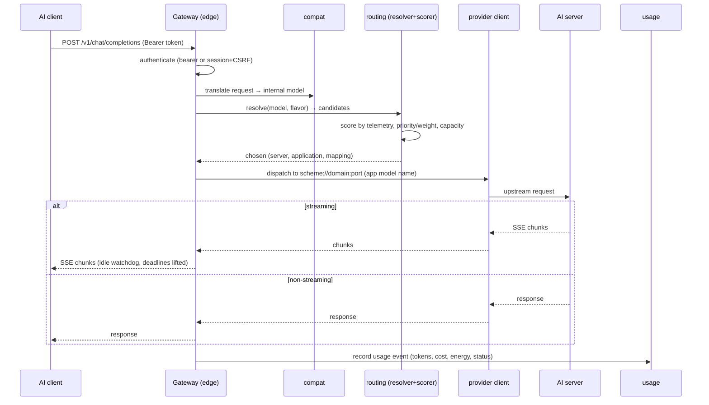

Notes: the six JSON inference endpoints read the request body with no size cap
(large multimodal payloads); the other two, the multipart image edit
(`POST /v1/images/edits`) and the multipart audio transcription
(`POST /v1/audio/transcriptions`), are the capped bodies, each at a setting of its
own (`OP_AI_GATEWAY_MAX_IMAGE_EDIT_BODY_BYTES`,
`OP_AI_GATEWAY_MAX_AUDIO_TRANSCRIPTION_BODY_BYTES`, default 32 MiB each). All eight
lift the server read/write deadlines; SSE streams are bounded by an idle watchdog and
client disconnect, not a total cap. See
[Compatibility & Inference](cross-cutting/compatibility-and-inference.md).

### 6.1.1 Speech relay (`POST /v1/audio/speech`)

Text-to-speech is the one inference scenario whose response is **binary and not
JSON**, so it has its own runtime shape: no translate path, a capability gate
before routing, a validation that refuses what the relay cannot serve, a sized
and unbuffered audio body, and a usage row in seconds rather than tokens.

```mermaid
sequenceDiagram
    participant C as AI client
    participant GW as Gateway (edge)
    participant R as routing (resolver)
    participant AC as audio.cpp server
    participant U as usage

    C->>GW: POST /v1/audio/speech {model, input, voice} (Bearer token)
    GW->>GW: authenticate (bearer or loopback, never a session)
    GW->>GW: validate: model + input; response_format wav or pcm (wav only when not streaming); stream boolean
    Note over GW: 400 speech.* here, before any admission, not recorded
    GW->>R: resolve(model, openai_audio, required capability speech)
    R-->>GW: candidate with speech: yes, or 404 no_model_route / model_not_capable
    GW->>AC: POST /v1/audio/speech (model rewritten to the app's own name)
    alt 2xx
        AC-->>GW: audio/wav + Content-Length + X-AudioCPP-* headers
        GW-->>C: audio/wav + Content-Length (streamed, never buffered)
        GW->>U: audio_second = Audio-Duration-Ms / 1000, zero tokens
    else non-2xx
        AC-->>GW: error body (an OpenAI object, or a plain string)
        GW-->>C: OpenAI-shaped error at the upstream's status
        GW->>U: audio_second error row, quantity 0
    end
```

The gate is `RequiredCapabilities = ["speech"]`, whose verdict the health loop wrote
from the server's `/v1/models` `task`; the flavor is the application's own
`openai_audio` declaration. A payload capture keeps the request JSON and a metadata
summary of the audio, never the WAV bytes. See [Compatibility & Inference
§3.6](cross-cutting/compatibility-and-inference.md#36-openai-audio-speech) and
[ADR-061](09-architecture-decisions.md#adr-061--speech-is-the-second-endpoint-on-the-capability-gate-a-distinct-speech-capability-a-coarse-openai_audio-flavor-the-audio_cpp-kind-and-a-binary-relay-that-serves-wav-only).

**`pcm` variant** ([ADR-069](09-architecture-decisions.md#adr-069--non-stream-speech-pcm-is-a-wav-header-strip-not-a-transcode-the-gateway-relays-the-data-chunk-of-a-16-bit-mono-wav-as-headerless-pcm-refuses-any-other-clip-after-synthesis-and-leaves-mp3opusflacaac-to-264), issue #253 part 1). A request that
does not stream and names `response_format: pcm` takes the same path with one change on the
2xx branch. The gateway asks audio.cpp for its WAV (the upstream `response_format` is forced to
`wav`; audio.cpp answers a WAV for every format), reads the RIFF/WAVE header **before** writing
the client's headers (`wavStripToData`), checks the clip is 16-bit mono PCM and that the
declared data size fits the upstream's own `Content-Length`, and relays only the `data` chunk
as `application/octet-stream` with that chunk's size as the `Content-Length`: a header strip,
not a transcode, headerless at the model's native rate. A clip that fails the check never
reaches the client in part: the answer is **502 `speech.pcm_unavailable`** and an
`audio_second` error row of quantity 0. Billing otherwise reads the upstream's
`X-AudioCPP-Audio-Duration-Ms` exactly as for `wav`, and the capture stays the redacted
summary (the octet-stream body is redacted by the binary-speech backstop). A `stream: true`
request answered buffered stays `audio/wav`, as below.

**Streaming variant** ([ADR-068](09-architecture-decisions.md#adr-068--streaming-speech-synthesis-the-gateway-relays-the-pcm-stream-of-a-streaming-model-meters-it-from-the-bytes-it-relayed-audio_bytes-or-audio_second-over-a-benchmark-learned-byte-rate-and-the-portal-composer-plays-it-as-it-arrives), issues #253 and #263). When the client sends
`stream=true` (with `response_format` `pcm` or absent) and the mapped model's
`speech_streaming` verdict is `yes` (the model is `mode=streaming`), the relay sends
`stream=true` upstream and **relays audio.cpp's stream unbuffered**: the SSE
`speech.audio.delta` (base64 PCM) → `speech.audio.done` → `[DONE]`, or raw PCM for
`stream_format=audio`, with **no `Content-Length`** (a stream has none). The stream states no
duration and no sample rate, so the relay **counts the PCM it relays** after each chunk has
been written, and on a clean completion bills `audio_second` = bytes ÷ the mapping's cached
output byte rate, or `audio_bytes` = the byte count while no rate is cached; anything else
(an error, a cut or a disconnected stream) is an `audio_second` row of quantity 0. The capture
stays the redacted summary, with the endpoint stamped speech. A verdict that is `no`, absent or
unreadable serves the buffered one-shot of the diagram (the body is sent without the stream
fields, so the client gets `audio/wav` whatever it asked), and a stale `yes` that draws a `500
"speech streaming requires a model configured with mode=streaming"` is **retried buffered
once**, nothing of the stream having reached the client. The byte rate is learned by the speech
benchmark (§6.5), which the health loop starts for a loaded streaming-capable mapping.

### 6.1.2 Transcription relay (`POST /v1/audio/transcriptions`)

Speech-to-text is speech's mirror image: its request is a **multipart audio upload** and
its response is **JSON**, and the quantity it bills is in that JSON, so its relay is the
one that reads its response before it writes. It shares speech's flavor, so what differs
is keyed on the endpoint.

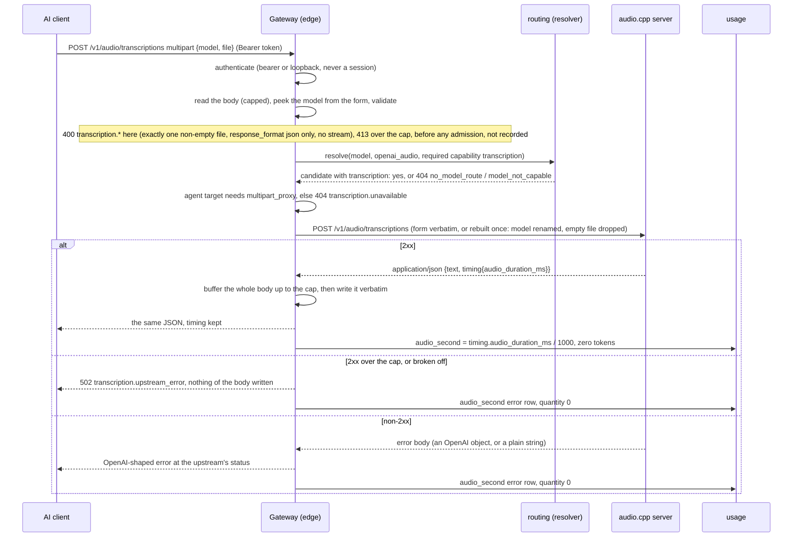

The gate is `RequiredCapabilities = ["transcription"]`, whose verdict the health loop wrote
from the same `/v1/models` `task` as speech's (`asr` is a transcription `yes`). A payload
capture keeps the form's text fields (the audio `file` part is redacted) **and the
transcript**, which is output-sensitive. See [Compatibility & Inference
§3.7](cross-cutting/compatibility-and-inference.md#37-openai-audio-transcriptions) and
[ADR-062](09-architecture-decisions.md#adr-062--transcription-is-multipart-in-and-json-out-on-the-shared-openai_audio-flavor-a-distinct-transcription-capability-billing-read-from-the-response-body-and-every-divergence-from-speech-keyed-on-the-endpoint).

**Streaming variant.** When the client sends `stream=true` and the mapped model's
`transcription_streaming` verdict is `yes` (the model is `mode=streaming`), the relay takes
a different shape: it sends `stream=true` upstream and **relays audio.cpp's SSE unbuffered**
(`transcript.text.delta` → `transcript.text.done` → `[DONE]`) instead of the read-decide-write
of the diagram above, bills `audio_second` from the **uploaded WAV header** on a clean
completion (there is no response `audio_duration_ms` to read), and stamps the transcription
endpoint on the capture so the assembled transcript is stored as text. A verdict that is
`no`, absent or unreadable serves the buffered one-shot of the diagram, and a stale `yes`
that draws a `500 "requires a model configured with mode=streaming"` is **retried buffered
once** — the upload is already in memory and nothing of the stream has reached the client.
A cold `mode=streaming` model is given a first-byte deadline grace before the idle watchdog
takes over ([ADR-065](09-architecture-decisions.md#adr-065--streaming-transcription-the-gateway-relays-the-sse-for-a-streaming-model-gated-by-a-transcription_streaming-verdict-with-a-retry-buffered-on-500-safety-net-bills-the-streamed-call-from-the-wav-header-and-the-portal-chat-run-streams-the-transcript),
[Compatibility & Inference §3.7 item 11](cross-cutting/compatibility-and-inference.md#37-openai-audio-transcriptions)).

### 6.1.3 Portal speech chat turn (through loopback to a chat blob)

A speech turn in the portal chat is the one place the speech relay of §6.1.1 is called
by the gateway itself. The browser never calls `/v1/audio/speech`: it starts a **run**
like any chat turn, and the run executor calls the endpoint over loopback, stores the
WAV it gets back as a chat blob (several ordered blobs for a long answer, [ADR-070](09-architecture-decisions.md#adr-070--long-speech-is-stored-as-multiple-ordered-wav-blobs-under-a-total-audio-cap-positional-order-with-no-migration-one-atomic-commit-an-honest-audio-too-large-error-that-still-bills-the-delivered-call-named-commit-failure-codes-and-a-gapless-client-side-stitch)) and lets the browser fetch them for playback.
A **buffered** speech turn, like an image turn, emits no incremental event between dispatch
and the finished reply, so the browser shows a wait state fed by a server-measured clock; a
**streaming** turn (below the diagram) plays the audio as it arrives.

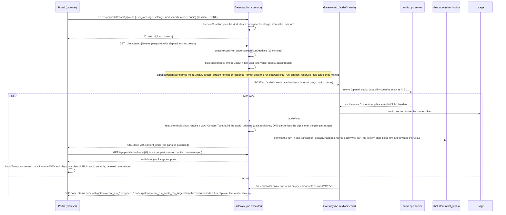

**Streaming branch** ([ADR-068](09-architecture-decisions.md#adr-068--streaming-speech-synthesis-the-gateway-relays-the-pcm-stream-of-a-streaming-model-meters-it-from-the-bytes-it-relayed-audio_bytes-or-audio_second-over-a-benchmark-learned-byte-rate-and-the-portal-composer-plays-it-as-it-arrives), issues #253 and #263). When the gateway can stream the
model (every mapping the model could route to is `speech_streaming: yes` with a cached output
byte rate, all agreeing, and the thread has not opted out; the composer asks
`GET /api/portal/model-speech-streaming` and the run re-evaluates the same gate), the executor
sends `stream=true` with `stream_format=sse` instead, arming `speechRunDeadline` only until the
first chunk of audio. Each `speech.audio.delta` reaches the browser as an **`audio`** run event
(`{seq, rate, data}`: base64 PCM, a sequence number and the sample rate) that the browser
schedules gaplessly on one shared `AudioContext`, and is buffered nowhere on the server. The
executor keeps the PCM, cutting it into WAV parts as it arrives (each a canonical WAV header at
the cached rate over at most one part-target of PCM, `min(8 MiB, blob cap / 2)`), and on a stream
that ended with `speech.audio.done` and `[DONE]` commits the **same `audio_url` parts** as the
buffered turn (one part unless the clip is over the per-part target), so the rest of the diagram (the blob,
the SSE `done`, `AudioTurn`) is unchanged; a cut stream commits nothing. Live playback is abandoned for the run at the first
gap in the sequence, which is harmless because the committed WAV is complete.

**Language** ([ADR-074](09-architecture-decisions.md#adr-074--portal-speech-language-a-per-thread-composer-control-injected-as-a-top-level-language-gated-by-a-cached-include_params-fact-with-a-fail-closed-agent-v1models-passthrough), issue #282). The body the executor
builds (buffered and streamed alike) carries a top-level `language` when the thread's
`settings.audio.language` is non-empty, which audio.cpp applies per model as the transcript language
and silently drops where a model takes none; the run never consults a gate for it. What the composer
may offer comes from the other side of the health loop: while a speech model is observed loaded (a
configured clone model included, [ADR-075](09-architecture-decisions.md#adr-075--offering-a-configured-voice-clone-speech-model-the-gateway-fetches-a-clone-models-preset-voices-a-non-empty-cached-list-is-the-offer-signal-for-both-portal-pickers-a-fail-closed-and-covers-mixed-names-and-streaming-for-clone-stays-deferred), issue #301), the loop caches whether it declares a `language`
param and its default (`speech_language` in
`model_mapping_cache`: from the verdict probe's own `GET /v1/models?include_params=true` for a static
`audio_cpp` server, and through the agent router's `GET /upstream/{model}/v1/models` for an
agent-launched child, only on an agent that declared `runtime_model_params`), and the composer asks
`GET /api/portal/model-speech-language` on each speech-model change to show its `Language` field and,
for an empty thread on a model whose default is not `auto`, pre-fill the portal's UI language. That gate
reads the **offerable** speech mappings (a plain tts model, or a clone model with cached preset voices),
the set the streaming gate above reads too (a preset clone streams once the speech benchmark has cached its
byte rate, [ADR-076](09-architecture-decisions.md#adr-076--a-configured-preset-clone-streams-in-the-portal-the-speech-benchmark-names-a-cached-preset-voice-both-exclusion-layers-relax-for-a-clone-model-with-presets-only-and-the-output-byte-rate-is-assumed-voice-independent), and a name streams only when every one of its mappings has a rate and they agree, so a name that
can reach a clone with no rate yet, or at another rate, closes that gate and the turn is buffered); and for a configured clone model the
composer also starts the thread on the first preset voice, since such a model has no text-only default
voice (cleared again on a model switch while it is still that pick, so it is never carried to a model that lacks it; [ADR-075](09-architecture-decisions.md#adr-075--offering-a-configured-voice-clone-speech-model-the-gateway-fetches-a-clone-models-preset-voices-a-non-empty-cached-list-is-the-offer-signal-for-both-portal-pickers-a-fail-closed-and-covers-mixed-names-and-streaming-for-clone-stays-deferred)).

**Long answers** ([ADR-070](09-architecture-decisions.md#adr-070--long-speech-is-stored-as-multiple-ordered-wav-blobs-under-a-total-audio-cap-positional-order-with-no-migration-one-atomic-commit-an-honest-audio-too-large-error-that-still-bills-the-delivered-call-named-commit-failure-codes-and-a-gapless-client-side-stitch), issue #279). A clip longer than the per-part target
(`min(8 MiB, MaxChatBlobBytes / 2)` of PCM, about 95 seconds at 44.1 kHz mono by default) is
committed as several ordered `audio_url` parts, each a standalone 16-bit mono WAV and each its
own `chat_blobs` row, in the one atomic `SaveChatWithBlobs`; their order is their position in the
content array, so there is no ordering column and no migration. The buffered turn cuts a
conforming WAV's `data` chunk the same way, and commits any other WAV whole. The total PCM a turn
may store is capped (`OP_AI_GATEWAY_MAX_CHAT_AUDIO_BYTES`, 256 MiB, enforced by the executor): a
clip over it ends the run `gateway.chat_run_audio_too_large` and commits nothing. A **streamed**
clip over the cap stops being *kept* but is still read and relayed to `[DONE]`, so the relay
bills the call as the delivered one it was and the listener hears it to the end. In the browser
`AudioTurn` fetches the parts and joins them into one gapless WAV for playback and for the
download (a single part is played and saved as it is).

**Audio answer lifecycle** ([ADR-071](09-architecture-decisions.md#adr-071--audio-answer-lifecycle-a-per-chat-retention-knob-keep-all-keep-the-last-n-or-do-not-store-one-atomic-delete-that-leaves-an-audio_removed-marker-a-lazy-and-a-confirmed-retroactive-prune-a-manual-per-answer-delete-and-live-mute-and-abort-with-no-migration-and-no-agent-bump), issue #281). What is
stored of a speech answer now follows the thread's `settings.audio.keep_last_audio` (omitted keeps
every answer, `N` keeps the newest N, `0` stores none), and an answer without audio carries one
`audio_removed` marker part instead of its `audio_url` parts. At the terminal commit
(`writeAssistant`), in the one `SaveChatWithBlobs` that stores the new answer, the gateway also
rewrites the older answers beyond N to the marker and deletes their `chat_blobs` rows (the new
answer is never the one pruned; an answer's parts go together). Under `0` a run that **streamed**
(`AudioStreamed`, from `generateSpeechTurn`) commits the marker with no blob, while a run that fell
back to a buffered clip stores that one answer anyway and supersedes any older stored audio; a user
**cancel** commits the marker in place of an empty turn (a deadline stays an error with no marker).
Two manual routes do the same rewrite on demand,
`DELETE /api/portal/chats/{id}/messages/{messageID}/audio` and
`POST /api/portal/chats/{id}/audio/prune` (`{"keep_last": N}`), refused `409 portal.chat_run_active`
while a run is live for the chat because they rewrite the whole document like `PUT`. In the browser
a finished marker answer is the not-stored bubble with a regenerate (no `AudioTurn`), and the live
streaming bubble gains **Mute** (a gain node, local and reversible, the run finishes and is stored
per retention) and **Abort** (the composer's Stop). See [Compatibility & Inference
§12](cross-cutting/compatibility-and-inference.md#12-in-portal-chat-playground).

What differs from the speech relay of §6.1.1: the caller is the executor and the
credential the internal loopback pair (never a session cookie, [Security
§1](cross-cutting/security-auth-rbac.md#1-overview-authentication-surfaces-at-a-glance)), so
billing, capture and routing run under the **run-as token**; the response is read
whole and checked before anything is stored (empty, unreadable or not labelled WAV is
`gateway.chat_run_no_audio` or `gateway.chat_run_speech_response_unreadable`); and the
WAV leaves the sealed transcript for `chat_blobs`, so the document carries a short gateway
URL (one per part). A failed commit is named where naming it helps: a blob over
`MaxChatBlobBytes` is `images.blob_too_large`, a commit that outlived its 30 s bound is
`gateway.chat_run_commit_timeout`, and only an unclassified store failure is the generic
`gateway.chat_run_commit_failed`. Playback is the browser's own concern: the blob
endpoint answers no `Range` request, so `AudioTurn` fetches each blob once and plays one
object URL (several parts joined into one WAV). See [Compatibility & Inference
§12](cross-cutting/compatibility-and-inference.md#12-in-portal-chat-playground) and
[ADR-063](09-architecture-decisions.md#adr-063--speech-in-the-portal-chat-is-a-third-run-kind-the-model-is-the-affordance-the-run-reuses-the-speech-endpoint-over-loopback-and-the-wav-lives-in-chat_blobs).

### 6.1.4 Portal transcription chat turn (through loopback from a chat blob)

A transcription turn **inverts** the speech turn of §6.1.3: the audio is the run's
**input**, not its output, and the reply is the ordinary text turn. The browser attaches a
file or records a clip in the composer and **converts it to a 16 kHz mono 16-bit PCM WAV**
(audio.cpp reads WAV only, so the upload is always a WAV, whatever was attached or
recorded); the clip is stored as a chat blob on the user turn, and the run executor
resolves it, relays it multipart to `/v1/audio/transcriptions` over loopback, and commits
the transcript as a text turn.

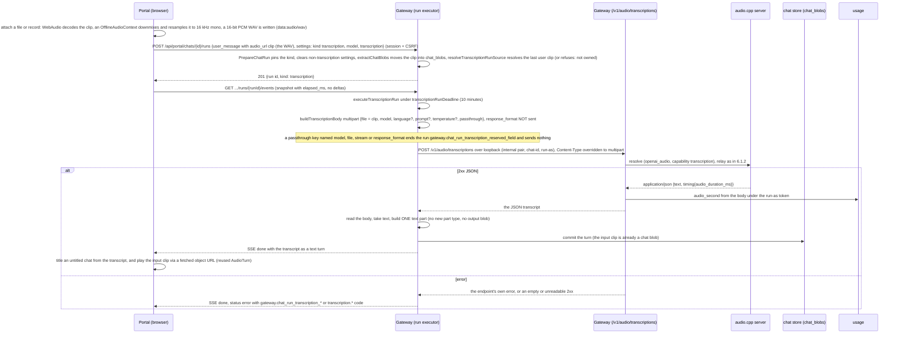

What differs from the transcription relay of §6.1.2: the caller is the executor and the
credential the internal loopback pair (never a session cookie, [Security
§1](cross-cutting/security-auth-rbac.md#1-overview-authentication-surfaces-at-a-glance)), so
billing, capture and routing run under the **run-as token**; the clip is a user-turn
**input resolved before the run** (like an image-edit source,
[ADR-057](09-architecture-decisions.md#adr-057--image-edit-a-derived-image_edit-capability-a-multipart-passthrough-and-the-attached-image-as-the-edit-affordance)),
not a client-supplied multipart body; and the transcript is committed as the **ordinary
text turn**, with no output part and no output blob — the inverse of the speech turn, whose
WAV becomes an `audio_url` blob. **Against a `mode=streaming` model the run streams**: the
executor POSTs `stream=true` over the loopback, renders the transcript **incrementally**
from `transcript.text.delta` events (reusing the text run's delta/checkpoint plumbing), and
`TranscriptionPendingTurn` shows only until the first delta, the run keeping its full
deadline until then; against an offline or unprobed model the gateway serves it buffered and
the run is the one zero-delta call ADR-064 described
([ADR-065](09-architecture-decisions.md#adr-065--streaming-transcription-the-gateway-relays-the-sse-for-a-streaming-model-gated-by-a-transcription_streaming-verdict-with-a-retry-buffered-on-500-safety-net-bills-the-streamed-call-from-the-wav-header-and-the-portal-chat-run-streams-the-transcript),
issue #262). See [Compatibility & Inference
§12](cross-cutting/compatibility-and-inference.md#12-in-portal-chat-playground) and
[ADR-064](09-architecture-decisions.md#adr-064--transcription-in-the-portal-chat-is-the-fourth-run-kind-the-model-is-the-affordance-the-audio-input-lives-in-chat_blobs-and-is-relayed-multipart-over-loopback-and-the-reply-is-the-ordinary-text-turn).

### 6.1.5 Live transcription (browser WebSocket, gateway loopback, agent `/live`, audio.cpp)

Live transcription is the one scenario where audio flows **up** while text flows **down** on the
same exchange: the transcript appears **while the user is still speaking**, where §6.1.4's turn
transcribes a clip that was recorded and uploaded whole. The gateway's own **`POST
/v1/audio/transcriptions/live`** is the canonical relay: a chunked, full-duplex HTTP request, bearer-authenticated, that
mirrors audio.cpp's native `/live` and is the one place a session is resolved, admitted, guarded per route and
billed. A browser cannot drive that (a streaming `fetch()` body needs HTTP/2 and is half-duplex) and a WebSocket
cannot carry `X-OP-CSRF`, so the portal uses a **WebSocket behind a CSRF-protected ticket** whose handler is a
thin adapter that **loops back** to the same `/v1` endpoint over the internal trusted-loopback pair, as a portal
chat run loops back to `/v1/chat/completions`
([ADR-072](09-architecture-decisions.md#adr-072--live-transcription-a-ticket-gated-websocket-carries-the-browsers-pcm-to-the-gateway-which-relays-it-full-duplex-through-a-new-agent-livemodel-route-and-bills-the-input-audio-it-counted-on-a-clean-end-of-input), [ADR-073](09-architecture-decisions.md#adr-073--portal-live-transcription-loops-back-through-the-public-v1audiotranscriptionslive-one-canonical-relay-that-resolves-admits-guards-and-bills-once), issue #266). A programmatic client skips the browser, the ticket and the adapter and
calls `/v1/audio/transcriptions/live` itself.

```mermaid
sequenceDiagram
    participant B as Portal (browser)
    participant TK as Gateway (gate + ticket endpoints)
    participant WS as Gateway (portal WebSocket adapter)
    participant LV as Gateway (/v1/audio/transcriptions/live, the one relay)
    participant AG as Agent router (POST /live)
    participant AC as audio.cpp (/v1/audio/transcriptions/live)
    participant U as usage

    B->>TK: GET /api/portal/model-transcription-streaming?name= (session)
    TK-->>B: 200 {streaming: bool}, every refusal-like case is {streaming: false}, so the composer offers live only on true
    B->>TK: POST /api/portal/transcription-live-ticket {model, sample_rate, channels, sample_format, language?} (session + X-OP-CSRF)
    TK->>TK: validate the params (400 transcription.live_params_invalid), then the gate WITHOUT admission: inferenceGate, resolveTarget, the transcription capability
    TK->>TK: transcription_streaming = yes (else 409 transcription.live_not_streaming), and for a server_agent target fullduplex_proxy declared (else 409 transcription.live_agent_unsupported)
    TK-->>B: 200 {ticket} (about 30 s, single-use, AES-256-GCM of the target + the validated params + UserID). No admission, no usage row.
    B->>WS: GET /api/portal/transcription-live, Upgrade, Origin, Sec-WebSocket-Protocol: op-live-transcription + the ticket (never in the URL)
    WS->>WS: redeem the ticket BEFORE Accept (a miss is 401 and no upgrade), Accept with the default same-origin check (cross-origin 403)
    WS-->>B: 101 Switching Protocols (subprotocol op-live-transcription)
    WS->>LV: loopback POST /v1/audio/transcriptions/live?model&sample_rate&channels&sample_format&language, chunked body from an io.Pipe, Expect: 100-continue, X-OP-Internal-Auth + X-OP-Internal-User (the ticket's user)
    LV->>LV: loopbackPrincipal, then the same gate WITH the one admission (429/402/503), streaming + fullduplex_proxy checks, then the per-route slot (busy = 503 transcription.live_busy)
    LV-->>WS: 100 Continue on the first body read, or a final refusal status that the adapter turns into one error frame
    LV->>AG: POST /live/{model}?sample_rate&channels&sample_format&language, chunked body fed from an io.Pipe (ProxyNativeDuplex, no target.Timeout)
    Note over LV,AG: a direct audio_cpp target skips the agent: the gateway POSTs the child's own /v1/audio/transcriptions/live?model=...
    AG->>AG: EnableFullDuplex FIRST (so any refusal below is answered promptly), then EnsureRunning (a cold start is held), release() deferred for the whole relay
    AG->>AC: POST /v1/audio/transcriptions/live?...&model=path model, the inbound body streamed chunked (never buffered)
    loop while the user speaks
        B->>WS: binary frame, raw PCM (at most 1 MiB)
        WS->>LV: PCM into the loopback body
        LV->>AG: PCM into the upstream body, payload bytes counted
        AG->>AC: PCM chunk
        AC-->>AG: SSE transcript.text.delta (or transcript.text.partial)
        AG-->>LV: SSE, flushed per write, under the idle watchdog and a write deadline
        LV-->>WS: SSE relayed verbatim
        WS-->>B: {type: delta, text} to append, or {type: partial, text} to replace
    end
    alt clean end
        B->>WS: text frame {type: end} (the explicit end-of-input)
        WS->>LV: close the loopback body (the terminating chunk)
        LV->>AG: close the upstream pipe, so the terminating chunk is sent
        AG->>AC: terminating chunk
        AC-->>AG: transcript.text.done then [DONE]
        AG-->>LV: SSE, flushed
        LV-->>WS: SSE, flushed
        WS-->>B: {type: done, text} with the final transcript
        LV->>U: audio_second = PCM bytes / byte-rate of the SAME validated params forwarded upstream, as the loopback user
    else the socket closes or drops without end
        B--xWS: close or drop
        WS->>LV: abort the loopback body (no terminating chunk)
        LV->>AG: abort the upstream body (a truncated session)
        LV->>U: audio_second 0 (loud zero, one Error log line)
    else the upstream fails, or the client stops reading
        AC-->>LV: SSE error event, or the agent or child answered non-2xx, or it was unreachable, or the idle watchdog cut a non-reading client
        LV-->>WS: SSE error, or a non-2xx status
        WS-->>B: {type: error, message}
        LV->>U: audio_second 0 (an error row for a dial failure or a non-2xx, a success row for an error event after a 200 or an idle reap)
    end
    LV->>LV: deferred teardown: unblock the pipe, cancel the one context, join, record the one usage row, THEN release the route slot
    WS->>WS: deferred teardown: unblock the pipe, cancel the one context (the writer flushes and CloseNows), join. No row, no slot
```

What differs from the transcription relays of §6.1.2 and §6.1.4. **One relay, two doors.** `/v1/audio/transcriptions/live`
is the only code that resolves a live session, takes its admission, holds the per-route slot, relays upstream and
records the usage row. A bearer client calls it directly with its token (and is billed to that token, its service and
project included); the portal's WebSocket handler is an adapter over it, so it **contacts no backend, takes no slot and
writes no row**, and the session is billed once, to the loopback user (a token-less session principal, so no
`TokenID`, service or project, like a portal chat run). **The ticket decides what it can and the loopback decides the
rest.** The ticket POST validates the params and runs the routing gate **without** the admission, so a wrong or
non-streaming model is a fast, plain HTTP refusal for the browser; the admission is spent **once, at `/v1`**. A refusal
there (a rate, quota or budget denial, `transcription.live_busy`) arrives after the upgrade as one `error`
frame carrying the loopback's code and message (the composer shows a busy-specific message for a busy slot, a
generic one for a rate limit), no longer a 1013 close. `Expect: 100-continue` on the loopback is what lets such a refusal, written before
`/v1` reads a byte of the open body, reach the browser instead of deadlocking. **Audio goes up in frames, not in a
body.** The browser sends binary PCM frames and one text control, `end`; the adapter turns the frames into one chunked
loopback body, and only `end` becomes the terminating chunk audio.cpp needs to emit `transcript.text.done`, so a Stop that
merely closes the socket is a truncated session that bills nothing. **One goroutine owns every WebSocket write** and one
context tears each relay down on any exit, so no goroutine is left blocked on a pipe and the usage row is written exactly
once. **Full duplex is the agent's, and it holds on both ways into the router**: in production the agent's TLS proxy hands
the router the same `(w, r)`, so the router's `EnableFullDuplex` (its first statement, ahead of every refusal) governs the
gateway-facing connection, and the dialed fallback enables it per request too, so a refusal or a non-2xx reaches the client
promptly on either path and no PCM is drained and lost ([Agent-Managed Model Runtime §4.7](cross-cutting/agent-runtime-manager.md#47-the-router-has-two-ways-in-and-only-one-of-them-is-a-socket)).
**Billing is the input**, over the rate the gateway told the backend to decode at, on a clean end only. **The `/v1` relay is
guarded by the streaming idle watchdog**: a client that keeps sending PCM but stops reading the SSE is cut after the idle
timeout, which releases the route's one slot and bills a loud zero. The WebSocket upgrade hijacks its connection, so none
of the 30 s server deadlines applies to the adapter, and the `/v1` relay lifts them. One live session per route is allowed,
because audio.cpp serves one `/live` per model. See [API Compatibility & Inference §3.8](cross-cutting/compatibility-and-inference.md#38-live-transcription-the-bearer-v1-endpoint-and-the-portal-websocket), [Telemetry §8.4.1](cross-cutting/telemetry-usage-observability.md#841-the-usage-event) and
[ADR-073](09-architecture-decisions.md#adr-073--portal-live-transcription-loops-back-through-the-public-v1audiotranscriptionslive-one-canonical-relay-that-resolves-admits-guards-and-bills-once).

### 6.1.6 Voice Chat (browser WebSocket, per-chunk live ASR, speculative LLM, deferred commit, streamed TTS)

Voice Chat is the portal's hands-free spoken conversation: the user talks, the gateway hears them, answers through the
chat model and speaks the answer back, while the chat thread fills in exactly as if each turn had been typed and sent.
It is **orchestrated entirely in the backend**: one WebSocket, `GET /api/portal/voice-chat`, behind a CSRF-protected ticket,
whose handler is a single-owner state machine that **composes three existing `/v1` cores over loopback** (the live ASR
relay of §6.1.5, chat completions, and the streaming speech relay of §6.1.1/§6.1.3) and spends nothing of its own. The
guarantee that matters most, that the microphone can never feed the model's own voice back into itself, is enforced in
that state machine, not by the browser
([ADR-078](09-architecture-decisions.md#adr-078--voice-chat-one-orchestration-websocket-composes-the-three-v1-cores-as-a-server-side-state-machine-with-a-pause-tolerant-continuation-window-a-deferred-commit-and-a-playout-aware-half-duplex-gate), issue #312).

```mermaid
sequenceDiagram
    participant B as Portal (browser)
    participant TK as Gateway (ticket endpoint + co-load gate)
    participant AG as Agent routers (ensure, loaded set)
    participant M as Gateway (voice WebSocket, state machine)
    participant LV as Gateway (/v1/audio/transcriptions/live)
    participant RN as Gateway (voice run)
    participant CH as Gateway (/v1/chat/completions)
    participant SP as Gateway (/v1/audio/speech)
    participant ST as chat store

    B->>TK: POST /api/portal/voice-chat-ticket {chat_id, asr_model, llm_model, tts_model, voice} (session + X-OP-CSRF)
    TK->>TK: read the caller's own chat (404 portal.chat_not_found), snapshot settings.audio with the request's voice laid over it (400 portal.voice_chat_audio_settings_invalid)
    TK->>TK: step 1, resolve and gate all three legs WITHOUT admission (400 portal.voice_chat_asr_unavailable, _llm_unavailable, _tts_unavailable)
    loop each agent-managed leg, one at a time
        TK->>AG: ensure the model (runtime.admission_blocked is 409 portal.voice_chat_coload_failed)
    end
    TK->>AG: step 3, read each agent's LIVE loaded set after all ensures
    TK->>TK: every agent-managed leg resident NOW, else 409 portal.voice_chat_coload_failed (bounded by OP_AI_GATEWAY_VOICE_COLOAD_TIMEOUT)
    TK-->>B: 200 {ticket} (about 30 s, single-use, AES-256-GCM of the three targets + chat + attribution + settings + PCM shape)
    B->>M: GET /api/portal/voice-chat, Upgrade, Sec-WebSocket-Protocol: op-voice-chat + the ticket
    M->>M: redeem BEFORE Accept (one 401 for every failure), default same-origin check
    M-->>B: 101 Switching Protocols, then {state: listening}

    Note over B,M: the mic is piped on only in listening and, while the continuation window is open, in thinking
    loop while the user speaks (one chunk)
        B->>M: binary PCM, about 100 ms per frame (16 kHz mono s16le)
        M->>LV: the first admitted frame opens a FRESH loopback live relay, the PCM is piped in as the ticket's user
        LV-->>M: SSE delta or partial
        M-->>B: {asr_partial, text} the CURRENT chunk's provisional text, replace
    end
    M->>M: silence timeout (or push_end) ends the chunk, min and max utterance guards apply
    M->>LV: close the pipe (end-of-input)
    LV-->>M: clean final transcript, the relay ends (one audio_second row for the chunk)
    M-->>B: {asr_final, text} one chunk, nothing is persisted yet
    M->>RN: start a SPECULATIVE voice run on pendingText, state thinking, the mic STAYS open
    RN->>ST: read the chat (a read, nothing is written): the history opens with ONE system message, the thread's own system prompt (settings.system_prompt) then the voice system prompt (settings.voice_chat.system_prompt else the built-in default)
    RN->>CH: loopback POST, that history plus pendingText, streamed
    CH-->>RN: answer deltas, the answer carries one or more short spoken sections, each inside its own speak tag
    RN->>RN: the speak scanner strips the tags from every delta BEFORE it is buffered or fanned out
    RN-->>M: clean text deltas
    M-->>B: {answer_delta, text} a preview of the answer, never any markup
    alt the user resumes speaking inside the continuation window
        B->>M: PCM, the next chunk's first voiced partial arrives
        M->>RN: cancel the run (it persisted nothing, tokens already produced are still billed)
        M-->>B: {answer_reset}, then {state: listening}
        Note over M,RN: the next chunk is appended to pendingText, and the run restarts on the longer text at the next chunk end, as often as the user pauses
    else the window closes with no resume
        RN->>RN: each closing speak tag is seen: that section's text and lang are complete
        RN->>SP: one loopback POST PER SECTION, that section's text only, streamed PCM, language only when the TTS model accepts one, CONCURRENT with the LLM and with the other sections
        par the LLM keeps streaming the text between and after the sections
            CH-->>RN: more deltas
            RN-->>M: clean text deltas
            M-->>B: {answer_delta, text}
        and the speech legs synthesize the sections
            SP-->>RN: audio events, one stream per section
            RN-->>M: ONE ordered stream: section k+1 waits for section k, one seq across all of them, each chunk tagged with its section. HELD while the window is open
        end
        M-->>B: {answer_done} (provisional, at the first audio event)
        Note over M: the window closes when the first audio has arrived AND the grace elapsed, OR when the run commits, whichever is first. The mic shuts.
        M-->>B: {state: speaking}, the held audio, then {audio_delta, seq, section, rate, audio} as it arrives
        opt the user controls the playback, only while audio is being heard
            B->>M: {pause}, later {resume}: the drain's floor and ceiling move by the paused interval, the mic stays shut
            B->>M: {stop}: speaking or draining back to listening, the mic opens. A run still uncommitted is CANCELLED (nothing stored), one already committing finishes its commit
        end
        RN->>RN: JOIN, the LLM stream has ended AND every section's speech leg has finished
        RN->>ST: CommitVoiceTurn, the user turn and the assistant turn [text (the full clean answer), audio_url... in section order] plus the spoken_sections key in ONE SaveChatWithBlobs
        RN-->>M: completed
        M-->>B: {audio_done}, then {state: draining}
        B->>B: reload the chat thread, which now holds the committed turns
        B->>M: {playback_done, played_through} when the streaming player has drained, the count of audio chunks received across all sections
        M->>M: honor the signal only when played_through covers every relayed chunk, then end draining at max(floor, min(ceiling, signal)), then the mic-resume tail
        M-->>B: {state: listening}
    end
    Note over RN,SP: no usable section (no tag, a malformed tag, only empty regions): the WHOLE answer is synthesized AFTER the LLM stream ends as one leg with no recorded section, the phase-1 ordered flow
    opt any leg fails (ASR drop, LLM or TTS error, admission_blocked, commit failure)
        M-->>B: ONE {error, code, message} with the core's stable code, then {state: idle}, no retry
    end
    M->>M: on bye or a dropped socket: cancel the run, tear the ASR loopback down, join every goroutine, exactly once
```

What differs from the live-transcription and speech scenarios. **The orchestrator composes, it never re-implements.**
Each leg is a loopback call to a public `/v1` core that resolves, admits, guards and bills for itself, so the state
machine takes no admission, holds no route slot and writes no usage row; the three rows of a turn are listed in
[Telemetry §8.4.1](cross-cutting/telemetry-usage-observability.md#841-the-usage-event). **The ASR relay is per chunk, not per
session**: it opens on the first admitted mic frame (no check for speech) and is closed at every chunk end, so a relay
exists whenever the mic gate is open, in `listening` and, until the window closes, in `thinking`, and is reopened about
100 ms after each chunk end. While it exists it holds its admission and the route's live slot and pins the ASR child
(including during the continuation window, when the speculative LLM and TTS run); it is absent only in `idle`, `speaking`
and `draining`. A session-long relay would hold them there too, and the clean final comes from end-of-input, the contract
the relay is tested on. **The live transcript is the current chunk's**:
`asr_partial` replaces the previous partial of *that chunk*, and across a pause the client shows the finalized chunks so far
plus it; no frame carries a message id, because nothing is persisted at a chunk boundary. **A pause is not the end of the
turn.** On a chunk end the machine answers **speculatively** and leaves the mic open (the continuation window): resumed
speech cancels the run, voids the preview (`answer_reset`) and extends the text, and a cancelled run persisted **nothing**,
because the run commits the user turn and the assistant turn together, once, on its single un-cancelled terminal path. The
TTS audio is **held** until the window closes, so nothing audible exists while the mic is open. **The window closes at the
commit at the latest.** The run is non-pausable (the LLM and TTS legs overlap, then one commit), so a fast answer gives a shorter keep-talking
window than the full grace, and a resume that begins once the run is committing (the commit write) is not accepted: the
voiced chunk is discarded when the window force-closes. True barge-in, interrupting the answer, is phase 4
([Risks & Technical Debt §11.4](11-risks-and-technical-debt.md#114-deliberate-design-acceptances)). **The half-duplex gate is
the server's.** Mic PCM is discarded in the machine, before any ASR loopback, in `speaking`, `draining`, `idle`, while a
chunk finalizes and once the window has closed; `push_start` only starts a turn from `idle`, and the one control that returns
to `listening` from any state is `cancel`, the user's own immediate stop (the client stops its playback first; true barge-in
is phase 4); since phase 3 `stop` ("stop speaking", below) also returns to `listening`, but only from `speaking` and `draining`. **`draining` tracks playout,
not relay.** The machine relays audio faster than real time, so `audio_done` is "all audio sent", and the drain holds the mic
gated until `max(floor, min(ceiling, playback_done))`, the floor being the relayed audio's own duration and the ceiling (30 s)
never cutting below it, so an early or
forged `playback_done` cannot re-open the mic while the answer is audible and a missing one cannot wedge the session. **Failure is one typed error and `idle`, never a retry.** The WebSocket upgrade hijacks its
connection, so none of the 30 s server deadlines applies to it; the ticket POST, which can wait on a cold start, lifts them
([API Compatibility & Inference §7](cross-cutting/compatibility-and-inference.md#7-streaming-lifecycle)). The frames and codes are in the
[HTTP API Surface](reference/api-surface.md#voice-chat-the-ticket-and-the-orchestration-websocket), the knobs in
[Configuration](reference/config-env.md#voice-chat-turn-detection-half-duplex-timing-and-the-co-load-gate).

**Phase 2: what is spoken is a short summary, and the two legs overlap** ([ADR-079](09-architecture-decisions.md#adr-079--voice-chat-phase-2-a-spoken-summary-marked-by-a-speak-tag-in-the-stream-is-spoken-concurrently-while-the-detail-streams-under-an-editable-per-thread-voice-prompt-with-a-per-answer-language), issue #314; phase 3 generalizes the one summary to several ordered sections, below). *What the model
is told.* The voice run's LLM history opens with the **voice system prompt**: the thread's `settings.voice_chat.system_prompt`,
read from the **stored** chat when the run starts (a blank, absent or non-string value means the built-in default; it is never
on the ticket and never a request field), as the voice half of the history's one system message (since phase 3 it follows the thread's own system prompt, below) and for voice runs only, so typed turns in the
same thread are untouched. The prompt asks the model to put what is spoken in short
`<speak lang="...">...</speak>` sections, in the language the user is speaking (one section for a short answer, since phase 3 roughly one per key point for a long one), and to write the detail as normal text outside the tags. The gateway never
relies on that: no tag, a self-closing `<speak/>` (stripped, it opens no region), a malformed tag or an empty region speaks the **whole answer** after the LLM finishes (the phase-1
ordered flow), an unclosed region speaks what it captured, and a tag problem is never an error turn. *Scanning.* A scanner
sits in the run's LLM SSE loop and strips the tags from every content delta **before** it is buffered or fanned out, so the
`answer_delta` preview, the run's text, the stored turn and the next turn's LLM history never carry markup (a tag split across
tokens is held back only while it is being parsed; every region is a spoken section since phase 3, in phase 2 only the first was). *Concurrency.* On the delta that
completes a closing tag the run fires that section's speech request (one per section), with the **complete** captured section text (the speech
endpoint takes its whole input in one body) and the tag's `lang` as the request's top-level `language`, **kept only when the
TTS model accepts a `language`** (the cached fact of [ADR-074](09-architecture-decisions.md#adr-074--portal-speech-language-a-per-thread-composer-control-injected-as-a-top-level-language-gated-by-a-cached-include_params-fact-with-a-fail-closed-agent-v1models-passthrough);
otherwise the field is omitted and the model speaks its own default), **while the LLM keeps streaming**. The
audio is held like any audio until the window closes, which now happens at the first audio event (the first section's) once
the grace has elapsed, or at the commit. `answer_done` goes out at that first audio event, so `answer_delta` frames of the
rest of the text can still follow it (the portal appends them regardless). *One commit joins all the legs.* The run joins every speech leg
when the LLM stream ends and commits **once**, through the same compare-and-swap that arbitrates it against a cancel: the full
clean text, each section's audio, and the sections' text with their rune spans in the full text as the stored turn's `spoken_sections` (a phase-2 turn stored its one summary as the scalars `spoken_summary` and `spoken_summary_start`, which the portal still reads); the portal renders each section as a
collapsed, replayable block at its position and cuts the body out by those spans ([Data Model](reference/data-model.md)). `audio_done` and `draining` follow
that commit, so the mic stays gated from the window's close through the commit and then the drain (the drain's floor still
counts from the first audio chunk, and the sections' audio is relayed early, so the client's one `playback_done` can arrive while the session is still `speaking`: the machine remembers it whenever it arrives and clears it on every relayed audio chunk, and honors it only when its `played_through` (the client's count of audio chunks received) covers every chunk relayed, so a stale gap signal that lands after the last chunk is ignored and only the genuine end of audio ends the drain at the floor instead of the 30 s ceiling; a signal without the counter takes the remembered-signal path, and the floor still always clamps it,
[Risks & Technical Debt §11.4](11-risks-and-technical-debt.md#114-deliberate-design-acceptances)). *Degrading.* An LLM failure
**before** the first closing tag fires no speech and stores nothing (phase 1). An LLM failure **after** it commits the turn with
what exists (the sections that closed, their audio and the cut-off text), and a speech failure commits the **text** turn with the sections whose speech did synthesize (no audio at all when every leg failed); in
both the run still ends as an error, so the machine emits its one `error` frame and returns to `idle`, and because the turn
*was* stored but no `audio_done` follows (the portal's cue to reload the thread), it shows at the next reload. A resume
before the window closes cancels every leg and persists nothing, as in phase 1; the tokens and any completed audio were
billed by their cores. **Product-visible change:** a voice run's stored time-to-first-token is now the **text** leg's (time to
the first LLM token, as for any text run). In phase 1 the ordered LLM-then-TTS sequence made it effectively the audio's first
chunk; with the legs overlapped the speech leg no longer writes the run's performance metrics, so the LLM leg is their only
writer and the stored values are deterministic.

**Phase 3: several ordered spoken sections, playback controls and one combined system prompt** ([ADR-080](09-architecture-decisions.md#adr-080--voice-chat-phase-3-several-ordered-spoken-sections-each-its-own-speech-leg-relayed-in-document-order-with-playback-and-microphone-controls-and-a-combined-system-prompt), issue #315). *Several sections, one ordered stream.* The scanner captures **every** `<speak>` region, each with its text, its `lang` and the rune offset where it begins in the clean text, so a long answer carries a few short spoken summaries (roughly one per key point) and a short one still carries one (N=1 is exactly phase 2). Each closed region launches its own speech leg while the LLM keeps writing, so section 1 is already being spoken while section 2 is still being written. The legs synthesize concurrently, but their audio is **relayed in document order**: one goroutine (`relayVoiceSections`) takes the legs in order, holds section k+1's audio until section k's leg has finished (a section that finishes early waits its turn, on the server), numbers **one monotonic `seq` across all of them**, before the lossy fan-out, and tags each `audio_delta` with the `section` it belongs to. The browser therefore receives one ordinary stream, `seq` counting from 0 once per answer, and its one gapless streaming player plays the sections back to back; the `section` tag only says which transcript block the audio being received belongs to (it is the section's launch index, so it can skip when a section's speech failed). Because every section rides one stream the drain does not change: its floor is the sum of the sections' durations from the first chunk, the mic stays gated across the whole queue, and `played_through` counts across all the sections. The single commit waits for the LLM **and every leg** (the join also runs for a cancelled or failed run, so no leg is leaked); a section whose speech failed records neither a span nor a clip, so the n-th stored clip is still the n-th stored section. In the transcript each stored section is a collapsed, replayable block at its position in the answer (the text between and after the blocks is the body), replaying its own clip, which is paired to its section by order when there is exactly one clip per section (otherwise no block plays and the answer's one stitched player sits below the text); a clip removed by retention shows the not-stored placeholder in each block. Re-synthesizing a single section on replay is deferred ([Risks & Technical Debt §11.4](11-risks-and-technical-debt.md#114-deliberate-design-acceptances)).

*One system message, two layers.* The history's one system message is composed on the gateway from the **stored** chat document: the thread's own system prompt (`settings.system_prompt`, the persona and context a typed run carries too), a blank line, then the voice prompt (the form of a spoken answer: `settings.voice_chat.system_prompt` or the built-in default, which now asks for several short sections on a long answer). Each is trimmed, and a blank, absent or non-string thread prompt leaves the voice prompt alone. Typed turns in the same thread carry the thread prompt alone, and nothing travels on the ticket. The portal fires a flush of a pending (debounced) edit of the thread before it asks for the ticket, so an edit of either prompt made just before starting is normally stored when the first answer is built; the flush is best-effort (fire-and-forget, not awaited), so it is not guaranteed to have completed by the time the ticket is asked for or the first answer is built.

*Playback controls.* While audio is actually being heard the portal offers pause/resume and "stop speaking"; whenever a conversation is on it offers, beside push-to-talk, a mute of the answer's speakers and a mute of the user's own microphone. Pause, resume and stop are WebSocket frames (`pause`, `resume`, `stop`, [HTTP API Surface](reference/api-surface.md#voice-chat-the-ticket-and-the-orchestration-websocket)); the two mutes are the browser's alone. **Pause and resume are tracked by the gateway**: a pause freezes the drain (the playout timer stops) and a resume moves the clock's origin (`firstAudioAt`) forward by the paused interval, so the floor and the ceiling, both measured from it, extend by exactly that interval and the mic cannot reopen over audio the user has paused. The mic stays shut for as long as the pause lasts; a pause is honored only while audio is playing out (`speaking`, or `draining` before its wait has ended; a pause before the first chunk is ignored) and is held until the client resumes or stops, with no server-side timeout of its own (a dropped socket still tears the session down). **Stop** returns `speaking` or `draining` to `listening`, which reopens the mic, and arbitrates against the run on the same one-way commit/cancel word that a `cancel` and the commit share: a run that has not committed is **cancelled** and removed at once, and a run that has already won its commit is left alone to finish its write, so there is no double commit and no stranded run slot. **That makes "stop speaking" a cancel until the turn commits.** In `speaking` the run is, apart from the duration of one store write, still uncommitted (the LLM is still writing, or a section is still being synthesized, and the commit is what starts `draining`), so a stop there discards the whole turn: the user's utterance and the answer are stored nowhere, the portal voids the preview and reloads the thread, and billing is as for any cancelled run ([Telemetry §8.4.1](cross-cutting/telemetry-usage-observability.md#841-the-usage-event)). Only a stop in `draining`, after the commit, is purely "stop speaking": the stored turn stays and only the playout ends. (A stop that lands in the commit write loses the race harmlessly: the turn is stored, but no `audio_done` follows and the stop's own reload of the thread may precede the write, so the turn shows at the next reload; see [Risks & Technical Debt §11.4](11-risks-and-technical-debt.md#114-deliberate-design-acceptances).) The **output mute** is the session's and holds for every answer in it (each answer's player is made muted): the audio keeps playing silently on the same clock, nothing is sent, and the gateway drains it as it would have. Since issue #326 it is **always on screen while the conversation is on**, in any state and before the first answer, so it can be set ahead of the first answer and its state is seen between answers (pressed, it is warning-coloured with the silent speaker and `aria-pressed`, like the microphone's); a new conversation starts with the speakers live. The **microphone mute** disables the capture track and sends no PCM, with no frame at all: the gateway hears silence, so it detects no turn; push-to-talk is closed under it and the indicator says the microphone is muted instead of listening. The **playback** controls (pause/resume and "stop speaking") are drawn **only while audio is being heard**: from the first played chunk until the answer has played out (the queue running dry once the gateway has sent everything, or staying dry for a short window, 1.2 s, while the gateway is still `speaking`, because the model goes on writing the detail long after the last section was heard), never before the first chunk and not in the gateway's tail, where a pause would do nothing. Neither mute is one of them: both are available for as long as the conversation is on. The playback group is drawn inside a room that is mounted for as long as the conversation is on and keeps the height of one row of small buttons (a constant, 32 px), so the group's coming and going does not move the controls or the error beneath it; a conversation that is off reserves nothing, and the always-on controls are separate nodes outside the room, so they are not remounted and keep keyboard focus when it changes. Two small residues are accepted ([Risks & Technical Debt §11.4](11-risks-and-technical-debt.md#114-deliberate-design-acceptances)): the playback controls themselves unmount when the audio ends, so focus that was on one of them falls to the document, and the room's height is a constant, so a row that wraps on a very narrow screen or grows with a large default font can still shift what is beneath it. "Cancel whole answer" is the phase-1 `cancel`, a different control.

*Loaded models, a stable automatic pick and the voice's model* (issue #326). The transcription and speech pickers mark a loaded model with the green dot of the chat's own model picker (the catalogue's `loaded` flag), and **Automatic** prefers the first model that streams *and* is loaded, else the first that streams, **at the moment the pick is made**. It is then **held**: the portal keeps the model a leg resolved to for as long as that model still streams (`stickyAutoVoiceModel`, per leg, driven by `stickyVoiceLegsOf` in `voiceModels.ts` and held per chat by `ChatStore`), so a model that merely becomes loaded in the background does not take the pick over, and only the held model's leaving the models that stream (it is gone, unreachable or no longer streams) moves it. A voice is chosen for the model that speaks, and a pick that drifted with the loaded state would have taken the voice to a model that may not know it. The hold is in memory and belongs to the open chat only (another chat, even one that was open before, starts afresh), and a leg under the user's own pick holds none, so returning it to Automatic picks afresh. **The voice has a model.** Next to the saved `voice` the thread stores the speech model it was chosen for, `settings.voice_chat.voice_model` (an additive key of the schema-free object that the backend never reads, [Data Model](reference/data-model.md)); it is recorded when the user picks a voice, and clearing the voice, or choosing a speech model that makes another model speak, clears both. A fresh automatic pick of the speech leg **starts from that model** when a voice is saved and the model still streams, so a thread reopens on its voice's model, whatever happens to be loaded just now, and keeps the voice; otherwise it is the first loaded model that streams, else the first that streams (the transcription leg has no such seed). **The voice that is sent is reconciled with the model that speaks, in memory** (`reconcileVoice`). Where another model than the voice's speaks (the voice's model no longer streams, or the thread predates the attribution), the saved voice is sent when that model's voice list (`api.modelVoices`) holds it, and the default voice (a preset clone's first preset, else the model's own) when it does not; the list must be known first, and while it is loading or has failed nothing is judged and the default speaks, because a list that has not arrived must not condemn a voice. Where the voice was chosen for the model that speaks, nothing is judged at all: the list is an offer, not a constraint, and a typed name stays. The reconciliation decides only the `voice` that `begin()` puts in the ticket and that the voice field shows, from the same render, and it **never writes the thread**: `voice` and `voice_model` are written only by the user's own pick of a voice or of a speech model. Opening a thread therefore does not save it, reorder the thread list or wipe a stored voice, and a voice whose model is gone is simply not sent (the default speaks) while it stays stored, to apply again when that model returns. The voice system-prompt field is a section collapsed by default; while it is shut and the thread's prompt is its own (the trimmed prompt, non-blank and not the built-in one, which is what the portal would persist), its toggle carries a small "Edited" marker (decorative, with the toggle described by it for assistive technology), which is gone while the section is open.

## 6.2 Portal login (session + CSRF) with optional TOTP

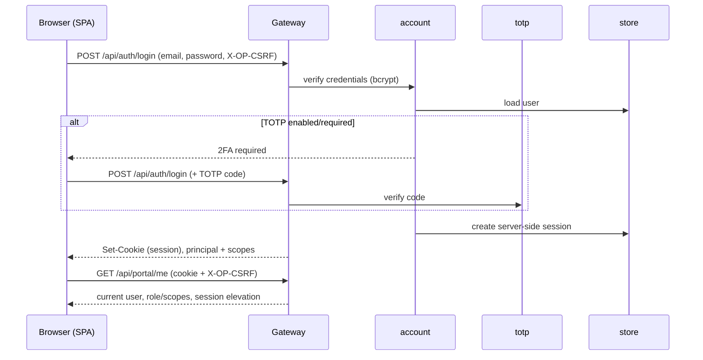

## 6.3 Server-Agent telemetry ingest

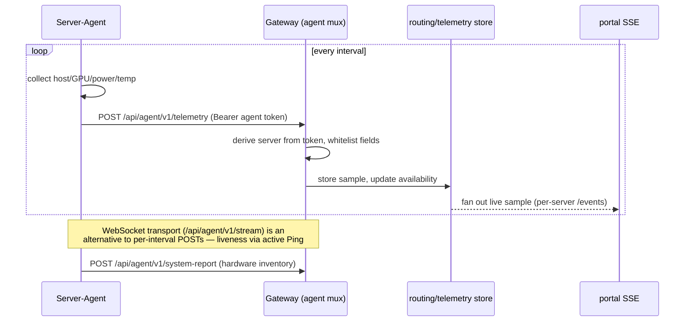

## 6.4 Model synchronization

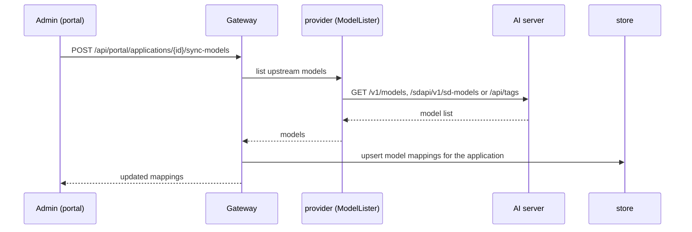

The listing endpoint is derived from the application's **type**, never from its
`loaded_models_path`: `/api/tags` for `ollama`, `/sdapi/v1/sd-models` for
`stable_diffusion_cpp` (whose `/v1/models` names only a placeholder), and
`/v1/models` for every other OpenAI-compatible type; `mock` answers fixed
names without a request. A body that is not JSON is an error that leaves every
mapping unchanged; which JSON bodies also count as errors differs by decoder
([API Compatibility & Inference §8](cross-cutting/compatibility-and-inference.md#8-provider-clients)).

## 6.5 Model-selection benchmark

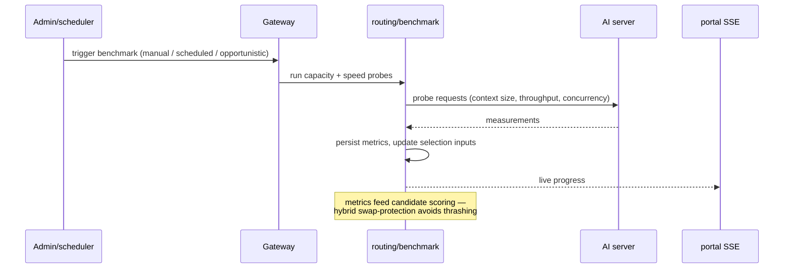

**Speech benchmark** ([ADR-068](09-architecture-decisions.md#adr-068--streaming-speech-synthesis-the-gateway-relays-the-pcm-stream-of-a-streaming-model-meters-it-from-the-bytes-it-relayed-audio_bytes-or-audio_second-over-a-benchmark-learned-byte-rate-and-the-portal-composer-plays-it-as-it-arrives), issue #263). `POST …/benchmark?mode=speech`, and the
app-health loop on its own for a loaded, streaming-capable text-to-speech mapping (a plain one, or
a configured clone model that lists preset voices, [ADR-076](09-architecture-decisions.md#adr-076--a-configured-preset-clone-streams-in-the-portal-the-speech-benchmark-names-a-cached-preset-voice-both-exclusion-layers-relax-for-a-clone-model-with-presets-only-and-the-output-byte-rate-is-assumed-voice-independent)) that
has no cached **output byte rate** (or one measured under another loaded model), is the one
benchmark that runs on audio mappings and sends no chat prompt. After taking the server's
reservation, and giving it back if the server has live requests, it synthesizes one short
**non-stream** clip **directly** to the mapping's upstream through the provider's native relay
(not through the gateway's own loopback, which the reservation would exclude and which has no
principal for a scheduled run), reads the byte rate from the WAV `fmt` chunk, caches it (only
from a mono 16-bit PCM WAV) in `model_mapping_cache` beside the model identity it was measured
under, and appends a `kind=speech` history row with `ttft_ms` (roughly synthesis plus any model
cold start, since the request does not stream), `wall_ms` and `rtf`. A clone model is synthesized with its first cached preset voice named in the request
(the rate is the model's output format, assumed the same for every preset), and a **reference-only** clone
model, which lists no preset, is skipped.
The health loop retires a rate and re-runs the benchmark when the loaded model behind the
mapping changes, and leaves a mapping whose run produced no rate alone for five minutes.

## 6.6 Mesh certificate issuance & HTTPS auto-switch

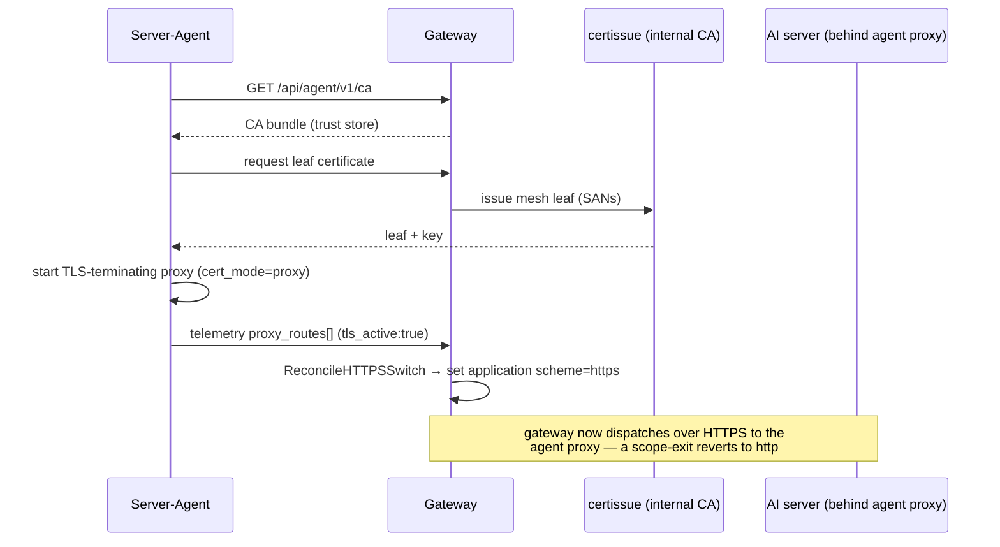

## 6.7 Agent-managed model runtime: on-demand start

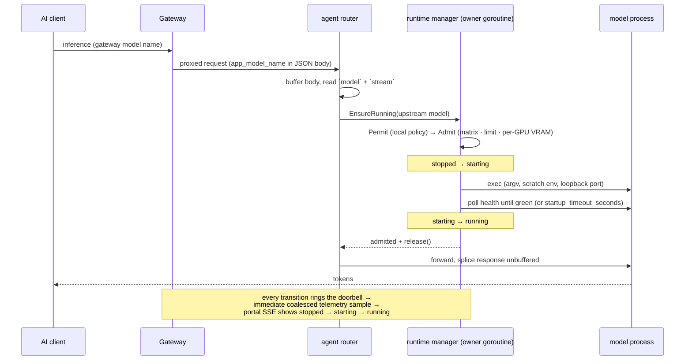

**The externally observable contract**, verified end to end with a real agent and
real child processes: an inference for a mapped model whose spec is not running
**blocks in the gateway** while the agent admits and starts the child, and the
request that triggered the start is the one that receives the answer — the first
request pays the start latency rather than failing fast. The state sequence on
the portal's runtime event stream is exactly `stopped → starting → running`, and
the status frame for the running spec reports the child's real `pid` and the
ephemeral loopback `port`. Nobody should redesign the router around a fail-fast
assumption.

**The degradation ladder is layered on purpose, and the WebSocket push is an
optimisation, not a dependency.** If a doorbell or a config frame is lost, the
agent's 60 s runtime poll catches up. If the gateway is entirely unreachable, the
agent keeps running from the last good runtime-config document it persisted
atomically to its own disk cache. In the reverse direction, every state
transition triggers an immediate coalesced out-of-band telemetry sample, so a
portal click feels like network latency rather than tick cadence. The
`RuntimeUpdates()` channel is buffered(1) with a non-blocking, coalescing send —
exactly like `certUpdates`. A reader who treats the push as *the* delivery
mechanism will "fix" a missed-frame bug with acks and retries instead of relying
on the poll and disk-cache fallbacks already designed in.

See [Agent-Managed Model Runtime](cross-cutting/agent-runtime-manager.md).

## 6.8 Theme resolution (built-in vs external)

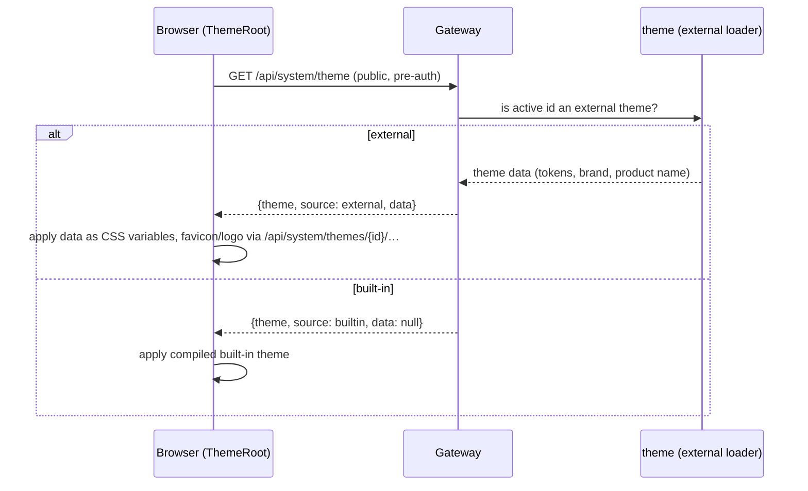
