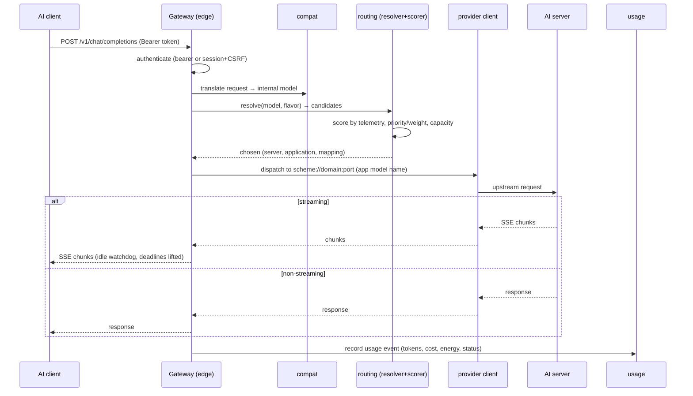
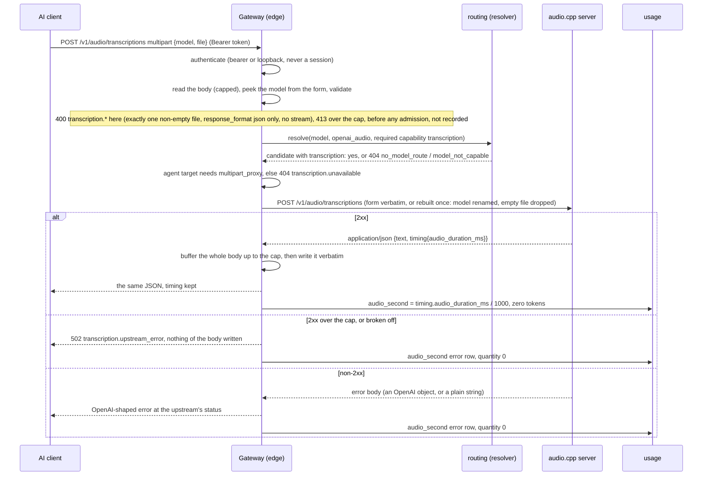
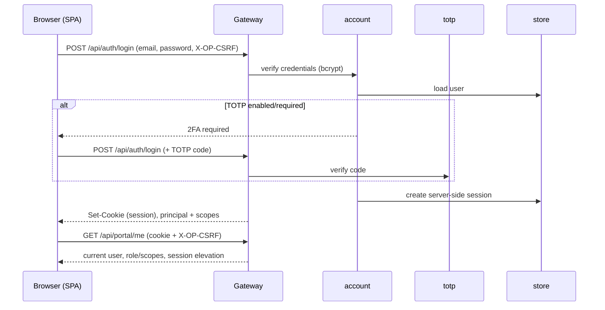
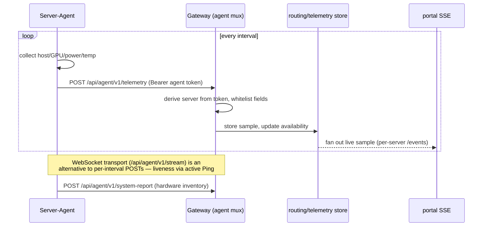
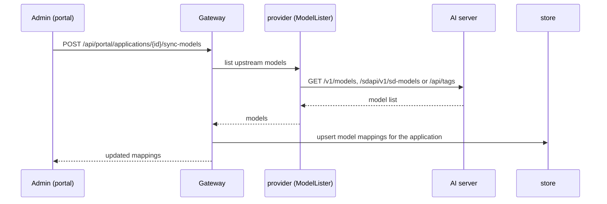
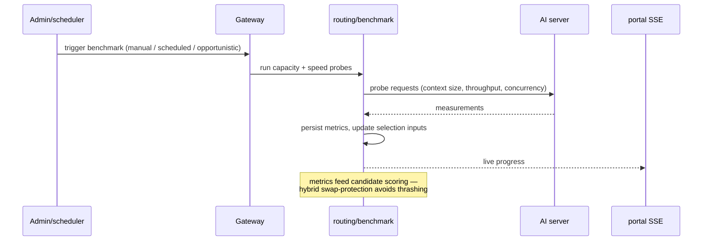
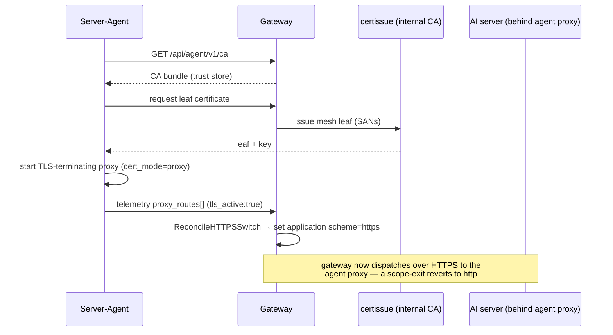
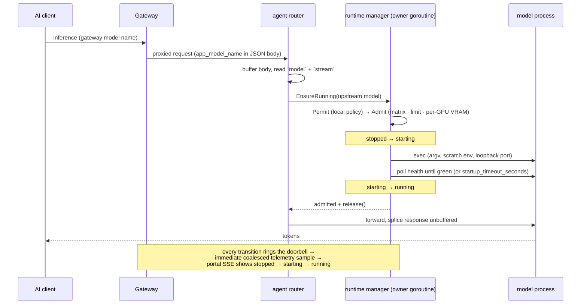
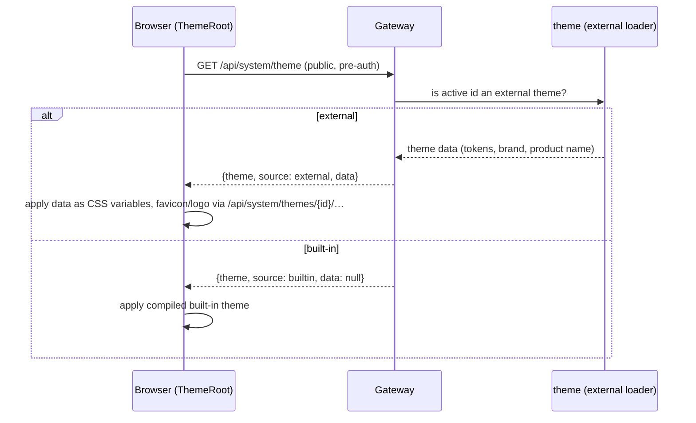

# 6. Runtime View

Key runtime scenarios as sequence diagrams. Details of each subsystem are in the
[cross-cutting concepts](README.md#8-cross-cutting-concepts).

## 6.1 Inference request (routing, dispatch, streaming)



Notes: the six JSON inference endpoints read the request body with no size cap
(large multimodal payloads); the other two, the multipart image edit
(`POST /v1/images/edits`) and the multipart audio transcription
(`POST /v1/audio/transcriptions`), are the capped bodies, each at a setting of its
own (`OP_AI_GATEWAY_MAX_IMAGE_EDIT_BODY_BYTES`,
`OP_AI_GATEWAY_MAX_AUDIO_TRANSCRIPTION_BODY_BYTES`, default 32 MiB each). All eight
lift the server read/write deadlines; SSE streams are bounded by an idle watchdog and
client disconnect, not a total cap. See
[Compatibility & Inference](cross-cutting/compatibility-and-inference.md).

### 6.1.1 Speech relay (`POST /v1/audio/speech`)

Text-to-speech is the one inference scenario whose response is **binary and not
JSON**, so it has its own runtime shape: no translate path, a capability gate
before routing, a validation that refuses what the relay cannot serve, a sized
and unbuffered audio body, and a usage row in seconds rather than tokens.

```mermaid
sequenceDiagram
    participant C as AI client
    participant GW as Gateway (edge)
    participant R as routing (resolver)
    participant AC as audio.cpp server
    participant U as usage

    C->>GW: POST /v1/audio/speech {model, input, voice} (Bearer token)
    GW->>GW: authenticate (bearer or loopback, never a session)
    GW->>GW: validate: model + input; response_format wav only; no stream
    Note over GW: 400 speech.* here, before any admission, not recorded
    GW->>R: resolve(model, openai_audio, required capability speech)
    R-->>GW: candidate with speech: yes, or 404 no_model_route / model_not_capable
    GW->>AC: POST /v1/audio/speech (model rewritten to the app's own name)
    alt 2xx
        AC-->>GW: audio/wav + Content-Length + X-AudioCPP-* headers
        GW-->>C: audio/wav + Content-Length (streamed, never buffered)
        GW->>U: audio_second = Audio-Duration-Ms / 1000, zero tokens
    else non-2xx
        AC-->>GW: error body (an OpenAI object, or a plain string)
        GW-->>C: OpenAI-shaped error at the upstream's status
        GW->>U: audio_second error row, quantity 0
    end
```

The gate is `RequiredCapabilities = ["speech"]`, whose verdict the health loop wrote
from the server's `/v1/models` `task`; the flavor is the application's own
`openai_audio` declaration. A payload capture keeps the request JSON and a metadata
summary of the audio, never the WAV bytes. See [Compatibility & Inference
§3.6](cross-cutting/compatibility-and-inference.md#36-openai-audio-speech) and
[ADR-061](09-architecture-decisions.md#adr-061--speech-is-the-second-endpoint-on-the-capability-gate-a-distinct-speech-capability-a-coarse-openai_audio-flavor-the-audio_cpp-kind-and-a-binary-relay-that-serves-wav-only).

### 6.1.2 Transcription relay (`POST /v1/audio/transcriptions`)

Speech-to-text is speech's mirror image: its request is a **multipart audio upload** and
its response is **JSON**, and the quantity it bills is in that JSON, so its relay is the
one that reads its response before it writes. It shares speech's flavor, so what differs
is keyed on the endpoint.



The gate is `RequiredCapabilities = ["transcription"]`, whose verdict the health loop wrote
from the same `/v1/models` `task` as speech's (`asr` is a transcription `yes`). A payload
capture keeps the form's text fields (the audio `file` part is redacted) **and the
transcript**, which is output-sensitive. See [Compatibility & Inference
§3.7](cross-cutting/compatibility-and-inference.md#37-openai-audio-transcriptions) and
[ADR-062](09-architecture-decisions.md#adr-062--transcription-is-multipart-in-and-json-out-on-the-shared-openai_audio-flavor-a-distinct-transcription-capability-billing-read-from-the-response-body-and-every-divergence-from-speech-keyed-on-the-endpoint).

## 6.2 Portal login (session + CSRF) with optional TOTP



## 6.3 Server-Agent telemetry ingest



## 6.4 Model synchronization



The listing endpoint is derived from the application's **type**, never from its
`loaded_models_path`: `/api/tags` for `ollama`, `/sdapi/v1/sd-models` for
`stable_diffusion_cpp` (whose `/v1/models` names only a placeholder), and
`/v1/models` for every other OpenAI-compatible type; `mock` answers fixed
names without a request. A body that is not JSON is an error that leaves every
mapping unchanged; which JSON bodies also count as errors differs by decoder
([API Compatibility & Inference §8](cross-cutting/compatibility-and-inference.md#8-provider-clients)).

## 6.5 Model-selection benchmark



## 6.6 Mesh certificate issuance & HTTPS auto-switch



## 6.7 Agent-managed model runtime: on-demand start



**The externally observable contract**, verified end to end with a real agent and
real child processes: an inference for a mapped model whose spec is not running
**blocks in the gateway** while the agent admits and starts the child, and the
request that triggered the start is the one that receives the answer — the first
request pays the start latency rather than failing fast. The state sequence on
the portal's runtime event stream is exactly `stopped → starting → running`, and
the status frame for the running spec reports the child's real `pid` and the
ephemeral loopback `port`. Nobody should redesign the router around a fail-fast
assumption.

**The degradation ladder is layered on purpose, and the WebSocket push is an
optimisation, not a dependency.** If a doorbell or a config frame is lost, the
agent's 60 s runtime poll catches up. If the gateway is entirely unreachable, the
agent keeps running from the last good runtime-config document it persisted
atomically to its own disk cache. In the reverse direction, every state
transition triggers an immediate coalesced out-of-band telemetry sample, so a
portal click feels like network latency rather than tick cadence. The
`RuntimeUpdates()` channel is buffered(1) with a non-blocking, coalescing send —
exactly like `certUpdates`. A reader who treats the push as *the* delivery
mechanism will "fix" a missed-frame bug with acks and retries instead of relying
on the poll and disk-cache fallbacks already designed in.

See [Agent-Managed Model Runtime](cross-cutting/agent-runtime-manager.md).

## 6.8 Theme resolution (built-in vs external)


