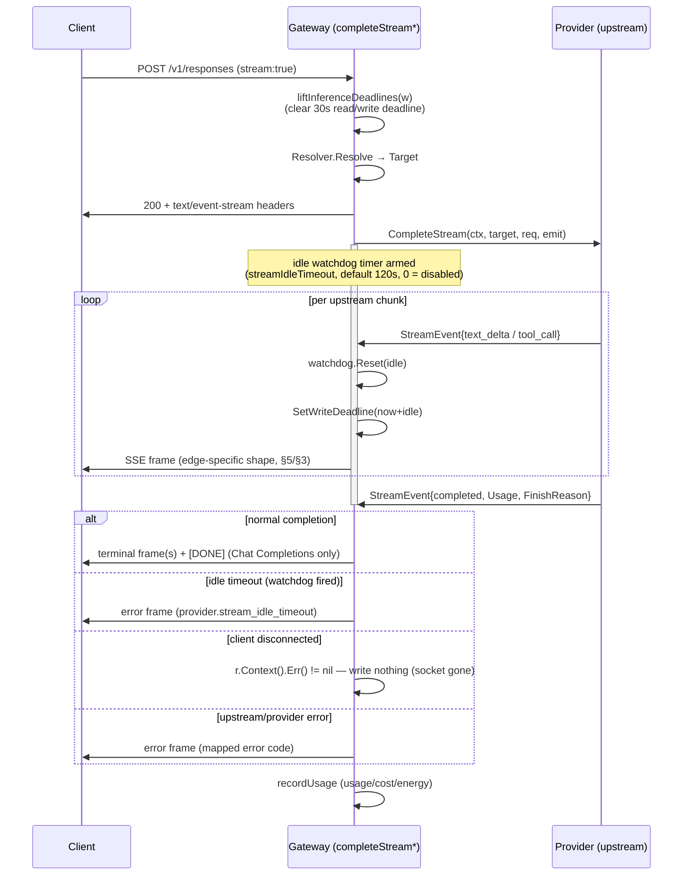

# API Compatibility & Inference

How OnPrem AI Gateway speaks three client protocols (OpenAI, OpenAI Responses,
Anthropic Messages) and two upstream dialects (Ollama, OpenAI-compatible) through
one provider-neutral internal model, and how streaming, tool-calling, multimodal
bodies, and model discovery are kept consistent across all of them.

## 1. The provider-neutral inference model

Every client request — regardless of which wire protocol it arrived on — is
parsed into one Go type before anything else happens: `inference.Request`
(`internal/inference/types.go`). It is the sole boundary between "edge" code
(protocol parsing/rendering) and "provider" code (upstream HTTP dialects); no
provider client ever sees a raw client body, and no edge handler ever builds an
upstream HTTP request directly.

| Field | Purpose |
|---|---|
| `APIFlavor` | fine-grained source protocol: `openai_chat_completions`, `openai_responses`, `anthropic_messages` |
| `Model` | the gateway model name the request is actually routed under — after the token's model-override rules, catch-all, and unknown-model redirect (see [Routing & Model Selection §2.1](routing-and-model-selection.md)) |
| `RequestedModel` | the client's original model name, before any of that; recorded on the usage event |
| `Messages []Message` | role + `[]ContentPart` (text/image/tool_result) + optional `ToolCalls`/`ToolCallID`/`Reasoning` |
| `Tools []Tool`, `ToolChoice any` | tool definitions; `ToolChoice` is forwarded upstream verbatim |
| `Stream`, `IncludeUsage` | streaming flag; OpenAI `stream_options.include_usage` |
| `MaxTokens`, `Temperature`, `Stop`, `ReasoningEffort` | sampling parameters, forwarded when set |
| `ClientSessionID`, `SessionSource`, `AgentID` | best-effort session continuity signal (§4) |
| `ServerOverrideID`, `ServerOverrideForceUnreachable` | pins routing to one AI-server (re-authorized per request; see [Routing & Model Selection](routing-and-model-selection.md)) |

`Message.Content` is `[]ContentPart{Type: text|tool_result|image, ...}` — a
message can carry text, one or more images, and (on a tool-result message) is
keyed by `ToolCallID`. `ToolCall.Arguments` is always the **raw JSON string**
exactly as produced by the model or sent by the client — every edge round-trips
it as a string rather than re-parsing, so no argument payload is ever mangled by
re-serialization.

The response side is the mirror: `provider.Response{Text, Usage, ToolCalls,
Reasoning, FinishReason}` (`internal/provider/mock.go`) for a buffered call, or a
sequence of `inference.StreamEvent{Type: text_delta|tool_call|completed|error,
...}` for a streamed one. `inference.Usage` normalizes token accounting to
OpenAI semantics: `InputTokens` **includes** the cached subset;
`CachedTokens`/`CacheWriteTokens` break out the Anthropic-only cache read/write
counts as a subset — `compat.AnthropicInputTokens` (`internal/compat/anthropic.go`)
is the one place that inverts this back to Anthropic's own (cache-exclusive)
convention.

## 2. Edge → translate/native → provider dispatch

```mermaid
flowchart TD
    subgraph Edges["Edge (internal/gateway)"]
        Chat["POST /v1/chat/completions\n/openai/v1/chat/completions"]
        Resp["POST /v1/responses\n/openai/v1/responses"]
        Msg["POST /v1/messages\n/anthropic/v1/messages"]
        CT["POST /v1/messages/count_tokens"]
        Img["POST /v1/images/generations\n/openai/v1/images/generations"]
        ImgEdit["POST /v1/images/edits (multipart)\n/openai/v1/images/edits"]
        Speech["POST /v1/audio/speech\n/openai/v1/audio/speech"]
        Transcribe["POST /v1/audio/transcriptions (multipart)\n/openai/v1/audio/transcriptions"]
    end

    Chat --> ParseChat["compat.ParseOpenAIChatCompletions"]
    Resp --> NativeGate{"endpointModeFor(target,\nopenai_responses)"}
    Msg --> NativeGate2{"endpointModeFor(target,\nanthropic_messages)"}
    CT --> CountTok["compat.CountAnthropicTokens\n(word-count estimate, no upstream call)"]
    Img --> CapGate{"Resolve with\nRequiredCapabilities=[image]"}
    CapGate -->|refused| Reject3["404 routing.model_not_capable"]
    CapGate -->|target| Native3["relayImages -> proxyNative:\nforward raw body\nto upstream /v1/images/generations"]
    ImgEdit --> CapGateE{"Resolve with\nRequiredCapabilities=[image_edit]"}
    CapGateE -->|refused| Reject4["404 routing.model_not_capable /\nimages.edit_unavailable"]
    CapGateE -->|target| Native4["relayImageEdit -> proxyNative:\nmultipart body verbatim (or rebuilt once)\nto upstream /v1/images/edits"]
    Speech --> CapGateS{"Resolve with\nRequiredCapabilities=[speech]"}
    CapGateS -->|refused| Reject5["404 routing.model_not_capable"]
    CapGateS -->|target| Native5["relaySpeech -> proxyNative:\nJSON body to upstream /v1/audio/speech,\nbinary audio/wav streamed back"]
    Transcribe --> CapGateT{"Resolve with\nRequiredCapabilities=[transcription]"}
    CapGateT -->|refused| Reject6["404 routing.model_not_capable /\ntranscription.unavailable"]
    CapGateT -->|target| Native6["relayTranscription -> proxyNative:\nmultipart body verbatim (or rebuilt once)\nto upstream /v1/audio/transcriptions,\nJSON response buffered, metered, written"]

    NativeGate -->|passthrough| Native["proxyNative:\nforward raw body byte-for-byte\nto upstream /v1/responses"]
    NativeGate -->|translate| ParseResp["compat.ParseOpenAIResponses"]
    NativeGate -->|disabled| Reject1["404 responses.endpoint_disabled"]
    NativeGate2 -->|passthrough| Native2["proxyNative:\nforward raw body byte-for-byte\nto upstream /v1/messages"]
    NativeGate2 -->|translate| ParseMsg["compat.ParseAnthropicMessages"]
    NativeGate2 -->|disabled| Reject2["404 messages.endpoint_disabled"]

    ParseChat --> Req["inference.Request"]
    ParseResp --> Req
    ParseMsg --> Req

    Req --> Resolve["routing.Resolver.Resolve\n(model+flavor → Target)"]
    Resolve --> Mux["provider.Multiplexer\n(dispatch by target.Provider)"]
    Native --> ProxyMux["provider.Multiplexer.ProxyNative\n(dispatch by target.Provider)"]
    Native2 --> ProxyMux
    Native3 --> ProxyMux
    Native4 --> ProxyMux
    Native5 --> ProxyMux
    Native6 --> ProxyMux

    Mux --> Ollama["OllamaClient\n/api/chat"]
    Mux --> OAIC["OpenAICompatibleClient\n{prefix}/chat/completions (default /v1)"]
    Mux --> Mock["Mock (dev/test)"]
    ProxyMux --> OAIC

    Ollama --> RenderChat["compat.OpenAIChatResponse"]
    OAIC --> RenderChat
    Mock --> RenderChat
    RenderChat -.->|or Responses/Anthropic render\nper originating edge| Client["client"]
```



Each of the three POST inference edges (chat completions, Responses, Messages)
funnels into exactly one `inference.Request`, one `Resolver.Resolve` call, and
one `provider.Multiplexer` dispatch — the multiplexing is entirely by
`target.Provider` (`internal/provider/multiplexer.go`), never by the client's
`APIFlavor`. That is what makes every upstream (Ollama, vLLM, llama.cpp,
llama-swap, LiteLLM) reachable from every client protocol: a Claude Code session
can be served by an Ollama-backed mapping, and a Codex session by a vLLM one,
with no special-casing.

`routing.NormalizeAPIFlavor` (`internal/routing/resolver.go`) reduces the five
fine-grained `APIFlavor` strings (`openai_chat_completions`, `openai_responses`,
`anthropic_messages`, `openai_images`, `openai_audio`) to the four coarse buckets
(`openai`, `anthropic`, `openai_images`, `openai_audio`) that a `model_mapping`'s
application declares
support for (§6) — see
[Routing & Model Selection](routing-and-model-selection.md) for how a mapping is
selected. **The Codex/generic-OpenAI split is by ENDPOINT, not by flavor**:
`/v1/chat/completions` and `/v1/responses` both normalize to `openai`, but they
are two distinct handlers (`handleOpenAIChat` / `handleOpenAIResponses`,
`internal/gateway/inference_handlers.go`) reachable at two distinct paths, and the session
extractor (§4) discriminates them by `sessionEndpoint`
(`internal/gateway/session_extract.go`) for exactly this reason.

## 3. Endpoints

| Client protocol | Endpoint(s) | Handler | Auth | Native passthrough |
|---|---|---|---|---|
| OpenAI Chat Completions | `/v1/chat/completions`, `/openai/v1/chat/completions` | `handleOpenAIChat` | `requireWebAnyScope` (session cookie **or** bearer) | none — always translated |
| OpenAI Responses (Codex) | `/v1/responses`, `/openai/v1/responses` | `handleOpenAIResponses` | `requireAnyScope` (bearer only) | `Target.ResponsesMode` (§6) |
| Anthropic Messages (Claude Code) | `/v1/messages`, `/anthropic/v1/messages` | `handleAnthropicMessages` | `requireAnyScope` (bearer only) | `Target.MessagesMode` (§6) |
| OpenAI Images generations | `/v1/images/generations`, `/openai/v1/images/generations` | `handleOpenAIImages` | `requireInternalOrBearerAnyScope` (bearer or internal loopback — never a session cookie) | **always** — there is no translate path (§3.4) |
| OpenAI Images edits (multipart) | `/v1/images/edits`, `/openai/v1/images/edits` | `handleOpenAIImagesEdit` | `requireInternalOrBearerAnyScope` (as generations) | **always** — a multipart relay, no translate path (§3.5) |
| OpenAI audio speech | `/v1/audio/speech`, `/openai/v1/audio/speech` | `handleOpenAISpeech` | `requireInternalOrBearerAnyScope` (as generations) | **always** — a binary-response relay, no translate path (§3.6) |
| OpenAI audio transcriptions (multipart) | `/v1/audio/transcriptions`, `/openai/v1/audio/transcriptions` | `handleOpenAITranscription` | `requireInternalOrBearerAnyScope` (as generations) | **always** — a multipart-in, JSON-out relay, no translate path (§3.7) |
| Anthropic token count | `/v1/messages/count_tokens`, `/anthropic/v1/messages/count_tokens` | `handleAnthropicCountTokens` | `requireAnyScope` (bearer only) | n/a — never calls an upstream |
| OpenAI model discovery | `/v1/models`, `/openai/v1/models` | `handleOpenAIModels` | `requireAnyScope` | n/a |
| Anthropic model discovery | `/anthropic/v1/models` | `handleAnthropicModels` | `requireScope("gateway:use")` | n/a |
| LM Studio v2 model discovery | `/api/v1/models`, `/openai/api/v1/models` | `handleLMStudioV1Models` | `requireAnyScope` (bearer only) | n/a |

`requireAnyScope` accepts **either** a normal `gateway:use` principal **or** a
service token's sole `llm:invoke` scope (service accounts); `requireWebAnyScope`
additionally accepts the portal session cookie (+ CSRF header on state-changing
methods) — `/v1/chat/completions` is deliberately the one inference endpoint
reachable that way (§9). Every body but the two multipart ones (the image edits
and the audio transcriptions) is read with `readRawJSONUnlimited` (§7); those two
bodies are `multipart/form-data` and each is read by its own capped reader (§3.5,
§3.7, §10). All eight POST endpoints call `liftInferenceDeadlines` before reading
the body (§6); the bearer live-transcription endpoint of §3.8, a ninth POST, lifts them as well, after its own gate.

### 3.1 OpenAI Chat Completions

`compat.ParseOpenAIChatCompletions` (`internal/compat/openai.go`) handles the
standard `messages` array (string or typed-block content, `image_url` blocks)
plus the **tool-call replay shape** a coding agent (e.g. opencode) sends on
turn 2+: an assistant message with `content: null` and a `tool_calls` array,
followed by a `role:"tool"` result message keyed by `tool_call_id`. Content is
required on every message *except* such a tool-call turn or a tool-result
message (`parseChatMessageContent`'s `contentOptional`).

### 3.2 OpenAI Responses — Codex continuity

`compat.ParseOpenAIResponses` accepts both the simple string `input` and the
full Responses `input` array: `message`, `function_call`,
`function_call_output`, and `reasoning` items, tolerantly skipping item types it
does not model (built-in tool items, images inside message content, …) rather
than rejecting the request. Two behaviors are specific to Codex continuity:

- **Reasoning replay.** A replayed `reasoning` item (Codex echoing the model's
  prior chain-of-thought) is buffered and attached to the assistant output it
  precedes (`function_call` or `message`) as `Message.Reasoning`, which the
  OpenAI-compatible provider client threads to the upstream as
  `reasoning_content` — this is how a reasoning model (llama.cpp / harmony)
  keeps continuity across a multi-turn agent loop.
- **Parallel tool calls.** Consecutive `function_call` items are merged into
  one assistant message with a `ToolCalls` array (not one message per call), so
  the upstream chat history is always the strict
  `assistant(tool_calls…) → tool… → user` shape a Chat Completions upstream
  expects.

Rendering the non-stream reply (`compat.OpenAIResponsesResponse`) emits, in
order: a `reasoning` output item (if the model reasoned), then a `message`
item (if there is text, or always when there are no tool calls), then one
`function_call` item per tool call.

### 3.3 Anthropic Messages — Claude Code thinking, stop_reason, cache

`compat.ParseAnthropicMessages` (`internal/compat/anthropic.go`) handles
Claude Code's full multi-turn shape: string-or-array `system`, `text` /
`image` / `tool_use` / `tool_result` / `thinking` content blocks, flat `tools`
(`input_schema`, not `parameters`), and `tool_choice`
(`auto`→`"auto"`, `any`→`"required"`, `none`→`"none"`,
`tool`→`{"type":"function","function":{"name":…}}`). A `tool_result` block
(which Anthropic nests inside a `user` message) is split out into its own
`tool`-role message emitted *before* the parent message, matching the
Chat-Completions-canonical `assistant(tool_calls) → tool(result) → user(text)`
ordering. An image block's `source` becomes a `data:<mime>;base64,…` URI (or is
passed through for a `url` source).

**Thinking.** A replayed `thinking` block's text becomes `Message.Reasoning`
(the same field Codex reasoning replay uses) — the Anthropic analog of the
Responses reasoning path. `thinking.signature` is read but never validated on
this path (the gateway never mints a real signature; only `api.anthropic.com`
does, and it is never reached here).

**stop_reason.** `compat.AnthropicStopReason` maps the upstream OpenAI
`finish_reason`: any tool call present (or `finish_reason:"tool_calls"`) →
`tool_use`; `"length"` → `max_tokens`; everything else → `end_turn`.
Anthropic's `stop_sequence` reason is **never produced** on the translate path
— over a generic Chat Completions upstream a stop-sequence match is
indistinguishable from a natural stop (`finish_reason:"stop"`); recovering it
requires native passthrough.

**Cache usage.** `AnthropicUsage.CacheReadInputTokens` is populated from
`inference.Usage.CachedTokens`; `AnthropicInputTokens(usage)` subtracts that
subset from the OpenAI-canonical `InputTokens` so the two numbers never
double-count.

**Effort.** Claude Code's `output_config.effort` is not translated by default:
the parser leaves `output_config` alone. A token with `claude_effort_compatibility`
on gets it read into the neutral `ReasoningEffort` and delivered to a llama.cpp
or vLLM target as `chat_template_kwargs.reasoning_effort`, on this path and on
native passthrough alike ([§9.2](#92-claude-code-reasoning-effort-compatibility)).

Rendering (`compat.AnthropicMessageResponse`) emits content blocks in
Anthropic's required order: `thinking` (if any) → `text` (if any, or always
when there are no tool calls) → one `tool_use` block per tool call, each with
`input` reconstructed as a JSON **object** from the internal string arguments.

### 3.4 OpenAI Images generations

`POST /v1/images/generations` (`handleOpenAIImages`,
`internal/gateway/images_handler.go`) relays to a natively OpenAI-shaped image
backend — `sd-server` from `leejet/stable-diffusion.cpp`, registered either as
an external application of type `stable_diffusion_cpp`
([Routing & Model Selection §1](routing-and-model-selection.md#1-data-model))
or launched by the agent under the runtime spec type of the same name
([Agent-Managed Model Runtime
§3.4](agent-runtime-manager.md#a-worked-sd-server-launch-under-stable_diffusion_cpp)).
Four things separate it from every other endpoint in §3.

**1. There is NO translate path, and two gates make that honest.** The
gateway proxies image requests; it does not synthesize them. So unlike
`/v1/responses` and `/v1/messages` — where `translate` is the safe fallback for
a backend that cannot speak the native shape (§6) — an application that does
not serve this shape must simply not be a candidate. The first gate is the
**application's**: the request's coarse flavor is `openai_images`, and only an
application that lists that flavor is a candidate (§6 has the two stages, and
the images relay's own post-resolve check for an agent-launched child). The
second is the **model's**: the request declares
`RequiredCapabilities = ["image"]`, and `Resolver.Resolve` refuses a model that
carries no `yes` verdict for it: 404 `routing.model_not_capable` ([Routing &
Model Selection §2.3](routing-and-model-selection.md#23-the-capability-gate)).
Neither refusal needs a gate of its own here — the handler consumes the shared
`inferencePreflight` like every other endpoint, and adds **no** second
`admitPrincipal` call site (there is exactly one in the package, deliberately).
Consequently
`endpointModeFor` has **no case** for this flavor — there is no `images_mode`
column to read — and `upstreamPath` answers the images path directly, before the
mode lookup and provider fallbacks that only chat, Responses and Messages need.
`upstreamPath(target, apiFlavor, endpoint)` is **endpoint-aware**: the images
flavor answers `/v1/images/generations` for every endpoint but
`endpointImagesEdit`, for which it answers `/v1/images/edits` (§3.5), and every
other flavor ignores the endpoint. The same endpoint reaches `recordUsage`
(`usageMeta.Endpoint`, whose zero value is the generations path), because the
usage row recomputes its `provider_path` from the flavor, not from the relay's
path, and would otherwise record the generations path for an edit.

**2. It validates its own shape and never calls
`inference.Request.Validate()`.** That validator requires `len(Messages) > 0`,
and an images request has no messages at all, so calling it would reject every
one of them. `validateImagesRequest` requires a non-empty `prompt`
(`images.prompt_required`) and a non-empty `model`
(`images.model_required`, resolved by the same tolerant `sniffRoutingModel`
probe the other native endpoints use — `sd-server` itself **ignores** the
`model` field, since one process serves one model, so the value is purely the
gateway's routing input). Every other field is the client's own business and
reaches the upstream unexamined, with two exceptions — and both are type-checked
rather than decoded straight into a Go string/bool, because a struct decode that
discards its type error (which this validator does, deliberately, being as
tolerant as `sniffRoutingModel` about everything it does not own) would leave a
non-string `response_format` such as `["url"]` at its zero value and walk past
the very check below.

**3. `response_format` accepts only `b64_json` or an absent value; anything
else is 400 `images.response_format_unsupported`.** The reason is what happens
*after* the relay, not OpenAI conformance: `sd-server` cannot host a URL for
output it generates in-process, and the billable-quantity counter is built
against the `b64_json` key (§13, and [Telemetry, Usage Analytics &
Observability §8.4.1](telemetry-usage-observability.md#841-the-usage-event)),
so a `url`-format request could only ever relay a shape this path does not
expect while billing every image in it as zero produced. Rejecting up front
turns that into a 400 the client can act on instead of a usage row that quietly
under-bills a response that streamed just fine.

**The compatibility cost is real and is stated here rather than discovered.**
`b64_json` is **not** OpenAI's default: the OpenAI Images API defaults
`response_format` to `url` for `dall-e-2`/`dall-e-3`, and `gpt-image-1` does
not accept the parameter at all. So a strict OpenAI client that explicitly
sends the documented OpenAI default now receives a 400 rather than an image.
That is the accepted trade — relaying a base64 body to a client that asked for
URLs is a silent wire-contract violation, and a 400 is the only answer that is
neither wrong nor silent — but a client-side `response_format` of `b64_json`
(or its omission) is a **precondition** for using this endpoint, not a
preference.

**`stream` is the second exception, refused by the same argument: `stream: true`
is 400 `images.stream_unsupported`.** The gateway has pinned this endpoint to
the buffered path — `Stream` is `false` in the request `proxyNative` builds, with
the deadline consequence spelled out below — so relaying the flag unexamined
sends the upstream a `"stream": true` the gateway then ignores and hands the
client a single `application/json` body where it asked for a stream. That is the
same silent wire-contract violation the `response_format` rule exists to
prevent, so it gets the same non-silent answer and its own code. `stream: false`
and an absent `stream` describe what the endpoint already does and are accepted,
which is what makes this a refusal of the *value* rather than of the field. The
case is reachable rather than theoretical: OpenAI's `gpt-image-1` accepts
`stream`/`partial_images`, so a real client has a reason to send it.

**4. A non-2xx upstream response is normalised, and the classification is the
gateway's own.** `sd-server` answers `{"error": "<plain string>"}`; OpenAI
clients expect `{"error": {message, type, code}}`.
`normalizeImagesUpstreamError` converts the first into the second with
`type: "upstream_error"` and `code: "images.upstream_error"` — **ours, not the
backend's**, because `sd-server` states neither and nothing downstream may read
them as an upstream statement. Three branches, and the fall-through matters: a
body that is *already* OpenAI-shaped passes through untouched (re-normalising
would overwrite an attested type/code with a gateway-authored one), a
plain-string body is converted, and a body matching **neither** shape is
relayed byte-unchanged rather than guessed at. The two fixed values are
deliberately independent of the upstream's HTTP status, since a plain string
carries no more information than itself. This normalisation is gated strictly
to this flavor: a non-2xx `/v1/responses` or `/v1/messages` passthrough body
still reaches the client byte-for-byte as before. The error body is read
bounded by `captureMaxBytes`, not by a wider cap.

**Two consequences of the relay's shape, both load-bearing.**

- **`Stream` is pinned `false` (and a client asking otherwise is refused up
  front, above), so this endpoint always takes `proxyNative`'s
  buffered-deadline branch — a *total* timeout, with no idle watchdog.** That
  total is `target.Timeout`, i.e. the serving application's `timeout_ms`.
  The `stable_diffusion_cpp` and `server_agent` types both default it to
  600000 ms (§7.1); on an application of any other type it is the stock
  30000, a value tuned for chat, and **an operator must raise it** before
  that application serves images: a diffusion request producing several
  images at high step counts can exceed a chat-shaped timeout while working
  perfectly, and because there are no frames,
  `OP_AI_GATEWAY_STREAM_IDLE_TIMEOUT` (§7) does not apply and cannot rescue
  it. The pinning is correct for a single-JSON
  backend — there is nothing to stream, and a buffered response gets no live
  TTFT or tokens/sec row either (§6) — but it means the whole generation is
  governed by one number, and that number is the application's.
- **Resolving an image request writes the token's last-used-model marker,
  and an image request is redirected only onto an image-capable model.**
  `relayImages` goes
  through the shared `resolveImagesTarget` (which `relayImageEdit` shares, §3.5)
  and so through `resolveTarget`, so an image model becomes the marker a
  **later chat request**'s unknown-model redirect tries first under
  `UnknownModelRedirect` ([Routing & Model Selection
  §2.1](routing-and-model-selection.md#21-per-token-model-resolution)). That
  redirect asks the `openai` offering, whose `Callable` holds a name only when
  its application declares `openai` and its effective flavors are neither
  images-only nor audio-only
  ([ADR-045](../09-architecture-decisions.md#adr-045--a-model-listing-advertises-what-dispatch-serves-one-flavor-rule-read-from-the-spec)):
  an application declaring only `openai_images` (the `stable_diffusion_cpp`
  default) keeps the image model out, and so does an agent-managed child whose
  spec is images-only (or audio-only), under a parent that declares `openai` for its text
  children. What it can still pick is an image model whose effective flavors
  also carry a text flavor; nothing on the chat path requires a capability, so
  the chat request is sent to that upstream. The images request's own redirect
  asks the `openai_images` offering together with the request's required
  capability, and takes a `LastUsedModel` or fallback only when that name
  carries `image` by the portal listing's own image fold
  (`ModelOffering.Capable`, [Routing & Model Selection
  §2.2](routing-and-model-selection.md#22-callable-existing--and-why-the-listing-is-neither)).
  A candidate without it is skipped, so a client that hardcodes `dall-e-3`
  against a token whose fallback generates images is served by the fallback,
  and one whose candidates are all text models gets 404
  `routing.no_model_route` for its own name — never a `model_not_capable`
  about a model it did not send. A requested name is redirected by the narrow
  default when every one of its mappings fails the `openai_images` flavor half
  — the text children of a mixed application, whose specs lack the flavor
  while the application declares it, or a group of only such names — because
  it is then not in `Existing(openai_images)`, like a name whose application
  lacks the flavor; without the redirect it answers 404
  `routing.no_model_route`, or `routing.model_not_capable` when it has no
  verdict.

**Session and affinity.** The endpoint has its own `sessionEndpoint` case and
that case is deliberately empty: an OpenAI images request carries no
`prompt_cache_key`, no `user` and no `metadata`, so there is no session signal
to extract. Image requests also take **no** affinity pin at all, by an explicit
write guard on every capability-carrying request. Their affinity key could not
collide with a chat client's anyway — the key hashes the coarse flavor, and
`openai_images` is its own — so for images the guard only keeps image traffic
pin-free; it exists for a future capability-carrying endpoint that shares a
coarse flavor with a text one ([Routing & Model Selection
§4](routing-and-model-selection.md#4-route-affinity)).

**Payload capture is clipped in practice on this endpoint.** A base64 image
inflates its raw bytes by roughly a third, so a single modest PNG already
occupies hundreds of KB and an `n > 1` response is a multiple of that —
routinely past `OP_AI_GATEWAY_CAPTURE_MAX_BYTES` (default 1 MiB), which stores
the body truncated with its `truncated` flag set ([Security, Authentication &
Authorization §14](security-auth-rbac.md#14-capture-redaction-of-sensitive-headers)).
The cap was **not** widened for this endpoint. The billable image count is
unaffected, because it is scanned off the full byte stream rather than read
back off the capped capture buffer — that independence is the whole reason the
counter exists, and it is documented with the usage event
([§8.4.1](telemetry-usage-observability.md#841-the-usage-event)).

**Per-model option discovery: what the portal composer may offer for an image
model.** The relay above forwards every native knob opaquely, so nothing on the
inference path knows which sampler names, output formats or sizes a given
`sd-server` accepts. The portal composer (§12) learns that from one read-only
endpoint, `GET /api/portal/model-image-options?name=<model>`
(`handlePortalModelImageOptions`, `internal/gateway/portal_model_endpoints.go`;
[API Surface](../reference/api-surface.md#models-servers-applications-mappings)),
which answers what the `sd-server`(s) behind a gateway model state, so the
composer can narrow its advanced dropdowns from the static sd-cpp superset to the
picked model's own options and show the server's defaults. It is a portal
endpoint beside `model-servers`, not part of the inference surface, and it
changes nothing about how a run is sent
([ADR-055](../09-architecture-decisions.md#adr-055--per-model-sd-server-image-options-are-read-live-on-pick-from-two-volatile-caches-and-never-stored)).

- **The source is the document the `image` verdict already reads.**
  `sd-server`'s `GET /sdcpp/v1/capabilities` states `samplers`, `schedulers`,
  `output_formats_by_mode.img_gen`, `limits.{min_width, max_width, min_height,
  max_height, max_batch_count}` and `defaults_by_mode.img_gen`, whose sampling
  defaults are nested under `sample_params` (`sample_method` is the sampler,
  `sample_steps` the step count, `scheduler`, `guidance.txt_cfg` the CFG scale)
  while `clip_skip`, `seed`, `negative_prompt`, `width`, `height` and
  `output_format` sit directly in it (names verified against
  stable-diffusion.cpp's `make_capabilities_json`).
- **Two in-memory caches, one per deployment shape, and nothing durable.**
  An **external** `stable_diffusion_cpp` application is read by the gateway's
  health loop: `probeSdcppCapabilities` (`cmd/gateway/app_health.go`) reads the
  document a second time per tick (skipped when the verdict probe already found
  the server unreachable), through `provider.ProbeSdcppImageOptions` (the
  verdict probe's own transport, credential and 1 MiB bound), and writes the
  decoded options to `AppImageOptionsRegistry` keyed by application id. A failed
  read keeps the last good entry; deleting the application evicts it.
  An **agent-launched** `server_agent` child sits behind the agent's router,
  which the health loop cannot reach, so the agent reads the same document
  itself and carries the decoded options on its telemetry sample as
  `runtimes[].image_options`, cached per (pid, type, model) generation like the
  verdict beside it and behind the same `capability_source_sdcpp` gate; the
  gateway mirrors it into `RuntimeStatusDTO.ImageOptions` in the volatile
  runtime-status registry (keyed by server and spec id, tagged `json:"-"` — it
  is an in-process hand-off and never rides the runtime-status SSE frame). This
  is the established "health loop writes, portal reads" split
  (`AppHealthRegistry`): the portal GET **never probes upstream**, so an
  unreachable server cannot slow or fail it.
- **The options decode is lenient and SEPARATE from the verdict decode.**
  `parseSdcppImageOptions` (`internal/provider/sdcpp_image_options.go`, with a
  verbatim twin in `server-agent/internal/collector/`, pinned by one case table
  duplicated in both modules' tests) reads what it can and leaves everything it
  cannot at zero, which uniformly means *unknown*; only a body that is not JSON
  at all is an error. The strict, fail-closed `parseSdcppCapabilities` that
  answers the routing `image` verdict is untouched, so a malformed options
  document yields partial or empty options and can **never** suppress or alter
  the verdict the images gate depends on.
- **Visibility is decided in the portal layer, before any cache is read.**
  `portal.Service.ModelImageOptionViews` applies the same suppression
  (`model_settings` visibility `hidden`/`locked` for a non-admin, fail-closed on
  a read error) and resource-group filtering as `model-servers`, then keeps only
  the sd-server mappings: an external `stable_diffusion_cpp` application, or a
  `server_agent` mapping whose spec's effective type is `stable_diffusion_cpp`.
  A model the token cannot route to has no views, touches no cache and answers
  `{"data":{}}`, exactly like an unknown model — it neither leaks nor 404s.
- **Aggregation answers "what every backing server can do"**
  (`aggregateImageOptions`, `internal/gateway/model_image_options_aggregate.go`),
  because a request may land on any server behind the model, including one
  external and one agent-launched sd-server in a single set. `samplers`,
  `schedulers` and `output_formats` are the **intersection** of the lists the
  servers state, in the first stated list's order. Size limits are the
  **tightest envelope** per axis (largest stated minimum, smallest stated
  maximum), and `max_batch_count` the smallest positive value; a non-positive
  limit is unknown and never becomes a bound, and an axis whose resulting
  minimum exceeds its maximum is dropped whole, so any emitted bound pair
  satisfies `min <= max` with no negatives. A default is emitted only when
  every server that states it agrees; `clip_skip` and `seed` carry the
  servers' own `-1` ("model default" / "random") faithfully.
- **Fail-open: an absent or empty field is UNKNOWN, never "none supported".**
  Every field of the response is `omitempty`, and a server that has not been
  read, whose probe failed, or whose document states nothing for a field
  contributes nothing to it. Where the aggregate ends up without a value for a
  field, the **client falls back to the static sd-cpp superset** for that field
  (§12). That includes the case a reader would otherwise take for a statement:
  two backing servers whose sampler sets are **disjoint** intersect to the empty
  set, which is omitted and read as unknown, not as "this model supports no
  sampler". The consequence is deliberate: an option the composer offers may be
  one a given build ignores (the gateway forwards every pick opaquely, as
  above), whereas a fail-closed reading would leave an unread model with an
  empty dropdown and no way to set a knob that works.
- **Freshness and the restart warm-up gap are accepted, not hidden.** The caches
  are volatile, so a gateway restart starts them cold. An agent-launched child's
  options reappear on the next telemetry sample (about a second); an external
  application's reappear on its next health tick, which can be up to the
  application's longest probe interval away. Until then the composer shows the
  static superset, which is the fail-open answer above. The endpoint is
  best-effort throughout: it answers `200` whatever the caches hold, and the
  only failure it reports is its own visibility read (`500`
  `model.image_options_failed`).

### 3.5 OpenAI Images edits

`POST /v1/images/edits` (`handleOpenAIImagesEdit`,
`internal/gateway/images_edit_handler.go`) edits an image on the same upstream,
under the same auth, flavor gate and metering as §3.4, and is the gateway's
**first multipart request path**
([ADR-057](../09-architecture-decisions.md#adr-057--image-edit-a-derived-image_edit-capability-a-multipart-passthrough-and-the-attached-image-as-the-edit-affordance)
records why each piece is shaped as it is). Both the public bearer endpoint and
the portal chat (server-side, over the loopback pair, §12) use this one handler.
What differs from §3.4:

**1. The body is `multipart/form-data`, and only a few fields are the gateway's
business.** `model` and `prompt` are required (400 `images.model_required` /
`images.prompt_required`) and at least one **non-empty** part must arrive under
`image` **or** `image[]`, the two spellings OpenAI's clients use (400
`images.image_required`). `response_format` must be `b64_json` or absent (400
`images.response_format_unsupported`) and `stream` may only be false or absent
(400 `images.stream_unsupported`), for the reasons §3.4 gives. `mask` is the one
part with a meaning of its own (below). Everything else — `n`, `size`,
`output_format`, `output_compression`, any other field — reaches the upstream
unexamined. The edit route of `sd-server` produces **png and jpeg** only (a
generation also produces webp); `size`, when absent, is derived from the source
image. **`strength` is not a form field**: `sd-server`'s edit route reads no such
field, and takes the value from the `<sd_cpp_extra_args>{"strength":…}</sd_cpp_extra_args>`
block at the end of `prompt` (the same block §12 describes for the native knobs),
otherwise using its own default of 0.75 — a weak edit for models that edit with
reference images, which want a higher value.

**2. The form is read once, bounded, before anything is admitted.**
`readImageEditBody` reads the whole body into memory, capped by
`OP_AI_GATEWAY_MAX_IMAGE_EDIT_BODY_BYTES` (default 32 MiB, §10; `413
request.body_too_large`, from a declared `Content-Length` without reading a byte
or from `http.MaxBytesReader` when none was declared). `parseImageEditForm` then
walks it **once** with `mime/multipart` and the request's own boundary — never
`ParseMultipartForm`, which spills to temp files and consumes the body this
handler still has to relay — reading `model`, `prompt`, `response_format` and
`stream` (each a single value of at most 1 MiB; a **repeated** one is 400
`request.invalid`, because two `model` fields would be two answers to "which
model" and the agent's router reads it again), counting the image parts, and
reading **every** part to its end (`mime/multipart` swallows the read error of a
part it merely steps over, so a truncated tail would otherwise fail later, after
admission). A body that is not multipart, has no boundary or is malformed is 400
`request.invalid`. All of this, and the mask conversion below, runs **before**
`inferencePreflight`, so a refused request spends no admission.

**3. The model gate is a derived capability, and the target is checked twice
more.** The handler sets `RequiredCapabilities = ["image_edit"]` from its own
identity, never from the body. `image_edit` is **derived** — a mapping with an
`image: yes` verdict is edit-capable unless an operator set `image_edit: no` — and
the one function that says so is read by the gate, by the unknown-model redirect
and by the portal listing alike ([Routing & Model Selection
§2.3](routing-and-model-selection.md#23-the-capability-gate)), so an unknown
edit model is redirected to an edit-capable fallback like an unknown image model
is, and an opted-out one answers 404 `routing.model_not_capable` while the same
model still generates. The candidate must also declare the `openai_images`
flavor, and `resolveImagesTarget` — the resolve and the post-resolve served-flavor
conjunct (§6), **extracted** from `relayImages` so the two relays share one copy —
refuses an agent-launched child whose spec lists only text with 404
`routing.no_model_route`. Then, for a `server_agent` target only, the relay
checks that its agent has **declared `multipart_proxy`**
(`AgentFeatures.Has(serverID, "multipart_proxy")`,
[Agent-Managed Model Runtime
§7](agent-runtime-manager.md#7-feature-negotiation)): an agent that predates it
would answer the multipart body `404 runtime.model_not_managed`, the same answer
it gives an unmanaged model, so trying the route could not tell the two apart. A
target that fails the check is refused **before anything is relayed** with
**404 `images.edit_unavailable`**, recorded as one error row with
`billing_unit: image` and no upstream. The check is fail-closed by construction
— the registry is in memory, so it is also false for an agent that **has not
reported since the gateway restarted**, and for one that was just upgraded until
its first telemetry sample under the new version — and its message names both
causes (an agent older than 0.9.0, or one that has not reported yet), so the
operator is not told to update an agent that is already current. 404, not 409 or a 5xx, because the OpenAI SDKs
retry 408/409/429 and every 5xx and a refusal only a different agent build can
change must not be retried. It gates the **edit** only (generations are JSON,
which every router serves), does not apply to an external target (no agent in
front of it), and, like the conjunct, is **not retried against another
application** that could have served the model.

**4. The relay carries the form's own Content-Type, and rebuilds the body only
when something in it must change.** `provider.NativeProxyClient.ProxyNative`
takes the request's `Content-Type` as a parameter (§8) and `nativeRelay` gains an
optional `upstreamBody`, so the relay can send the **client's bytes verbatim**
(boundary included) or a body built for the upstream. It is **rebuilt once**
(`rebuildImageEditBody`: every part copied with its headers, bytes and position,
a fresh boundary) when either holds: the **`model` field must carry the mapping's
own model name** (`Target.ProviderModel`) and the form's differs — for **every**
target, since the JSON generations relay rewrites it for every provider too, an
agent's router keys the child on that name, and a model-routing upstream would
otherwise route on the gateway's name; the comparison is against the *form's*
value, because a token override or a redirect can land on a mapping whose two
names are equal — or the form carries a **mask**, which is always a rebuild. A
no-mask edit whose model needs no rewrite is relayed verbatim. `nativeRelay.raw`
stays the client's bytes either way, which is what capture records. The usage row
records `/v1/images/edits` as its `provider_path`. A body bound for
an agent-launched target is checked against **the agent's own 32 MiB** *after*
the rebuild (§10); one over it is refused `413 request.body_too_large` and
recorded rather than sent.

**5. The mask: alpha in, luminance out.** An OpenAI edit marks the region to
regenerate by **transparency** (an RGBA PNG whose transparent pixels are the
edit); `sd-server` reads the `mask` field as **luminance** — white regenerates,
black keeps — and drops the alpha channel, so a mask forwarded as sent would edit
the opposite region. The gateway converts it (`convertImageEditMask`,
`internal/gateway/images_edit_mask.go`):

| Mask pixel | Sent to `sd-server` | Meaning |
|---|---|---|
| fully transparent | white (255) | regenerate |
| fully opaque, whatever its colour | black (0) | keep |
| partly transparent | grey, `255 − alpha` | a soft edge stays soft |

The result is an 8-bit grayscale PNG file part named `mask.png` (the field needs a
filename to be read as a file, and a client's own name may not be ASCII).
Everything is checked from the image headers **before** a pixel is decoded, and
each refusal is a 400 of its own: **`images.mask_invalid`** — the mask's size is
not the **first** source image's (the first `image[]` part when there is one,
else the first `image`, as `sd-server` picks; further `image[]` parts are
references and may be any size), the mask is past **16 megapixels** (4096 × 4096,
`sd-server`'s own edge limit; a PNG is a few bytes of header for any pixel count,
so the body cap does not bound a decode's memory), or it has **no transparent
pixel** (it selects nothing to edit — an opaque mask, or an sd-style luminance
mask sent to this endpoint, would otherwise be a silent "edit nothing" that still
costs a full diffusion run); and **`images.edit_unsupported_format`** — a mask that
is not a readable PNG (a JPEG has no alpha) or has cut-off pixel data, or, **when a
mask is sent**, a source that is not a readable PNG or JPEG (all `sd-server`'s edit
route reads, and all the size check can read; with no mask nothing is decoded and
the source's type is the upstream's business). Two `mask` parts are 400
`request.invalid`, and an empty mask part is no mask.

**6. The response, the usage row and the capture are the generations
endpoint's, with three differences.** The upstream answers the same
`{created, output_format, data:[{b64_json}]}` document, so the non-2xx
normalisation (`images.upstream_error`), the `b64_json` counter and the buffered,
`target.Timeout`-bounded relay of §3.4 apply unchanged, and the request takes **no
affinity pin** and has **no session signal** (its own empty `sessionEndpoint`
case). The differences: billing counts **output** images only — the source and
the mask are **unmetered**, so a two-input edit bills like a zero-input generation
([Telemetry §8.4.1](telemetry-usage-observability.md#841-the-usage-event));
the usage row's path is the edits path; and a multipart **request** is not stored
as bytes by capture — the envelope holds a JSON summary of the form with the
text fields and each file part `redacted`
([Security §14](security-auth-rbac.md#14-capture-redaction-of-sensitive-headers)).

### 3.6 OpenAI audio speech

`POST /v1/audio/speech` (`handleOpenAISpeech`, `internal/gateway/speech_handler.go`)
relays to a natively OpenAI-shaped speech backend: audio.cpp's `audiocpp_server`,
registered as an application of type `audio_cpp` (a static, operator-run server; the
agent-launched counterpart, the runtime spec kind of the same name, is described in
[Agent-Managed Model Runtime
§3.4](agent-runtime-manager.md#34-runtime-server-kind-and-per-kind-probe-path-derivation),
and its automatic verdict is deferred). It is the images endpoint's twin and keeps
all of §3.4's structure: **no translate path**, two gates (the application's coarse
`openai_audio` flavor, §6, and the model's `speech` capability,
`RequiredCapabilities = ["speech"]`, [Routing & Model Selection
§2.3](routing-and-model-selection.md#23-the-capability-gate)), a handler that
validates its own shape and never calls `inference.Request.Validate()`, `upstreamPath`
answering `/v1/audio/speech` directly (`endpointModeFor` has no case for the flavor),
an empty `sessionEndpoint` case (a speech request carries no session signal), and
**no affinity pin**. What follows is what speech decides differently
([ADR-061](../09-architecture-decisions.md#adr-061--speech-is-the-second-endpoint-on-the-capability-gate-a-distinct-speech-capability-a-coarse-openai_audio-flavor-the-audio_cpp-kind-and-a-binary-relay-that-serves-wav-only)).

**1. The request.** The handler checks the method, authenticates a bearer token **or**
the internal loopback pair (never the session cookie, the same third user of that leg
as the two image endpoints, [Security
§1](security-auth-rbac.md#1-overview-authentication-surfaces-at-a-glance)), lifts the
connection deadlines, reads the body with `readRawJSONUnlimited`, and then validates it
**before** the run-as block and the preflight that makes the one admission call.
`validateSpeechRequest` requires a non-empty `model` (`speech.model_required`, resolved
by the same tolerant `sniffRoutingModel` probe as every native endpoint) and a
non-empty string `input` (`speech.input_required`), and answers those as a gateway 400
rather than relaying them, because audio.cpp answers a missing `input` or an unknown
model with **HTTP 500**, which the gateway would otherwise hand on as a server
failure. Every other field (`voice`, `instructions`, `speed`, `language`, ...) is the client's own
business and reaches the upstream unexamined, with the exceptions below. (`voice` is
additionally **read**, never changed, as a routing preference: item 8. `language` is a top-level
audio.cpp field that sets the transcript language per model and that audio.cpp silently drops for a
model that takes none, so the gateway neither reads nor gates on it: item 11.)
`response_format`, `stream` and `stream_format` are type-checked rather than decoded
straight into Go types, for the reason `validateImagesRequest` gives: a struct decode
that discards its type error would leave a non-string `response_format` such as
`["mp3"]` at its zero value and walk it past the very check below. A JSON `null` is an
absent value throughout.

**2. For a request that does not stream, `response_format` accepts `wav`, `pcm` or an absent
value; everything else is 400 `speech.response_format_unsupported`** (a streamed request
asks `pcm` or nothing, item 3; `pcm` on a one-shot request is item 2a).

| `response_format` sent | The gateway | Why |
|---|---|---|
| absent, `null`, `""` or `"wav"` | relays | audio.cpp answers a real `audio/wav` body with `Content-Length` and the metering headers |
| `pcm` (without a stream) | relays **the WAV's `data` chunk**, headerless, as `application/octet-stream` (item 2a) | the WAV audio.cpp answers is signed 16-bit little-endian mono PCM in a 44-byte header, so stripping the header yields the raw samples with no re-encoding |
| `mp3`, `opus`, `flac`, `aac` | 400 | audio.cpp has **no encoder** (re-verified live, 2026-10-22: it answers **raw WAV, still labelled `audio/wav`**, for every one of them), so a client that asked for `mp3` would be handed WAV without being told; compressed output needs a transcoder, issue #264 |
| `json`, `b64_json` | 400 | not OpenAI speech formats, and audio.cpp's JSON answer (base64 WAV) carries **none** of the metering headers, so a relayed one would be billed as zero seconds on every success |
| a non-string value | 400 | the same refusal, with the received value in the message |

**The compatibility cost is real and is stated here rather than discovered.** An
absent `response_format` means `wav` on this endpoint, **not** OpenAI's default of
`mp3`: the body is honestly labelled `audio/wav`, so a client that decodes by
`Content-Type` plays it, but a client that hard-codes an `mp3` decoder, or that sends
`mp3` explicitly, does not work against this gateway. The 400 is the only answer that
is neither wrong nor silent. Lifting the restriction for `json` and `b64_json` later
means decoding the clip's RIFF header for its duration, because the upstream's header
is absent on those responses.

**2a. A one-shot `pcm` request is a WAV-header strip, not a transcode**
([ADR-069](../09-architecture-decisions.md#adr-069--non-stream-speech-pcm-is-a-wav-header-strip-not-a-transcode-the-gateway-relays-the-data-chunk-of-a-16-bit-mono-wav-as-headerless-pcm-refuses-any-other-clip-after-synthesis-and-leaves-mp3opusflacaac-to-264), issue #253 part 1). A live re-verification on 2026-10-22 found audio.cpp v0.9.1 still
answering a plain 44100 Hz mono 16-bit WAV for `mp3`, `opus`, `flac`, `aac` and `pcm` alike,
metering headers included, so the backend has no encoder and metering was never the blocker.
What the gateway can serve without one is the raw PCM inside that WAV. For a request that
does not stream and names `pcm` (`sniffSpeechResponseFormat`), `relaySpeech` forces the
**upstream** `response_format` to `wav` (`speechPCMUpstreamBody`, every other field as
written) and marks the relay `speechPCMStrip`; `proxyNative`'s 2xx path reads the WAV header
with `wavStripToData` (the chunk walker of `wavduration.go`, stopped at the first `data`
byte) **before** the client's headers are written, and relays exactly the `data` chunk's
declared size through the ordinary copier as `Content-Type: application/octet-stream` with
`Content-Length` set to the data size (the upstream's full-WAV length is not forwarded). There
is no decode, resample or codec, so ADR-063/ADR-064's "never converts or re-encodes" holds. The
clip is served only when it **conforms**: `isMono16PCM` (integer PCM, one channel, 16 bits), a
usable upstream `Content-Length`, and header bytes plus the declared data size within it.
Otherwise the answer is **502 `speech.pcm_unavailable`**, an OpenAI-shaped error written in the
copier's place (the gate lets no non-conforming or over-declared clip start), recorded as an error row billed
`(audio_second, 0)`; it is a post-synthesis code because the format is known only once audio.cpp
has answered, so `validateSpeechRequest` never returns it. The answer is **headerless by
contract**: the sample rate is the model's native one (44100 Hz for the probed model, not the
24 kHz OpenAI documents for its own `pcm`) and the client learns it out of band, as for
`stream_format=audio`. The strip is keyed on the client's own stream intent: a `stream: true`
request answered buffered by item 3 stays a one-shot `audio/wav`, whatever `response_format` it
named. Metering and capture are unchanged (item 6): `audio_second` from the upstream's
duration header, and the octet-stream body redacted by the binary-speech backstop.

**3. Streaming is served for a `mode=streaming` model: the stream is headerless PCM, and the
gateway meters it by counting the bytes it relays**
([ADR-068](../09-architecture-decisions.md#adr-068--streaming-speech-synthesis-the-gateway-relays-the-pcm-stream-of-a-streaming-model-meters-it-from-the-bytes-it-relayed-audio_bytes-or-audio_second-over-a-benchmark-learned-byte-rate-and-the-portal-composer-plays-it-as-it-arrives), issues #253 and #263; it lifts ADR-061 (e)'s refusal). `stream: true`
is admitted, and whether it is *relayed as a stream* is decided up front from the resolved
route's **`speech_streaming`** verdict (`mappingStreamsSpeech`, a keyed `MappingCapabilities`
read in the handler, `transcription_streaming`'s twin, [ADR-065](../09-architecture-decisions.md#adr-065--streaming-transcription-the-gateway-relays-the-sse-for-a-streaming-model-gated-by-a-transcription_streaming-verdict-with-a-retry-buffered-on-500-safety-net-bills-the-streamed-call-from-the-wav-header-and-the-portal-chat-run-streams-the-transcript)
(b)). The verdict is `yes` for a `mode=streaming` `tts` or `clon` model, `no` for `offline`
and absent when unprobed; the gateway's health loop writes it for a static `audio_cpp`
application and the ServerAgent (0.11.1) for an agent-launched child ([Routing & Model
Selection §2.3](routing-and-model-selection.md#23-the-capability-gate)). A **`yes`** relays
audio.cpp's own stream; a **`no`, an absent verdict or a failed read** answers the buffered
one-shot WAV instead: the body is sent without `stream`, `stream_format` and `response_format`
(`speechBufferedBody`), one upstream call, so a client that asked for a stream and `pcm` from a
route that does not stream is handed `audio/wav`, never an error. audio.cpp streams only as
PCM, so the request surface of a streamed request is:

| Field | On a request with `stream: true` |
|---|---|
| `stream` | a JSON boolean; a non-boolean value is 400 `speech.stream_unsupported` |
| `response_format` | `pcm` or absent; **`wav` is 400 `speech.stream_unsupported`** (audio.cpp 500s a wav stream, so the gateway refuses it up front), any other value 400 `speech.response_format_unsupported` |
| `stream_format` | `sse` (audio.cpp's default) or `audio`, relayed as written with nothing translated; any other value, and a `stream_format` on a request that does not stream, is 400 `speech.stream_unsupported`; `null` is absent |

The streamed answer is `text/event-stream` — `speech.audio.delta` frames (base64 PCM in
`audio`, signed 16-bit little-endian mono, **headerless: no sample rate and no duration on the
wire**) → `speech.audio.done` (only `timing.ttft_ms`) → `[DONE]` — or, for
`stream_format=audio`, raw `application/octet-stream` PCM. Either is relayed chunked and byte
for byte through the native copier (§7). If the gateway streamed on a **stale** `yes` and
audio.cpp answers `500 "speech streaming requires a model configured with mode=streaming"`,
the request is **re-sent once buffered** (nothing of the failed stream was written, and the
refused attempt records nothing), ADR-065 (b)'s safety net with the speech endpoint's own
sentence; any other upstream error is relayed as item 5 says.

**4. The relay is binary, sized and unbuffered.** `proxyNative` relays the upstream
`Content-Type` verbatim and streams the body through the shared copier, 32 KiB at a
time with a flush per chunk, so a clip is never held whole. Two things are specific to
speech. The upstream's declared **`Content-Length` is forwarded** (speech only: images,
chat, Responses and Messages keep relaying chunked; a one-shot `pcm` answer carries the
data chunk's length instead, item 2a), so a player can show a duration
and a download its progress, while the per-chunk flush keeps the bytes streaming; an
upstream that declared no length stays chunked. The length is read off the upstream's
header, which is sound because Go's client drops that header for a chunked or
auto-decompressed response, so a surviving value is exactly the length the copier
writes. And the **usage scanner is nil** (`newUsageScanner` answers nil for
`apiFlavorSpeech`, as for images): a binary body has no chat usage in it, and scanning
it would split the audio on newlines and retain it per in-flight request to find that
out. A **one-shot** request never sets `Stream`, so it takes `proxyNative`'s buffered-deadline
branch: the application's `timeout_ms` is the one **total** deadline, with no idle
watchdog (§7), and a long synthesis can occupy the whole of it. The `audio_cpp`
application type defaults it to 600000 ms; an application of any other type that serves
speech has the stock 30000 and needs it raised by hand (§7.1). A **streamed** answer differs
in three ways (item 3): the request sets `Stream`, so the idle watchdog governs once audio
flows, with a first-byte grace (§7); **no `Content-Length` is set** (a chunked stream has none;
a stream request answered with a plain `audio/wav` keeps the forwarded length); and the copier
tees nothing for capture (the capture of a streamed response is the redacted summary of
item 6, built from the byte count the copier keeps).

**5. A non-2xx upstream response is normalised, and the classification is the
gateway's own where the upstream gave none.** `relaySpeechUpstreamError` (behind
`needsSpeechErrorRelay`, exactly as narrow as the images gate: the speech flavor and a
non-2xx status, so a 2xx WAV still streams and no other flavor's error handling
changes) reads the error body, bounded by `captureMaxBytes`, and
`normalizeSpeechUpstreamError` treats it in this order. A body that is **already an
OpenAI error object** (an `error.message` is what identifies one) passes through byte
for byte, because audio.cpp answers `{"error":{"message":...,"type":"server_error"}}`
and re-normalising it would overwrite the upstream's attested type. A
**plain-string** `{"error":"..."}` is wrapped into an OpenAI object whose message is
that string, with `type: "upstream_error"` and `code: "speech.upstream_error"`, the
gateway's own, because the upstream stated neither. A body matching **neither** shape
(audio, HTML from an intermediary, an empty body) is relayed unchanged under its own
`Content-Type`. The upstream's **HTTP status is relayed as it came**; correcting
audio.cpp's 500 for a client error is done up front by the validation in step 1, never
here. A refused or failed request is one `error`-status usage row billed as
`audio_second` with quantity `0`, since no clip was produced.

**6. A speech request bills in seconds (a streamed call, before its byte rate is known, in
bytes) and its capture holds metadata.** The usage row of a one-shot call carries
`billing_unit = audio_second` and a quantity read from the upstream's
`X-AudioCPP-Audio-Duration-Ms` header ([Telemetry
§8.4.1](telemetry-usage-observability.md#841-the-usage-event)); a one-shot `pcm` answer is
billed the same way, since the strip leaves the upstream WAV's headers untouched
(item 2a). The upstream's
`X-AudioCPP-*` metering headers are **not** forwarded to the client. A **streamed** call has no
such header, so the relay **counts the PCM it relays** (`speechStreamScan`: the decoded
`speech.audio.delta` payloads, or the raw body bytes) and, **on a clean completion only**
(`speech.audio.done` then `[DONE]`, or a raw body the upstream closed cleanly), bills
`audio_second` = bytes ÷ the mapping's cached **output byte rate** (item 10) — the same number
audio.cpp's own header would have stated — or, while no rate is cached, `audio_bytes` = the byte
count. Every other outcome (an error status, a copy error, an idle timeout, a client that went
away, a stream that ended without its terminal events or with a count that could not be made
whole, a stream with no audio) is `(audio_second, 0)`: the quantity is never a partial count.
`audio_bytes` is unpriceable in Tier 3 until a coefficient declares that unit. A payload capture
stores the request JSON as usual, since it carries the `input` text the opt-in exists
for, and stores a **metadata summary instead of the audio bytes** (content type, size,
the metering headers), gated on the response's own `Content-Type`; a streamed response is
`text/event-stream` or `application/octet-stream` and is still that redacted summary, because
the capture's endpoint is stamped speech
([Security §14](security-auth-rbac.md#14-capture-redaction-of-sensitive-headers)).

**7. Resolving a speech request writes the token's last-used-model marker, and the
redirect only takes a speech-capable model.** Like the image relays, `relaySpeech`
resolves through `resolveTarget`, so a speech model becomes the marker a later request's
unknown-model redirect tries first. A later **chat** request is not redirected onto it:
the `openai` offering's `Callable` holds a name only when its effective flavors are
neither images-only nor audio-only
([ADR-045](../09-architecture-decisions.md#adr-045--a-model-listing-advertises-what-dispatch-serves-one-flavor-rule-read-from-the-spec)),
so neither an application that declares only `openai_audio` nor an agent child whose
spec is audio-only, under a parent that declares `openai`, is one. A speech request's own redirect
asks the `openai_audio` offering together with the required capability and takes a
`LastUsedModel` or fallback only when that name carries `speech` by the portal's own
speech fold (`ModelOffering.Capable`, [Routing & Model Selection
§2.2](routing-and-model-selection.md#22-callable-existing--and-why-the-listing-is-neither)),
so a candidate without the verdict is skipped rather than turned into a
`model_not_capable` about a model the client never named.

**8. `GET /v1/audio/voices` is served from a cache, not proxied, and a requested `voice`
is a fail-open routing preference.** The voices listing is an audio.cpp and llama-swap
convention, not an OpenAI endpoint, and audio.cpp lists voices only for the model it has
**loaded** (and ignores a `?model=` query), so the gateway does not proxy it. It reads
what the health loop cached while the model was loaded: the persistent per-mapping
`model_mapping_cache` table ([ADR-067](../09-architecture-decisions.md#adr-067--a-persistent-per-mapping-cache-first-used-for-tts-voices-fetched-while-the-model-is-loaded-change-detected-and-read-by-a-picker-and-a-fail-open-routing-filter),
[Data Model](../reference/data-model.md#the-per-mapping-cache-table)), filled by a gateway
lister for a static `audio_cpp` server and through the agent router's voices route for an
agent-launched child ([Agent-Managed Model
Runtime §4.1](agent-runtime-manager.md#41-control-routes)), for every loaded speech model: a
**voice-clone model with configured presets is fetched too** ([ADR-075](../09-architecture-decisions.md#adr-075--offering-a-configured-voice-clone-speech-model-the-gateway-fetches-a-clone-models-preset-voices-a-non-empty-cached-list-is-the-offer-signal-for-both-portal-pickers-a-fail-closed-and-covers-mixed-names-and-streaming-for-clone-stays-deferred), issue #301), because
audio.cpp's listing names a model's `voice_presets` whatever its task; a clone model without presets
caches an empty list.

- **`GET /v1/audio/voices?model=<gateway model name>`** (alias
  `/openai/v1/audio/voices`; `handleAudioVoices`) takes the speech endpoints' auth: a bearer
  token with `gateway:use` or `llm:invoke`, **or** the internal loopback pair, never the
  session cookie. It is a **read of the cache only**: no model is loaded and no upstream is
  contacted, so a model that is not loaded is answered from what was recorded while it was.
  The response is `{"model": "<name as asked>", "voices": ["..."]}`, the deduped, sorted
  union over everything the name resolves to (a group name is expanded to its members).
  `?model=` picks the cache rows to read; audio.cpp's own parameter is moot. Visibility is
  **routing-consistent**: the token's model override, then a service token's allowlist,
  then exactly the mappings a speech dispatch for this token could reach
  (`Resolver.ReachableCandidates`: the group and locked rule, resource-group provisioning),
  then only mappings that are **offerable now** (`routing.CapabilityRowsOfferableTTS`:
  `(speech, yes)` and either not `(speech_clone, yes)` or a non-empty cached list, read at request
  time, so a cached list that outlived a flip to a clone model without presets offers nothing; a
  clone model **with** presets lists its preset names, where this answered `[]` for every clone model
  before [ADR-075](../09-architecture-decisions.md#adr-075--offering-a-configured-voice-clone-speech-model-the-gateway-fetches-a-clone-models-preset-voices-a-non-empty-cached-list-is-the-offer-signal-for-both-portal-pickers-a-fail-closed-and-covers-mixed-names-and-streaming-for-clone-stays-deferred)). **No-leak:** every "nothing to show" case (an unknown name,
  one the token cannot route to or is not allowed, a non-speech model or a clone model without
  presets, nothing cached) is the same `200` with `"voices": []`; a missing or blank `model` is `400`
  `model.name_required`; a store failure is `500` `model.voices_failed`, never an empty
  answer. Voices are not part of `/v1/models`.
- **`GET /api/portal/model-voices?name=<gateway model name>`** is the browser's route to the
  same cache (`handlePortalModelVoices`, session cookie, `gateway:use`; the public endpoint
  refuses the cookie). It answers `{"voices": [...]}` and applies the **portal's**
  visibility rule rather than the routing-consistent one. **The gate, precisely:**
  hidden/locked suppression applies to the **requested name only** (a non-admin asking for a
  hidden or locked model gets the empty answer, an admin bypasses it), and **the members of
  a group are filtered by provisioning only**, so a locked member's voices are still listed
  through its group (a hidden or locked model is a full member of a group). Both routes
  share one union core, `cachedVoicesForMappings`, and differ only in who may see which
  mapping.
- **A requested `voice` steers routing, and fails open** ([Routing & Model Selection
  §2.5](routing-and-model-selection.md#25-the-voice-filter-speech-only-fail-open)). The
  handler sniffs the body's `voice` (`sniffSpeechVoice`: a non-blank JSON string, exactly as
  sent, else none) into `inference.Request.RequiredVoice`. It **excludes only the candidates
  known (from their cached voices row) to lack the voice**; candidates that list it and
  candidates of unknown/uncached voice status stay eligible (**unknown is not absent**, fail
  open), so an existing client that sends a free-text voice, and a healthy same-model server
  not yet voice-cached, are both unaffected, and the upstream stays the authority (audio.cpp
  answers an unknown voice with **HTTP 500**, relayed like any other speech error). When no
  candidate is known-absent — and also when **every** candidate is known-absent (nothing is
  known to offer the voice, fail open) — the request routes exactly as it did before voices
  were routable. Only a MIX narrows: if the voice excluded at least one known-absent candidate
  while an eligible one remained and no eligible host is usable, the answer is `503`
  `routing.voice_unavailable` (§13) instead of the generic no-healthy-host.

The portal chat's speech composer reads the cache through the portal route (§12), so its
`voice` field is a combobox over that list and still takes free text.

**9. The portal chat is a caller of this endpoint.** A chat thread of kind `speech`
reaches `POST /v1/audio/speech` through the run executor, over the internal loopback pair
with the run-as header, which is the leg this endpoint admits instead of a session
cookie. The endpoint, its validation, its relay and its billing are the public endpoint's
own; the chat takes the whole WAV (a buffered run) or the assembled stream (item 3), stores it
as a chat blob (several ordered blobs for a long answer, [ADR-070](../09-architecture-decisions.md#adr-070--long-speech-is-stored-as-multiple-ordered-wav-blobs-under-a-total-audio-cap-positional-order-with-no-migration-one-atomic-commit-an-honest-audio-too-large-error-that-still-bills-the-delivered-call-named-commit-failure-codes-and-a-gapless-client-side-stitch)) and plays it back
([§12](#12-in-portal-chat-playground),
[ADR-063](../09-architecture-decisions.md#adr-063--speech-in-the-portal-chat-is-a-third-run-kind-the-model-is-the-affordance-the-run-reuses-the-speech-endpoint-over-loopback-and-the-wav-lives-in-chat_blobs),
[ADR-068](../09-architecture-decisions.md#adr-068--streaming-speech-synthesis-the-gateway-relays-the-pcm-stream-of-a-streaming-model-meters-it-from-the-bytes-it-relayed-audio_bytes-or-audio_second-over-a-benchmark-learned-byte-rate-and-the-portal-composer-plays-it-as-it-arrives)).

**10. The output byte rate is learned by the speech benchmark, never assumed.** A stream states
no sample rate, so the constant that turns its bytes into seconds (the PCM **format** rate,
`sampleRate × channels × bytesPerSample`, 88200 B/s for a 44.1 kHz mono 16-bit model — not a
throughput) is observed once per mapping. The speech benchmark (`POST …/benchmark?mode=speech`,
[HTTP API Surface](../reference/api-surface.md#1-inference--compatibility-endpoints))
synthesizes one short non-stream clip **directly** through the provider's native relay on a
plain text-to-speech mapping (not through the gateway's own loopback: the run holds the
server's reservation, which excludes the server from routing, a scheduled or health-loop run
has no principal, and the relay forwards none of audio.cpp's `X-AudioCPP-*` headers), reads the
byte rate from the WAV `fmt` chunk and caches it in the generic per-mapping cache
(`output_byte_rate`, a plain decimal; [Data
Model](../reference/data-model.md#the-per-mapping-cache-table)). Only a **mono, 16-bit integer
PCM** WAV is cached, because a byte rate alone cannot say what format it belongs to and a
stream is played and stored as exactly that, so `sampleRate = byteRate ÷ 2` wherever a rate
exists; a non-conforming model stays on `audio_bytes` and plays buffered. The design assumes
the **streamed rate equals the buffered WAV's** (verified for the probed model, and required
for any client to play headerless PCM). The rate is a property of the **model**, so a companion
row (`output_byte_rate_model`) records the loaded-model identity it was measured under, and the
health loop retires the rate and re-runs the benchmark when the identity changes. The health
loop starts the benchmark for a loaded, plain-TTS mapping whose `speech_streaming` verdict is
`yes` and that has no usable rate (an agent-launched child only while it is running, so a cold
child is never started); a run that was started leaves the mapping alone for five minutes. A
clone model is skipped (its synthesis needs a server-side reference WAV, or a preset voice the
benchmark does not send; streaming for clone is deferred, [ADR-075](../09-architecture-decisions.md#adr-075--offering-a-configured-voice-clone-speech-model-the-gateway-fetches-a-clone-models-preset-voices-a-non-empty-cached-list-is-the-offer-signal-for-both-portal-pickers-a-fail-closed-and-covers-mixed-names-and-streaming-for-clone-stays-deferred)) and bills
`audio_bytes`. The run also records a `kind=speech` history row with `ttft_ms`, `wall_ms` and
`rtf` (migration 95): `ttft_ms` is the time to the first byte of a **non-stream** answer, so it
is roughly synthesis plus any model cold start, not a streamed time to first audio.

**11. A `language` is the client's own field; the gateway only learns whether a model takes
one** ([ADR-074](../09-architecture-decisions.md#adr-074--portal-speech-language-a-per-thread-composer-control-injected-as-a-top-level-language-gated-by-a-cached-include_params-fact-with-a-fail-closed-agent-v1models-passthrough), issue #282). audio.cpp accepts `language` as a
**top-level** field of `POST /v1/audio/speech`, uses it as the transcript language (the authority for
the text frontend), applies it **per model** and **silently drops** it for a model that does not take
it, so a client may send it unconditionally and the relay passes it byte for byte like every other
field (it is not in the portal's reserved set either, so an Advanced-passthrough `language` still
works). Why it matters: a model whose default is a fixed code speaks the wrong language for other
text (German through `confucius4_tts`, default `zh`, comes out with a Chinese frontend), while a
model whose default is `auto` (`qwen3_tts`) detects it. What the gateway adds is the **fact**, not a
filter: whether the model behind a mapping declares a `language` request param and the default it
states, read from `GET /v1/models?include_params=true`, cached as the `speech_language` row of
`model_mapping_cache` while the model is observed loaded (a configured clone model included), for a static `audio_cpp` server and, through
the agent router's `/upstream/{model}/v1/models` passthrough (agent 0.13.0, `runtime_model_params`),
for an agent-launched child ([Routing & Model Selection
§2.6](routing-and-model-selection.md#26-the-speech-language-fact-a-composer-gate-not-a-routing-filter)).
The portal's composer reads it through `GET /api/portal/model-speech-language` (§12). The audio.cpp
`params` array states only the **default**, never the accepted values, so the gateway validates no
language: the control is free text and an unsupported value is dropped by audio.cpp.

### 3.7 OpenAI audio transcriptions

`POST /v1/audio/transcriptions` (`handleOpenAITranscription`,
`internal/gateway/transcription_handler.go`) relays a multipart audio upload to a
natively OpenAI-shaped speech-to-text backend: the same audio.cpp `audiocpp_server`,
registered as the same `audio_cpp` application type, and under the same `openai_audio`
flavor, as §3.6. It is **speech's twin on the gate and the image edit's twin on the
request**, and it keeps all of §3.4's structure: **no translate path**, two gates (the
application's coarse `openai_audio` flavor, §6, and the model's `transcription`
capability, `RequiredCapabilities = ["transcription"]`, [Routing & Model Selection
§2.3](routing-and-model-selection.md#23-the-capability-gate)), a handler that
validates its own shape and never calls `inference.Request.Validate()`, `upstreamPath`
answering `/v1/audio/transcriptions` directly, an empty `sessionEndpoint` case (OpenAI's
transcription request has no session field, and its body is multipart), and **no
affinity pin**. What follows is what transcription decides differently
([ADR-062](../09-architecture-decisions.md#adr-062--transcription-is-multipart-in-and-json-out-on-the-shared-openai_audio-flavor-a-distinct-transcription-capability-billing-read-from-the-response-body-and-every-divergence-from-speech-keyed-on-the-endpoint)).

**1. The flavor is speech's, so every difference is keyed on the endpoint.** Both
endpoints carry the `openai_audio` flavor string, which therefore cannot say which of
them a request is. The upstream path (answered **before** speech's flavor branch), the
source of the billing quantity, the upstream-error relay and the capture predicate are
keyed on `endpoint == endpointTranscription`, and the speech-side guards
(`setSpeechBillingQuantity`, `needsSpeechErrorRelay`, `isBinarySpeechResponse`) each
skip a transcription **and nothing else**, so a speech call site built without an
endpoint is still speech. The flavor-keyed behavior that remains, the `audio_second`
unit and the nil usage scanner, is right for both. A transcription never reaches the
speech-shaped streaming copier or its speech-only `Content-Length` forwarding.

**2. The request is `multipart/form-data`, read once and bounded.** The handler checks
the method, authenticates a bearer token **or** the internal loopback pair (never the
session cookie, a fourth user of that leg, [Security
§1](security-auth-rbac.md#1-overview-authentication-surfaces-at-a-glance)), lifts the
connection deadlines, and reads the whole body with `readTranscriptionBody`, capped by
`OP_AI_GATEWAY_MAX_AUDIO_TRANSCRIPTION_BODY_BYTES` (default 32 MiB, §10; `413
request.body_too_large`, from a declared `Content-Length` without a read or from
`http.MaxBytesReader` when none was declared). `parseTranscriptionForm` then walks it
**once** with `mime/multipart` and the request's own boundary, never `ParseMultipartForm`
(which spills to temp files and consumes a body the relay still needs), reading `model`,
`language`, `prompt`, `response_format`, `stream` and `stream_format` (each a single
value of at most 1 MiB; a **repeated** one is 400 `transcription.invalid`), counting the
`file` parts, and reading **every** part to its end, so a truncated tail fails here and
not after admission. A body that is not multipart, has no boundary or is malformed is
400 `transcription.invalid`; **a JSON body is refused the same way**, although audio.cpp
would take one, because OpenAI's contract is multipart. The **model is read exactly as
the agent router reads it** (`peekMultipartModel`): a single-use part whose form-data
name is `model`, with the whole body walked, because the gateway allowlists the name it
read and the router then starts a process on the name it read, and a parity test holds
this parser to the image edit's. All of it runs **before** the run-as block and the
preflight that makes the one admission call, so a refused request spends no admission
and is not recorded.

**3. Exactly one non-empty `file`, and only `file`.** `validateTranscriptionRequest`
requires a non-empty `model` (`transcription.model_required`) and **exactly one
non-empty part named `file`**: none is `transcription.file_required`, and more than one
is `transcription.invalid`, since a form with two audio files is two answers to "which
audio". audio.cpp reads the upload from `file` alone, so the image edit's `image[]`
spelling has no twin here and a `file[]`-only form has no file. An **empty** `file` part
is not a file (it does not count, and one beside the real upload is accepted), but it is
stripped before the relay (item 6). Every other field (`temperature`,
`timestamp_granularities[]`, and `language` and `prompt`, which are read but not
checked) reaches the upstream unexamined. **The audio itself is not examined either**, and
audio.cpp's transcription endpoint reads **WAV only** (a live probe: a `webm`, `ogg`,
`m4a` or `mp3` upload is answered 400, "only WAV audio uploads are currently supported for
transcription; MP3 support is planned"): an API client has to send WAV, and a refusal of
anything else is the upstream's own, relayed with its status and normalised by item 8. The
portal chat is such a client and never sends anything else, because its composer converts
every clip to WAV in the browser (§12).

**4. `response_format` accepts only `json` or an absent value; everything else is 400
`transcription.response_format_unsupported`.**

| `response_format` sent | The gateway | Why |
|---|---|---|
| absent, empty or `json` | relays | the one shape audio.cpp produces, `{"text", "timing"}` |
| `verbose_json` | 400 | audio.cpp ignores the field and answers the same plain document, with none of the `segments` or `language` the format promises |
| `text`, `srt`, `vtt` | 400 | audio.cpp ignores the field and answers JSON, so the client would be handed JSON where it asked for text, and a non-JSON answer would carry no duration to bill from |
| any other value | 400 | no transcription format at all |

The match is exact after trimming whitespace, and case-sensitive as OpenAI's is. **The
compatibility cost is stated rather than discovered.** OpenAI's default is `json`, so a
client that sends nothing is served, but one that needs timestamps, a language, plain
text or subtitles is refused, and the 400 is the only answer that is neither wrong nor
silent. Lifting it later means a real `verbose_json` shape, or honoring `text`, `srt` and
`vtt`, which is a translation this project does not do.

**5. Streaming is relayed for a `mode=streaming` model, and refused only for a non-boolean
`stream` or any `stream_format`.** When the mapped model's `transcription_streaming`
verdict is `yes` and the client asked `stream=true`, the gateway sends `stream=true`
upstream and relays audio.cpp's event stream **unbuffered** (item 11); otherwise — a `no`,
absent or unreadable verdict — it drops `stream` and serves the buffered one-shot of items
6–9, so a client that asks `stream=true` against an offline or unprobed model gets a valid
buffered answer, never an error. A **non-boolean** `stream` and **any** `stream_format` are
still 400 `transcription.stream_unsupported` (a typo is a client error, not a silent
fallback; audio.cpp emits its own SSE shape and the gateway translates no `stream_format`).
`stream: false` and an absent or empty `stream` describe the buffered path and are accepted.
This lifted ADR-062's blanket refusal
([ADR-065](../09-architecture-decisions.md#adr-065--streaming-transcription-the-gateway-relays-the-sse-for-a-streaming-model-gated-by-a-transcription_streaming-verdict-with-a-retry-buffered-on-500-safety-net-bills-the-streamed-call-from-the-wav-header-and-the-portal-chat-run-streams-the-transcript),
issue #262).

**6. The upload is relayed verbatim only when nothing in it must change.** The relay
sends the **client's bytes and its own `Content-Type`**, boundary included, unless the
form needs one of two changes, in which case it is **rebuilt once**
(`rebuildTranscriptionBody`: every other part copied with its headers, bytes and
position, a fresh boundary). The first is the **`model` value**: when the mapping's own
name for the model (`Target.ProviderModel`) differs from the form's, for **every** target,
because an agent's router keys the child on that name and an external upstream is handed
it as the JSON relay hands it; the comparison is against the form's value, since a token
override or a redirect can land on a mapping whose two names are equal. The second is
**an empty `file` part**, which is **dropped**: validation ignores it, but audio.cpp
reads the upload from `file` and, handed two parts of that name, could take the empty
one. So a form with any empty `file` part is rebuilt even when its model needs no
rewrite, and this relay is **not purely verbatim**. `nativeRelay.raw` stays the client's
bytes, which is what capture records, and the usage row's `provider_path` is
`/v1/audio/transcriptions`. For a `server_agent` target only, the relay checks that its
agent has **declared `multipart_proxy`**, the image edit's check on the same feature
([Agent-Managed Model Runtime
§7](agent-runtime-manager.md#7-feature-negotiation)): without it the agent's router would
answer the multipart body 404 `runtime.model_not_managed`, the answer it gives an
unmanaged model. A target that fails it is refused **before anything is relayed** with
**404 `transcription.unavailable`**, recorded as one error row billed as `audio_second`
and with no upstream; the check is fail-closed (also false for an agent that has not
reported since the gateway restarted), its message names both causes, it does not apply
to an external target, and, like the served-flavor conjunct (`resolveTranscriptionTarget`,
speech's `resolveSpeechTarget` twin), it is **not retried against another application**.
The body finally handed to an agent-launched target is checked against **the agent's own
32 MiB** *after* the rebuild (§10), and one over it is `413 request.body_too_large`,
recorded, not sent. **No agent change was needed**: the router reads the model from the
form whatever the path and relays the response untouched, so the agent version did not
move.

**7. On the buffered path, the response is buffered, metered from its body and written verbatim.** audio.cpp
answers `application/json`: `{"text": "...", "timing": {"wall_ms": ..., "audio_duration_ms":
..., "rtf": ...}}`. The `timing` block comes **after** the text, so the billable duration
is unknown until the body has been read to its end, and the gateway must not have sent a
byte by then, or an unreadable or oversized body could not become an error. This is the
one success in `proxyNative` that cannot stream. `relayTranscriptionResponse` reads
the whole body up to the transcription body cap, through a `LimitReader` of `limit + 1`
so that exceeding the cap is **detected, not clipped**, then writes it **verbatim**: the
upstream's status and `Content-Type`, an exact `Content-Length`, and the `timing`
extension **kept** (the gateway proxies a natively shaped backend and does not
translate; OpenAI clients ignore unknown fields). A response **over the cap**, or one
that **breaks off mid-read**, is **HTTP 502 `transcription.upstream_error`** (an OpenAI
error object of `type: upstream_error`, the gateway's own, since there is no upstream
status worth relaying): **nothing of the body is written**, and the row is an error
row with quantity `0`. The bound is the body cap and **not** `captureMaxBytes`, which
is for error bodies and would hand the client a truncated success. 32 MiB is orders of
magnitude above a real transcript (a 32 MiB upload transcribes to a few MB of text at
most), and the memory held per in-flight request is bounded by it. On this buffered path
`Stream` is not set, so there is no idle watchdog and no usage scanner: the application's
`timeout_ms` is the one **total** deadline (§7), `audio_cpp` defaults it to 600000 ms,
an application of any other type that serves transcription has the stock 30000 and
needs it raised by hand (§7.1), and the first call after a model load pays a warm-up of
several seconds inside it.

**8. A non-2xx upstream response is normalised, as speech's is.**
`relayTranscriptionUpstreamError` (behind `needsTranscriptionErrorRelay`: the
transcription endpoint and a non-2xx status) reads the error body, bounded by
`captureMaxBytes`, and `normalizeTranscriptionUpstreamError` treats it in speech's
order. A body that is **already an OpenAI error object** (an `error.message` identifies
one) passes through byte for byte, because audio.cpp answers `{"error":{"message":...,
"type":"server_error"}}` and re-normalising it would overwrite the upstream's attested
type. A **plain-string** `{"error":"..."}` is wrapped into an OpenAI object whose message
is that string, with `type: "upstream_error"` and `code: "transcription.upstream_error"`,
the gateway's own. Anything else (HTML from an intermediary, an empty body) is relayed
unchanged under its own `Content-Type`. The upstream's **HTTP status is relayed as it
came**. audio.cpp answers **500 for a client error** (a missing file, an unknown model),
which is why items 2, 3 and 4 validate up front instead of handing a client's own mistake
back as a server failure. A refused or failed request is one `error`-status usage row
billed as `audio_second` with quantity `0`.

**9. On the buffered path a transcription bills in seconds read from the response body, and its capture holds
the form and the transcript.** The usage row carries `billing_unit = audio_second` and a
quantity of `timing.audio_duration_ms / 1000`, **from the body and not from a header**
as speech's is, because audio.cpp sends no `X-AudioCPP-*` header on this endpoint (a
**streamed** call, which has no response `audio_duration_ms` at all, bills from the uploaded
WAV header instead — item 11)
([Telemetry §8.4.1](telemetry-usage-observability.md#841-the-usage-event)). A payload
capture stores the multipart **request** as a JSON summary, the text fields kept and the
`file` part redacted, and stores the **response** transcript as an ordinary text body:
the transcript is the user's spoken content, **output-sensitive**, captured like any
response under the opt-in and clipped, like any, at the capture cap
([Security §14](security-auth-rbac.md#14-capture-redaction-of-sensitive-headers)).

**10. Resolving a transcription writes the token's last-used-model marker, and the
redirect takes a transcription candidate.** `relayTranscription` resolves through
`resolveTarget`, so a transcription model becomes the marker a later request's
unknown-model redirect tries first, and a later **chat** request is not redirected onto
it (an audio-only model is not in the `openai` offering's `Callable`, the rule §3.6
gives). The redirect for a **transcription** request asks the `openai_audio`
offering together with the required capability, and `transcription` has its **own portal
fold** (`hasCapabilityFold` now admits it; `transcriptionFlagsByName`, `speechFlagsByName`'s
twin): `ModelOffering.Capable` carries every transcription-capable name, so a token with
the redirect on and a transcription-capable `LastUsedModel` or fallback is redirected to
it exactly as a speech request is, and the gate still refuses a model without the verdict.
The fold also backs the `transcription` listing flag (`ModelDTO.Transcription`), which the
portal chat reads to switch its composer; only the shared Models-view "Available via"
column stays ungated, on purpose ([Routing & Model Selection
§2.2](routing-and-model-selection.md#22-callable-existing--and-why-the-listing-is-neither),
[Risks §11.4](../11-risks-and-technical-debt.md#114-deliberate-design-acceptances),
[ADR-064](../09-architecture-decisions.md#adr-064--transcription-in-the-portal-chat-is-the-fourth-run-kind-the-model-is-the-affordance-the-audio-input-lives-in-chat_blobs-and-is-relayed-multipart-over-loopback-and-the-reply-is-the-ordinary-text-turn)).

**11. Streaming transcription relays the SSE unbuffered, decided up front by a
`transcription_streaming` verdict and billed from the WAV header
([ADR-065](../09-architecture-decisions.md#adr-065--streaming-transcription-the-gateway-relays-the-sse-for-a-streaming-model-gated-by-a-transcription_streaming-verdict-with-a-retry-buffered-on-500-safety-net-bills-the-streamed-call-from-the-wav-header-and-the-portal-chat-run-streams-the-transcript),
issue #262).** audio.cpp streams transcription on the same endpoint for a model **loaded
with `mode=streaming`** (an offline model answers `500 "requires a model configured with
mode=streaming"`): the wire shape is OpenAI-style SSE, `transcript.text.delta` (incremental)
→ `transcript.text.done` (the full `text` plus `timing.ttft_ms`, **no `audio_duration_ms`**)
→ `[DONE]`. The gateway captures that model's `mode` as the per-mapping capability verdict
`transcription_streaming` (`yes` = streaming, `no` = offline, absent = unknown; written only
for an ASR model, [Routing & Model Selection
§1](routing-and-model-selection.md#1-data-model)) and reads it keyed on the resolved route
(`MappingCapabilities(ctx, target.RouteID)`): a **`yes`** with the client's `stream=true`
streams the SSE through byte for byte (the one transcription success that is **not**
read-decide-write of item 7); a **`no`, absent or unreadable** verdict drops `stream` and
serves the buffered one-shot. **Retry-buffered-on-500 safety-net:** when the gateway
streamed on a `yes` that had gone stale (the model swapped or unloaded in audio.cpp's UI)
and the upstream answers the mode-mismatch 500, it **re-sends the same buffered request once
with `stream` dropped** — the upload is already held whole (item 2), nothing of the failed
stream reached the client — so a stale verdict degrades to a correct buffered answer and
self-heals at the next probe. **Billing** cannot read a response `audio_duration_ms` that is
not there, so a streamed call bills `audio_second` from the **uploaded WAV header** (the
`data` chunk bytes over the byte-rate), set only on a clean `transcript.text.done` + `[DONE]`
completion and a **loud zero** otherwise (a cut stream that otherwise ended `success`, or an
upload that is not a parseable PCM WAV), with a forged-header guard that bounds under-billing
from both directions — the uploaded bytes may not exceed the header's declared `data` size by
more than about 16 KiB (audio hidden behind a small or zero `data` chunk is a loud zero), and
the `fmt` chunk must be self-consistent (`byteRate == sampleRate * blockAlign`) so an inflated
byte-rate cannot shrink the duration ([Telemetry
§8.4.1](telemetry-usage-observability.md#841-the-usage-event)); the non-streaming path still
bills from the response body (item 9). **Capture** stamps the transcription endpoint on the
streamed path too, so the assembled transcript is stored as text, not caught by the
binary-speech backstop ([Security
§14](security-auth-rbac.md#14-capture-redaction-of-sensitive-headers)). The streamed relay
is given a **first-byte deadline grace** so a cold `mode=streaming` model's time-to-first-token
is not cut by a short idle watchdog (its budget is the larger of the application `timeout_ms`
and the idle timeout; when the idle timeout is disabled the relay is left unbounded and the
portal run's own deadline bounds that path, [Risks
§11.4](../11-risks-and-technical-debt.md#114-deliberate-design-acceptances)). For an
agent-launched child the `transcription_streaming` verdict is **reported by the ServerAgent**
(0.9.2), riding the existing `capability_source_audiocpp` wire with no new feature flag
(§6, [Agent-Managed Model Runtime §7](agent-runtime-manager.md#7-feature-negotiation)).

### 3.8 Live transcription: the bearer `/v1` endpoint and the portal WebSocket

Live transcription is the **live-input** sibling of §3.7 item 11: text appears **while the user is
still speaking**, where a streamed transcription (item 11) streams the deltas of a clip that was
already uploaded whole. It has **two client surfaces over one relay**
([ADR-072](../09-architecture-decisions.md#adr-072--live-transcription-a-ticket-gated-websocket-carries-the-browsers-pcm-to-the-gateway-which-relays-it-full-duplex-through-a-new-agent-livemodel-route-and-bills-the-input-audio-it-counted-on-a-clean-end-of-input), issue #266; [ADR-073](../09-architecture-decisions.md#adr-073--portal-live-transcription-loops-back-through-the-public-v1audiotranscriptionslive-one-canonical-relay-that-resolves-admits-guards-and-bills-once)):

- **`POST /v1/audio/transcriptions/live`** (and `/openai/v1/audio/transcriptions/live`) is the **canonical
  relay**: a chunked, full-duplex HTTP request that mirrors audio.cpp's own native `/live`, for programmatic
  clients (item 1).
- **`GET /api/portal/transcription-live`** is the **portal's WebSocket**, a thin adapter that **loops back** to
  the first one (items 2 and 3). A browser cannot drive a chunked, full-duplex POST (a streaming `fetch()` body
  needs HTTP/2 and is half-duplex) and a WebSocket cannot carry `X-OP-CSRF`, hence a ticket and a WebSocket
  for the browser. Using live transcription in the portal therefore also exercises, and tests, the public endpoint.

```
bearer client --(raw PCM, chunked, bearer token)------------------------------------+
                                                                                     v
browser --(WebSocket: PCM frames, {"type":"end"})--> portal adapter --(loopback POST)--> POST /v1/audio/transcriptions/live
browser <--(JSON delta / partial / done / error)---- portal adapter <-------(SSE)------- (the one relay: resolve, gate, admit once,
                                                                                          per-route slot, billing)
                                                         (chunked PCM, full-duplex POST) |  ^  (SSE, flushed)
                                                                                         v  |
                                                      agent POST /live/{model} --> audio.cpp /v1/audio/transcriptions/live
```

The sequence is [Runtime View §6.1.5](../06-runtime-view.md#615-live-transcription-browser-websocket-gateway-loopback-agent-live-audiocpp).

**1. The canonical relay: `POST /v1/audio/transcriptions/live`.** `handleBearerLiveTranscription`
(`internal/gateway/live_transcription_bearer.go`). The request is chunked HTTP/1.1: the body is raw interleaved
PCM, the parameters ride the **query string** (`model`, `sample_rate`, `channels`, `sample_format`,
`language`), and the response is the upstream's own SSE (`transcript.text.delta`, then
`transcript.text.done`, then `data: [DONE]`, plus `transcript.text.partial` for a revisable-hypothesis model and an
`error` event), relayed **verbatim** and flushed per write. The response headers are flushed **before** any body
byte, as audio.cpp's own `/live` does: a full-duplex client waits for them before it starts sending audio, and
the first SSE frame is itself downstream of that audio. The client ends the session by **finishing its chunked
body** (the terminating chunk): there is no WebSocket framing, no `{"type":"end"}` and no ticket. Auth is
`requireInternalOrBearerAnyScope` (scope `gateway:use` or `llm:invoke`): a **bearer token** (a user's or a
service's) or the **internal trusted-loopback pair**, **never** the portal session cookie, so there is **no
CSRF** step (nothing ambient to forge). The order, each step a refusal before the next:

| Step | Refusal |
|---|---|
| method | `405` for anything but `POST` |
| authentication and scope | `401` (no or invalid bearer, and a session cookie alone), `403 auth.insufficient_scope` |
| `model` (trimmed, non-empty) | `400 transcription.model_required` |
| the params: `sample_rate` 1000 to 384000, `channels` 1 to 16, `sample_format` `s16le` or `f32le`, `language` empty or `[A-Za-z0-9_-]` up to 64 characters (an absent or non-integer number is out of range) | `400 transcription.live_params_invalid` |
| the buffered transcription's own gate (§3.7: the token's model and server overrides, the allowlist, then the principal's **one** rate, quota and budget admission) | `403 model.not_allowed` or `server_override.forbidden`, `429 limit.rate_limited` (with `Retry-After`), `limit.request_quota_exceeded` or `limit.token_quota_exceeded`, `402 limit.cost_budget_exceeded` |
| the resolve: the user's reachable servers, the `transcription` capability, the effective-flavor rule | `404 routing.no_model_route` or `routing.model_not_capable` (so no new way to probe which models exist), `503 routing.no_healthy_host` or `routing.admission_queue_timeout`/`_full` |
| a stored `transcription_streaming = yes` verdict | `409 transcription.live_not_streaming` |
| for a `server_agent` target, positive evidence the agent declared `fullduplex_proxy` (fail-closed like `multipart_proxy`'s gate in §3.7 item 6, [Agent-Managed Model Runtime §7](agent-runtime-manager.md#7-feature-negotiation); a direct `audio_cpp` target has no agent in front and is exempt) | `409 transcription.live_agent_unsupported` |
| the **per-route session slot** (audio.cpp serves one `/live` per model) | `503 transcription.live_busy`, before a byte moves, no usage row |

Past the slot, `liftInferenceDeadlines` removes the 30 s control-plane deadlines and `EnableFullDuplex` lets the
gateway read the client's body while it writes the SSE. A dial failure is the mapped provider error; a **non-2xx
upstream** (the agent's `404 runtime.model_not_managed` or `503 runtime.admission_blocked`, a child error) is relayed
under **the upstream's own status** with its bounded body, and records an `error` row. The gate (the table from
`model` on) is the one function the portal's ticket also runs, `resolveLiveTarget`, so a model is admitted by
the bearer endpoint exactly when the portal's gate admits it. `inferencePreflight` was split into `inferenceGate`
(everything but the admission) and `admitPrincipal` so the ticket can run the gate alone (item 2).

**2. The portal's gate and ticket.** The composer offers its **live** record mode only when
`GET /api/portal/model-transcription-streaming?name=<model>` answers `{"streaming": true}`
(`handlePortalModelTranscriptionStreaming`, `internal/gateway/chat_runs_audio_stream.go`; scope `gateway:use`, the
speech-streaming gate's twin without a sample rate): true only when the model has at least one portal-visible
mapping with a `transcription` verdict of `yes` and **every** such mapping also carries
`transcription_streaming = yes` (fail-closed). It is **no-leak**: an unknown, hidden, locked, restricted,
non-transcription, offline or not-yet-probed model is the same `200 {"streaming": false}`; a blank `name` is `400
model.name_required`; a failed read is `500 model.transcription_streaming_failed`, never read as `false`. The
gate is advisory (it reads the stores, loads nothing, contacts nothing); the ticket decides again.

`POST /api/portal/transcription-live-ticket` (`handlePortalLiveTranscriptionTicket`,
`internal/gateway/live_transcription.go`) is the portal's own authentication (scope `gateway:use`; a session cookie
also needs `X-OP-CSRF`, a bearer does not), because the upgrade that follows cannot carry that header. The
body is `{model, sample_rate, channels, sample_format, language?}`. It **validates first** (a blank model is
`400 model.name_required`, the params are `400 transcription.live_params_invalid`), then runs the **same
`resolveLiveTarget` as item 1, without the admission** (`admit=false`): the buffered transcription's gate and
resolve, the streaming verdict (`409 transcription.live_not_streaming`) and the agent flag (`409
transcription.live_agent_unsupported`), with the refusals listed in item 1. It is a **gate, not a relay**: **no admission**,
no usage row, no capture, no upstream contact. The point of running it at all is a fast, plain HTTP error for the
browser (an unknown or non-streaming model) before it opens a microphone session; **the session's one admission is
spent once, later, at `/v1/audio/transcriptions/live`** ([ADR-073](../09-architecture-decisions.md#adr-073--portal-live-transcription-loops-back-through-the-public-v1audiotranscriptionslive-one-canonical-relay-that-resolves-admits-guards-and-bills-once)). It answers `200 {"ticket": "..."}`; a failed
mint is `500 portal.live_transcription_ticket_failed`.

The ticket is the server's decision, sealed. It lives about **30 seconds**, is **single-use**, and is
**AES-256-GCM encrypted** under a random per-process key (additional authenticated data bound to its purpose; a
tampered, truncated, foreign or non-canonical token fails to open), not merely signed, because its claims
carry the resolved `routing.Target` (the internal upstream endpoint, the sealed upstream credential,
upstream headers), the **one validated `(sample_rate, channels, sample_format, language)` set** and the
`UserID` (with the `TokenID`, service and project as a record that billing does not read). The WebSocket
handler therefore never takes a model, a route or a billing rate from the client; the loopback consumes the
model name, the params and the `UserID`. The token is a valid `Sec-WebSocket-Protocol` value (URL-safe base64, no
padding). A ticket opens only on the process that minted it (the key is per process, and single-use is an
in-memory set), which suits one instance and a 30 s TTL; sharing both across instances is issue #285
([ADR-072](../09-architecture-decisions.md#adr-072--live-transcription-a-ticket-gated-websocket-carries-the-browsers-pcm-to-the-gateway-which-relays-it-full-duplex-through-a-new-agent-livemodel-route-and-bills-the-input-audio-it-counted-on-a-clean-end-of-input), [Risks & Technical Debt §11.4](../11-risks-and-technical-debt.md#114-deliberate-design-acceptances)). The bearer
endpoint uses no ticket.

**3. The portal WebSocket: origin-checked, then a loopback adapter.** `GET /api/portal/transcription-live`
(`handleLiveTranscription`, `internal/gateway/live_transcription_ws.go`) reads the ticket from
`Sec-WebSocket-Protocol` (the browser calls `new WebSocket(url, ["op-live-transcription", <ticket>])`;
**never** a `?ticket=` query, which would land in access logs and `Referer`) and redeems it **before**
`websocket.Accept`: an absent, expired, replayed or foreign ticket is a plain **`401` with no upgrade**. The
handshake selects the fixed `op-live-transcription` subprotocol, so the opaque ticket never becomes the
negotiated one. `Accept` uses coder/websocket's **default same-origin check** (no `InsecureSkipVerify`, no
`OriginPatterns`), so a cross-origin upgrade is refused `403` by the library; that check plus a ticket a foreign page
cannot obtain are the CSRF defense of a handshake that cannot carry `X-OP-CSRF`. **Operationally**, that check
compares the request's `Origin` host **and port** with its `Host`, so a reverse proxy in front of the gateway must forward
the original `Host` with its port (the bundled nginx uses `$http_host` on this location, [Networking & Mesh §10](networking-mesh.md#10-agentgateway-websocket-transport)), or the upgrade is refused `403`.

After the upgrade, `relayLiveTranscription` is the **adapter**: it opens an internal **full-duplex loopback**
`POST {selfBaseURL}/v1/audio/transcriptions/live?model=...&sample_rate=...&channels=...&sample_format=...[&language=...]`,
built from what the ticket sealed, with the trusted-loopback header pair (the per-process secret and the
ticket's `UserID`), as a portal chat run loops back to `/v1/chat/completions` (§12): `loopbackPrincipal` resolves it
to a token-less session principal of that user. The browser's PCM is pumped into the loopback request body
through an `io.Pipe`; the loopback's SSE comes back through the shared `transcriptionStreamScan` and
`decodeTranscriptionEvent` as typed WebSocket frames. The request carries **`Expect: 100-continue`**: `/v1` may refuse
(`409`, `429`/`402`, `503`) before it reads a byte of the open body, and the Go client would otherwise not surface that
response until the body ended, which for a microphone is never; with it the client holds the body until `/v1` sends
`100 Continue` (on its first body read, after every refusal) or answers a final status. A non-2xx loopback answer
(an admission denial, `transcription.live_busy`, anything past the mint's gate) reaches the browser as one
`{"type":"error"}` frame after the upgrade, carrying the loopback's `code` and `message` from a bounded (64 KiB)
read of its body (a generic message only when neither parses; the status is logged, not forwarded); the composer
maps a busy or unsupported code to a specific sentence and any other, a `429` rate limit among them, to a generic
one. The `StatusTryAgainLater` (1013) close of phase 1 is no longer sent. The adapter has **no** admission, **no** session
slot, **no** upstream call and **no** usage row of its own.

**4. The portal WebSocket's wire.**

| Direction | Frame | Meaning |
|---|---|---|
| Up | binary | Raw interleaved PCM, in the `sample_rate`/`channels`/`sample_format` the ticket was minted for. At most **1 MiB** per frame (a contract the portal's capture worklet frames against: one byte over closes the socket `1009`). The gateway counts the **payload bytes only**. |
| Up | text `{"type":"end"}` | The explicit **end-of-input**. Any other text frame is ignored. |
| Down | text `{"type":"delta","text":"..."}` | An increment to **append**. |
| Down | text `{"type":"partial","text":"..."}` | A whole provisional transcript to **replace** (a revisable-hypothesis model). |
| Down | text `{"type":"done","text":"..."}` | The final transcript (an empty text is a valid statement: keep what you have). If audio.cpp emits `done` **per utterance, mid-stream**, which is unconfirmed, a `done` is not necessarily the last message ([ADR-072](../09-architecture-decisions.md#adr-072--live-transcription-a-ticket-gated-websocket-carries-the-browsers-pcm-to-the-gateway-which-relays-it-full-duplex-through-a-new-agent-livemodel-route-and-bills-the-input-audio-it-counted-on-a-clean-end-of-input)). |
| Down | text `{"type":"error","message":"..."}` | A failure, terminal: an upstream SSE `error` event, an unreachable upstream, a non-2xx upstream or loopback answer. |

The upstream SSE is parsed by the **same** `transcriptionStreamScan` and `decodeTranscriptionEvent` the
streamed relay of §3.7 item 11 uses; the live path adds only the `partial` and `error` event types.

**5. The upstream request.** The relay (item 1) forwards the validated params as the query (`sample_rate`, `channels`,
`sample_format`, `language` when set), POSTed **chunked** through `NativeDuplexProxyClient.ProxyNativeDuplex`
(`internal/provider/proxy.go`), an optional provider interface beside the unchanged `NativeProxyClient`, which
applies **no `target.Timeout`**. A `server_agent` target is addressed at the agent router's `/live/{model}` (the
agent adds `model` to the child query), a direct `audio_cpp` target at `/v1/audio/transcriptions/live` with
`model=<provider model>`. The upstream request carries the target's own per-mapping credential
(`target.APIToken` and `APITokenHeader`, attached by `upstreamAuthCtx` exactly as the buffered native path does), so
a child that needs a token is reachable live; the relay forwards no client header, and a token-less target
sends none.

**6. The lifecycle.** Both relays own **one context**, cancelled on any exit. On the **WebSocket adapter**: the
context tears down the read loop, the loopback request and the PCM pump together; **one goroutine owns every
WebSocket write** (transcript frames, the 30 s ping, 10 s to answer, and the close), so a second writer can
never make a write "succeed" while its frame is lost; a read loop pumps PCM through an `io.Pipe` into the loopback
body. **End-of-input is explicit:** `{"type":"end"}` closes the pipe cleanly, the loopback body ends, `/v1`
sends the **terminating chunk** upstream, and only then does audio.cpp emit `transcript.text.done` and `[DONE]`;
a WebSocket **close without it** aborts the loopback body and so the upstream one (no terminating chunk), a
**truncated** session that bills a loud zero, so the portal's Stop sends `end` and does not close the socket.
On the **`/v1` relay**: the per-route slot is acquired before anything else and released exactly once
(`liveSessionRegistry`; a missing registry fails closed); a copy goroutine pumps the client's body into the
upstream request through an `io.Pipe`, latching a clean EOF (the terminating chunk) versus a truncated body (any
other read error, which aborts the upstream body and cancels the context). The teardown of both is **deferred**, so a
panic cannot skip it: it unblocks the pipe from both sides, expires the request read deadline (`/v1` only, the one
thing that unblocks a copy goroutine still reading the client's body), cancels the context, joins, and
**`/v1` records the usage row exactly once, then releases the slot**. Live-versus-**non-live** contention on a single-slot model is not
guarded: audio.cpp's one-at-a-time behavior surfaces as an upstream error, an honest loud zero. The WebSocket close
**handshake** is deliberately not used on this path (it would stall about 5 s on the read lock the read loop
holds): the writer flushes queued frames and closes abruptly, after the browser already has every transcript frame.

**7. Deadlines and the idle watchdog.** The WebSocket upgrade **hijacks** the connection, which detaches it from the
server's default 30 s read and write deadlines (§7), so the adapter calls no `liftInferenceDeadlines`; its session is
bounded by the client (a stop, a drop) and the ping/pong keepalive. The **`/v1` relay** calls `liftInferenceDeadlines`
and guards the SSE leg like every streamed relay (§7): the streamed-transcription copier (`nativeCopier`) with the
**idle watchdog** (`OP_AI_GATEWAY_STREAM_IDLE_TIMEOUT`, default 120 s) and the per-chunk **write deadline**. The first frame gets the
cold-start budget (the larger of the target's `timeout_ms` and the idle timeout), every frame re-arms the watchdog,
and a client that keeps streaming PCM but stops **reading** the SSE is cut by the write deadline after the idle timeout; the
watchdog cancels the context, the relay tears down, the **per-route slot is released** (a non-reading client cannot
hold the model's one live slot and deny every later session) and the session bills the **loud zero**. A
genuine dictation pause is not cut: with no PCM the upstream emits no SSE, and audio.cpp's own idle timeout ends the
stream first, a clean end billed normally. With the idle timeout disabled there is no watchdog. Because the portal's
session passes through this relay, the guard covers it too. The upstream SSE line is bounded at 1 MiB, past which the
read fails and the relay ends, billing a loud zero.

**8. Billing is the input PCM the gateway received over the byte rate it told the backend to decode at, and it happens at
`/v1/audio/transcriptions/live`.** On a clean end only (end-of-input requested, `transcript.text.done` then `[DONE]`, a
positive rate), the row is `(audio_second, pcmBytes ÷ (sample_rate × channels × bytes_per_sample))`, where the rate is
recomputed from the **same validated params forwarded upstream** (the billing-rate ≡ forwarded-rate invariant), `s16le`
is 2 bytes and `f32le` 4; every other end, **an idle-reaped session included**, is `(audio_second, 0)` with one `Error`
log line ([Telemetry §8.4.1](telemetry-usage-observability.md#841-the-usage-event), [ADR-041](../09-architecture-decisions.md#adr-041--a-billable-measure-is-a-unit-quantity-pair-never-a-scalar)). A dial failure or a non-2xx upstream is an `error` row (`upstream.<status>` or the mapped code); a
truncated session and a mid-stream `error` after a `200` stay `success` with the loud zero. The completion
check is a latch the end-of-input does not reset, so if `done` + `[DONE]` can appear per utterance (unconfirmed), an upstream
that fails after the client sent `end` could still bill clean for the PCM it sent. The row's attribution depends on the
caller: a **bearer** session is attributed to its token (`UserID`, `TokenID` and, for a service token, `ServiceID` and
`ProjectID`, as a buffered transcription is), a **portal** session to the **loopback user** (`UserID` only, like a portal
chat run's loopback call). Only `/v1` writes a row; the portal adapter and the ticket mint write none.

**9. The portal client.** The composer's record-mode switch (**file**, **record**, **live**) offers *live* only when
the gate of item 2 is true for the effective transcription model, in a transcription thread
(`ChatStore.transcriptionStreaming`, `api.modelTranscriptionStreaming`, fail-closed). Under it
(`gateway/frontend/src/components/chat/`):

- **Capture** (`captureWorklet.ts`, `livePcm.ts`): an `AudioWorkletProcessor` on the page's `AudioContext` takes the
  microphone as one channel (the browser mixes it to mono), resamples the context's rate (usually 48 kHz) to **16 kHz** by linear
  interpolation and posts **s16le** PCM in ~100 ms batches (3200 bytes, transferred, far below the 1 MiB frame cap) that
  the page sends as binary frames. The audio captured while the ticket and the handshake are in flight is kept
  (up to 100 batches) so the first words are not lost.
- **Session** (`liveTranscription.ts`, `createLiveSession`): everything up to the first `await` runs inside the user's
  gesture (the microphone and the audio context need it); the ticket is minted only **after** the microphone is granted (it is
  single-use and good for 30 s); `stop()` asks the worklet for its last batch, sends `{"type":"end"}` and waits up to 10 s for
  `done`; `abort()` closes without `end`. The client fixes `16000` Hz, mono, `s16le`.
- **Transcript** (`liveSession.ts`): `delta` appends, `partial` **replaces** the current session's whole transcript, `done`
  finalizes (an empty `done` keeps what there is). The text of earlier sessions of a recording is kept apart (`base`) so a
  reconnected session's partial cannot wipe it.
- **Recording and reconnect** (`useLiveTranscription.ts`): a recording outlives its connections. On an **unexpected drop while the
  user is still recording** the hook starts a **new session** (a fresh ticket, a new backend session, no audio resent) after a
  bounded backoff of **1 s, 2 s, 4 s**, at most **3 attempts in a row** (a session that transcribes something gives them
  back), carrying the transcript so far across; what is said while the connection is down is lost, and the reconnecting
  state says so. A **refusal** (an `error` frame, a busy or unsupported model), a **denied microphone** and a **browser
  without `AudioWorklet`/`getUserMedia`** are never retried.
- **Commit** (`ChatStore.tsx`): on a finished recording the transcript is appended as **one completed turn written directly**, **not a chat
  run** (the live endpoint has already done, and billed, the work): a user marker for the recording (there is no clip) and an
  assistant message `status: 'complete'` in the same shape a buffered transcription answer has, so it renders, auto-titles the chat and
  saves like one. It is refused while a run is in flight; a failure that left a transcript keeps it (`keepLiveTranscript` commits it).
  The text is in German and English.

**10. Limits worth knowing.** Full duplex is enabled on **both** ways into the agent's router, the in-process
path and the dialed fallback, and before any response, so a refusal or a non-2xx from the agent or the child
reaches the client promptly rather than after it has streamed audio into the void
([Agent-Managed Model Runtime §4.7](agent-runtime-manager.md#47-the-router-has-two-ways-in-and-only-one-of-them-is-a-socket)). The one
timing note is that the gateway's chunked upstream request sends its headers up front, so the upstream
exchange begins as soon as the request is dispatched (the first PCM frame follows immediately in the real
microphone flow). A ticket opens only on the gateway process that minted it (issue #285). A refused portal
session shows the loopback's own error: a busy or unsupported code maps to a specific message, a rate-limit or other code to the generic one (item 3). **Through a Kubernetes Ingress** the portal
WebSocket works, but the bearer endpoint is **not** streamed full-duplex by the shipped `ingress.yaml`, because
ingress-nginx buffers request bodies per Ingress and not per path; a dedicated Ingress for the two live paths is
the follow-up ([Deployment View §7.3](../07-deployment-view.md#73-kubernetes), [Networking & Mesh §10](networking-mesh.md#10-agentgateway-websocket-transport)). The path is verified against mock backends and a real agent proxy and router on
both paths, **not yet against a real audio.cpp `/live`** ([ADR-072](../09-architecture-decisions.md#adr-072--live-transcription-a-ticket-gated-websocket-carries-the-browsers-pcm-to-the-gateway-which-relays-it-full-duplex-through-a-new-agent-livemodel-route-and-bills-the-input-audio-it-counted-on-a-clean-end-of-input)).

## 4. Session / continuity signals

`extractClientSession` (`internal/gateway/session_extract.go`) derives a
best-effort session id per request, gated by `sessionEndpoint` — **the
endpoint, not the `APIFlavor`**, since Codex (`/v1/responses`) and generic
OpenAI (`/v1/chat/completions`) share the flavor `openai`:

| Priority | Signal | Endpoint(s) |
|---|---|---|
| 1 | `X-OP-AI-Gateway-Session-ID` header (explicit override; portal chat loopback sets it to the chat id) | all |
| 2 | `session_id` header | `/v1/responses` (Codex) |
| 2 | `x-claude-code-session-id` header | `/v1/messages` (Claude Code) |
| 3 | `prompt_cache_key` body field | `/v1/responses` |
| 3 | `prompt_cache_key`, then `user`, body field | `/v1/chat/completions` |
| 3 | `metadata.user_id` body field | `/v1/messages` |
| — | `x-claude-code-agent-id` header → `AgentID` | `/v1/messages` only |

The result populates `ClientSessionID`/`SessionSource` (`header`, `chat`,
`codex`, `claude-code`, `openai`, or `anthropic`) on `inference.Request`,
which drives `client_session`-mode route affinity (see [Routing & Model
Selection §4](routing-and-model-selection.md)) and is shown in Activity/live
requests. `AgentID` is the Claude Code **subagent** id, carried separately
because one Claude Code session can fan out into several subagents sharing the
same `ClientSessionID`.

## 5. Tool-calling across edges

| Edge | Non-stream | Stream | Native passthrough |
|---|---|---|---|
| Chat Completions | `tool_calls` array on the assistant message | incremental `tool_calls` deltas (opening id/name delta, then a full-arguments delta) per OpenAI SDK accumulation shape | n/a (never native) |
| Responses (Codex) | `function_call` output item(s) | `response.output_item.added` → `response.function_call_arguments.delta`/`.done` → `response.output_item.done` per call | raw upstream `/v1/responses` body forwarded byte-for-byte |
| Anthropic Messages (Claude Code) | `tool_use` content block(s), `input` as a JSON object | `content_block_start` (type `tool_use`) → one `input_json_delta` (whole-argument fragment) → `content_block_stop` | raw upstream `/v1/messages` body forwarded byte-for-byte |

**Replay** (turn 2+ of a multi-turn tool loop) is handled per-edge: Chat
Completions replays the OpenAI shape (§3.1); Responses replays
`function_call`/`function_call_output` items, merging consecutive calls into
one assistant message (§3.2); Anthropic replays `tool_use`/`tool_result`
blocks split into separate messages (§3.3). Argument JSON is never re-parsed
or re-serialized on the way through — `ToolCall.Arguments` stays the original
string end to end, so a client's exact formatting (key order, whitespace)
survives a round trip.

**opencode.** As an OpenAI-compatible coding agent, opencode drives the plain
Chat Completions edge, and the null-content tool-call-replay shape (§3.1) is
modelled on what such an agent sends (a parser fixture pins it; nothing here is
tested against opencode itself). The gateway also reports each model's context
window for it, which is metadata only (chat always flows over
`/v1/chat/completions`) and is served on two listings (§9), both for exactly the
models offered under `openai` (the names `/v1/models` lists). A current
opencode's LM Studio provider is understood to
learn a model's window from the LM Studio v2 listing `GET /api/v1/models`
(`handleLMStudioV1Models`, `internal/gateway/server.go`), which reports it as
`max_context_length` (that is issue #171's reading of opencode's source; it is
not verified against opencode here); the standard OpenAI-style `GET /v1/models`
carries the same number as `context_length`, the place a generic
OpenAI-compatible client reads a model's window. No released opencode is known
to read that `/v1/models` field yet, and a hand-written `openai-compatible`
provider in `opencode.json` is understood to discover nothing on its own, which
is why
`scripts/gen-opencode-config.sh` reads `context_length` from `/v1/models` and
writes the limits into the file it generates
([Development & Quality §5](development-and-quality.md#5-continuous-integration)). LM Studio's earlier v0
listing, `/api/v0/models`, has no known current client and is retired: it
answers 404 ([ADR-045](../09-architecture-decisions.md#adr-045--a-model-listing-advertises-what-dispatch-serves-one-flavor-rule-read-from-the-spec)
(h)).

## 6. Endpoint modes and native passthrough

For Codex and Claude Code, translation is inherently lossy (it can represent
only text + simple tool calls). Each of these two coding-agent endpoints is
governed by a three-state `routing.EndpointMode`
(`internal/routing/endpoint_mode.go`), replacing the two booleans
`Application.NativeResponses`/`NativeMessages` this design superseded
(`true`→`passthrough`, `false`→`translate`, per the migration backfill in
[Data Model §4](../reference/data-model.md)):

| Mode | Meaning |
|---|---|
| `disabled` | the endpoint is not served — a client gets a stable 404 (below) |
| `translate` | the client body is translated to `/v1/chat/completions`, exactly the lossy compat path described in §1–§5 |
| `passthrough` | the gateway proxies the **raw client body** to the upstream's own native endpoint and streams the raw response back unmodified |

An absent or blank mode defaults to `passthrough`
(`routing.EndpointModePassthrough`) — substituted at write time by the portal
service, on an application's create and on every runtime-spec write
(`writeRuntimeSpec`) — for every application type, because every supported
upstream now serves both native endpoints (see [Agent-Managed Model
Runtime](agent-runtime-manager.md) for the researched matrix and rationale).

**Where the effective mode lives.** An ordinary application carries
`ResponsesMode`/`MessagesMode` directly on `routing.Application`
(`internal/routing/store.go`). A `server_agent` application's **resolved
runtime spec** is instead the sole authority for its model:
`RuntimeSpec.APIFlavors`/`ResponsesMode`/`MessagesMode` are a per-spec
snapshot — independent of the parent application once created — documented in
[Agent-Managed Model Runtime §11.5](agent-runtime-manager.md#115-what-each-remaining-tab-shows).
`Resolver.targetFrom` (`internal/routing/resolver.go`) surfaces whichever is
authoritative onto the routing `Target` (the spec's values when the mapping
has one, the application's otherwise), so every downstream reader —
candidacy and dispatch alike — consumes one uniform
`Target.{APIFlavors,ResponsesMode,MessagesMode}`.

**The effective-served rule** is the single source of truth for both
eligibility and the pass-through decision:

```
responsesServed = ("openai"    ∈ APIFlavors) && ResponsesMode != disabled
messagesServed  = ("anthropic" ∈ APIFlavors) && MessagesMode  != disabled
```

**Images have the flavor half of that rule and no mode half.**
`openai_images` is a **coarse** flavor of its own, not a refinement of `openai`
(`routing.APIFlavorOpenAIImages`): `NormalizeAPIFlavor` tests the images prefix
before the generic `openai` one, because every fine images flavor also starts
with `openai`, and `applicationServesEndpoint`'s ordinary default branch then
admits only an application that lists it. So an application listing
`openai_images` and not `openai` serves images and not text, and the reverse,
with no filter case of its own. The flavor is **opt-in everywhere**: an empty
`api_flavors` on save still becomes exactly `[openai, anthropic]`, on the
application and on a runtime spec alike, and so does an absent one, except on
an application update, which keeps the stored list. Were the empty default to gain
`openai_images`, every existing text-only application would become a candidate
for image requests it cannot serve. Every image upstream is therefore given
the flavor explicitly, by the `stable_diffusion_cpp` application type's
default or by the flavor checkbox. No upgrade step gives it to a route that served images
through `openai` before the split: that model answers 404
`routing.no_model_route` until the flavor is ticked on its application and,
for an agent-managed child, on its runtime spec
([ADR-044](../09-architecture-decisions.md#adr-044--stable-diffusioncpp-is-a-first-class-type-and-openai_images-is-a-coarse-opt-in-flavor)).
What images lack is a mode: there is no `EndpointMode` column and no
`imagesServed` rule, so `endpointModeFor` has no case for that flavor and
never sees one (§3.4). That is not "falls through and is treated as
translate" — there is no translate path for images at all — and
a model within an admitted application is admitted by its **capability
verdict**, not by a mode (§3.4).

**Speech is the same shape, with a flavor of its own.** `openai_audio`
(`routing.APIFlavorOpenAIAudio`) is a second coarse flavor on the images pattern:
`NormalizeAPIFlavor` tests the images and audio prefixes before the generic `openai`
one, an application lists it to be a speech candidate, it is opt-in everywhere under
the same `[openai, anthropic]` empty default, and speech has the flavor half of the
effective-served rule and **no mode half** (§3.6). The audio flavor is unrelated to the
`audio` capability, which means a model *accepts* audio input; the flavor names the
endpoint that *produces* it. Every speech upstream is given the flavor explicitly, by
the `audio_cpp` application type's default or by the flavor checkbox, and a model that
has it and no `(speech, yes)` verdict answers 404 `routing.model_not_capable`
([ADR-061](../09-architecture-decisions.md#adr-061--speech-is-the-second-endpoint-on-the-capability-gate-a-distinct-speech-capability-a-coarse-openai_audio-flavor-the-audio_cpp-kind-and-a-binary-relay-that-serves-wav-only)).
**Transcription shares that flavor** rather than taking one of its own
(`POST /v1/audio/transcriptions`, §3.7): an application that lists `openai_audio` is a
candidate for both audio endpoints, and what tells the two apart is the **endpoint**, not
the flavor string, which is why `upstreamPath` takes the endpoint as a parameter for this
flavor as it does for `openai_images`. The model decides which endpoint it serves, by its
`speech` or `transcription` verdict
([ADR-062](../09-architecture-decisions.md#adr-062--transcription-is-multipart-in-and-json-out-on-the-shared-openai_audio-flavor-a-distinct-transcription-capability-billing-read-from-the-response-body-and-every-divergence-from-speech-keyed-on-the-endpoint)).

So an endpoint can be off two independent ways: the coarse `openai`/`anthropic`
flavor is unchecked, or the flavor stays checked and the mode is set to
`disabled` — the latter is what lets an application serve plain
`/v1/chat/completions` while refusing Codex's `/v1/responses` specifically.
Unchecking a flavor does not force its stored mode to `disabled`; the
effective rule already treats it as off, so re-checking the flavor restores
whatever mode was last set. Unchecking **every** flavor is refused by both
forms, the application form and the launch-spec form, with a message at the
flavor group and focus moved to it, so the refusal is announced rather than
silent: an empty list is stored as `[openai, anthropic]`, so the form would
save a text candidate while showing nothing ticked (`ApplicationSection`'s and
`RuntimeAdminSection`'s submits; the launch-spec form refuses before it writes
the mapping).

**Two-tier enforcement**, because a `server_agent` application's authority
only resolves per-model, after a candidate has already been picked:

1. **Candidate eligibility** — `applicationServesEndpoint`
   (`internal/routing/store.go`), consulted wherever the resolver builds its
   candidate list. For an `openai_responses` request, an **ordinary**
   application is a candidate only when `responsesServed` is true; a
   `server_agent` application is gated on the coarse `openai` flavor alone
   here, because its authoritative per-model mode isn't knowable until a
   model has actually been picked — candidacy must not exclude it on the
   (possibly stale) application-level fallback. `anthropic_messages` is the
   `anthropic`/`MessagesMode` analogue. A plain `openai_chat_completions`
   request is unaffected by either mode — only the coarse flavor gates it —
   so a disabled Codex endpoint never removes an application's
   chat-completions eligibility.
2. **Dispatch-time rejection** — `endpointModeFor`/`tryProxyNative`
   (`internal/gateway/native_passthrough.go`), described below. Once a
   `server_agent` mapping's runtime spec has been resolved, a per-model
   `disabled` mode is enforced right there, with a stable error code — the
   only point in the request lifecycle where it is knowable. The spec's
   **flavor** half is enforced at the same point by `targetServesFlavor`: a
   coding-agent endpoint whose coarse flavor the resolved spec no longer lists
   is treated as `disabled`. That check runs after the mode is read but before
   the mode decides the dispatch, so it holds a `translate`-mode endpoint to
   the full rule as well: a request it
   finds lacking the flavor is refused with `*.endpoint_disabled` and never
   reaches the translate path. That holds only for the target it judged; what
   reaches the translate path unjudged is set out below.

**The images, speech and transcription relays apply the same flavor conjunct.**
`relayImages`, `relayImageEdit`, `relaySpeech` and `relayTranscription`
(`internal/gateway/images_handler.go`, `images_edit_handler.go`,
`speech_handler.go`, `transcription_handler.go`) call `proxyNative` directly rather
than through `tryProxyNative`, so they run `targetServesFlavor` themselves after
resolution — in `resolveImagesTarget`, the one shared step the two image relays
share, and in its twins `resolveSpeechTarget` and `resolveTranscriptionTarget`: an
agent-launched child whose spec excludes `openai_images` (or, for speech and
transcription, `openai_audio`) is
refused with 404 `routing.no_model_route`, the answer candidacy would have
given had it been the model's only route. The usage row records no upstream,
since none was called. **The refusal is not retried against another
application** that could have served the model, which is the same limitation
`tryProxyNative`'s check has for the coding-agent endpoints: a model reachable
through several applications is refused when the resolve picked a candidate
whose spec narrows the flavor, even though a sibling would have served it. An
external application needs no such check, because its flavors are its
candidacy.

**The text translate path applies only an images-only and an audio-only check.** Every
`/v1/chat/completions` request is dispatched by `complete`/`beginStream`
(`internal/gateway/inference_complete.go`, `stream_session.go`) without ever
going through `tryProxyNative`, and so is every `/v1/responses` or
`/v1/messages` request `tryProxyNative` did not handle. It has already held
most of those to the full rule; the ones it has not — a body whose `model` the
routing probe could not read, a request its own resolve failed on, and one
whose translate-path re-resolve lands on a different candidate — reach this
path with the resolved spec unjudged, neither its flavors nor its per-model
mode read. Both functions resolve through `resolveTranslateTarget`, which
refuses exactly two kinds of target: an **images-only** one, whose effective
flavors list `openai_images` and neither `openai` nor `anthropic`
(`targetIsImagesOnly`; an empty list is not images-only), and its **audio-only**
twin, whose flavors list `openai_audio` and neither (`targetIsAudioOnly`). The refusal is
candidacy's own answer for a model with no route — 404
`routing.no_model_route`, a usage row with no upstream, and, for a stream, no
byte of the stream — and, like the relay's, it is **not retried** against
another application. It never fires for an external application, whose
images-only or audio-only flavors already kept it out of text candidacy. **The general
effective-served rule is not enforced on this path**: a spec that keeps a text
flavor is not checked against its list, so a spec narrowed to `["anthropic"]`,
or stored as `[]`, serves `/v1/chat/completions`, and serves those unjudged
Responses and Messages requests too. That is how every spec served before
`openai_images` existed, when this path read no spec flavors at all, and the
listings' `openai` rule mirrors this path rather than the general rule, so the
portal chat and `/v1/models` still offer such models
([ADR-045](../09-architecture-decisions.md#adr-045--a-model-listing-advertises-what-dispatch-serves-one-flavor-rule-read-from-the-spec));
enforcing the general rule here would silently stop working setups. Nor
is the rule's mode half enforced here, since this path has never read the
endpoint's mode: a spec whose Responses or Messages mode is `disabled` serves
those unjudged requests as well. Both are recorded debt
([Risks §11.4](../11-risks-and-technical-debt.md#114-deliberate-design-acceptances)).

`tryProxyNative` (`internal/gateway/native_passthrough.go`) makes the
dispatch-time decision:

1. Peek `model`/`stream` from the raw body (tolerant of a malformed body — falls
   through to the translate path, which produces the proper parse error).
2. Consume the **shared preflight** (`inferencePreflight`) the caller already
   ran: the token's model-override chain and unknown-model redirect
   ([Routing & Model Selection §2.1](routing-and-model-selection.md)), the
   server-override re-authorization, the service-account allowlist gate, and
   the principal admission gate. It is computed exactly once per client
   request — this path used to run its own copy of the same steps in a
   different order — so a rejected request never resolves twice and admission
   budget is never consumed twice.
3. `Resolver.Resolve` the model. An admission-queue rejection here is
   **terminal** (surfaced immediately, never falls through — otherwise the
   translate path would re-queue and wait a second time).
4. Read `endpointModeFor(target, apiFlavor)` — the resolved `Target`'s
   effective mode for this flavor — and switch three ways:
   - `passthrough` → `proxyNative` forwards the body (with only its `model`
     field rewritten to the upstream's mapped name — `rewriteModelField`,
     value-lossless but not byte-identical JSON) and `tryProxyNative` returns
     `true` (handled).
   - `disabled` → reject immediately: a stable error code + HTTP 404
     (`responses.endpoint_disabled` / `messages.endpoint_disabled`, written
     inline like `model.not_allowed` — see §13) and return `true`. This never
     falls through to translate — falling through would silently downgrade an
     operator's explicit "not served" into a lossy best-effort answer.
   - anything else (`translate`, or an unpopulated `""` — treated as the safe
     translate fallback) → return `false`, and the caller's translate handler
     parses and resolves again (an accepted, idempotent double-resolve — the
     one place in the gateway that happens).

The client's own bearer token is **never** forwarded upstream; only
`Content-Type` and — via `provider.WithUpstreamAuth` — the resolved
application's own per-app upstream credential (if configured) are set on the
outbound request. Usage accounting on this path is best-effort: a
`usageScanner` (`internal/gateway/passthrough_usage_scan.go`) merges token
counts out of the response's bytes as they are copied to the client, per-flavor
(`response.usage`/`input_tokens_details.cached_tokens` for Responses;
`message.usage`/`cache_read_input_tokens`/`cache_creation_input_tokens` for
Anthropic, folded back into the OpenAI-canonical `InputTokens`). That is its own
incremental scan rather than a single pass over the capture tee's capped buffer,
which used to drop even the terminal count on a response longer than
`captureMaxBytes`. The scan splits a line-delimited SSE stream into frames (so
counts max-merge across `message_start`/`message_delta` and the live column is
fed per frame) but treats a **buffered** body as one JSON value — held whole and
scanned once at end-of-copy — because its interior newlines are formatting, not
frame boundaries. The two shapes are told apart by the body's first
non-whitespace byte (`{`/`[` for a buffered value; an SSE frame opens with a
field name or `:` comment, never a brace). A buffered body's usage is therefore
recovered regardless of whitespace formatting — compact, or pretty-printed with
interior newlines, with or without a trailing newline; splitting such a body at
an interior newline previously handed the parser a truncated fragment and lost
**all** of its usage, zeroing both the persisted row and the token budget the
request consumed while the request itself still succeeded.

**The panel's live figures are no longer part of the trade-off — except where
the wire cannot honestly supply them.** Choosing `passthrough` used to cost the
running-connections panel's live TTFT and tokens/sec entirely: the per-request
counter was allocated only on the translate path, so every in-flight
`/v1/responses` and `/v1/messages` row read "not measured". A **streaming**
passthrough request now carries that counter, fed from the frames the usage
scanner is already parsing, so what `passthrough` costs is only what its own
wire cannot supply — and on the Responses shape what the wire supplies now
depends on one operator opt-in. Without `timings_per_token` on the outgoing body
there is **no** mid-stream token count and **no** mid-stream rate: the `*.delta`
partials carry no usage object, and the terminal `response.completed` frame is
what finally lands one. With it, those same partials carry llama.cpp's own
`timings`, and the row gets both an upstream-reported rate and an
upstream-reported count while the request is still running — the count on a
column that ships **hidden**, which an operator who has never changed that
panel's columns reveals from its column menu. The flag reaches the body either
because the **client** set it, in which case it is relayed untouched, or because
the application's (or runtime spec's) `responses_live_timings_enabled` opt-in is
on and the request is a streaming `/v1/responses` passthrough to a `llama_cpp`
upstream. A **buffered** response still gets nothing at all, having no frames to
time. The per-flavor detail, the five conditions that gate the injection plus the sixth ANDed at its call site, and
the two rules that keep it honest — a relayed body is augmented only where the
operator asked and never over a value the client set itself, and no in-flight
figure ever becomes a routing input — are in [Telemetry, Usage Analytics &
Observability
§8.4.3](telemetry-usage-observability.md#843-running-connections-active-requests).

## 7. Streaming lifecycle



`completeStream` / `completeStreamResponses` / `completeStreamAnthropic`
(`internal/gateway/inference_complete.go`) share this machinery — the common
per-stream session (`beginStream`/`streamSession`) lives in
`internal/gateway/stream_session.go`; only the SSE frame shapes
differ:

| Edge | Frame shape | Terminal |
|---|---|---|
| Chat Completions | `data: {"object":"chat.completion.chunk",...}` | `data: [DONE]` |
| Responses | named events (`response.created`, `.output_item.added`, `.output_text.delta`, `.reasoning_text.delta`, `.function_call_arguments.delta/.done`, `.output_item.done`, `.completed`/`.failed`), each with an incrementing `sequence_number` | connection close after `response.completed`/`.failed` — **no** `[DONE]` |
| Anthropic Messages | named events (`message_start`, `content_block_start/_delta/_stop`, `message_delta`, `message_stop`) | connection close after `message_stop` — **no** `[DONE]` |

**Idle watchdog vs. total deadline.** `OP_AI_GATEWAY_STREAM_IDLE_TIMEOUT`
(default `120s`; an explicit `0`/negative value disables it — unbounded, ended
only by client disconnect) bounds *inactivity*, not total stream duration: the
watchdog timer is reset on every event the provider emits, so an arbitrarily
long but continuously-producing stream never times out. `http.ResponseController`
(`SetReadDeadline`/`SetWriteDeadline`) is used for two distinct purposes:
`liftInferenceDeadlines` clears the connection's default 30s read/write
deadline entirely for all eight POST inference endpoints at request start (a
large multimodal upload can take longer than 30s to arrive), and the streaming
handlers then re-arm just the write deadline to `now + idle` before every SSE
write — so a stalled real socket (as opposed to an idle *upstream*) is still
caught, without needing a second timer. **No provider `CompleteStream`
implementation applies a total deadline of its own** (`internal/provider/ollama.go`,
`internal/provider/openai_compatible.go`): only `Complete` (the non-streaming
path) wraps `ctx` in `context.WithTimeout(target.Timeout)`; a stream is
cancelled only by its caller or by the client's own disconnect. The caller's
cancellation sources are the idle watchdog above, a benchmark stream's own
watchdog (§7.2), and any deadline or cancellation on the caller's own context,
such as a capacity level's budget or the model warmer's 60 s ceiling.

`/v1/images/generations` and `/v1/images/edits` sit entirely on the *other* side
of that split: each pins `Stream` to `false`, so it always takes the buffered
branch and is bounded by `target.Timeout` alone, with no idle watchdog at all. Because a diffusion
request can legitimately occupy that whole budget without emitting anything,
the application's `timeout_ms` is the only thing standing between a working
long generation and a cancelled one — see §3.4. A **one-shot** `/v1/audio/speech` is on that
side too: it never sets `Stream`, so a long synthesis is bounded by the application's
`timeout_ms` alone (§3.6). A **streamed** speech call (a `mode=streaming` model asked with
`stream: true`, §3.6 item 3, [ADR-068](../09-architecture-decisions.md#adr-068--streaming-speech-synthesis-the-gateway-relays-the-pcm-stream-of-a-streaming-model-meters-it-from-the-bytes-it-relayed-audio_bytes-or-audio_second-over-a-benchmark-learned-byte-rate-and-the-portal-composer-plays-it-as-it-arrives)) takes the streaming side exactly as a
streaming transcription does: it sets `Stream`, so the idle watchdog governs once audio
flows, behind the same **first-byte grace** (the larger of `timeout_ms` and the idle timeout,
so a cold `mode=streaming` model's time to first audio is not cut short), and the relay
forwards no `Content-Length`. Its copier hands each chunk to a byte-counting scan only
**after** the chunk was written and flushed, so the stream is as unbuffered as without it;
what the scan counts is what the call is billed on (§3.6 item 6). A **buffered**
`/v1/audio/transcriptions` is on that side too, its `timeout_ms` covering the buffered read
of the response body and the first call after a model load, which pays the model's warm-up
(§3.7). A **streaming** transcription, by contrast, sets `Stream` and takes the streaming
side: it rides the idle watchdog once deltas flow, with a **first-byte deadline grace**
beforehand — its budget the larger of `timeout_ms` and the idle timeout — so a cold
`mode=streaming` model's time-to-first-token is not cut short (and when the idle timeout is
disabled the relay is left unbounded, the portal run's own deadline bounding that path;
§3.7 item 11, [ADR-065](../09-architecture-decisions.md#adr-065--streaming-transcription-the-gateway-relays-the-sse-for-a-streaming-model-gated-by-a-transcription_streaming-verdict-with-a-retry-buffered-on-500-safety-net-bills-the-streamed-call-from-the-wav-header-and-the-portal-chat-run-streams-the-transcript)).

The control plane (every `/api/portal/*`, `/api/admin/*`, `/api/system/*`
handler) keeps the server's default 30s `ReadTimeout`/`WriteTimeout` (60s
`IdleTimeout`) unmodified — only the inference/streaming paths, and a handful
of other genuinely long-lived responses (log/usage/benchmark SSE, and the live-transcription
WebSocket, whose upgrade hijacks the connection, §3.8), lift them.

### 7.1 Cold loads and long prefills are the same failure class

A model that is not yet loaded, and a warm model with a very long prefill, both
produce the same thing on the wire: **a silent window with no bytes.** Which
timer bounds that window — and whether raising it helps at all — depends on the
path, and the distinctions below are the reason the
[agent-managed model runtime](agent-runtime-manager.md) exists at all.

- **Non-streaming requests of every upstream type are bounded by
  `Target.Timeout` = the application's `timeout_ms`, a TOTAL deadline that
  upstream activity never resets** (`openai_compatible.go`, `ollama.go`, and the
  buffered `native_passthrough.go`). At the stock 30 s default, the client gets
  `502 provider.timeout` on **every** cold load longer than 30 s. Treating
  `timeout_ms` as an idle timeout leads to the wrong remedy for every cold-load
  report.
- **Streaming requests are bounded by the idle watchdog above.** On the
  *translate* path the client sees a 200 followed by a terminal idle-timeout
  frame (`provider.stream_idle_timeout` on Chat Completions and Responses, an
  Anthropic `error` event on Messages); the *native* path failing before headers
  reports `502 provider.unavailable`, which is **mislabelled** — a separate fix.

Four secondary traps on the same path are still live and explain field symptoms
whose causes are elsewhere than where they appear:

| Trap | Field symptom |
|---|---|
| The application health probe has a **3 s** timeout and flips a *blocking* application unreachable after **one** failed cycle. | A server drops out of routing entirely if that is its only application — and can then never warm up. |
| The benchmark streams' idle budget (**120 s** by default) ends a silent cold load on an upstream that sends nothing before its first event; behind the agent router, whose `: keepalive` comments count until then, the bound is the larger of the application's `timeout_ms` and the idle budget (§7.2). | On such an upstream, a model that loads in more than ~2 minutes never records a `load_time_ms`. |
| `warmCallTimeout` is hardcoded at **60 s**, defeating climb-up warming for large models (spun off as a separate fix). | Large models are never warmed. |
| Swap-protection routes a concurrent same-model request to a **second server**. | The same model is loaded twice. |

Because `timeout_ms` is a total deadline on a non-streaming request, the
**`server_agent` application type defaults it to 600000 ms (10 minutes)**
instead of the stock 30000. At 30000 every non-streaming request that meets a
cold managed-model load longer than 30 s fails reproducibly, and a benchmark
stream (the Load's included) gets no keepalive credit against the default
120 s idle budget, so its silent cold start ends at that budget (§7.2). The
**`stable_diffusion_cpp`** type defaults to the same 600000 ms for its own
reason: an image request is one buffered call governed by this total alone
(§3.4), a 512x512 generation measured about 17 s, and the server's own limits
permit far larger ones. The **`audio_cpp`** type defaults to 600000 ms for the same
reason: a speech request is one such call (§3.6), and a long input can take longer
than 30 s to synthesize.
`normalizeApplicationTimeoutMS(appType, timeoutMS)` preserves any non-zero value
and maps zero to the type's default, so the default is re-applied on a retype and
when an update sends `timeout_ms: 0`; note the ordering dependency, that
`UpdateApplication` calls it **after** assigning the new type, so a single PATCH
that both retypes to `server_agent` and sets `timeout_ms: 0` gets the *new*
type's 600000. Normalising that value back to 30000 "for consistency" brings
both failures back. The portal additionally warns when an application's `timeout_ms`
is below the largest `startup_timeout_seconds` among its enabled
mappings — **the agent runtime alone does not heal the 30 s case**, because the
gateway's timer keeps running while the agent's router holds the request.

The agent's router emits SSE keepalive comments during a silent streaming window,
which re-arms the **native passthrough** watchdog (byte-based), nginx's timer
and, up to a bound, the **benchmark streams'** watchdog (§7.2), but **not** the
translate path's watchdog (event-based, and its scanner skips SSE comment lines)
and **not** the non-streaming total deadline. Whether a live translate stream
actually breaks off on a cold start behind the router has not been measured
([Risks & Technical Debt
§11.1](../11-risks-and-technical-debt.md#111-operational-risks)). The real
gateway-side fix for live requests — deadlines computed from measured
`load_time_ms` and `prompt_tokens_per_second` × a prompt estimate, using the
authoritative loaded-state the agent now provides, plus the double-load vector —
is deliberately deferred to a later routing-integration sub-project.

**Immediate operator relief, independent of that work:** raise `timeout_ms` on
applications serving large models, and raise `OP_AI_GATEWAY_STREAM_IDLE_TIMEOUT`
— at the cost of detecting genuine hangs later.

### 7.2 The benchmark stream watchdog

The streams the gateway sends straight to a provider, outside the inference
endpoints — the load run, the context probe, the VRAM probe, the speed,
capacity and vision benchmarks, the cold pass's sibling swap and the model
warmer — go through one watchdog helper, `watchBenchmarkStream`
(`internal/gateway/benchmark_stream_watchdog.go`), behind `streamOnce` and
`streamCollect` (`internal/gateway/benchmark_runner.go`). Such a stream has no
client whose disconnect could end it, so the helper is always on. A Load or VRAM
probe of an images-only agent child sends no stream, and so passes through no
watchdog (below). The helper works with two timers:

- **The idle timer** runs for `OP_AI_GATEWAY_STREAM_IDLE_TIMEOUT`, or for
  2 minutes (`benchmarkDefaultStreamIdle`) when that is `0` or negative, and
  every event the provider emits resets it, as on the translate path.
- **The first-data timer** runs for the first-data budget, the larger of the
  target's `Timeout` (the application's `timeout_ms`) and the idle budget. It is
  armed only when that budget exceeds the idle budget: by default 600 s for a
  `server_agent`, `stable_diffusion_cpp` or `audio_cpp` application, while a stock
  application's 30000 ms, against the default 120 s idle budget, leaves the
  budget at the idle budget and arms nothing.
  While it is armed and nothing has been emitted, every SSE comment line (the
  router's `: keepalive`, reported by the provider through
  `provider.WithStreamActivity`) also resets the idle timer. The first emitted
  event stops the first-data timer and ends that credit. From then on only
  events count, which matches the router: it sends no keepalive once the
  child's first byte flows. When the budget equals the idle budget, a comment
  counts for nothing, exactly as on the translate path.

So a stream that produces data has no total cap, and a stream that only
keepalives hold open ends at the budget
([ADR-010](../09-architecture-decisions.md#adr-010--streaming-idle-watchdog--lifted-deadlines-no-total-cap)).
That also bounds a start queued with `admission_wait_timeout_seconds: 0`, which
the router heartbeats with no end of its own. The credit needs an idle budget
above the router's 10 s heartbeat interval; with a smaller one the idle timer
fires between two keepalives. Only the OpenAI-compatible client reports comment
lines: an Ollama stream is NDJSON and gets no credit.

The helper maps its own two timers to errors that wrap `provider.ErrTimeout`:

| Text | When |
|---|---|
| `provider.timeout: benchmark stream: no data for <idle> (OP_AI_GATEWAY_STREAM_IDLE_TIMEOUT)` | the idle timer fired, or the first-data timer fired before any keepalive was credited |
| `provider.timeout: benchmark stream: no first data within <budget> although the upstream kept the connection alive (max of the application's timeout_ms and the idle budget)` | the first-data timer fired after at least one credited keepalive |

For a Load or VRAM-probe attempt, `<budget>` in that second row can be less than
max(timeout_ms, idle budget): the load loop (below) cuts each attempt's
first-data budget to what remains of its own bound, so the printed duration
can be shorter than the parenthetical's formula while the parenthetical still
names it.

A cancellation from outside the helper comes back as the provider reported it:
a capacity level's own budget and the warmer's 60 s ceiling (`warmCallTimeout`)
still end their streams on their own terms.

**The load core bounds its whole retry loop with one deadline.**
`ensureResidentForRun`, which the load run and the VRAM probe share, retries a
503 (`ErrUpstreamStarting`) in `loadUntilServable`
(`internal/gateway/load_runner.go`) until the larger of 5 minutes
(`coldLoadResidentMaxWait`) and the first-data budget has passed: 10 minutes at
the 600000 ms default. Each attempt gets the first-data budget cut to what
remains of that deadline, but never less than the idle budget, so an attempt
started near the deadline can overrun it by at most one idle budget. Once no
more than one retry gap remains, the loop returns the last 503. Neither of the
helper's two errors is retried. The run holds the server's benchmark
reservation for as long as it waits: the server is excluded from routing, and
its launch-spec writes are refused, so `admission_wait_timeout_seconds` cannot
be changed until the run ends, and a lower `timeout_ms` applies only to the
next run. A Load of a spec whose `admin_state` is already `force_stopped` is
refused before the reservation, with 409 `benchmark.spec_force_stopped`; one
stored after that check, which the router answers with an immediate 503, keeps
the Load retrying until the deadline.

**A speed run's cold pass after a stop of its own target runs through the same
loop.** When a manual speed or both run has force-stopped its own target before
the cold pass ([Agent-Managed Model Runtime
§11.10](agent-runtime-manager.md#1110-load-time-of-an-agent-model-the-stop-all-the-temporary-unpin-and-the-override-lease)),
the router answers 503 `runtime.admission_blocked` until the clear reaches the
agent. The cold pass is then `loadUntilServable` around one stream per attempt
(`coldPassAfterStop`), under the same bound and with each attempt's first-data
budget cut the same way, and it records the time to first token of the attempt
that was served, which includes the whole start. A failure reads
`cold pass after the benchmark's stop: <provider error text>`. Every other cold
pass is one stream: a model server that answers 503 while it loads would lose
part of its load from the served attempt's time to first token.

**An images-only agent child is loaded through the router's ensure route
instead.** For a Load or VRAM probe of such a mapping on an agent that declares
`runtime_ensure`, each attempt of the same loop is one bodiless
`POST /ensure/{model}` (`provider.RuntimeEnsurer`), which the router answers
once the child is healthy or its start failed
([ADR-046](../09-architecture-decisions.md#adr-046--a-request-scoped-router-ensure-route-start-a-managed-child-without-forwarding-a-request)).
The attempt runs under the loop's deadline itself, through
`context.WithDeadlineCause` with a cause the loop owns (`errLoadLoopBound`), and
the provider arms no timeout of its own. The router sends no keepalive on this
route, so there is nothing for a watchdog to credit, and none of the bundled
hops between the gateway and the router has an idle timer to trip. A proxy an
operator adds in between must allow the whole wait, or it cuts the attempt
([Risks §11.1](../11-risks-and-technical-debt.md#111-operational-risks)).
A 503 is retried as above.
A failed ensure is recorded (`loadEnsureError`) in one of four texts. The
loop's own deadline ends the load with
`provider.timeout: not running within <loop bound> (the larger of 5 min and the stream budget); a start already under way may still come up`,
but only when the provider reports the timeout: a router answer that lands at
that deadline, such as a last 503, keeps its router code. A failure that
carries one of the codes the route answers reads
`<router code>: <hint> (<provider text>)`. A 2xx without `"status":"running"`,
or one cut short, reads
`provider.invalid_response: the agent's ensure route answered without "running"`.
Any other failure keeps the provider's own text, such as
`provider.timeout: ensure route: context deadline exceeded` for a deadline that
is not the loop's own
([Agent-Managed Model Runtime
§11.9](agent-runtime-manager.md#119-manual-runs-on-an-images-only-mapping)).

## 8. Provider clients

| Client | `internal/provider/*.go` | `Complete` | `CompleteStream` | `NativeProxyClient` | `ModelLister` |
|---|---|---|---|---|---|
| Mock | `mock.go` | echoes the request text | word-by-word chunks | canned Responses-shaped SSE; for a `/v1/images/` path, a one-image generations body (`{created, output_format, data:[{b64_json}]}`) | 2 fixed names |
| Ollama | `ollama.go` | `POST /api/chat` | `POST /api/chat` (stream:true, NDJSON) | — | `GET /api/tags` |
| OpenAI-compatible (vLLM, llama.cpp, llama-swap, LiteLLM, the server agent, stable-diffusion.cpp, audio.cpp, and the OpenAI-compatible vendor accounts) | `openai_compatible.go` | `POST {prefix}/chat/completions` | `POST {prefix}/chat/completions` (stream:true, SSE) | forwards raw body to `path` with the caller's `Content-Type` (`application/json` on every JSON endpoint) | `GET {prefix}/models`; `GET /sdapi/v1/sd-models` for `stable_diffusion_cpp` (below) |
| Native Google Gemini (a `google_native` vendor account, provider kind `vendor_gemini`) | `gemini.go` | `POST /v1beta/models/{model}:generateContent` | `POST /v1beta/models/{model}:streamGenerateContent?alt=sse` (SSE, no `[DONE]`; complete on a `finishReason`) | forwards raw body to the caller-composed `path` (reserved for the inbound Gemini endpoint, #204) | none (vendor discovery lives in the portal) |

`{prefix}` is `Target.OpenAIPathPrefix`, and **empty means `/v1`**: every self-hosted
and OpenAI vendor target leaves it empty and composes exactly the paths this table
always named, while an OpenAI-compatible vendor account sets its preset's prefix
(`/v1beta/openai` for Gemini's OpenAI shim, `/gateway` for Kilo,
[External Vendor Accounts §4.4](external-vendor-accounts.md#44-openai-compatible-vendors)).

**`ProxyNative` carries the request's `Content-Type`.** The interface is
`ProxyNative(ctx, target, path, body, contentType)`: the value is sent upstream
verbatim as the request's `Content-Type` (there is no empty-string fallback; the
method is still `POST`, and the defaults and `applyUpstreamAuth` ordering are
untouched). Every JSON caller passes `application/json`, the same value the
method used to hard-code, so a JSON passthrough is byte-for-byte what it was; the
image edit relay (§3.5) and the transcription relay (§3.7) pass the multipart type
**with its boundary**, which the upstream needs to read the body. All six implementers
(`multiplexer`, `openai_compatible`, `anthropic_messages`, `openai_responses`,
`gemini`, `mock`) thread it through. The **mock** answers any path under
`/v1/images/` — generations and edits alike — with a one-image generations-shaped
body (`{created, output_format, data:[{b64_json}]}`, a real decodable 1×1 PNG) and
`Content-Type: application/json`, so an images request round-trips end to end
without an upstream. It answers `/v1/audio/transcriptions` with the transcription
document audio.cpp returns (`{"text": ..., "timing": {"audio_duration_ms": 2000}}`,
`Content-Type: application/json`), so a transcription relay finds the duration it bills;
every other path keeps its canned Responses-shaped SSE.

The mock, Ollama and OpenAI-compatible clients also implement `Prober` (reachability probe) and, where applicable,
`LoadedModelLister`/`ModelInfoProber`/`MemoryProber`/`ModelUnloader` for the
routing/capacity subsystems — out of this chapter's scope; see [Routing & Model
Selection](routing-and-model-selection.md). One `OpenAICompatibleClient`
instance is shared across vLLM, llama.cpp, llama-swap, LiteLLM, `server_agent`,
`stable_diffusion_cpp` and `audio_cpp` (`cmd/gateway/main.go`) since they all speak the
same OpenAI HTTP dialect; only Ollama gets its own client for its distinct
`/api/chat` NDJSON shape. `stable_diffusion_cpp` cannot borrow the Ollama client
instead: that client does not implement `NativeProxyClient`, and the images
relay is a native passthrough; the same holds for `audio_cpp` and the speech relay.
That shared client also implements the optional `AudioCppModelsProber` capability
(`ProbeAudioCppModels`, `internal/provider/audiocpp_models.go`): a `GET /v1/models`
through the client's own transport, with the application's credential and a 1 MiB
bound, from which the gateway's health loop derives the `speech` and `transcription`
verdicts of an `audio_cpp` application ([Routing & Model Selection
§2.3](routing-and-model-selection.md#23-the-capability-gate)). A transport failure or
a non-2xx status is an error and states nothing; a 2xx body that does not name the
model, or cannot be read, is an empty verdict, not an error. The same read also states
whether the model is **loaded** right now (`AudioCppVerdicts.Loaded`, from the listing's
`loaded` flag, which the verdict decode used to drop), and that gates the voices step
below.

It also implements the optional **`AudioCppVoicesLister`** capability (`ListVoices`,
`internal/provider/audiocpp_voices.go`, dispatched by the `Multiplexer` under a tracing
span): a `GET /v1/audio/voices` through the same transport, credential, 1 MiB bound and
`target.Timeout`, decoded as audio.cpp's flat `{"voices": [names]}` into name-only
`Voice` values. It never sends `?model=` (audio.cpp ignores it and lists the model it has
loaded, so the caller must have observed that model loaded before attributing the result
to a mapping). Unlike the tolerant models probe it **tells a genuine empty listing from a
failure**: a valid listing with an empty, absent or null `voices` is a success (an empty,
non-nil slice, which the health loop stores), whereas a transport failure, a non-2xx
status, or a body that cannot be read or decoded is `ErrUnavailable` and states nothing, so
a garbage or HTML 2xx never reads as "the model has no voices". A blank name is dropped
and every other name is kept verbatim, because the match upstream is exact. Its callers are
the health loop's two voices passes
([ADR-067](../09-architecture-decisions.md#adr-067--a-persistent-per-mapping-cache-first-used-for-tts-voices-fetched-while-the-model-is-loaded-change-detected-and-read-by-a-picker-and-a-fail-open-routing-filter)).

The **native Gemini client** (`GeminiClient`) is not an OpenAI-dialect client and
shares none of that path machinery. It translates the neutral request and response
through `internal/geminiwire` (a leaf package that imports only `inference`; both the
Gemini wire structs and the neutral-to-Gemini converters live there so the later
inbound endpoint can reuse them), authenticates with the `x-goog-api-key` header,
puts the model in the URL path, never follows a redirect (a custom credential header
would travel with it) and implements no `ModelLister` or `Prober`, since vendor
model discovery lives in the portal. The `Multiplexer` reaches it by `target.Provider = vendor_gemini`, set by the
resolver for a `google_native` account, which is translate-only
([External Vendor Accounts §4.5](external-vendor-accounts.md#45-native-google-gemini),
[ADR-054](../09-architecture-decisions.md#adr-054--native-google-gemini-dialect-its-own-vendor-id-and-provider-kind-selected-by-the-preset-dialect-field-over-a-leaf-translation-package)).

**Upstream model discovery is derived from the application TYPE.**
`ListModels` asks `provider.modelDiscoveryFor(type)` where to list and how to
decode: `GET /sdapi/v1/sd-models` for `stable_diffusion_cpp`, `GET /v1/models`
for every other OpenAI-compatible type. `sd-server`'s own `/v1/models` reports
the static placeholder `sd-cpp-local`, which the server does not dispatch on
(measured: a real name, a bogus name and an empty `model` return byte-identical
responses), while `/sdapi/v1/sd-models` reports the real model — and
`app_model_name` is what the mapping form, the Runtime view and the Activity
list display. Discovery is **never** derived from `loaded_models_path`: that
field answers "what is loaded right now" and has a stock value for most types
(`/props`, `/running`), so discovery read from it would disable every model
that is merely not loaded at the moment, and permanently, because reconcile
matches an existing mapping by name regardless of its status and never
re-enables one. **This type's** discovery also **fails closed**
(`decodeSdcppModelList`): an unreadable body, a bare JSON `null`, or a
non-empty list in which no entry names a model is an error, which leaves every
mapping unchanged, whereas `[]` is a real answer and disables them all. The
OpenAI decoder every other OpenAI-compatible type uses (`decodeOpenAIModelList`)
is not that strict: a body that is not JSON is an error, but a JSON `null`, an
object without `data`, or a `data` list whose entries carry no `id` decodes to
an empty list without one, and reconcile then disables every mapping of the
application. Both decoders — and the Ollama `/api/tags` decoder — read the
listing through `decodeSingleJSON`, which rejects **any bytes after the first
JSON value** (trailing whitespace aside). A `json.Decoder` stops at the end of
its first value and ignores what follows, so without this a 200 body of `[]`
followed by a reverse proxy's error page would decode as an empty listing and
disable every mapping; trailing data is therefore an error even when the first
value is a real, non-empty list, since a 200 carrying bytes after a complete
JSON document is malformed and cannot be trusted. The loaded-models probe reads
the same listing through the
`sdcpp_models` format (the type's default `loaded_models_path` is
`/sdapi/v1/sd-models`), and the two share the one function that extracts a
model name, so a mapping's name and the probe's loaded name agree by
construction — they must, because a mapping counts as loaded only when the
probe lists that same name. The probe's parser stays tolerant in the opposite
direction (an unreadable body reads as nothing loaded); discovery must not
inherit that. **"Loaded" for this type means "the server answers"**: the
server's capability document carries no residency field, and the listing names
the model identically when idle and right after a generation (measured), so an
sd mapping reads as loaded whenever its application is up, and a `loaded_only`
model group cannot constrain one ([Routing & Model Selection
§5](routing-and-model-selection.md#5-model-groups)).

`provider.Multiplexer` (`internal/provider/multiplexer.go`) dispatches every
call by `target.Provider` (never by `APIFlavor`), with **capability-dependent
fallback semantics**:

- `Complete`/`ListModels`/`Probe`/`LoadedModels` fall back to a configured
  `fallback` client (the mock, in practice) when the provider is unknown or the
  matched client lacks that optional interface.
- `CompleteStream`/`ProxyNative` **do not** fall back on a capability mismatch
  — a resolved target that can't stream or can't proxy natively is a hard
  `provider.unavailable` error, since silently downgrading a streaming/native
  request to a different provider's behavior would be surprising.

The OpenAI-compatible client also implements `RuntimeEnsurer`
(`EnsureRuntimeModel`) for the agent router's `POST /ensure/{model}`: a
bodiless POST to `ExpandModelPath("/ensure/{model}", target.ProviderModel)` with
the same upstream credential as every call, no timeout of its own, and success
only for a 2xx whose `status` is `running`. A 2xx that says anything else is
`provider.invalid_response`. A 2xx whose body cannot be read is classified by
the context: `provider.timeout` once its deadline has passed,
`provider.unavailable` when it was cancelled, and `provider.invalid_response`
only while it is live (a body cut short). A non-2xx keeps the tags
`unavailableStatus` sets — 503 `ErrUpstreamStarting`, 401/403
`ErrAuthRejected` — and, when the body is a router envelope, its code, as a
`RouterError` that unwraps to that error; the context deadline gives
`provider.timeout`, with the deadline's cause kept in the chain. The
Multiplexer dispatches it like the sd capability probe, and a provider whose
client lacks it answers `provider.unavailable`
([ADR-046](../09-architecture-decisions.md#adr-046--a-request-scoped-router-ensure-route-start-a-managed-child-without-forwarding-a-request)).

## 9. Model discovery

| Endpoint | Shape | Filtering |
|---|---|---|
| `GET /v1/models`, `/openai/v1/models` | OpenAI `{"object":"list","data":[{"id","object":"model","owned_by":"op-ai-gateway","capabilities":{"vision","image","image_edit","trained_for_tool_use"},"context_length"?,"original_model_id"?,"display_name"?}]}` — `context_length` is omitted when the window is unknown; `capabilities` is always present; `original_model_id` and `display_name` appear on a [generated Claude alias row](#91-generated-claude-model-aliases) only | `Portal.Models(token)`, kept to the rows whose `flavors` contain `openai` (`openAIModelDTOs`) — exactly the names `Portal.ModelsForFlavor(token, "openai")` lists |
| `GET /anthropic/v1/models` | Anthropic `{"data":[{"id","type":"model","display_name","created_at","original_model_id"?}]}` — `display_name` is the id, except on a generated Claude alias row, where it is the honest label and `original_model_id` is present | `Portal.Models(token)`, kept to the rows whose `flavors` contain `anthropic` (`anthropicModelDTOs`) — exactly the names `Portal.ModelsForFlavor(token, "anthropic")` lists |
| `GET /api/v1/models`, `/openai/api/v1/models` | LM Studio v2 `{"models":[{"type":"llm","key","display_name","max_context_length","loaded_instances":[{"config":{"context_length"}}],"capabilities":{"vision","image","image_edit","trained_for_tool_use"},"original_model_id"?}]}` — `max_context_length` is always present; `original_model_id` appears on a generated Claude alias row only | the same `openAIModelDTOs` rows as `/v1/models`, so it lists exactly the same names |

`ModelsForFlavor` (`internal/portal/service.go`) returns the sorted gateway
model names that have at least one **active** mapping that passes the served
rule for that flavor (below), or for a group an offerable member that does,
filtered to what the calling principal may see under
resource-group provisioning visibility — the list is intentionally **not**
filtered by a service token's model allowlist (discovery is unrestricted;
invocation is gated separately, §3/§6). It is the ids-only **reference** of
the per-flavor listings, not their production source: all three HTTP listings
read the richer `Models()` rows (next paragraph), narrowed by flavor —
`openAIModelDTOs` for the two `openai` listings, `anthropicModelDTOs` for
`/anthropic/v1/models` — because only a row carries the metadata of a generated
Claude alias ([§9.1](#91-generated-claude-model-aliases)); tests pin each
listing's ids to `ModelsForFlavor` for the same token and flavor, in order.
With no routing store configured, all three fall back to two fixed seed model
names so a fresh/dev instance always answers something (and no generated alias,
which needs the routing views). The seeds are text models: they carry
`anthropic` and `openai` and never `openai_images` (`seedAPIFlavors`, kept apart
from the listing's own flavor set on purpose).

**The two `openai` listings carry the model's context window.**
`/v1/models` and `/api/v1/models` both list from `Portal.Models(token)` narrowed
by `openAIModelDTOs` (`internal/gateway/server.go`), so each row has the
portal's `ContextSize`: the **minimum** known (`> 0`) `context_size` across the
model's offering mappings (conservative, so it never overstates when the
servers differ), and `0` when no mapping reports one (a vendor-only model, a
seed name). The two listings treat an unknown window differently, on purpose:
`/v1/models` **omits** `context_length` (a client that reads
`context_length ?? fallback` would be blocked by a `0`), while `/api/v1/models`
always writes `max_context_length`, `0` included (LM Studio's v2 contract
requires the key, and a client keeps its own default for `0`) — the two
contracts differ, so they are not harmonised. Either way the fix for an unknown
window is to set the mapping's `context_size`, by the `/props` probe or by hand.
`/api/v1/models` is reported to be decoded strictly by its clients (issue
#171), so `models` and every `loaded_instances` encode as `[]`, never `null`. `loaded_instances` holds one
`{"config":{"context_length":N}}` while the model is loaded on some offering
server and is empty otherwise. `capabilities` carries `vision`, `image` and
`image_edit` — the portal's fail-closed folds for accepting image input,
generating images and editing images — plus `trained_for_tool_use`, the
constant `true`, because the gateway tracks no per-model tool support (the one
place it drops tools is a native `ollama` application, whose client sends no
`tools` to `/api/chat`, tracked as issue #219). The same `capabilities` object
is carried on `/v1/models` too, built by one shared helper so the two listings
stay identical (issue #222); `vision` and `trained_for_tool_use` are the keys an
LM Studio client / opencode read, while `image` and `image_edit` are gateway
extensions beyond those two keys
([ADR-045](../09-architecture-decisions.md#adr-045--a-model-listing-advertises-what-dispatch-serves-one-flavor-rule-read-from-the-spec)
(h)). The v2 listing is registered under `/api/v1/models` and
`/openai/api/v1/models` only, never under `/anthropic/`, whose prefix has no OpenAI
chat-completions route a discovered model could be used with. Both are bearer-only
(`requireAnyScope`, so a service token's `llm:invoke` reaches them, like
`/v1/models`); a session cookie is not accepted.

**The portal listing's `image` means "the images endpoint would serve this
model".** `modelsResponse` AND-folds it across the model's offering mappings,
fail-closed, and a mapping counts only when it carries an `image` verdict of
`yes` **and** its route passes both flavor stages (§6): its application
declares `openai_images`, and — for a `server_agent` mapping that has a runtime
spec — so does the spec (`viewServesImages`, `internal/portal/service.go`; the
specs are read once per `server_agent` application in the listing, and a
failed read counts as not serving). A verdict alone is not enough, because
candidacy refuses an application without the flavor however capable the
mapping is. A model group's `image` is the AND of its offerable members', and
an offered alias carries its target's.

**Speech has the fold and a portal listing flag.** The same fail-closed AND exists for
`speech` (`speechFlagsByName`, `viewServesAudio`, `internal/portal/service.go`): a name
is speech-capable only when **every** offering mapping carries a `(speech, yes)`
verdict **and** passes both flavor stages for `openai_audio` (the application, and for
an agent-launched mapping with a spec, the spec), failing closed on a missing or `no`
row and on a failed spec read; a group folds over its offerable members, and an offered
alias carries its target's. It is read by the unknown-model redirect
(`ModelOffering.Capable`, [Routing & Model Selection
§2.2](routing-and-model-selection.md#22-callable-existing--and-why-the-listing-is-neither))
and is the portal model DTO's `speech` flag (`ModelDTO.Speech`, on `/api/portal/models`
including `?manage=1`), independent of `image` and `vision`, which the portal chat reads
to switch its composer to a speech turn. **Neither `capabilities` object carries it**
(`/v1/models` and the LM Studio listing keep `vision`, `image` and `image_edit`), and the
portal's Models view "Available via" column does not read it, so it cannot gate
`openai_audio` behind a verdict the way it gates `openai_images` behind `image`. The
request itself is still refused server-side (`routing.model_not_capable`); recorded in
[Risks §11.4](../11-risks-and-technical-debt.md#114-deliberate-design-acceptances).
**Transcription has the same fold and a listing flag of its own**
([ADR-064](../09-architecture-decisions.md#adr-064--transcription-in-the-portal-chat-is-the-fourth-run-kind-the-model-is-the-affordance-the-audio-input-lives-in-chat_blobs-and-is-relayed-multipart-over-loopback-and-the-reply-is-the-ordinary-text-turn)):
`transcriptionFlagsByName` (`speechFlagsByName`'s twin) is now in `hasCapabilityFold`, so
the unknown-model redirect takes a transcription candidate (§3.7) and the portal model
DTO's `transcription` flag (`ModelDTO.Transcription`) advertises the verdict to the chat,
exactly as `speech`; neither `/v1/models` nor the LM Studio `capabilities` object carries
it, and the Models-view column stays ungated the same way.

**A `speech_clone` refinement hides a voice-clone model from the chat picker (unless it has
presets).** The one
audio.cpp task that decides `speech` and `transcription` also decides a third row,
`speech_clone` (`clon` → yes, `tts` → no, nothing for a non-speech model), written by
both producers of the `audiocpp_models` source and folded into the portal DTO's
`speech_clone` flag (`ModelDTO.SpeechClone`, `speechCloneFlagsByName`). Unlike the folds
above it is the fail-OPEN INVERSE — an OR across a model's mappings and a group's offerable
members — because it answers "should the picker HIDE this?": a voice-clone model needs a
reference voice a text-only speech composer cannot supply, so the chat excludes it (§12),
while `speech` stays `true` so the direct `/v1/audio/speech` endpoint still serves it to a
bearer client that can. It gates no route, no request requires it, and it is absent from
`/v1/models` and the LM Studio listing, like `speech` and `transcription`
([ADR-063](../09-architecture-decisions.md#adr-063--speech-in-the-portal-chat-is-a-third-run-kind-the-model-is-the-affordance-the-run-reuses-the-speech-endpoint-over-loopback-and-the-wav-lives-in-chat_blobs) (h), issue #252).
**A clone model with configured presets is the exception** ([ADR-075](../09-architecture-decisions.md#adr-075--offering-a-configured-voice-clone-speech-model-the-gateway-fetches-a-clone-models-preset-voices-a-non-empty-cached-list-is-the-offer-signal-for-both-portal-pickers-a-fail-closed-and-covers-mixed-names-and-streaming-for-clone-stays-deferred), issue #301): its
audio.cpp child lists the presets, so a request naming one needs no reference voice. A second flag,
`speech_clone_voices` (`ModelDTO.SpeechCloneVoices`, `speechCloneVoicesByName`, always present), is the
offer-direction twin and the **fail-closed AND** of the pair: true only when **every** clone-audio
mapping of the name (one that is `(speech_clone, yes)` and would serve audio) has a non-empty cached
voices list, AND-ed across a group's offerable members and inherited by an alias. The picker offers a
speech model when `speech && (!speech_clone || speech_clone_voices)`, so a name that mixes a preset
clone with a reference-only clone stays hidden (a send could route to the reference-only mapping),
and a store error reading the voices cache keeps every clone model hidden. It too gates no route.

**The portal listing carries `openai_images` and `openai_audio`; `/v1/models`
deliberately carries neither.** Every listing keeps only the coarse flavors it knows
(`knownAPIFlavors`: `anthropic`, `openai`, `openai_audio`, `openai_images`), so a model
that is served only under `openai_images` reaches the portal's model DTO with
`flavors: ["openai_images"]` — which is what lets the portal chat offer it
(§12) — and a speech-only or transcription-only model with `flavors: ["openai_audio"]`,
which the portal chat offers when it carries `speech: true` (and not `speech_clone: true`,
unless `speech_clone_voices: true`, §12) **or** `transcription: true`
(its rule needs `openai`, or `openai_images` with `image`, or `openai_audio` with a
non-clone or preset-clone `speech` or with `transcription`), so a transcription-only model is offered as a
transcription turn.
`/v1/models` keeps
only the rows that carry `openai`, so the same models are **not** listed there (nor in
`/api/v1/models`): that listing is what an external OpenAI client fills its *chat*
picker from, and an images-only or audio-only model offered for chat would fail.

**Every listing's flavors follow the rule dispatch follows.** A model's
`flavors`, and the per-flavor filters behind the listings — `/anthropic/v1/models`
through the `anthropic`-flavored `Models()` rows (`anthropicModelDTOs`),
`/v1/models` and `/api/v1/models` through the `openai`-flavored ones
(`openAIModelDTOs`), all pinned to `ModelsForFlavor` — hold the flavors under
which at least one of its mappings passes the served rule ([Routing & Model Selection
§2.2](routing-and-model-selection.md#22-callable-existing--and-why-the-listing-is-neither),
[ADR-045](../09-architecture-decisions.md#adr-045--a-model-listing-advertises-what-dispatch-serves-one-flavor-rule-read-from-the-spec)):
`openai` when the application declares it and the effective flavors — the
runtime spec's for a `server_agent` mapping with a spec, the application's
otherwise — are neither images-only nor audio-only, the two checks the text translate
dispatch makes (§6), so a spec of `["anthropic"]` or `[]` stays listed under `openai`;
`anthropic` when the application and the effective flavors both declare it and
the effective messages mode is not `disabled`; and `openai_images` (or
`openai_audio`) when the application and the effective flavors both declare it. A group's flavors are
the union of its offerable members'. So an agent-launched child whose spec is
`["openai_images"]` carries at most `openai_images`, whatever else its parent
declares, and appears on neither text listing. When a `server_agent`
application's spec read fails, its models take the application's flavors and
messages mode for as long as the read fails (fail-open, like every listing),
while their `image` stays false. `/v1/models` and `/api/v1/models` keep only the
portal rows whose `flavors` contain `openai` (the v2 listing types each
`"llm"`), `/anthropic/v1/models` only those that contain `anthropic`; because the
portal listing and the per-flavor sets apply the same views, group overlay,
suppression and override aliases, each lists exactly the names `ModelsForFlavor`
returns for its flavor, groups and aliases included.

**A name that no flavor serves keeps its row, with `flavors: []`.** No mapping
of it, and for a group no offerable member, passes the served rule for any
flavor — an agent child whose spec lists only `openai_images` under a parent
that lacks that flavor, say, or an `["anthropic"]` application whose messages
mode is `disabled`. Its row stays in the portal listing and in `ManageModels`,
because a service's model **allowlist** is validated against the portal
listing (`validateServiceAllowedModels`), and hiding the row would break every
edit of a service whose allowlist names it. `callableModelNames`, the
configuration-time guard on a token's model-valued settings (the catch-all
override and each rule target on a user or service token, and the redirect's
fallback), unions `Callable` over every known coarse flavor: any of them may name an
images-only or audio-only model, which every consumer re-checks per request, but none may
name a model that no flavor serves, which is refused with 400
`portal.token_model_override_invalid` ([Routing & Model Selection
§2.1](routing-and-model-selection.md#21-per-token-model-resolution)).

**Per-token override aliases.** A token's model-override rules
(`requested -> {to, offer, hide_target}`) are also a listing overlay
(`applyOverrideAliases`, `internal/portal/service_model_offering.go`), applied
last, over the finished listing:

- `offer` adds the **requested** name to this token's listing, inheriting its
  target's API flavors — and, in the richer portal shape (the `Models()` rows the
  `openai` listings are built from), the target's loaded state, offering
  servers, context size, vision flag, and
  whether the target is a model *group*, so the alias row looks exactly like
  its target's row filed under a different name. Flavors are read from the
  pre-suppression set, so an alias onto a hidden or locked target is still
  listed: the alias is a different name and does not reveal the target.
- `hide_target` drops the **target's** own name from this token's listing.
  With several rows onto one target, `hide_target` set on any of them hides
  it — a set switch is an instruction, an unset one merely its absence.

A rule whose target does not exist adds nothing (an alias would be a dead
name), and the catch-all `model_override` has no requested name of its own and
therefore no switches. The overlay reaches all three inference listings above
and the portal's own Models view; it is never applied to the admin management
surface (`ManageModels`), which shows the system's real models rather than one
token's aliases.

A second, automatic overlay exists for a token with the `claude_model_aliases`
setting: its *generated* Claude aliases, which no rule configures
([§9.1](#91-generated-claude-model-aliases)).

**This is a display, never an access control.** A target hidden by
`hide_target` stays fully callable under its real name — the three sets that
keep listing and reach apart are
[Routing & Model Selection §2.2](routing-and-model-selection.md).

The portal's own **Models** view (`ModelList.tsx`) is the cross-flavor
counterpart: each row's "Available via" column shows the flavors (`openai`,
`anthropic`, `openai_images`) the model is **offered** under — its `flavors`,
minus `openai_images` unless `image` is true, the helper (`offeredFlavors`)
the chat's picker uses too (§12) — alongside its loaded state, offering
servers, context size, and vision capability: one place to see, per gateway
model name, everything §1–§9 of this chapter routes around. A displayed
`openai_images` therefore means an image request can pass, because the images
gate refuses a model without `image: yes` with `model_not_capable`, and
`image` is the same fold as `Capable`. Two kinds of row show no flavor. A model whose
`flavors` are exactly `["openai_images"]` and whose `image` is false shows a
muted "no image verdict" note, whose tooltip says that image requests are
refused until the model — for a group, every member — has an `image: yes`
verdict. During a capability or runtime-spec read failure the note can also
show for a model that has one, because `image` fails closed there. A row with
`flavors: []` shows a "none" warning chip, whose tooltip says the model (for a
group row, every one of its members) is offered under no API and, for an
admin, names both places to check: the application's API flavors and modes
and, for a model the server agent launches, its launch spec; an override
alias row reads like its target's row. The tooltips are static, because the
DTO carries no agent-launched marker and no member list. The column's text
filter matches the displayed label. A name that mixes an image-capable mapping
with one lacking a verdict hides `openai_images`, although the capable one
would serve — the same fail-closed AND the chat and the redirect use.

### 9.1 Generated Claude model aliases

A token that opts in with the `claude_model_aliases` setting (a plain boolean,
**off by default**, on user and service tokens alike — [Security, Authentication
& Authorization §4](security-auth-rbac.md#4-bearer-api-tokens)) is offered each
eligible local model or group a second time, under a neutral
`anthropic-local-<hash>` id, **in addition to** the real one. The aim is a
Claude client that cannot select the real id. Claude Desktop 2.37337.1 and
Claude Code 2.1.295 (macOS, checked 2026-10-15) filter a discovered model's
`id` and reject several non-Anthropic family markers such as `qwen` and `gpt`,
while accepting `anthropic-local-556f772a70b1`; they do not scan `display_name`,
a label override or unknown extension attributes for those names, and they
discard unknown discovery attributes they do not use. That is an observation of
the tested client versions, not a documented Anthropic guarantee, which is why
the feature stays opt-in and its labels stay truthful. It is **naming,
discovery and routing only**: it does not make an incompatible backend
Anthropic-compatible, promises no tool support per model, and does not
configure the client's per-model context, vision or reasoning controls.

**The alias id.** `anthropic-local-` followed by the first 12 lowercase
hexadecimal characters of the SHA-256 of the UTF-8 **gateway model or group
id** (`GatewayModelName`, or the group name), so `qwen3.8-fast-loaded` becomes
`anthropic-local-556f772a70b1`. The hash input is never the upstream
application model name, a display label, a list position, the loaded state or
the group member currently serving, so an alias is stable across list
reordering, restarts, metadata changes, load and unload events and group
membership changes; a gateway id that is renamed is a new identity and gets a
new alias. Aliases are **computed from the token's current offering on every
use** and never written into the token's `model_override_map`: a new eligible
model appears, a removed one disappears, and the operator's manual rules are
untouched (`internal/portal/claude_aliases.go`).

**The filter-safe fallback stays hexadecimal.** If the 12-character window
makes the id contain an entry of the denylist of client-blocked family markers
(`abab`, `qwen`, `gpt`, `llama`, `mistral`, `gemini`, `deepseek`; only `abab`
is expressible in hex, so only it can ever trigger this), the window **slides**
along the 64-character digest (offset 0, 1, 2, …) and the first window whose
whole alias id contains none of them is used; there is no switch to another
encoding. A digest with no clean window (astronomically unlikely) skips the
alias with a diagnostic, like a collision. The encoding — the prefix, the
hash, the window length and order, and the hex-expressible denylist entries —
is a **compatibility contract**: clients persist alias ids, so changing any of
it renames existing aliases, and adding a hex-expressible denylist entry
renames the aliases whose window contains it. A unit test pins the canonical
example and the slide.

**Collisions are deterministic, never silent.** Two distinct gateway ids that
derive the same alias id are **both skipped**, so one alias is never routed to
two targets. An alias id equal to a real model or group name of the token's
view, a model name one of the token's vendor accounts serves, or a key of its
manual `model_override_map` is skipped as well: the real identity or the manual
rule wins, and no generated metadata is published for it. Each skip logs a
`portal: generated Claude alias skipped` warning naming the reason.

**What a generated row looks like.** A row is the target's row filed under the
alias id, built like an `offer` override alias that never hides its target: the
flavors from the pre-suppression composition, the loaded and offered state, the
context size, `vision`/`image`/`image_edit` and the group flag are the
target's, copied rather than invented — a capability the target does
not state stays unstated, and an id that starts with `anthropic` implies
nothing. Because the flavors are the target's, an alias follows the listings
its target is in: a model served under both `openai` and `anthropic` has its
alias on `/v1/models`, `/api/v1/models` and `/anthropic/v1/models`, while an
`anthropic`-only model's alias appears on `/anthropic/v1/models` alone — an
Anthropic-only alias is not pushed into the OpenAI chat listing to populate a
Claude picker. The overlay runs on the usage listings (`Models()` and
`ModelsForFlavor()`) after the manual override-alias overlay, and **never** on
the admin management view (`ManageModels`, `?manage=1`), which keeps showing the
system's real models. The portal session principal gets none (the setting lives
on a token), so the portal chat picker shows no alias. Which models are eligible
is [Routing & Model Selection
§2.4](routing-and-model-selection.md#24-generated-claude-model-aliases).

**The discovery metadata contract.** A generated alias row — and only such a
row — carries two keys that a listing serializes as **top-level siblings of
`capabilities`**, neither nested nor under a vendor namespace
(`addClaudeAliasMetadata`, `internal/gateway/server.go`, the one helper all
three listings call):

| Key | Value |
|---|---|
| `original_model_id` | the real gateway model or group id the alias resolves to |
| `display_name` | the honest label: the target's own listing label, which today is its gateway id (a model has no display name of its own and a group is labelled by its id too) — never a Claude product name |

On `/v1/models` and `/openai/v1/models` the two keys are added next to
`capabilities`, where an ordinary row has no `display_name` at all;
`/api/v1/models` already writes `display_name` on every row and adds
`original_model_id`; `/anthropic/v1/models` keeps its response shape and
required fields (`id`, `type`, `display_name`, `created_at`, where an ordinary
row's `display_name` is its id) and adds the same two. A **manual** override
alias row never carries `original_model_id`: a manual alias may intentionally
hide its target, so it never says what it points to. The portal's own models
API serializes the same field (`original_model_id`, omitted when empty) for a
bearer token with the setting, and the `loading_on_count` the gateway injects
into that listing takes the target's count for such a row.

**Resolution** is the other half: a client that sends a generated alias as its
`model` reaches the real target through the shared preflight, once, with the
explicit manual rule still winning and every access check judging the target
([Routing & Model Selection
§2.4](routing-and-model-selection.md#24-generated-claude-model-aliases)). No
response-model rewriting is added for aliases; the tested clients accept a served
model id that differs from the requested alias.

**The external sync contract.** With only an inference token and no
token-management API, a config-sync script can fetch `/anthropic/v1/models`,
recognize the alias rows by `original_model_id`, write one Claude Desktop
`inferenceModels` entry per row with `name` = the row's `id` and `labelOverride`
= its `display_name` (falling back to `original_model_id`), leave genuine
Anthropic entries unchanged and omit the duplicate original local entries, with
`modelDiscoveryEnabled: false`. For the row

```json
{"id": "anthropic-local-556f772a70b1", "type": "model", "display_name": "qwen3.8-fast-loaded",
 "created_at": "2026-07-09T00:00:00Z", "original_model_id": "qwen3.8-fast-loaded"}
```

the entry is `{"name": "anthropic-local-556f772a70b1", "labelOverride":
"qwen3.8-fast-loaded"}`. Shape and names follow the Claude Desktop version
tested; installing, scheduling or distributing such a script is out of scope
here — the gateway provides the contract above. Genuine Anthropic model ids are
never aliased or altered: a vendor-account model, an Anthropic account's
included, is not a mapping view and never receives an alias.

### 9.2 Claude Code reasoning-effort compatibility

A token that opts in with the `claude_effort_compatibility` setting (a plain
boolean, **off by default**, on user and service tokens alike, and
**management-only** to set — [Security, Authentication & Authorization
§4](security-auth-rbac.md#claude-code-effort-compatibility-is-a-management-only-setting))
makes the reasoning effort Claude Code selects control a chat-template-driven
local backend: Qwen served by llama.cpp or vLLM. Claude Code states the level
as `output_config.effort` on every Messages request (its per-session `/effort`
command picks it; the levels Qwen's template knows are `low`, `medium` and
`xhigh`, `xhigh` being its default, and `/effort auto` was observed to be
unreliable), and without this setting that field never reaches the model's chat
template, so the picker changes nothing. The setting is **independent of
`claude_model_aliases`** (§9.1): either, both or neither may be on, and enabling
one never enables the other.

**One mechanism, because only one field reaches the template.** Qwen's chat
template, including the fixed one this deployment runs
(`froggeric/Qwen-Fixed-Chat-Templates`, `chat_template.jinja`), reads effort
**only** from the jinja variable `reasoning_effort`, which the server fills from
`chat_template_kwargs`. A jinja template cannot read a raw request field, so
Anthropic's `output_config.effort` has no effect on its own, and what else sets
the variable differs per backend:

| Backend and endpoint | What sets Qwen's `reasoning_effort` | Status |
|---|---|---|
| llama.cpp native `/v1/messages` | `chat_template_kwargs.reasoning_effort` **only**: its Anthropic-to-OpenAI converter drops both `output_config.effort` and a top-level `reasoning_effort` (read in the source at the pinned build `08698c81`) | verified in source |
| llama.cpp `/v1/chat/completions` | a top-level `reasoning_effort` **or** `chat_template_kwargs.reasoning_effort` (the request parser maps the top-level field into the kwargs) | verified |
| vLLM `/v1/chat/completions` | `chat_template_kwargs.reasoning_effort` always; a top-level `reasoning_effort` only on current builds | kwargs verified, top-level version-dependent |
| vLLM native `/v1/messages` | its Anthropic endpoint understands `output_config.effort` on capable builds; `chat_template_kwargs` is robust on all | version-gated |
| Ollama | no reliable per-level effort for Qwen, no effort field on its Anthropic route, no `chat_template_kwargs` injection | out of scope |

So the gateway delivers the level as `chat_template_kwargs.reasoning_effort`, on
**both** the native Messages passthrough and the Anthropic-to-OpenAI translate
path, for the two backends whose template reads it. A top-level
`reasoning_effort` is not the lever: it is enough for llama.cpp and the newest
vLLM and harmless elsewhere, but not sufficient for a released vLLM.

**Which targets: a resolved-type selector.** `targetUsesChatTemplateKwargs`
(`internal/gateway/chat_template_effort.go`) answers from the **resolved**
`routing.Target`, the way `wantsResponsesLiveTimings` does: the kind is
`Target.Provider`, or, when that is the literal `server_agent`,
`Target.LiveProgressSpecType`, and it is capable only when that kind is
`llama_cpp` or `vllm`. A direct llama.cpp or vLLM application and an
agent-managed one both qualify. `llama_swap` (it proxies to an arbitrary
downstream), Ollama, a generic OpenAI-compatible application, a native Anthropic
application and any vendor account do not, and the answer is **never** inferred
from an alias name, a model family or the mere presence of `/v1/messages`. It is
deliberately not `routing.LiveTimingsCapableKind`, which answers a different
question (which upstreams take llama.cpp's live-progress parameters) and agrees
with it only for llama.cpp today. Both vocabularies spell the two kinds with one
string, which `TestChatTemplateKwargsKindsShareOneStringAcrossBothVocabularies`
pins.

**The value is forwarded verbatim.** The effort is a JSON string, trimmed of
surrounding whitespace, passed on by name: there is no enum check and no
`high`-to-`xhigh` mapping, because the template aliases names itself and a
mapping here would be the gateway second-guessing a template it cannot see. A
missing, `null` or blank effort means the client supplied none, so nothing is
injected and **no default is invented**; unrelated `output_config` properties are
ignored. The cost is a documented limitation: a different Qwen template that
only reads `low`, `medium` and `high` would see the raw value.

**Native passthrough: the third body edit.** `proxyNative` makes at most three
edits to a relayed body, all value-lossless: the `model` rewrite, llama.cpp's
`timings_per_token` (§6) and this one. The edit
(`injectChatTemplateReasoningEffort`, `native_effort_injection.go`) runs only
when **all three** hold: the token opted in, the resolved target is
`chat_template_kwargs`-capable, and the request is the Anthropic Messages flavor
with a JSON body (`wantsChatTemplateEffort`). With any of them false the body is
not even inspected. It then reads `output_config.effort` and merges it into
`chat_template_kwargs.reasoning_effort`, **preserving** every other key of an
existing `chat_template_kwargs`; `output_config`, `thinking`, `messages`, `tools`
and everything else stay as the client wrote them. The rules for an existing
value are a contract:

| Existing `chat_template_kwargs` in the body | Result |
|---|---|
| absent, or JSON `null` (read as absent, like `effort: null`) | created, holding only `reasoning_effort` |
| an object without `reasoning_effort` | `reasoning_effort` added beside its other keys |
| an object already holding the **same** string | no-op, forwarded unchanged |
| an object holding **anything else** under `reasoning_effort` (a different string, a non-string, `null`) | `400 messages.invalid_output_config` |
| not an object (string, number, array, boolean) | `400 messages.invalid_output_config` |

A non-string `output_config.effort` is the same 400. All three refuse to guess,
because delivering the effort would otherwise override or discard a value the
client sent deliberately. The rejection is the native relay's own pre-dispatch
refusal, written with `writeJSONCaptured` and recorded as a failed usage row
against the resolved target, **not** through `writeRequestError`, so it is
**captured and shows in Activity and Logs**, like the endpoint-disabled refusal
(§6) and unlike a parse failure; it runs before the running-connections row is
added and before anything is sent upstream, so it costs the upstream nothing. The
message names fields, never values. The edit returns a **fresh** slice and never
writes into the client's bytes (`rel.raw`), which are read again after dispatch
to build the payload capture, so the capture holds what the client sent; the body
is re-serialized with numbers kept lossless, so it is value-identical rather than
byte-identical (keys may reorder, `<`, `>` and `&` are HTML-escaped). A body that
is not a JSON object, or is a bare `null`, is forwarded unchanged. An
`output_config` that is not an object holds no effort and is not rejected.

**Translate path: a neutral request plus an internal directive.** With the flag
on, `compat.ParseAnthropicMessagesWithOptions` (`ParseAnthropicMessages`
delegates with the zero options) reads `output_config.effort` into the neutral
`inference.Request.ReasoningEffort`, the field the Responses parser already
fills. With the flag **off** the parser never inspects `output_config`, exactly
as before, and `CountAnthropicTokens` stays off. The parser takes a bool from the
handler and never touches token storage. After target resolution
`applyChatTemplateEffortPolicy` (`internal/gateway/chat_template_effort_policy.go`)
edits the **upstream copy** of the request, the way `applyAnthropicCachePolicy`
does, so nothing leaks into the response echo or the usage record:

- **A capable target** (llama.cpp or vLLM, direct or agent-managed) gets the
  internal directive `ReasoningEffortViaTemplateKwargs` (`json:"-"`, never parsed
  from or serialized to a client body). The OpenAI-compatible provider then
  emits `chat_template_kwargs.reasoning_effort` **in addition to** the existing
  top-level `reasoning_effort`, in both the buffered and the streaming request
  builders.
- **Any other translate target has the effort cleared.** On this path the field is
  only ever filled by this feature, so clearing removes exactly what the feature
  added. Without it the setting would leak off its scope: a generic or vendor
  OpenAI-compatible target would receive a top-level `reasoning_effort`, a Gemini
  target a `thinkingConfig`, and an OpenAI Responses target an overridden effort
  default. The feature is **strictly scoped to llama.cpp and vLLM**; every other
  backend behaves as if it were off.
- A **direct** OpenAI chat or Responses request that merely sets a reasoning
  effort of its own never meets the policy (it acts only on the Anthropic
  Messages flavor), so it keeps today's top-level-only behavior.

On the translate path a malformed effort is judged where the parser reads it:
for an opted-in token a non-string `output_config.effort`, or an `output_config`
that is neither an object nor `null`, is `400 messages.invalid_output_config` whatever backend
the request resolved to. It is a plain parse failure, so, like every
`request.*` body error (§13), it leaves no usage row. This is deliberately
stricter than the native relay above, which checks only after resolution and only
for a capable target, so the very same malformed body bound for a non-llama.cpp
/vLLM backend is forwarded by the native path and refused by the translate parser.
The asymmetry follows from each path reading `output_config` at a different point —
the parser before resolution, the native edit after — and is immaterial to a real
Claude Code client, whose `effort` is always a well-formed string.

**The on/off contract.** With the flag off, every path keeps its exact previous
behavior: a native body is never inspected, the translate parser never reads
`output_config`, and a request that carries one, however malformed, is **never
newly rejected**. With it on, the only changes are the two above on a llama.cpp
or vLLM target, plus the validation of a body that cannot be delivered. Native
Anthropic and other native Messages providers, Ollama, `llama_swap`, generic
OpenAI-compatible, and direct OpenAI chat and Responses requests, streaming and
non-streaming alike, are unchanged, and routing, model permissions, quotas and
requested-versus-served attribution are untouched. A passthrough route is never
forced into translation.

**Limits.** Only the two chat-template-kwargs backends are covered; Ollama is
out of scope, and so are a thinking on/off switch, `thinking.budget_tokens`
translation and a graphical effort selector in Claude Desktop, all of which are
separate from effort. The upstream model must itself honor the effort level: the
gateway delivers a value, it does not make a model reason differently. A
llama.cpp that maps `output_config.effort` itself would be an alternative to the
native edit; the deployed build and template are what decide, and a manual smoke
test that the template actually consumes the injected value, not merely that the
gateway sent it, is the check to run. The reasoning is recorded in [ADR-059](../09-architecture-decisions.md#adr-059--claude-code-effort-is-delivered-as-a-chat-template-kwarg-on-both-paths-for-llamacpp-and-vllm-and-is-a-management-only-token-setting).

## 10. Request bodies and size limits

| Scope | Reader | Cap |
|---|---|---|
| The six JSON inference endpoints (`/v1/chat/completions`, `/v1/responses`, `/v1/messages`, `/v1/messages/count_tokens`, `/v1/images/generations`, `/v1/audio/speech`) | `readRawJSONUnlimited` | none — a large base64-encoded multimodal payload is read in full (a speech body is a short JSON object, read the same way) |
| The image edit endpoint (`/v1/images/edits`), whose body is `multipart/form-data` | `readImageEditBody` (`internal/gateway/images_edit_handler.go`; `readRawJSONLimit` would refuse anything but one JSON value) | `OP_AI_GATEWAY_MAX_IMAGE_EDIT_BODY_BYTES`, default 32 MiB: a declared `Content-Length` over it is refused without a read, an undeclared body is stopped by `http.MaxBytesReader`, both `413 request.body_too_large` |
| The audio transcription endpoint (`/v1/audio/transcriptions`), whose body is `multipart/form-data` | `readTranscriptionBody` (`internal/gateway/transcription_handler.go`; the same reasoning) | `OP_AI_GATEWAY_MAX_AUDIO_TRANSCRIPTION_BODY_BYTES`, default 32 MiB, a variable of its own, independent of the image-edit one: the same two refusals, both `413 request.body_too_large`; the same value also bounds the **response** the relay buffers (§3.7) |
| The portal chat documents (`POST /api/portal/chats`, `PUT /api/portal/chats/{id}`, `POST /api/portal/chats/{id}/runs`) | `readRawJSONLimit` | `portal.MaxChatRequestBytes` = 5 MiB (the 4 MiB content cap plus the JSON envelope); the bundled nginx allows the same on `/api/portal/chats` |
| Everything else (control plane: `/api/portal/*`, `/api/admin/*`, `/api/system/*`) | `readRawJSON` | `maxJSONBodyBytes` = 1 MiB (`http.MaxBytesReader`) |

This mirrors llama-swap's own behavior of proxying request bodies without a
size limit. The chat documents are bounded, not uncapped: the gateway reads
them at the chat request cap and the service enforces the content cap —
unrelated to the inference size policy documented here.

**The two multipart endpoints are the inference bodies that are capped, and the cap has a
second half** ([ADR-009](../09-architecture-decisions.md#adr-009--no-body-size-cap-on-inference-1-mib-on-control-plane),
[ADR-057](../09-architecture-decisions.md#adr-057--image-edit-a-derived-image_edit-capability-a-multipart-passthrough-and-the-attached-image-as-the-edit-affordance)
(j)). The handler holds the body whole — it peeks the form before routing and may
rebuild it afterwards — so an unbounded read is a memory exposure. The default
equals the **agent router's own** request limit (32 MiB, `runtime.request_too_large`
there), but the setting bounds what the **client** sends, and preparing a body can
**grow** it: a converted mask of a highly compressed one, the longer model name,
the new boundary. So the body actually handed to an **agent-launched** target is
re-checked against the agent's 32 MiB **after** any rebuild, and one over it is
refused `413 request.body_too_large` at the gateway (and recorded) rather than
sent to come back as the agent's own refusal; raising the setting only admits
larger bodies to **external** edit upstreams. Edge nginx is uncapped for `/v1/`
(`client_max_body_size 0`), so the gateway's setting is the effective limit.

**The transcription endpoint carries the same two halves under its own setting**
([ADR-062](../09-architecture-decisions.md#adr-062--transcription-is-multipart-in-and-json-out-on-the-shared-openai_audio-flavor-a-distinct-transcription-capability-billing-read-from-the-response-body-and-every-divergence-from-speech-keyed-on-the-endpoint)).
The upload is a body of one audio file plus a handful of short fields, held whole to
peek the form and, when the model name or an empty `file` part forces it, to rebuild
it, so `OP_AI_GATEWAY_MAX_AUDIO_TRANSCRIPTION_BODY_BYTES` (default 32 MiB, the agent
router's limit) bounds what the **client** sends, and the body handed to an
**agent-launched** target is re-checked against the agent's 32 MiB after the rebuild
(`413 request.body_too_large`, recorded, not sent); raising the setting only admits
larger uploads to **external** transcription upstreams. It is its own variable so that
audio and images are sized independently. It has a **second use** the edit has no
analogue of: the same value is the bound on the response the relay buffers to read the
trailing `timing` block (§3.7), so one transcription can hold up to that many bytes of
upload and up to that many of response in memory at once, per in-flight request, and a
response past it is `502 transcription.upstream_error`, not a clipped transcript.
A portal edit's body is the source image, the optional mask and a handful of
fields, and three bounds apply by where the bytes are. A freshly **uploaded**
source or mask additionally rides **inline** in the run-start body, which is read
under `portal.MaxChatRequestBytes` (5 MiB, the 4 MiB content cap plus the JSON
envelope, [ADR-056](../09-architecture-decisions.md#adr-056--chat-binary-payloads-live-in-an-owner-scoped-sealed-chat_blobs-store-and-the-transcript-references-them-by-gateway-url)
(f)), so an uploaded edit is refused `413 request.body_too_large` at about 5 MiB
whatever the client, long before the figures below. Only a **stored** source — a
refine's, resolved server-side from `chat_blobs` — can approach them: each stored
image is bounded by `MaxChatBlobBytes` (default 20 MiB, below), so two maximal
files exceed the 32 MiB of the loopback hop together, which then answers
`request.body_too_large` and the run fails cleanly.

A stored chat image is **not** part of that document: it lives in `chat_blobs`
and the document carries only its URL ([§12](#12-in-portal-chat-playground),
"Images live outside the transcript"). Two further bounds apply to images in
place of the old shared 4 MiB budget — `OP_AI_GATEWAY_MAX_CHAT_BLOB_BYTES`
(default 20 MiB, one decoded payload) and `OP_AI_GATEWAY_MAX_RUN_HISTORY_BYTES`
(default 32 MiB decoded, the stored-image bytes one run's upstream request
carries). A single uploaded image still rides inline in the run-start body, so
the 5 MiB request cap above still bounds one upload.

## 11. Multimodal images

**This section is about images as INPUT.** Image *generation* — a model that
produces images, served at `/v1/images/generations` — is §3.4, and the two are
orthogonal axes that must never be folded into one: the `vision` capability
means a model **accepts** images, the `image` capability means it **generates**
them, and a model can carry both, either or neither. Advertising a generator as
a consumer (or the reverse) fails far from its cause, which is why the two
capability names are kept distinct all the way down to the verdict rows
([ADR-038](../09-architecture-decisions.md#adr-038--capability-detection-one-props-read-three-states-an-open-vocabulary)).
A third name, `image_edit` (§3.5), joins them without folding into either: it
means a generator may be handed an image **as the source of an edit** — an image
*generator* taking an image *input*, which is the case `vision` was never about.
It is derived from `image` rather than probed
([ADR-057](../09-architecture-decisions.md#adr-057--image-edit-a-derived-image_edit-capability-a-multipart-passthrough-and-the-attached-image-as-the-edit-affordance)),
and the portal's attach control reads it, **never `vision`**, on an image thread
(§12): an sd model is `vision: false` and edits, while on a text thread the
control still needs `vision` and still refuses a model that also generates images.

On the wire, an input image is always a `ContentImage` `ContentPart` carrying
either a `data:<mime>;base64,...` URI or a plain URL:

- **OpenAI Chat Completions** accepts `image_url` content blocks
  (`{"type":"image_url","image_url":{"url":...}}`); the same shape is what the
  OpenAI-compatible provider client sends upstream.
- **Anthropic Messages** accepts `image` blocks with a `base64` or `url`
  `source`; `anthropicImageURL` (`internal/compat/anthropic.go`) converts a
  `base64` source into the same `data:` URI form used internally, so images
  cross flavors transparently (an Anthropic-uploaded screenshot can be served
  by a vision-capable OpenAI-compatible upstream).
- **Ollama** takes raw base64 (no `data:` prefix) in an `images` array;
  `stripDataURLPrefix` (`internal/provider/ollama.go`) strips it back out.
- The **Responses** parser is tolerant of image content inside a `message`
  item's `content` array (it is simply skipped — Codex does not send images
  today).

**Frontend capture** (`gateway/frontend/src/components/shared/imageAttach.ts`,
used by the portal chat playground's image attach control): accepts
JPG/PNG/GIF/WEBP directly (`ALLOWED_TYPES`), plus HEIC/HEIF (detected by MIME
type or a `.heic`/`.heif` filename fallback, since browsers often report an
empty type for these) via client-side conversion to JPEG using the `heic-to`
library **before** the normal validation/size checks. `heic-to` inlines the
libheif WASM decoder (~3 MB minified), so it is loaded via dynamic import on
the first HEIC upload and stays out of the eagerly loaded portal bundle. An
accepted image whose longest edge exceeds 1568px is downscaled (canvas
re-encode); one already within it is passed through untouched. A 20 MB cap applies
to the original file before conversion. On an **edit** turn (§12) the picker takes
PNG and JPEG — and HEIC/HEIF, which is converted to JPEG here, so the server
never sees it — and refuses WebP and GIF with its own message, because
`sd-server`'s edit route reads only PNG and JPEG; the mask slot takes a PNG only.

**Where an attached image goes once sent.** In the in-portal chat the image is
stored outside the transcript (`chat_blobs`, [§12](#12-in-portal-chat-playground))
and the transcript keeps a gateway URL, but the **upstream request is
unchanged**: `PrepareChatRun` resolves every stored reference back to a
`data:<mime>;base64,...` part before the history reaches this section's
adapters, so every wire shape above is what a provider still receives.

## 12. In-portal chat playground

The persistent chat feature (`gateway/frontend/src/components/chat/ChatStore.tsx`,
backend `internal/gateway/chat_runs.go`) does not call `/v1/chat/completions`
from the browser. Instead:

1. The frontend `POST`s to `/api/portal/chats/{id}/runs` (portal session, cookie
   + `X-OP-CSRF`; handler `chat_run_endpoints.go`) to start a run, then opens an
   `EventSource` on `/api/portal/chats/{id}/runs/{runId}/events` for live deltas.
2. The gateway's own background run executor (`executeRun`,
   `internal/gateway/chat_runs.go`) makes a **loopback** `POST` to its own
   `/v1/chat/completions` — or, when the run's kind is `image` (below), to
   `/v1/images/generations`, or to `/v1/images/edits` when the turn carries a
   source image, or, when the kind is `speech` (below), to `/v1/audio/speech`, or,
   when the kind is `transcription` (below), multipart to `/v1/audio/transcriptions` —
   authenticating via the internal trusted-loopback
   header pair (`X-OP-Internal-Auth` + `X-OP-Internal-User` — checked *first*
   by `loopbackPrincipal`, `internal/gateway/auth.go`, which both
   `authenticateWeb` and, for the images and audio hops,
   `authenticateInternalOrBearer` call before anything else; blanked by nginx at
   the public edge so an external client can never inject them), plus the same
   `X-OP-CSRF` header a direct browser call would need.
3. `/v1/chat/completions`, `/v1/images/generations`, `/v1/images/edits`,
   `/v1/audio/speech` and `/v1/audio/transcriptions` are the five inference
   endpoints the run executor reaches
   through a token-less, session-shaped principal — chat
   completions via `requireWebAnyScope` →
   `authenticateWeb` (session cookie, internal loopback, or bearer), the images
   and audio endpoints via
   `requireInternalOrBearerAnyScope` → `authenticateInternalOrBearer`
   (`auth_internal_or_bearer.go`, `authenticateWeb` minus its cookie branch:
   internal loopback or bearer, **never** a session cookie). `/v1/responses`
   and `/v1/messages` stay **bearer-only** (`requireAnyScope` →
   `authenticate` → `LookupBearer`, which always yields a populated token id).
   That populated-vs-empty token id — not the headers a request happens to
   carry — is what actually gates the run-as header (`X-OP-Run-As-Token`):
   `handleOpenAIChat`, `handleOpenAIImages`, `handleOpenAIImagesEdit` and
   `handleOpenAISpeech` (like the transcription handler, through the shared
   `runAsPrincipal`) all honour it, guarded on `token.ID == ""`, so it can only
   ever act on a session-shaped principal from one of those endpoints; it
   structurally cannot reach
   `/v1/responses` or `/v1/messages`, whose bearer-derived token id is never
   empty. `applyServerOverride` runs from `inferencePreflight`
   (`internal/gateway/inference_handlers.go`), which **every** inference
   endpoint calls (chat, responses, messages, images, speech, transcription), so
   `server_override` is not distinctive of any of them either.
4. The executor relays the resulting SSE deltas into the chat's own live-run
   state, which the browser's `EventSource` streams to the UI — the browser
   itself never opens a fetch stream.

**A run carries a KIND, and the kind chooses the target.**
`portal.ChatRunSettings.Kind` is pinned to the thread at its first send and
forced back on every later one, so what the executor posts to is a property of
the **thread** rather than of the model the picker currently shows
([ADR-043](../09-architecture-decisions.md#adr-043--the-portal-image-turn-the-model-is-the-affordance-the-kind-is-pinned-to-the-thread)).
`""` is text — the default, and every chat that predates the field — and
`image` posts to `/v1/images/generations` instead (or to `/v1/images/edits`,
when the turn is an edit, below), with the prompt built from
the last user message and `response_format: "b64_json"` stated explicitly
rather than inherited from the endpoint's tolerance of an absent value (§3.4).
`speech` posts to `/v1/audio/speech`, with the last user message's text as the
`input` ([ADR-063](../09-architecture-decisions.md#adr-063--speech-in-the-portal-chat-is-a-third-run-kind-the-model-is-the-affordance-the-run-reuses-the-speech-endpoint-over-loopback-and-the-wav-lives-in-chat_blobs), the speech paragraphs below).
`transcription` posts the last user message's **audio clip** multipart to
`/v1/audio/transcriptions` and commits the transcript as the ordinary text turn — the
inverse of speech, the audio being the input ([ADR-064](../09-architecture-decisions.md#adr-064--transcription-in-the-portal-chat-is-the-fourth-run-kind-the-model-is-the-affordance-the-audio-input-lives-in-chat_blobs-and-is-relayed-multipart-over-loopback-and-the-reply-is-the-ordinary-text-turn), the transcription paragraphs below).
An image thread also carries a `ChatImageSettings` that the composer's settings
panel edits in place of the text-chat controls (which the images endpoint uses
none of); `buildImagesBody` forwards each field the user actually set, so an
untouched knob is omitted and sd-server keeps its own default. It is persisted
per thread the same way as `kind` — `omitempty` on the wire and in the stored
blob, cleared for any non-image kind — so a text chat's settings stay
byte-identical. Two groups of knobs: the OpenAI-shaped fields sd-server honors as
top-level JSON (`size`, `n`, `output_format`, `output_compression`, §3.4), and —
in a collapsible "advanced" section — sd-server's **native** knobs
(`negative_prompt`, `sampler`, `scheduler`, `steps`, `cfg`, `seed`, `clip_skip`,
and `strength`, the edit knob).
The native ones are **not** top-level fields upstream: `buildImagesBody` renders
the set ones (via `json.Marshal` of a typed struct, in sd-server's native
`sample_params`/`guidance` schema) into a `<sd_cpp_extra_args>{…}</sd_cpp_extra_args>`
block appended to the prompt — sd-server's own extension point — and strips any
literal tag the user typed so the appended block is unambiguous. `strength`
(0–1, how far an edit departs from its source; blank leaves sd-server's own 0.75)
is a pointer in that block so an explicit `0` is a value and blank is omitted;
sd-server's edit route reads no `strength` form field, which is why it travels
here rather than as one, and a generation that carries it simply ignores it
(§3.5). The gateway
forwards every knob opaquely (it does not own sd-server's sampler enum or numeric
caps); the composer offers the static sd-cpp sampler/scheduler superset until the
picked model's own options arrive (next paragraph).

**The image controls follow the picked model.** When the effective model is an
image model, `ChatStore` fetches `GET /api/portal/model-image-options` for it
(`api.modelImageOptions`, exposed as `modelImageOptions`; §3.4 has the
endpoint, its two caches and the aggregation). The state is cleared on every
model change, so one model's options are never selectable while the next
model's fetch is in flight; a stale response is discarded (latest pick wins) and
a failed fetch also clears it. The advanced section then reads each field from
the fetched options and **falls back to the static superset for any field the
response leaves empty or absent** (`optionsOr` in `chatDoc.ts`) — an absent field
is *unknown*, not "none", so the composer never ends up with an empty dropdown
(§3.4, fail-open):

- **Sampler, scheduler and output format** list the fetched values, else
  `IMAGE_SAMPLERS`/`IMAGE_SCHEDULERS`/`IMAGE_OUTPUT_FORMATS`.
- **Size presets** keep only the `WxH` presets inside the reported
  `size_limits` (each bound optional; an unstated bound constrains nothing); the
  empty "model default" entry always stays.
- **The image count** is bounded by `min(8, max_batch_count)`. `IMAGE_N_MAX = 8`
  is the portal's **hard** per-request cap — a portal-side limit, not a model
  limit (it dates from when every generated image counted against the
  transcript's 4 MiB cap; the images now live in `chat_blobs` and the cap was
  left as it was) — so a model's reported batch ceiling may only *narrow* it (a model reporting 16 still gets 8; an
  absent or unusable report leaves 8).
- **The model's defaults are shown as hints and never pre-filled** — placeholder
  text in the free-text/numeric fields, helper text beside the dropdowns.
  Pre-filling would turn an untouched blank-able knob into an explicitly sent
  override and break the "blank = leave sd-server's own default" contract above;
  the client shows any default it receives, including `-1` for `clip_skip` and
  `seed` ("model default" / "random"), as a real reported default. A
  server-reported `0` for either is dropped upstream as "not stated"
  (`agreedDefault` treats zero as unknown and the DTO fields are `omitempty`), so
  it never reaches the client; only `-1` or a positive value does.
- **A persisted value the narrowed list omits stays selectable**, as a synthetic
  trailing option (the trick the model and server-override pickers use), so
  reopening a chat whose saved sampler the current model does not list never
  silently drops it; a saved count above the model's ceiling is kept but
  flagged.

A run is registered before its kind is known (the reservation predates
`PrepareChatRun`), which is why that field is mutex-guarded rather than one of
the run's immutable identity fields.

**The picker offers a model the gateway would serve.** `ChatStore`'s
`chatModels` keeps a model whose **offered** flavors — its `flavors`, minus
`openai_images` unless `image` is true, the helper the Models view's column
uses (§9) — include `openai` or `openai_images`; `anthropic` alone is not
enough, because the chat's text turn is a chat completions request. So it
keeps a model that carries `openai`, or one that carries `openai_images`
**and** `image: true`. The second clause is what makes an images-only model
selectable at all: one on an `sd-server` application that declares only
`openai_images`, or an agent-launched `sd-server` child whose spec lists only
that flavor under a parent that declares it too — neither upstream has a chat
endpoint, and each DTO carries only that flavor, because the listing's flavors
follow the rule dispatch follows (§9). A model that no flavor serves carries
none and is not offered at all. The `image` half keeps out
an `openai_images` model the images gate would refuse, which could not be
chatted with either: offering it could only produce a request that fails. And
`image: true` is what makes the thread an image thread, for any model; the
listing sets it only when the images endpoint would actually serve the model
(§9), so a model with an `image: yes` verdict on an application that does not
declare `openai_images` is offered as the text model it is, not as an image
model every turn of which would 404. A saved model that is no longer listed
still appears, as a synthetic trailing option.

**The picker also offers a speech model, by a rule of the chat's own.** `chatModels`
additionally keeps a model whose offered flavors include `openai_audio` **and** whose
`speech` flag is true (`ModelOption.speech`, the backend's `ModelDTO.Speech`, §9), the
polarity `openai_images` has behind `image`. The rule lives in `ChatStore`, **not** in
`offeredFlavors`: that helper is shared with the Models view, whose "Available via" column
must keep showing an audio row's flavor whether or not the row has a speech verdict
(transcription models, unprobed ones, and agent-managed ones whose agent has not yet
reported one have none), so it passes
`openai_audio` through and the chat applies its stricter filter on top. A
transcription-only model carries no `speech` flag, so the speech filter leaves it out —
but the transcription filter admits it (next paragraph). A
speech-capable model puts an empty thread into the speech composer
(`prospectiveKind`), and a model that is both image- and speech-capable is an image
model, image having been the kind first. A **clone**-task model **without presets** is the one
speech model the picker leaves OUT: it carries a `speech_clone: true` flag (`ModelDTO.SpeechClone`,
from the audio.cpp task's `clon` verdict, §9), and the speech filter admits a model only
when `speech: true` **and** (not `speech_clone: true` **or** `speech_clone_voices: true`,
`ModelDTO.SpeechCloneVoices`, the fail-closed AND over the name's clone mappings, §9), because a
clone model with no configured preset needs a reference voice this text-only composer cannot
supply, so every send would fail upstream (the audio counterpart of the picker-offers-what-send-fails
problem), while one with presets takes a preset voice from the list. The same rule gates
`modelSpeechCapable`, which opens the speech composer. The model is still `speech: true`, so the
direct `/v1/audio/speech` endpoint serves a clone model for a bearer client that can supply the voice;
for one without presets only the chat affordance is withheld
([ADR-063](../09-architecture-decisions.md#adr-063--speech-in-the-portal-chat-is-a-third-run-kind-the-model-is-the-affordance-the-run-reuses-the-speech-endpoint-over-loopback-and-the-wav-lives-in-chat_blobs) (e), (h), issue #252, refined by [ADR-075](../09-architecture-decisions.md#adr-075--offering-a-configured-voice-clone-speech-model-the-gateway-fetches-a-clone-models-preset-voices-a-non-empty-cached-list-is-the-offer-signal-for-both-portal-pickers-a-fail-closed-and-covers-mixed-names-and-streaming-for-clone-stays-deferred), issue #301).

**The picker also offers a transcription model, by the twin rule.** `chatModels` keeps a
model whose offered flavors include `openai_audio` **and** whose `transcription` flag is
true (`ModelOption.transcription`, the backend's `ModelDTO.Transcription`, §9), exactly as
it does for `speech`; the rule again lives in `ChatStore`, not in the shared
`offeredFlavors`, which the Models view's "Available via" column reads and which stays
ungated. A transcription-capable model puts an empty thread into the **transcription**
composer, and `prospectiveKind` chooses `transcription` **after** `speech` (the chain is
`image → speech → transcription`), so a model carrying *both* audio verdicts — which only
manual or agent config can make, never the audio.cpp probe — resolves to speech and its
transcription mode is unreachable for that one model (accepted;
[ADR-064](../09-architecture-decisions.md#adr-064--transcription-in-the-portal-chat-is-the-fourth-run-kind-the-model-is-the-affordance-the-audio-input-lives-in-chat_blobs-and-is-relayed-multipart-over-loopback-and-the-reply-is-the-ordinary-text-turn) (a), (f)).

**The transcription run streams the transcript when the model streams.**
`executeTranscriptionRun` POSTs `stream=true` over the loopback and, against a
`mode=streaming` model, consumes audio.cpp's `transcript.text.delta` → `transcript.text.done`
→ `[DONE]` SSE with a transcription-specific consumer, publishing a run delta on each chunk
and committing the full text at the terminal event — reusing the **text run's** delta/
checkpoint/terminal plumbing, not the chat-completions parser, and filling the ordinary text
turn incrementally. `TranscriptionPendingTurn` is shown only until the **first** delta, and
the run keeps its **full deadline until then** (a `mode=streaming` model's time-to-first-token
can exceed a short idle watchdog), after which the usual idle/checkpoint cadence applies. The
gateway (not the run) decides stream-vs-buffered from the `transcription_streaming` verdict
(§3.7 item 11), so the same branch also handles a buffered answer against an offline or
unprobed model, in which case the run is the one buffered zero-delta call of ADR-064 (i)
([ADR-065](../09-architecture-decisions.md#adr-065--streaming-transcription-the-gateway-relays-the-sse-for-a-streaming-model-gated-by-a-transcription_streaming-verdict-with-a-retry-buffered-on-500-safety-net-bills-the-streamed-call-from-the-wav-header-and-the-portal-chat-run-streams-the-transcript),
issue #262).

**The attach control follows what the picked model can do with an image, and a
generated image can be refined in place.** `ModelOption.image_edit` carries the
backend's folded `ModelDTO.ImageEdit` (§3.5; the client never re-derives it), and
**one** predicate, `attachModeOf(kind, {vision, image, imageEdit})` in
`chatDoc.ts`, turns the thread's kind and the picked model's flags into
`'edit'`, `'vision'` or `'none'`: on an **image** thread it is `'edit'` exactly
when the model is edit-capable — it never consults `vision`, because an sd model is
`vision: false` and edits — on a text thread it is `'vision'` for a model that
reads images and does not generate them, as before, and on a **speech** or
**transcription** thread it is
always `'none'` (the audio composers take no image; a transcription thread has its own
audio attach-and-record control instead). It drives the attach button
(disabled while a run is live or in mode `'none'`, with the tooltip for the
reason), the file picker (`multiple` off for an edit), the prompt field's hint, the
clear-on-model-switch effect (an attachment is dropped only when the mode becomes
`'none'`: a switch between a vision and an edit model keeps it, being the operand
either way), `send()`, `handleFiles` (one source for an edit) and the replay
guard. That guard used to exempt image threads on the premise that an image
request carries no history, which is **false for an edit turn** — it carries the
source — so a replay (regenerate, edit a message) whose last user message holds a
source is refused on a model that cannot edit **before** the transcript is
truncated. An edit also needs a prompt: `send()` (and a replay with blank text)
refuses an image with no instruction, leaving the image attached; a vision text
turn keeps its optional prompt.

The **mask slot** is a second attach control, shown in edit mode only, that takes
a PNG, no `multiple`, and is disabled until a source is attached (a mask without a
source is impossible to send three ways: the slot refuses it, an effect drops a
mask whose source goes, and `userTurnContent` never emits one). The user turn is
built in one place, `userTurnContent(text, images, mask, mode)`, which appends the
`purpose: "mask"` part only for an edit with exactly one source; the bubble shows
the mask apart, as its own thumbnail. The mask is sized to the source the composer
holds (`prepareMaskDataUrl`), not clamped to the 1568 px cap: an uploaded source is
downscaled to that cap, but a refined one is sent by reference at its stored size
(1792 × 1024 is a size the composer offers), and the gateway refuses a mask that is
not exactly the first source's size (`images.mask_invalid`). A mask already of the
source's size goes as it is; the same picture at another size (the same shape, within
1 %) is drawn at the source's size, PNG with its alpha; a mask of another shape, or a
source that cannot be read, falls back to the cap and the gateway's refusal — a mask
is never stretched onto a source it was not drawn for. **Refine** is a per-image
control on a generated result (`ImageTurn`'s `onRefine`, offered on assistant turns and only
where `attachMode` is `'edit'`): it **seeds the composer** — it never sends — with
that image's own `/api/portal/chat-blobs/{id}` reference, replacing whatever was
attached (an edit has one source) and any mask (one drawn for the old source would
not fit), then focuses the prompt. The reference is the transcript's own, string
for string, so nothing is copied or re-embedded and no `data:` URL appears in the
request; because it is chat-bound, switching chats drops it (an uploaded `data:`
attachment still carries across), and an old chat's inline `data:` result is
seeded verbatim and migrates on its run as an upload does.

**`kind` and a server-measured `elapsed_ms` ride on every run shape a client
reads**: the `201` from run start, each row of the active-runs listing, and the
`snapshot` and `done` SSE events — but deliberately **not** the deltas, which
describe an increment rather than the run. The `201` carries them because
between it and the first snapshot the sending tab knows nothing about the run
and would otherwise render the *text* pending state, character counter and all,
on the most common path of the very feature that exists to remove it. The age
is measured by the **server** because a reopened or second tab never witnessed
the moment of Send and must still show the same true number; the client
re-anchors on each snapshot and ticks locally in between. Once a run is
terminal the age **freezes at its duration** — a finished run lingers in the
registry for the eviction grace period, and a late subscriber needs to know how
long the run took, not how long ago it started.

The executor also derives the turn's display metrics (`consumeRunStream`):

- **TTFT** — request start to the first content delta.
- **chars/s** — the visible answer's character rate. Counted in **runes, not
  bytes** (`utf8.RuneCountInString`), over the **content window** (first content
  delta → completion; reasoning text is not in the answer buffer, so its window
  excludes the reasoning phase), and floored: a rate is only reported once that
  window reaches `minGatewayRateWindow` (the same 50 ms floor the passthrough
  surfaces use), so the first delta's microsecond divisor can no longer
  fabricate an absurd rate.
- **tokens/s** — the real output tokens per second. The loopback body sets
  `stream_options.include_usage`, so `/v1/chat/completions` emits a terminal
  usage chunk carrying the exact `completion_tokens`; the executor divides that
  by the **full generation window** (first token of any kind → completion, also
  floored). The window deliberately differs from chars/s: `completion_tokens`
  includes reasoning tokens, so anchoring it on the first *content* delta would
  divide a reasoning-inclusive count by a reasoning-excluding window and inflate
  the rate on reasoning turns. It exists only once a turn has completed, and is
  absent (not zero) mid-turn or when the upstream reported no usage.

  These reach the UI two ways, with deliberately different key casing:
  the live SSE metrics event is snake_case (`ttft_ms`, `reasoning_ms`, `tps`,
  `tokens_per_second`), while the persisted transcript message is camelCase
  (`ttftMs`, `reasoningMs`, `tps`, `tokensPerSecond`) so the portal reads it by
  a direct cast. In **both**, `tps` is the character rate (the key predates the
  tokens/s metric and is kept so old transcripts still render); the real
  tokens/s is always the separate `tokens_per_second`/`tokensPerSecond` key.

**Only an image, speech or transcription run is bounded.** `runDeadlineFor` gives the
image kind an end-to-end deadline (`imageRunDeadline`, 10 minutes), the speech kind one of
its own (`speechRunDeadline`, also 10 minutes) and the transcription kind a third
(`transcriptionRunDeadline`, also 10 minutes), each a separate variable so the three can
move independently, and leaves the text kind
unbounded exactly as it is today: a text run streams deltas, so its liveness is
visible, while a process-wide ceiling would newly kill long generations from a
slow local model that complete perfectly well now — a behaviour change to the
text path arriving as a side effect rather than a simplification
([ADR-043](../09-architecture-decisions.md#adr-043--the-portal-image-turn-the-model-is-the-affordance-the-kind-is-pinned-to-the-thread) (e),
amended by [ADR-063](../09-architecture-decisions.md#adr-063--speech-in-the-portal-chat-is-a-third-run-kind-the-model-is-the-affordance-the-run-reuses-the-speech-endpoint-over-loopback-and-the-wav-lives-in-chat_blobs) (b) for speech and [ADR-064](../09-architecture-decisions.md#adr-064--transcription-in-the-portal-chat-is-the-fourth-run-kind-the-model-is-the-affordance-the-audio-input-lives-in-chat_blobs-and-is-relayed-multipart-over-loopback-and-the-reply-is-the-ordinary-text-turn) for transcription,
[ADR-065](../09-architecture-decisions.md#adr-065--streaming-transcription-the-gateway-relays-the-sse-for-a-streaming-model-gated-by-a-transcription_streaming-verdict-with-a-retry-buffered-on-500-safety-net-bills-the-streamed-call-from-the-wav-header-and-the-portal-chat-run-streams-the-transcript)
for the streaming transcription run).
A **streaming** transcription run is the exception on the transcription side:
`transcriptionRunDeadline` bounds only the wait **until the first delta** (the cold
`mode=streaming` warm-up), and once deltas flow the deadline is **lifted** and the relay's
idle watchdog bounds liveness instead, exactly as a text run's visible-liveness makes it
unbounded. A **streaming speech** run is the same on the speech side
([ADR-068](../09-architecture-decisions.md#adr-068--streaming-speech-synthesis-the-gateway-relays-the-pcm-stream-of-a-streaming-model-meters-it-from-the-bytes-it-relayed-audio_bytes-or-audio_second-over-a-benchmark-learned-byte-rate-and-the-portal-composer-plays-it-as-it-arrives): its executor arms `speechRunDeadline` itself and lifts it at the first
chunk of audio), while a buffered speech run is bounded to its end as before.
The deadline is applied in `executeRun`, the first point at which the kind is
known, as a child of the reservation's context — so Stop still cancels it — and
it is released on every terminal path, the ordinary success one included.

**A timeout is its own terminal state, never a cancel.** A firing deadline ends
the run `error` with `gateway.chat_run_timeout`, on both branches it can land
on (before the upstream answers, and while the response body is being read),
rather than the empty-message `canceled` the user's Stop produces — which would
tell someone who pressed nothing that they pressed it. And the terminal commit
runs on a context stripped of cancellation (`context.WithoutCancel`), because
it is reached with the run's *own* context: without that, the very timeout that
ended the run would cancel the write recording why it ended.

**That stripped context carries a fresh bound of its own, and it is the one
deadline that applies to a TEXT run too.** `run.finish` and
`chatRunRegistry.retire` both sit *below* the commit, so an unbounded commit
that never returns leaves the run `running` with nothing to evict it, Stop
unable to reach it (the cancel does not reach a context stripped of
cancellation), and — with `PUT /api/portal/chats/{id}` refused during a run
(below) — the chat unsaveable and unrenameable until a restart. So the commit
context is `context.WithTimeout(context.WithoutCancel(ctx),
chatRunCommitTimeout)`: stripped first, so the run's expired deadline still
cannot reach it, then bounded independently at 30 s — two orders of magnitude
above a legitimate 4 MiB gzip+seal+`UPDATE`, 20x below `imageRunDeadline`, and
equal to `runEvictionDelay`.

**The periodic checkpoint carries the same bound, because the commit is not
the only write that can strand a run.** `consumeRunStream`'s checkpoint
goroutine writes to the same store on its own `context.Background()`, and the
`finish:` label **joins that goroutine before** calling the terminal step —
so a checkpoint that never returns means the commit is never entered and the
paragraph above is simply unreachable. It is bounded by the same
`chatRunCommitTimeout`, with its error discarded as before (a lost checkpoint
is recovered by the next tick or by the commit), and still on `Background`
rather than the run's context: a checkpoint records progress that has already
happened, so a cancel must not erase it either.

**That makes TEXT the exposed kind here, the reverse of the run deadline
above.** The text executor checkpoints, and so does the transcription executor **when it
streams** (its streaming branch reuses the text run's delta/checkpoint plumbing,
[ADR-065](../09-architecture-decisions.md#adr-065--streaming-transcription-the-gateway-relays-the-sse-for-a-streaming-model-gated-by-a-transcription_streaming-verdict-with-a-retry-buffered-on-500-safety-net-bills-the-streamed-call-from-the-wav-header-and-the-portal-chat-run-streams-the-transcript));
`executeImageRun`, `executeAudioRun` (a streaming speech run too: its audio events never enter
the text buffer, so it has no checkpoint) and a **buffered** `executeTranscriptionRun` each make
one request and have no periodic write —
so a hung store reaches a text run (and a streaming transcription run) by two routes and an
image, speech or buffered transcription run by one. Both bounds applying to text is
therefore required rather than merely tolerated; a kilobyte text write that
has not returned in 30 s is already pathological, so nothing legitimate is cut
short ([§11.1](../11-risks-and-technical-debt.md#111-operational-risks)).

**A failed terminal commit ends the run as an ERROR.** It used to be logged
while the run reported success — leaving the trailing assistant message stuck
at `pending`, which a later restart reads as a false `interrupted`, and telling
the browser a turn succeeded that was never durably saved. That was tolerable
while every turn was a few KB of text; an inline image routinely approaches
`portal.MaxChatContentBytes`, so a too-large image turn rendered in the browser
and then vanished on reload with only a log line behind it. A commit failure
now overrides whatever terminal the run was about to report:
`portal.chat_too_large` is surfaced **verbatim**, being a named and actionable
condition — nothing was stored for this turn, so the one thing that helps is a
new chat, which starts with the whole budget free. It deliberately does **not**
tell the user to download the image: the commit failed, so the terminal event
carries no content parts (below) and there is nothing on screen to save. `images.blob_too_large` (one blob over the per-blob ceiling, which a retry cannot cure) is
surfaced by name too, and a commit that outlived its 30 s bound is
`gateway.chat_run_commit_timeout` (the turn may not have been stored, so its label says to
reload and check, not to retry; [ADR-070](../09-architecture-decisions.md#adr-070--long-speech-is-stored-as-multiple-ordered-wav-blobs-under-a-total-audio-cap-positional-order-with-no-migration-one-atomic-commit-an-honest-audio-too-large-error-that-still-bills-the-delivered-call-named-commit-failure-codes-and-a-gapless-client-side-stitch) (e)). Any
other store failure degrades to one stable `gateway.chat_run_commit_failed`
rather than reaching a portal bubble as a raw Go error string. **One
exception:** a
run already ending `canceled` whose chat is simply *gone* keeps its own status,
because `DELETE /chats/{id}` cancels that chat's run and removes its row in the
same request and there is nothing left to persist for. The `canceled` half of
that condition is load-bearing — a DELETE landing after the stream ended but
before the commit ran would otherwise let a **successful** run keep reporting
success with nothing stored.

**What `portal.chat_too_large` means changed with the image store
([ADR-056](../09-architecture-decisions.md#adr-056--chat-binary-payloads-live-in-an-owner-scoped-sealed-chat_blobs-store-and-the-transcript-references-them-by-gateway-url)).** The paragraph above
is written from the time an inline image routinely approached
`portal.MaxChatContentBytes`. An image no longer counts against it: it is moved
into `chat_blobs` *before* the cap is checked, so the code now means a too-large
**text** document, and a thread of many images does not reach it. A *generated*
image the store refuses at the commit is named when one decoded payload is over
`MaxChatBlobBytes` (`images.blob_too_large`, surfaced verbatim since [ADR-070](../09-architecture-decisions.md#adr-070--long-speech-is-stored-as-multiple-ordered-wav-blobs-under-a-total-audio-cap-positional-order-with-no-migration-one-atomic-commit-an-honest-audio-too-large-error-that-still-bills-the-delivered-call-named-commit-failure-codes-and-a-gapless-client-side-stitch) (e):
a retry of the same request cannot succeed), while a media type outside the
allow-list still degrades to `gateway.chat_run_commit_failed` like any other
store failure — whereas the same refusals on a run-start `POST` are answered by
their own `400` codes (`images.blob_type_unsupported`, `images.blob_too_large`,
`images.blob_not_owned`, and `portal.chat_run_history_too_large`; see "Images
live outside the transcript" below).

**A non-200 on the loopback hop surfaces the upstream error code.** The
executor turned any non-200 into `"upstream status " + resp.Status` without
reading the body at all, discarding every code either endpoint was built to
return — the `images.*` codes and every routing refusal in §13 — and
showing the chat a bare status line instead. It now reads the body bounded by
`OP_AI_GATEWAY_CAPTURE_MAX_BYTES` (an error body has no reason to exceed it,
and this is not the ordinary streamed 200) and lifts `error.code` out of the
gateway's own envelope, falling back to the status line only when there is no
code to find.

**The image half of the executor shares four things with the text half and
nothing else:** the reservation, the deadline, the loopback header set, and the
one terminal commit. The stream consumer is not among them and cannot be partly
reused — it scans a delta stream, drives the periodic checkpoint goroutine and
computes TTFT, chars/s and tokens/s, all of which assume deltas that do not
exist here, and a checkpoint alone would write a `pending` assistant turn with
empty content that the terminal commit then has to replace. Its four added
terminal codes each name a condition a user has to be able to tell apart from
an ordinary failure: `gateway.chat_run_image_dispatch_failed` (the loopback
request never went out — the body could not be marshalled, the request could
not be built, or the round trip failed outright; the Go transport error names
the gateway's own internal base URL, so it goes to the log and the user gets
the code); `gateway.chat_run_no_image` (a 2xx that produced no usable
image — an error, not an empty success, since a committed turn with no image
renders as a blank bubble indistinguishable from a bug);
`gateway.chat_run_image_format_unknown` (a 2xx whose `output_format` is absent
or is not a media subtype that can safely be named — the media type is the one
thing about the image that **must** come from the response, and a default would
stay stated in the transcript, in the download's file name, and in every later
request the part is carried into); and
`gateway.chat_run_image_response_unreadable` (a 2xx body that could not be read
or decoded, which previously reached the browser as Go's own decode message).
That the field is there to be read was, until #130, warranted only by this
repository's own fixtures; it has since been measured against a real
stable-diffusion.cpp server (FLUX.1-dev-FP16 GGUF, model `sd-cpp-local`),
which volunteers `output_format` at the top level although the request never
asks for it. The same server answers `jpeg` and `webp` when asked for them,
with the decoded bytes' magic number agreeing every time — so the field is
genuinely variable and a hardcoded `image/png` would have been wrong, not
merely unwarranted.

**An image turn is an EDIT when its last user message carries an image
(ADR-043 R1,
[ADR-057](../09-architecture-decisions.md#adr-057--image-edit-a-derived-image_edit-capability-a-multipart-passthrough-and-the-attached-image-as-the-edit-affordance)).**
The thread's kind stays `image`; what the executor posts to is a function of the
kind **and** the turn, decided server-side from the prepared history and never
from a client setting. `generateImageTurn` asks `imageEditInputsOf` for the images
of the **last user message only** — an earlier user turn's images were an earlier
turn's and an assistant turn's are its results, and none is ever sent — split by
`portal.MessageImages` (the one definition of an image part) into **sources** and
at most one **mask**, a part tagged `purpose: "mask"` (an ordinary `image_url`
part with that one extra member, so it inherits the source's whole lifecycle —
extraction into `chat_blobs`, owner-scoped resolution, edit and replay). With one
or more sources it posts a **multipart** body to `/v1/images/edits` over the same
loopback (`buildImageEditBody`, the multipart `Content-Type` set after the shared
header helper): the fields `model`, `prompt` (the text plus the
`<sd_cpp_extra_args>` block, `strength` among its knobs, §3.5),
`response_format=b64_json` and whichever of `size`, `n`, `output_format` and
`output_compression` the thread set, then the sources — `image` for one, repeated
`image[]` for several, in order, the mask not counted — each a file part named
after its media type, and the mask as `mask.png`. The part headers use the
canonical `form-data; name="…"; filename="…"` spelling, which `sd-server`'s HTTP
parser matches. With no source it posts the unchanged JSON generation, byte for
byte, and a mask that arrives without a source is **not an edit**: it is ignored,
not even decoded. The edit takes **one** source in the composer (the executor
itself sends several, which lifts the cap with no backend change) and requires a
prompt. The mask is an OpenAI-style alpha PNG (transparent = edit) of the
source's size, which the gateway's endpoint converts (§3.5).

**Run start resolves an edit's source and mask, fail-closed.** For an image run
`PrepareChatRun` calls `resolveImageRunSource` where a text run calls
`resolveChatBlobRefs`: it resolves **only the last user message** to bytes through
the same chat-scoped, size-bounded `ChatBlobsByIDs` batch (a fresh upload is
already an inline `data:` URL and needs no round trip; a stored `/chat-blobs/`
reference becomes the blob's bytes), so a **refine** — whose source is the
existing reference of an earlier generated image, **never copied or re-embedded**
([ADR-057](../09-architecture-decisions.md#adr-057--image-edit-a-derived-image_edit-capability-a-multipart-passthrough-and-the-attached-image-as-the-edit-affordance)
(h)) — reaches the executor exactly as an upload does. It deliberately does
**not** take the text run's `[image unavailable]` placeholder tolerance: a
reference the chat does not hold (another chat's, never stored, evicted) is
refused `400 images.blob_not_owned` **before the turn is stored**, because an
edit that silently lost its source would answer as an unrelated generation.

**Two terminal codes name an edit whose image cannot be sent, and they are
siblings with different remedies.** Each fails the run and sends **nothing** —
the prompt alone, or the edit without the offending image or without its mask
(which would repaint what the user meant to keep), would answer a request the user
did not make:

- `gateway.chat_run_image_source_unreadable` — an image or mask the executor
  cannot turn into bytes it may send: an external link (a run never fetches one),
  a gateway reference that was not resolved, a bad base64, a type outside the
  stored image types, a mask that is not a PNG (the part is labelled `image/png`;
  refusing beats mislabelling), or a second mask. The remedy is to attach it
  again.
- `gateway.chat_run_image_source_unsupported` — a **source** that is a readable
  image of a type the edit route does not read. `sd-server`'s edit route takes
  **PNG and JPEG only**, and nothing on the way checks a whole-image edit's source
  type (the gateway's endpoint looks at it only when a mask is sent), so a webp or
  gif would be forwarded and come back as the generic `images.upstream_error`,
  whose "try again" can never come true. It is refused in the **portal's executor**
  (`imageEditSourceTypes`), before anything is sent, with copy that says what to
  do: set the image format to PNG or JPEG and **regenerate the image first**.
  The usual way to meet it is a **refine** of the webp result of a thread whose
  format is webp, or the replay of an older upload; the composer's own picker
  already refuses a new webp or gif attachment. **The public
  `/v1/images/edits` is deliberately not so restricted** — an external client may
  send what its own `sd-server` build reads.

Both are mapped in `format.ts`'s `errorLabelByCode` with their own German and
English sentence, as are the four `images.*` refusals of the edit endpoint a run
can relay through `upstreamErrorCode` — `images.image_required`,
`images.edit_unavailable`, `images.mask_invalid`,
`images.edit_unsupported_format` (§13), plus the older `request.body_too_large`
for a body past the edits cap. A both-directions test pins the `images.*` set and
the chat-run set, so a code added to the map without being named there fails.

**Known behavior: webp output is silently defaulted on edit turns.** An edit's
form **omits** an `output_format` outside `{png, jpeg}` together with its
`output_compression` (`imageRequestFields(prep, edit)`), because the edit route
cannot produce webp and would otherwise refuse the whole edit as an upstream
error. A thread whose format is **webp** therefore gets the upstream's own default
on its **edit** turns — silently, from the user's point of view — while its stored
setting is untouched and its **generations** still honor webp. The omission lives
in the executor rather than the composer because the executor is the one place
that knows a turn is an edit on every path (send, edit a message, regenerate).
Together with the source limit above it means a webp thread's results cannot be
refined until its format is PNG or JPEG.

**A speech run is the image run's twin against `/v1/audio/speech`
([ADR-063](../09-architecture-decisions.md#adr-063--speech-in-the-portal-chat-is-a-third-run-kind-the-model-is-the-affordance-the-run-reuses-the-speech-endpoint-over-loopback-and-the-wav-lives-in-chat_blobs)).**
`executeAudioRun` (`chat_runs_audio.go`) shares with the text half what the image half
shares (the reservation, the deadline, the loopback header set and the one terminal
commit) and nothing of the stream consumer. Its request is JSON, so nothing overrides the
shared header set's `Content-Type` as the edit hop does. `buildSpeechBody` sends `model`
(the thread's pinned model), `input` (the **last user message's text**) and, when set,
`voice`, `speed` and `language`, plus the thread's advanced passthrough, and **no `response_format`**:
the endpoint answers WAV when it is absent and refuses every other value (§3.6), so there
is no format knob and the reply is always WAV (a streamed synthesis is assembled into one, below). The run's knobs are a
`ChatAudioSettings` (`voice`, `speed`, `stream`, `keep_last_audio`, `language`, `passthrough`), persisted under `settings.audio` the
way `kind` and `image` are (`omitempty`, and cleared server-side for any non-speech kind,
so a text or image chat's stored and wire bytes are unchanged; a speech thread always
emits the key, `{}` when empty):

- **`voice` is a combobox: a dropdown of the voices the gateway has cached for the model
  that still accepts free text** (`SpeechVoiceField.tsx`, an MUI `Autocomplete` in `freeSolo`
  mode, outside `chat/` for the architecture test's sake), bound to the existing `voice`
  field of `ChatAudioSettings` (it is the field audio.cpp consumes, so nothing on the run
  path or in the settings wire changed). Its placeholder says the model's own default
  applies and is never written, and a blank leaves the model on that default. When the
  effective model synthesizes speech, `ChatStore` fetches `GET /api/portal/model-voices`
  for it (`api.modelVoices`, exposed as `modelVoices`; §3.6 item 8 has the endpoint, the
  cache behind it and the portal visibility rule), shaped like the image-options fetch
  above: the list is **cleared first** on every model change (a voice belongs to one model,
  so the previous model's names are never on offer while the next fetch is in flight), a
  stale response is discarded (latest pick wins), and the whole thing is **fail-open** — a
  failed fetch, an empty answer and a model with no cache are the same empty list, which
  leaves the plain free-text field. A list is an offer, never a constraint (the cache
  holds only the voices the health loop has seen), so any name may be typed and what is
  typed is what the run sends; a saved voice the list omits stays shown rather than being
  blanked, and the helper hint (a voice may be picked or a name typed) appears only while
  there is a list. An unknown voice still reaches audio.cpp, which answers HTTP 500
  ([ADR-067](../09-architecture-decisions.md#adr-067--a-persistent-per-mapping-cache-first-used-for-tts-voices-fetched-while-the-model-is-loaded-change-detected-and-read-by-a-picker-and-a-fail-open-routing-filter),
  [ADR-063](../09-architecture-decisions.md#adr-063--speech-in-the-portal-chat-is-a-third-run-kind-the-model-is-the-affordance-the-run-reuses-the-speech-endpoint-over-loopback-and-the-wav-lives-in-chat_blobs)
  (f) amendment). **A configured clone model gets a default voice** ([ADR-075](../09-architecture-decisions.md#adr-075--offering-a-configured-voice-clone-speech-model-the-gateway-fetches-a-clone-models-preset-voices-a-non-empty-cached-list-is-the-offer-signal-for-both-portal-pickers-a-fail-closed-and-covers-mixed-names-and-streaming-for-clone-stays-deferred), issue #301): it
  has no text-only default (a blank-voice send relies on an operator-set `default_voice_preset` the
  gateway cannot see), so when the effective model is a preset clone (`speech`, `speech_clone` and
  `speech_clone_voices` all true) the answer of that same fetch fills a **blank** voice with the first
  listed name, once, as it arrives, on an **empty** speech thread; it never runs on the user's own
  edit and never overwrites a typed or saved voice, and a plain tts model keeps its blank voice. The
  chosen voice stays in the thread's settings across a later model switch, like a typed one (a known
  staleness, [Risks §11.4](../11-risks-and-technical-debt.md#114-deliberate-design-acceptances)).
- **`speed` is passed through as given** (placeholder `1.0`, no clamp: the model's own
  range applies).
- **`language` is a free-text field shown only where the gateway says the model takes one**
  ([ADR-074](../09-architecture-decisions.md#adr-074--portal-speech-language-a-per-thread-composer-control-injected-as-a-top-level-language-gated-by-a-cached-include_params-fact-with-a-fail-closed-agent-v1models-passthrough), issue #282, the twin of the transcription
  composer's `Language`). `ChatAudioSettings.Language` (`language`, `omitempty`, declared **last**,
  after `KeepLastAudio`, so a stored chat's serialized bytes do not move) is merged into the speech
  body as a top-level `language` by `speechBodyFields`, after `voice` and `speed` and before the
  passthrough merge, on the buffered and the streamed run alike, only when non-empty. **The
  injection does not gate on the cached fact**: audio.cpp drops an unsupported value, so the gate is
  a composer concern only and the server never takes the client's word either way. `language` is
  **not** reserved, and the first-class control wins over an Advanced-passthrough `language` key when
  set (the `voice`/`speed` rule, logged). The composer asks `GET
  /api/portal/model-speech-language?name=<model>` (`api.modelSpeechLanguage`, fail-closed: anything
  but a boolean `true` is "no control", a non-string `default` reads as "none declared") on every
  speech-model change, **closes the gate first** (a stale yes must not stay on offer while the next
  lookup is in flight) and discards a stale response (latest pick wins), and renders a `Language`
  text field (labelled `Sprache` in German, with a placeholder saying the model default applies and a
  hint naming an ISO-639-1 code such as `de` or `en`) only on a yes. Any code may be typed: audio.cpp publishes no accepted-value list, so
  there is no closed enum and no validation. **The pre-fill:** when the gate answers `accepts` and
  the declared default is **not** `auto`, a **blank** language on an **empty speech thread** (no
  message yet) is filled once, when the answer arrives, with the portal's UI language (`de` or
  `en`), so `confucius4_tts` speaks German in a German portal without the user finding the field;
  it never runs on the user's own edits (a field they cleared stays cleared), never overwrites a
  language the thread already has (typed or saved), and a model whose default is `auto` starts
  blank ("model default"). A blank language is never written (`audioSetting` trims it and omits
  it), so an unset thread persists nothing and every existing chat is byte-identical. The gate's
  server side (which candidate mappings it folds, why it opens on ANY accepting candidate where the
  streaming gate needs EVERY one, the no-leak rule) is [Routing & Model Selection
  §2.6](routing-and-model-selection.md#26-the-speech-language-fact-a-composer-gate-not-a-routing-filter).
- **Advanced is a JSON passthrough.** One text box takes a JSON object whose keys are
  merged into the body verbatim as top-level fields (the OpenAI `instructions` field and
  audio.cpp's native knobs; each value keeps the JSON type the user wrote). `model`,
  `input`, `stream`, `stream_format` and `response_format` are **reserved**, matched ignoring
  case: a key that names one ends the run `gateway.chat_run_speech_reserved_field` and **sends
  nothing**, since dropping the key and sending the rest would answer a request the user
  did not make. (`stream_format` joined the list with streaming: the run states `stream` and
  `stream_format` itself when it streams and omits both when it does not, and a passthrough
  `stream_format=audio` would answer raw PCM in a shape the run does not parse.) A `voice`,
  `speed` or `language` passthrough key yields to the same field when the first-class control is set. The composer refuses, on send and on replay, text that is not a JSON
  object (it would otherwise be omitted from the request in silence) and an object that
  names a reserved key (so a turn is not committed only to fail): the reserved list is
  copied to the client (`SPEECH_RESERVED_FIELDS`, matched ignoring case), the Advanced
  section is held open and the error names the offending field. The backend check stays
  the authority for every other caller.

Four terminal codes name the conditions a user has to tell apart from an ordinary
failure, each with its image namesake's meaning restated for audio:
`gateway.chat_run_speech_dispatch_failed` (the loopback request never completed; the Go
error names the gateway's own address, so it goes to the log and the user gets the
code); `gateway.chat_run_no_audio` (a 2xx with an empty body: an error, not an empty
success, which would render as a blank bubble);
`gateway.chat_run_speech_response_unreadable` (a 2xx body that could not be read to its
end, or whose `Content-Type` is not a WAV label — `audio/wav`, `audio/x-wav`,
`audio/wave` or `audio/vnd.wave`, all normalised to `audio/wav`, since the media type is
the one fact about the audio that must come from the response); and
`gateway.chat_run_speech_reserved_field`. A fifth, `gateway.chat_run_audio_too_large`
([ADR-070](../09-architecture-decisions.md#adr-070--long-speech-is-stored-as-multiple-ordered-wav-blobs-under-a-total-audio-cap-positional-order-with-no-migration-one-atomic-commit-an-honest-audio-too-large-error-that-still-bills-the-delivered-call-named-commit-failure-codes-and-a-gapless-client-side-stitch)), has no image namesake: the synthesized audio is longer than the total
a turn may store (`MaxChatAudioBytes`), so **nothing is committed**, and its label says what to
change (a shorter text), not to retry. The endpoint's own refusals reach the run as
their codes through `upstreamErrorCode` — `speech.input_required`,
`speech.response_format_unsupported`, `speech.stream_unsupported` and
`speech.upstream_error` (§3.6, §13) — and all nine have German and English labels in
`format.ts`'s `errorLabelByCode`, worded for speech rather than reusing the image labels,
which talk about images. `speech.model_required` is left unlabelled, as its images twin
is: a run always sends the thread's pinned model. Both-directions tests pin the speech
run codes and the speech endpoint codes, so a code added to the map without being named
there fails. A deadline is the shared `gateway.chat_run_timeout`, never a cancel.

**The speech wait and the audio answer.** During a buffered run (a streaming one is below) the bubble is
`AudioPendingTurn`, the image wait's twin over a shared `RunPendingTurn`: liveness from the
run's own status, a server-measured elapsed clock and one sentence saying no intermediate
news is coming, with no progress figure, since the endpoint reports none. The finished turn
is `AudioTurn`: an HTML5 `<audio controls>` and a download button. The blob endpoint
answers **no `Range` request** ([Security
§13.1](security-auth-rbac.md#131-chat-binary-payloads-a-sealed-store-ownership-on-read-a-hardened-serving-url)),
which Safari and iOS likely require to play from a URL, so `AudioTurn` does not give the
element the stored `/api/portal/chat-blobs/` URL: it fetches it **once**, same-origin with the session cookie, and plays an object URL
made from the bytes, and the effect's cleanup **revokes the object URL** when the turn
unmounts or the URL changes (it pins the whole WAV in memory until then) and aborts a
fetch still in flight. A long answer is **several** ordered parts ([ADR-070](../09-architecture-decisions.md#adr-070--long-speech-is-stored-as-multiple-ordered-wav-blobs-under-a-total-audio-cap-positional-order-with-no-migration-one-atomic-commit-an-honest-audio-too-large-error-that-still-bills-the-delivered-call-named-commit-failure-codes-and-a-gapless-client-side-stitch)):
`AudioTurn` fetches every stored part and joins them client-side (`concatWavBlobs` writes each
part's PCM end to end behind one canonical header) into **one** gapless WAV, which is the one
object URL the element plays and the one file the download saves; a single part is played and
saved as the blob the server served. The run's own terminal event carries the parts as produced, inline
`data:audio/wav` URLs: a **single** one the element plays directly until the post-`done` refetch
swaps in the stored one, while several are joined like stored parts; any other URL shape is
refused inline rather than fetched. The download goes
through `downloadBinary` (a second fetch, on click), whose extension map is keyed on the
whole media type so `audio/wav` saves as `.wav`; the file is named from the turn's id. The
fetch guard `isFetchableUrl` is the same literal-prefix check the image download uses
(`/api/portal/chat-blobs/`, on a URL read from a persisted transcript): it names no host
and is a same-origin, cookie-carrying `GET` of the user's own content, but it does not
normalise path segments, so tightening it to the exact blob-id shape is a deferred
hardening rather than a defect.

**A speech run streams its audio when the gateway can stream the model
([ADR-068](../09-architecture-decisions.md#adr-068--streaming-speech-synthesis-the-gateway-relays-the-pcm-stream-of-a-streaming-model-meters-it-from-the-bytes-it-relayed-audio_bytes-or-audio_second-over-a-benchmark-learned-byte-rate-and-the-portal-composer-plays-it-as-it-arrives)).** `executeAudioRun` keeps the buffered run above and gains
a streaming branch, the transcription run's shape (below) on the output side: it POSTs `stream=true`
with `stream_format=sse` (and no `response_format`) to the gateway's own `/v1/audio/speech` over
the same loopback, so the relay and its metering are the public endpoint's (§3.6 items 3 and 6),
reads the SSE (`consumeSpeechStream`), and commits **the same `audio_url` parts** the
buffered run commits (one for a clip at or under the per-part target, several ordered ones for a longer
clip, [ADR-070](../09-architecture-decisions.md#adr-070--long-speech-is-stored-as-multiple-ordered-wav-blobs-under-a-total-audio-cap-positional-order-with-no-migration-one-atomic-commit-an-honest-audio-too-large-error-that-still-bills-the-delivered-call-named-commit-failure-codes-and-a-gapless-client-side-stitch)), WAVs assembled from the PCM as it arrives (the canonical 44-byte
header written with the cached rate over each part's slice) that `chat_blobs` stores as ever. It reuses the run's reservation, first-delta
deadline (armed by the executor itself and **lifted at the first chunk of audio**, after which
the relay's idle watchdog bounds liveness), TTFT metric and one terminal commit. It commits only
a stream that ended with `speech.audio.done` then `[DONE]` and some audio: a stream cut short
commits nothing (`gateway.chat_run_speech_response_unreadable`, or the run's own timeout or
cancel when its context ended), and an empty one is `gateway.chat_run_no_audio`. The branch
also handles a one-shot WAV answer, since the gateway answers a stream request buffered when its
verdict has gone stale.

- **The gate: stream only where the PCM is playable.** The composer asks `GET
  /api/portal/model-speech-streaming?name=<model>` (`api.modelSpeechStreaming`, fail-closed: any
  answer but a boolean `true` with a whole sample rate is "no streaming") and shows its "stream"
  checkbox only on a `yes`. The gate is open only when **every** mapping a speech request for the
  model could be routed to (the portal-visible plain-TTS ones: the voice picker's set less a configured
  clone model, which is left out of the strict plain-tts stream candidate set) has a
  `speech_streaming` verdict of `yes` **and** a usable cached output byte rate, and they agree
  on it, the sample rate being half the byte rate (the cache holds only a mono 16-bit PCM rate,
  §3.6 item 10). A route is chosen per request after the gate is asked, so a model with two
  mappings streams only if it makes no difference which serves it. The run evaluates the gate
  **again server-side** (`speechRunStreamRate`, for the model the request will route for, the
  run-as token's override applied) and never takes the client's word: the toggle is a choice,
  not an authority. Anything else is the buffered run, so the portal never plays PCM at an
  unknown rate and never needs the `audio_bytes` path.
- **On by default, opt-out.** `settings.audio.stream` is a pointer: absent means the default,
  which streams where the gate allows, and only an explicit `false` is persisted, so an existing
  thread's stored settings stay byte-identical. The client mirrors this (`audioSetting` writes
  `stream` only when it is off).
- **Progressive playback.** Each `speech.audio.delta` is published to the run's subscribers as a
  new SSE event, **`audio`** (`{"audio": {"seq", "rate", "data"}}`: the chunk's base64 PCM
  exactly as the stream carried it, numbered, with the sample rate), and **buffered nowhere**: not
  in the run's text buffer, so never in a checkpoint, and not replayed by a `snapshot` (a late
  subscriber is served the committed turn). `speechPlayback.ts` decodes each chunk and schedules
  it on one shared `AudioContext` clock as an `AudioBufferSourceNode` started where the previous
  one ends, which is gapless without an AudioWorklet. It plays only an **unbroken** stream from
  chunk 0 at one rate, because the run's fan-out drops events for a subscriber whose buffer is
  full (harmless for text, an audible gap for audio): the first irregularity, a context that is
  not running (a tab that re-adopted the run without a gesture, whose queue would otherwise
  play stale), or a format it cannot play abandons live playback for that run, and the
  committed WAV, which is complete whatever a subscriber missed, is rendered by `AudioTurn` like
  a buffered reply. While audio is playing live the pending bubble says so
  (`AudioPendingTurn`'s `live` state) instead of "no intermediate news", and offers two
  distinct controls, **Mute** and **Abort** (below, the audio answer lifecycle).
- **The Models view and the benchmark.** A `speech_streaming` capability chip (shown on a `yes`
  only) sits beside the speech chips in the Models view, and the benchmark section renders the
  speech mode's results (§3.6 item 10) with the first-byte time named as including a cold start.

**The audio answer lifecycle: retention, delete, the not-stored bubble, and live mute and abort
([ADR-071](../09-architecture-decisions.md#adr-071--audio-answer-lifecycle-a-per-chat-retention-knob-keep-all-keep-the-last-n-or-do-not-store-one-atomic-delete-that-leaves-an-audio_removed-marker-a-lazy-and-a-confirmed-retroactive-prune-a-manual-per-answer-delete-and-live-mute-and-abort-with-no-migration-and-no-agent-bump), issue #281).** A stored answer used to live
until the whole chat was deleted. A speech thread now chooses how long its answers' audio is
kept, and the audio of an answer can go on its own. None of it needs a schema: the setting rides
the sealed chat document and the removal is a document rewrite plus a delete on `chat_blobs`
(no migration, no ServerAgent bump, no new knob).

- **The retention is one optional integer, `settings.audio.keep_last_audio`.** Omitted (the
  default, and every chat from before the field) keeps every answer; `N >= 1` keeps the audio of
  the newest N assistant answers; `0` stores none. The composer shows a **"Keep audio answers"**
  checkbox (default on) over a **"Keep all"** / **"Keep last N"** radio (the N field, N >= 1,
  exists only for the second choice); unchecking the box is `0` and is selectable **only while
  the portal's `speechStreaming` gate holds** (the gate of the Stream toggle), because a
  buffered answer is only ever heard from storage. The control shows a stored value as it is and
  never re-persists it. N counts **answers, not blobs** (a long ADR-070 answer is one slot and
  goes with all its parts), only assistant messages that still hold an `audio_url` part count,
  and a transcription turn's user clip never does.
- **A removed answer carries one `audio_removed` content part** (`{"type":"audio_removed"}`, no
  URL, no reason) in place of its `audio_url` parts: every path that leaves an answer without
  audio writes it, the message stays a real turn with its id, and the not-stored bubble keys on
  the marker, not on "no audio", so a genuinely failed run still renders its error. Removing
  audio is **one atomic save**: the rewritten document and the delete of the answer's blob rows
  are one `SaveChatWithBlobs(…, deleteBlobIDs)` transaction, so no stored message ever points at
  a deleted blob.
- **Lazy prune at commit.** When a run commits an assistant answer that holds audio,
  `writeAssistant` rewrites the older answers beyond N to the marker in the same commit that
  stores the new one (the new answer is the newest and is never the one pruned); a checkpoint or
  an errored commit prunes nothing. The lazy prune is silent: it is the chosen setting operating
  as intended.
- **Retroactive prune with a confirm.** Lowering N, or turning storing off, on a chat that already
  holds more is an irreversible bulk delete, so the stricter value is **held, not saved**, until
  the user confirms in an inline notice that names how many answers lose their audio. The hold is
  immediate, but the notice appears only once the held value has stood unchanged for 500 ms, so an
  interim digit toward a larger count is not announced as a deletion; nothing is persisted or
  deleted before Apply. Confirm calls `POST /api/portal/chats/{id}/audio/prune` with
  `{"keep_last": N}` (the client states only the count, the gateway computes the set) and only then
  commits the setting, decline reverts and deletes nothing, and raising N or keeping all needs no
  confirm. The client then rewrites its own copy of the transcript the same way, because a `PUT`
  replaces the whole stored document and a stale copy would write back audio the gateway deleted.
- **Per-answer delete.** A delete icon on a stored spoken answer asks inline (no modal), then calls
  `DELETE /api/portal/chats/{id}/messages/{messageID}/audio`, which removes every part of that
  answer and leaves the marker; an answer with no stored audio is a no-op. Both routes are refused
  **409 `portal.chat_run_active`** while a run is active for the chat (they rewrite the whole
  document like `PUT`), a missing chat, another owner's chat and an unknown message id are the
  same 404, and a negative or missing `keep_last` is 400 `portal.chat_audio_keep_last_invalid`
  ([HTTP API Surface](../reference/api-surface.md#tokens-chats-usage)).
- **`0` and the buffered fallback.** `AssistantTurn.AudioStreamed` (from `generateSpeechTurn`'s
  fourth result) tells the commit whether the run actually streamed. Under `0`, a **streamed**
  answer is committed as the marker with no blob (the user heard it live; nothing is ever moved
  into `chat_blobs`), while a run that **fell back to a buffered clip** stores that one answer
  anyway, because a paid answer never heard live must not vanish, and it supersedes any older
  stored audio of the chat (keep-last-1), so a `0` thread never accumulates. A raw-API client
  that sets `0` on a non-streaming model therefore needs no hard refusal.
- **Abort commits the marker; a timeout does not.** A user cancel of a speech run commits the
  not-stored marker instead of an empty canceled turn, so the bubble ends as not-stored with a
  regenerate; billing is unchanged (the aborted stream bills the loud-zero incomplete, ADR-068)
  and nothing paid is committed. A deadline is `gateway.chat_run_timeout` and any other error
  commits as an error with **no** marker, so it keeps its error text.
- **The not-stored bubble and regenerate.** A finished answer with the marker and no audio renders
  `AudioNotStoredTurn`: one line ("The audio for this answer is not stored.") and a **regenerate**
  (the existing `regenerate(id)` → `startRunWithHistory`), no player and no download; a mixed
  text-and-audio answer keeps its text and gets the placeholder where the player was.
- **Live Mute and Abort.** While a streaming answer plays, the pending bubble offers **Mute**, a
  reversible toggle that silences this tab's playback only (`StreamingPcmPlayer` has one
  persistent `GainNode`, set to 0 or 1, that every scheduled source reaches the destination
  through; nothing is stopped or dropped, so the clock keeps running), after which the run
  finishes and is stored per the retention; and **Abort**, the composer's own Stop, which cancels
  the run and ends in the not-stored state. Both exist only while playback is live, and the mute
  mark is cleared when it stops being live, so the next run starts unmuted.

**A transcription run is the speech run's inverse against `/v1/audio/transcriptions`
([ADR-064](../09-architecture-decisions.md#adr-064--transcription-in-the-portal-chat-is-the-fourth-run-kind-the-model-is-the-affordance-the-audio-input-lives-in-chat_blobs-and-is-relayed-multipart-over-loopback-and-the-reply-is-the-ordinary-text-turn)).**
`executeTranscriptionRun` (`chat_runs_transcription.go`) shares the reservation, the
deadline, the loopback header set and the one terminal commit, and nothing of the stream
consumer. Unlike speech its request is **multipart**: `buildTranscriptionBody` writes the
last user message's **audio clip** as the single `file` part (a filename by media type,
mirroring the image edit), `model`, the set `language`/`prompt`/`temperature` as form
fields and the Advanced passthrough, then POSTs over loopback and **overrides the
`Content-Type`** with the multipart one as the edit hop does; **no `response_format`** is
sent, because the endpoint forces JSON (§3.7). The reply is the **ordinary text turn** —
the transcript becomes one `{"type":"text",…}` part, no new part type and no output blob,
the inverse of speech's WAV. The run's knobs are a `ChatTranscriptionSettings` (`language`,
`prompt`, `temperature`, `passthrough`), persisted under `settings.transcription` the way
`settings.audio` is (`omitempty`, cleared server-side for any non-transcription kind, so a
text, image or speech chat's stored and wire bytes are unchanged):

- **`language`, `prompt` and `temperature` are the OpenAI transcription options**, each
  blank-able: a blank field is omitted and the model's own default applies.
- **Advanced is a JSON passthrough**, merged into the multipart body as form fields.
  `model`, `file`, `stream` and `response_format` are **reserved**, matched ignoring case: a
  key that names one ends the run `gateway.chat_run_transcription_reserved_field` and
  **sends nothing**. The reserved list is copied to the client
  (`TRANSCRIPTION_RESERVED_FIELDS`), which blocks send and replay exactly as
  `SPEECH_RESERVED_FIELDS` does. There is **no `response_format` control** — the gateway
  forces JSON, so a static caption states the reply is text, the twin of speech's "always
  WAV".

Five terminal codes name the conditions: `gateway.chat_run_transcription_dispatch_failed`
(the loopback request never completed), `gateway.chat_run_transcription_source_unreadable`
(the clip could not be turned into bytes), `gateway.chat_run_transcription_response_unreadable`
(a 2xx body that could not be read), `gateway.chat_run_transcription_no_transcript` (an
empty or absent `text`: an error, not a blank turn) and
`gateway.chat_run_transcription_reserved_field`. The endpoint's own refusals reach the run
through `upstreamErrorCode`, and all are labelled in `format.ts`'s `errorLabelByCode`,
worded for transcription, **except** `transcription.model_required` and
`transcription.invalid`, which are left unlabelled on purpose (as `speech.model_required`
and `images.model_required` are): a run always sends the thread's pinned model, and a
structurally broken form is not a user-correctable run condition. Both-directions tests pin
the mapped codes. A deadline is the shared `gateway.chat_run_timeout`.

**The transcription wait and the input clip.** During the run the bubble is
`TranscriptionPendingTurn`, `AudioPendingTurn`'s twin over the shared `RunPendingTurn`
(liveness from the run's own status, a server-measured elapsed clock, one static caption,
no progress figure). The **input** clip shows in the user bubble through the reused
`AudioTurn`, which fetches the blob once into an object URL (the blob endpoint answers no
`Range`) and revokes it on unmount. The composer attaches a file **or records** in-browser
(`MediaRecorder`), releasing the microphone tracks on stop, on a failed start, on a
recorder error and on unmount (#249's own fix), while send and discard revoke the preview's
object URL. **Whichever way the clip arrives, the composer converts it to WAV before it
enters the turn, so the upload is always a WAV**, because audio.cpp reads WAV only (§3.7):
`prepareAudioClip` (`chat/audioAttach.ts`, the one path both a picked file and the
recorder's "Use recording" take) decodes the bytes with WebAudio's `decodeAudioData`
(whatever the browser has the codec for: webm/opus, mp4/aac, mp3, ogg, flac or wav), renders
them through an `OfflineAudioContext` into one channel at 16 kHz and writes a canonical
44-byte RIFF/WAVE header plus 16-bit little-endian PCM (`shared/audioToWav.ts`), so the
data URL the turn carries, the stored blob and the upstream `file` part (named `audio.wav`)
are all `audio/wav` and the same bytes. The composer's own gate is only "plainly not audio
is refused" (an image, text, a PDF) before decoding; audio the browser cannot decode, a
browser without WebAudio and an empty clip are refused as such with nothing attached; and
the 20 MiB ceiling is checked on the upload and again on the WAV (16 kHz mono 16-bit is
32 KB a second, so a small compressed upload can come out far larger). While a clip is
converting, `ChatStore.audioConverting` is true and the composer shows an indeterminate
"Converting audio…" indicator and holds its attach, record and Send controls; attaches are
numbered, and only the newest one lands (a conversion superseded by a later attach, or
abandoned by removing or sending the clip, is discarded). The gateway
transcodes nothing; the conversion's accepted costs are in [Risks
§11.4](../11-risks-and-technical-debt.md#114-deliberate-design-acceptances). A transcription thread's first user turn is audio-only, so
`deriveTitleFromMessages` (the first user message's text) and the backend `deriveChatTitle`
find nothing; an untitled transcription chat is **titled from its transcript** on
completion (`titleFromTranscript`), falling back to the localized "Untitled" placeholder.

**A live input mode.** For a model the gateway says streams (`GET /api/portal/model-transcription-streaming`, §3.8
item 2), the composer's record-mode switch has a third choice beside attaching a file and recording a clip: **live**.
The microphone is streamed up a WebSocket while the user speaks and the transcript appears as it is said; on
Stop it lands as **one completed turn written directly, not a chat run** (the live endpoint has already done
and billed the work), so it bypasses the clip, the WAV conversion and the run described above (§3.8 item 9).

**The turn is committed as structured content.** `portal.AssistantTurn` carries
an optional `ContentParts`, written as the message's `content` when it is
non-empty and ignored otherwise, so a text turn's stored shape stays
byte-for-byte what it was. An image turn's parts are OpenAI-style `image_url`
parts carrying `data:` URLs — one per item of the upstream `data[]`, which is
plural by design because the billed quantity comes from the response rather
than from the request's `n` (§3.4). That is the same shape an *uploaded* vision
image already has (§11), so history construction feeds a generated image back
as a vision input on the next turn with no extra code, and the transcript
renderer already understood it. A speech turn's part is an `audio_url` part (one for a clip that fits the per-blob
ceiling, several ordered ones for a longer answer, [ADR-070](../09-architecture-decisions.md#adr-070--long-speech-is-stored-as-multiple-ordered-wav-blobs-under-a-total-audio-cap-positional-order-with-no-migration-one-atomic-commit-an-honest-audio-too-large-error-that-still-bills-the-delivered-call-named-commit-failure-codes-and-a-gapless-client-side-stitch)),
`{"type":"audio_url","audio_url":{"url":"data:audio/wav;base64,…"}}`, `image_url`'s
twin, which no history construction ever feeds back as a vision input.

**Images live outside the transcript ([ADR-056](../09-architecture-decisions.md#adr-056--chat-binary-payloads-live-in-an-owner-scoped-sealed-chat_blobs-store-and-the-transcript-references-them-by-gateway-url)).**
The `data:` parts above exist only until the commit: both an uploaded and a
generated image, and a speech reply's WAV, are moved into the owner-scoped `chat_blobs`
store (`extractChatBlobs`, which walks `image_url` and `audio_url` parts), and the part
that is sealed into the chat document carries
`/api/portal/chat-blobs/{id}` instead, so the document stays small and the
4 MiB cap bounds the text only. The extraction runs at exactly the **two run
commits** — `PrepareChatRun` (an upload, an `edited_history` image, an old
inline image not yet migrated) and `writeAssistant` (a generated image) — never
on `POST /api/portal/chats` (the chat row a blob's foreign key points at does
not exist yet) and never on the bare autosave `PUT` (it carries only what a run
already stored). It happens **before** the cap check, so an old, nearly full
inline thread can take its next turn, and the rewritten document and its new
blobs are written in one store transaction (`SaveChatWithBlobs`), so a refused
turn leaves nothing behind. It accepts only a standard-padded base64 `data:`
URL of `image/png`, `image/jpeg`, `image/webp` or `image/gif` in an `image_url` part, or
of the audio types in an `audio_url` part — `audio/wav` (a speech reply, and since the
composer converts every transcription clip to WAV, the clip the portal itself stores) and
the broader input family `audio/webm`, `audio/mpeg`, `audio/mp4` or `audio/ogg`, which the
allow-list **deliberately retains** although the composer no longer produces them (the store
is payload-type-agnostic and upstream plans MP3 support; each
kind takes only its own media family, so audio cannot be filed as a picture nor the
reverse), within
`MaxChatBlobBytes` (else `400 images.blob_type_unsupported` /
`images.blob_too_large`, codes that keep their image wording); a `/chat-blobs/` URL
arriving in request-supplied
content must reference a blob **this chat holds** (`400 images.blob_not_owned`),
verified only from the first message the request supplied (`verifyFrom`), so the
images the chat itself stored are not re-verified on every turn and checkpoint.
Old chats keep their inline `data:` parts, which still render and still run, and
migrate on their next run. Serving and ownership are
[Security, Authentication & Authorization
§13.1](security-auth-rbac.md#131-chat-binary-payloads-a-sealed-store-ownership-on-read-a-hardened-serving-url).

**A run's upstream history carries the bytes, never the URLs.** An upstream
cannot reach a gateway URL, and an adapter drops an image it cannot read without
an error (the Anthropic image-source conversion returns nil for a URL that is
neither `data:` nor `http(s)`), so a reference left in the request would make
the image silently vanish. `PrepareChatRun` therefore resolves the history it
returns through a **three-way dispatch** on the run's kind. A **text or speech** run takes
the default `resolveChatBlobRefs`: all
`/chat-blobs/` **image** URLs become `data:<type>;base64,...` URLs of the real bytes
through **one** batched, **chat-scoped** `ChatBlobsByIDs` call, so a foreign id
grafted into the transcript is simply absent and never resolves to another
user's bytes, and a real remote provider receives real bytes exactly as before.
Only **image** references are resolved here: a speech thread takes this branch too (it
carries no image of its own), but the walk reads image parts alone, so a stored WAV is
never fetched, unsealed or counted against `MaxRunHistoryBytes`, and an `image_url`
reference that names a non-image blob is treated as an image the chat does not hold.
A reference with no stored bytes (a foreign or never-stored id) is replaced by a `[image unavailable]` text part: the model is told, the
run continues, and the stored document is untouched. The bytes one run carries
are bounded by `MaxRunHistoryBytes`, counted per occurrence; a run over it is
refused `400 portal.chat_run_history_too_large` **before** its turn is stored
(declared sizes are checked first, so a refusal decrypts nothing), so a retry is
not a duplicate turn. The turn being sent keeps the bytes it was uploaded with
and needs no round trip, and an **image** run skips the history step (its
executor reads only the last user message, so decrypting the thread's images
would be wasted and the bound would refuse a thread for bytes never sent): it takes
`resolveImageRunSource` and
resolves that one message instead, so an edit's source and mask arrive as bytes
("An image turn is an EDIT", above). A **transcription** run is the twin on the audio
side: it takes `resolveTranscriptionRunSource` ([ADR-064](../09-architecture-decisions.md#adr-064--transcription-in-the-portal-chat-is-the-fourth-run-kind-the-model-is-the-affordance-the-audio-input-lives-in-chat_blobs-and-is-relayed-multipart-over-loopback-and-the-reply-is-the-ordinary-text-turn)),
which resolves the last user message's **audio** clip (the resolve walks were generalised
to a `blobPartKind`) and **refuses** a clip the chat does not hold, exactly as the edit
refuses a source it does not hold.

**The run's terminal event carries what was committed, and only that.** The
SSE `snapshot`/`done` events carry a `content_parts` field alongside `content`.
`content` is the run's streamed **text** buffer, and an image run never writes
a byte into it, so without `content_parts` the terminal event of a perfectly
successful image run carries **no content at all** — the browser sets the
bubble to `""`, its own empty-tail prune (correctly, by its own rule) deletes
the turn, and only the post-`done` refetch of the whole document (multi-megabyte
while images were inline; small now that they are not) puts it back. That made a best-effort optimisation the single thing
standing between the user and a blank thread, and a failed refetch followed by
the portal's ordinary debounced save then wrote the pruned transcript over the
server's good one. The field is set **only when `CommitAssistant` succeeded**,
so the event can never claim a turn the store refused; it rides on
`snapshot` as well as `done`, because a late subscriber inside the eviction
grace is served the terminal state as a snapshot and never sees a `done`.
The parts it carries are the ones as they were **produced** — the `data:`
URL, not the gateway URL the commit rewrote them to — so the bubble renders from
bytes it already has, and the post-`done` canonical refetch then swaps in the
stored form.

**And the portal never PUTs a transcript it cannot vouch for.** The
post-terminal canonical refetch marks the chat *unproven* before its request
and clears the mark only once it has adopted the server's answer. While the
mark stands, **no write may carry that chat's local transcript** — the
invariant, deliberately stated rather than a list of the functions that
currently honour it, because an enumeration goes stale the next time someone
adds a writer. The writers that carry a transcript (the debounced PUT, the
`pagehide` keepalive and the unmount flush) all refuse a stale chat, and the
user is told the tab has stopped persisting it. A rename satisfies the
invariant by carrying no transcript at all: it sends only the new title, and
the backend's PUT keeps the stored content when the body has no `content`
key.

A refetch of an image document can easily outlast the 800 ms save debounce,
so cancelling a pending save on failure would be too late — the mark has to
be armed before the request, not after it. Once set it stands for the rest of
the session: the run stays in the client's registry as a terminal entry, so
re-activating the chat prefers its streamed buffer over the freshly loaded
document and does not re-prove anything. Only a reload, or deleting the chat,
clears it, which is what both locales of the notice say.

**`PUT /api/portal/chats/{id}` is refused while a run is active for that
chat** — 409 `portal.chat_run_active`, the same sentinel the run-start endpoint
returns. That PUT writes the **whole** document, so a save racing a live run
silently overwrites what the run has already checkpointed or is about to
commit. The frontend's own skip is per-tab with no cross-tab signal, so a
second already-open view never learns a run started; the exposure window is the
run's duration, which an image run stretches from seconds to minutes, and what
it clobbers is a just-committed image.

**A rename is the one writer that reaches that 409 with no client-side gate,
so it rolls its optimistic title back.** `renameChat` sets the new title in
the sidebar before the PUT and never consults `isRunning`, so a rename during
a run shows a failure toast next to a title that still looks applied — and
stays that way until a reload silently reverts it. The rollback restores the
previous title (and the active-title ref) on **every** failure code, not only
409: a rename refused with 404 because the chat was deleted in another tab
leaves exactly the same lie on screen, and "which codes revert" is a
distinction nothing downstream could act on.

**`GET /api/portal/chats` still carries `max_content_bytes`, but it is
informational.** It is `portal.MaxChatContentBytes`, the 4 MiB cap on the chat's
**text** document, served rather than duplicated so a client never needs a second
literal that could drift, and deliberately not `omitempty` (a missing field and a
zero are the same thing on the wire). It used to feed the composer's
remaining-image-capacity line and the Send refusal behind it
([ADR-043](../09-architecture-decisions.md#adr-043--the-portal-image-turn-the-model-is-the-affordance-the-kind-is-pinned-to-the-thread)
(d)); with the images out of the document that estimate would have divided into
~60-character references, so it is removed, and **no portal code consumes the
field any more**. A text document that overflows the cap is still the server's
`400 portal.chat_too_large`, and the bounds that now limit images
(`MaxChatBlobBytes`, `MaxRunHistoryBytes`) are enforced server-side with their
own codes, not estimated in the client. Saving a stored image fetches the
serving endpoint with the session cookie and names the file from the response's
`Content-Type` (a `data:` URL from an old chat is still decoded in place).

## 13. Errors

Every inference error response uses the gateway-wide envelope
(`apierror.Response`, `internal/apierror/`):

```json
{"error": {"code": "provider.unavailable", "message": "...", "request_id": "req_..."}}
```

| Error code | HTTP status | Source |
|---|---|---|
| `request.*` (e.g. `request.model_required`, `openai.content_required`, `anthropic.content_unsupported`) | 400 | body failed `compat.Parse*`/`inference.Request.Validate` |
| `model.not_allowed` | 403 | service-token allowlist (§6 step 2) |
| `limit.rate_limited` / `.request_quota_exceeded` / `.token_quota_exceeded` | 429 | `PrincipalLimiter` admission gate |
| `limit.cost_budget_exceeded` | 402 | `PrincipalLimiter` admission gate |
| `server_override.forbidden` | 403 | re-authorization failure (§6) |
| `responses.endpoint_disabled` | 404 | the resolved application/spec's effective `ResponsesMode` is `disabled` (§6) |
| `messages.endpoint_disabled` | 404 | the resolved application/spec's effective `MessagesMode` is `disabled` (§6) |
| `messages.invalid_output_config` | 400 | an opted-in token (`claude_effort_compatibility`) whose `/v1/messages` effort cannot be delivered: on a native llama.cpp or vLLM relay a non-string `output_config.effort`, a non-object `chat_template_kwargs`, or a `chat_template_kwargs.reasoning_effort` that conflicts with the effort; on the translate path a non-string effort or an `output_config` that is neither an object nor `null` (§9.2) |
| `images.model_required` / `images.prompt_required` | 400 | the images body failed `validateImagesRequest` (§3.4), or the edit form failed its twin `validateImageEditRequest` (§3.5) |
| `images.response_format_unsupported` | 400 | a `response_format` other than `b64_json` or absent — including OpenAI's own documented default, `url`, and any non-string value (§3.4) |
| `images.stream_unsupported` | 400 | an images request asking for a streamed response (`stream: true`, or a non-boolean `stream`); this endpoint is pinned to the buffered path (§3.4) |
| `images.image_required` | 400 | an image edit whose form has no non-empty part under `image` or `image[]` (§3.5) |
| `images.mask_invalid` | 400 | an edit's mask that is not the first source's size, is past 16 megapixels, or has no transparent pixel (§3.5) |
| `images.edit_unsupported_format` | 400 | an edit's mask that is not a readable PNG, or — when a mask is sent — a source that is not a readable PNG or JPEG (§3.5) |
| `images.edit_unavailable` | 404 | an edit resolved to an agent-launched model whose agent has not declared `multipart_proxy` (an agent older than 0.9.0, or one that has not reported since the gateway restarted or the agent was upgraded); nothing is relayed (§3.5) |
| `request.body_too_large` | 413 | an edit body over `OP_AI_GATEWAY_MAX_IMAGE_EDIT_BODY_BYTES`, a transcription body over `OP_AI_GATEWAY_MAX_AUDIO_TRANSCRIPTION_BODY_BYTES`, or either one over the agent router's 32 MiB once the gateway has prepared it (§10) |
| `images.upstream_error` | the upstream's own status | a non-2xx `sd-server` body normalised into the OpenAI error object; `type` and `code` are the **gateway's**, never the backend's (§3.4) — an edit relays it the same way |
| `speech.model_required` / `speech.input_required` | 400 | the speech body failed `validateSpeechRequest` (§3.6): no `model`, or no non-empty string `input` |
| `speech.response_format_unsupported` | 400 | on a request that does not stream, a `response_format` other than `wav`, `pcm` or absent — `mp3`, `opus`, `flac`, `aac`, `json`, `b64_json` and any non-string value (the compressed ones are issue #264); on a streamed request, one other than `pcm` or absent (§3.6) |
| `speech.stream_unsupported` | 400 | a speech request whose stream fields the relay cannot honor: a non-boolean `stream`, a `stream_format` other than `sse` or `audio` or one on a request that does not stream, or `response_format=wav` beside `stream: true` (audio.cpp serves streaming only as `pcm`) (§3.6) |
| `speech.pcm_unavailable` | 502 | a one-shot `pcm` request whose synthesized clip cannot be served as raw PCM: the mapped model's native WAV is not 16-bit mono PCM, is structurally unsound or declares a data size past the upstream's body, or the 2xx declared no usable `Content-Length` (§3.6 item 2a). A **post-synthesis** code, so recorded as an error row billed `(audio_second, 0)` |
| `speech.upstream_error` | the upstream's own status | a non-2xx audio.cpp body that was a **plain string**, wrapped into the OpenAI error object with the gateway's own `type: "upstream_error"`; an already OpenAI-shaped body passes through with its own `type` and `code`, and any other body is relayed unchanged (§3.6) |
| `transcription.model_required` / `transcription.file_required` | 400 | the transcription form failed `validateTranscriptionRequest` (§3.7): no `model`, or no non-empty part named `file`; and, for `model` alone, a blank `model` query on the bearer live endpoint (§3.8) |
| `transcription.invalid` | 400 | a structurally broken form (§3.7): not `multipart/form-data` or no boundary (a JSON body included), a truncated or malformed part, a field over 1 MiB, a repeated single-use field, a body that could not be read — or **more than one** non-empty `file` part |
| `transcription.response_format_unsupported` | 400 | a `response_format` other than `json` or absent — `verbose_json`, `text`, `srt`, `vtt` and any other value (§3.7) |
| `transcription.stream_unsupported` | 400 | a **non-boolean** `stream`, or any `stream_format` — the only shapes still refused, since a `stream=true` against a `mode=streaming` model is now served as an SSE relay (§3.7 items 5, 11) |
| `transcription.unavailable` | 404 | a transcription resolved to an agent-launched model whose agent has not declared `multipart_proxy` (an agent older than 0.9.0, or one that has not reported since the gateway restarted or the agent was upgraded); nothing is relayed (§3.7) |
| `transcription.upstream_error` | the upstream's own status, or **502** | a non-2xx audio.cpp body that was a **plain string**, wrapped into the OpenAI error object with the gateway's own `type: "upstream_error"` (an already OpenAI-shaped body passes through with its own `type` and `code`, and any other body is relayed unchanged); **and**, as a 502, a 2xx response that was **over the buffer bound** or broke off mid-read, with nothing of the body written (§3.7) |
| `transcription.live_params_invalid` | 400 | the live-transcription params are out of range or absent, on either transport (the portal ticket's body or the bearer `/v1/audio/transcriptions/live` query): `sample_rate` (outside 1000 to 384000), `channels` (outside 1 to 16), `sample_format` (not `s16le` or `f32le`) or `language` (outside `[A-Za-z0-9_-]`, up to 64); refused before admission so no session is opened that could only bill a loud zero (§3.8). Surface-neutral since [ADR-073](../09-architecture-decisions.md#adr-073--portal-live-transcription-loops-back-through-the-public-v1audiotranscriptionslive-one-canonical-relay-that-resolves-admits-guards-and-bills-once), which phase 1 namespaced under `portal.` |
| `transcription.live_not_streaming` | 409 | the live-transcription model resolved to a mapping with no stored `transcription_streaming = yes` verdict; the shared gate's refusal on the portal ticket and the bearer endpoint alike (§3.8) |
| `transcription.live_agent_unsupported` | 409 | the live-transcription model is agent-launched and its agent has not declared `fullduplex_proxy` (an agent older than 0.12.0, or one that has not reported since the gateway restarted or the agent was upgraded); a direct `audio_cpp` target is exempt; the shared gate's refusal on both transports (§3.8) |
| `transcription.live_busy` | 503 | the route of a bearer `/v1/audio/transcriptions/live` request already has an active live session (audio.cpp serves one `/live` per model); transient, the slot frees when that session ends; refused before a byte moves, so no usage row. A portal session meets the same refusal on its loopback and sees it as a generic `error` frame (§3.8) |
| `portal.live_transcription_ticket_failed` | 500 | the ticket could not be minted (no ticket store, or the random source or the encoding failed); portal-only, the bearer endpoint mints no ticket (§3.8) |
| `model.transcription_streaming_failed` | 500 | a store failure while reading `GET /api/portal/model-transcription-streaming`; never read as `streaming: false` (§3.8 item 2) |
| `routing.no_model_route` | **404** | no mapping for the model/flavor — and what an all-chat model **group** answers a capability-carrying request, what the images, speech and transcription relays answer when the resolved agent-launched child's spec excludes `openai_images` (`openai_audio` for speech and transcription), and what the text translate path answers when that child's spec is images-only or audio-only (§6) |
| `routing.no_healthy_host` | **503** | mappings exist but every candidate is gated |
| `routing.voice_unavailable` | **503** | a speech request named a `voice` that at least one candidate is **known** (from its cached voice list) to lack while an eligible candidate (one that lists it, or of unknown/uncached status) remained, so the voice **narrowed** the candidates to the eligible ones and none of those is usable (unreachable, unhealthy or busy) — `routing.no_healthy_host`'s narrower twin, answered instead of it **only** when the voice narrowed the pool; a voice no candidate is known to lack, or one **every** candidate is known-absent for (fail open), never produces it ([Routing & Model Selection §2.5](routing-and-model-selection.md#25-the-voice-filter-speech-only-fail-open), §3.6 item 8) |
| `model.name_required` | 400 | `GET /v1/audio/voices` without a non-blank `model`, or `GET /api/portal/model-voices` (and `model-image-options`) without a non-blank `name`: a client bug an empty list would hide (§3.6 item 8) |
| `model.voices_failed` | 500 | a store failure while reading the voices cache or the visibility it depends on, on either voices route; never read as an empty list (§3.6 item 8) |
| `routing.model_not_capable` | 404 | candidates exist for the model but none carries a `yes` verdict for a capability the endpoint requires — for an edit's `image_edit`, one that is not **derived**: no `image: yes`, or an operator's `image_edit: no`; for speech or transcription, no `(speech, yes)` or `(transcription, yes)` verdict, an unprobed model included ([Routing & Model Selection §2.3](routing-and-model-selection.md#23-the-capability-gate)) |
| `routing.admission_queue_timeout` / `_full` | 503 | admission queue (see [Routing & Model Selection §6.3](routing-and-model-selection.md)) |
| `provider.timeout` / `.invalid_response` / `.unavailable` | 502 | upstream call failed or returned something unparseable |
| `provider.stream_idle_timeout` | mid-stream error frame | idle watchdog fired (§7) |
| `provider.client_disconnected` | (no frame written) | client gone before/during the stream |

**`routing.no_model_route` and `routing.no_healthy_host` were 502 until the
capability gate landed**, because neither had a case in `completionHTTPStatus`
and both fell through to the 502 default that genuine upstream failures use.
Remapping them was folded into the change that added
`routing.model_not_capable` rather than deferred: a refusal that is legible on
the new branch and illegible on the two next to it is not legible at all. **The
remap is global** — every endpoint in §3, prefixed aliases and streaming
variants included — and it is the one externally visible behavior change, so a
consumer whose retry policy distinguishes 502 (retryable) from 404 (terminal)
now gets the correct reading of a fact that used to be misreported
([ADR-042](../09-architecture-decisions.md#adr-042--the-images-gate-keys-on-a-required-capability-and-an-absent-verdict-refuses)).

**Not every rejection becomes a usage event, and the line is `Resolve`.**
`Server.recordUsage` is called only from the paths that have a resolved (or
attempted) `routing.Target`, so a request refused *before* `Resolve` leaves no
`usage_events` row at all:

- **Not recorded** — the four gates `inferencePreflight` and the body parse run
  first: `request.*` (the body failed `compat.Parse*`/`Validate`),
  `model.not_allowed`, every `limit.*` denial from the **principal limiter**,
  and `server_override.forbidden`. Each writes its response and returns; no
  upstream is contacted and nothing reaches `recordUsage`.
- **Recorded**, with `status:"error"` — everything from `Resolve` onward:
  `routing.no_model_route` / `routing.no_healthy_host` /
  `routing.voice_unavailable` / `routing.model_not_capable`, both
  `routing.admission_queue_*` rejections,
  `responses.endpoint_disabled` / `messages.endpoint_disabled` (only knowable
  after model resolution, and recorded against the resolved target), the native
  relay's `messages.invalid_output_config` (§9.2; its translate-path twin is a
  parse failure and, as above, not recorded), and every
  `provider.*` outcome. The images codes fall on both sides of the line, as the
  rule predicts: the `images.*` 400s of both endpoints (`images.model_required`,
  `images.prompt_required`, `images.response_format_unsupported`,
  `images.stream_unsupported`, and the edit's `images.image_required`,
  `images.mask_invalid` and `images.edit_unsupported_format` — the mask is
  converted before the preflight on purpose), the edit's `request.invalid`
  refusals of a malformed form and its client-body `413` are pre-`Resolve`
  validation and are **not** recorded, while `images.upstream_error`,
  `images.edit_unavailable` and the `413` of a prepared body that is too large for
  the agent are post-`Resolve` and **are** — carrying `billing_unit: "image"` with
  a zero quantity, because nothing was produced
  ([§8.4.1](telemetry-usage-observability.md#841-the-usage-event)). The speech
  codes split the same way: the `speech.*` 400s of §3.6 are pre-`Resolve`
  validation and are **not** recorded, while a speech request that fails from
  `Resolve` onward (an upstream error included) **is**, carrying
  `billing_unit: "audio_second"` with a zero quantity. The transcription codes split
  the same way: the `transcription.*` 400s of §3.7 (`model_required`, `file_required`,
  `invalid`, `response_format_unsupported`, `stream_unsupported`) and the client-body
  `413` are pre-`Resolve` validation and are **not** recorded, while
  `transcription.unavailable`, the `413` of a prepared body that is too large for the
  agent, `transcription.upstream_error` (a normalised upstream error and the 502 of an
  over-bound or broken 2xx response alike) and every other failure from `Resolve` onward
  **are**, carrying `billing_unit: "audio_second"` with a zero quantity.

So the honest answer to "is my 429'd request in Activity?" is *it depends which
429*: a principal-limiter denial is not, a 503 from the capacity queue is.

**Two different gates are called "admission" in this repository, and they fall
on opposite sides of that line.** (1) The **principal limiter**
(`PrincipalLimiter.Admit`) is the per-principal rate/quota/budget gate; it runs
pre-`Resolve`, answers 429/402, and is **not** recorded. (2) The **CP4 capacity
admission queue** (`routing.ErrAdmissionQueueTimeout` / `...Full`) is the
bounded FIFO wait for a serving slot; it runs *inside* `Resolve`, answers 503,
and **is** recorded. A third, unrelated sense — the agent-side co-residency and
VRAM admission for managed model *processes* — belongs to
[Agent-Managed Model Runtime](agent-runtime-manager.md) and never touches an
inference request's usage row. See [Telemetry, Usage Analytics &
Observability §8.4.1](telemetry-usage-observability.md#841-the-usage-event) for
the row itself and [§8.4.5](telemetry-usage-observability.md#845-cost-and-currency)
for what the limiter reads.

## 14. Configuration reference

| Env var | Default | Governs |
|---|---|---|
| `OP_AI_GATEWAY_STREAM_IDLE_TIMEOUT` | `120s` | idle-inactivity watchdog for all streaming/native-passthrough responses (§7); `0`/negative disables it there. The gateway's own benchmark streams fall back to 2 minutes instead, and wait for their first event up to the larger of the application's `timeout_ms` and their idle budget while the upstream sends keepalive comments (§7.2) |

See [Configuration](configuration.md) for the full variable list.

## Related chapters

- [Routing & Model Selection](routing-and-model-selection.md) — how
  `Resolver.Resolve` turns `(model, api_flavor)` into the `routing.Target` this
  chapter dispatches on, and how model groups/affinity/capacity interact with
  an inference request.
- [Security, Authentication & Authorization](security-auth-rbac.md) — bearer
  tokens, service accounts, the portal session/CSRF model, and the
  `PrincipalLimiter` admission gate referenced in §3 and §13.
- [Telemetry, Usage Analytics & Observability](telemetry-usage-observability.md) —
  how every completed/failed/streamed request in this chapter becomes a usage
  event, and the optional encrypted payload capture threaded through
  `complete`/`completeStream*`.
- [Agent-Managed Model Runtime](agent-runtime-manager.md) — the feature built
  around §7.1: on-demand model starts behind one router port, and the timeout
  budget that spans the gateway's deadlines and the agent's per-spec ones.
