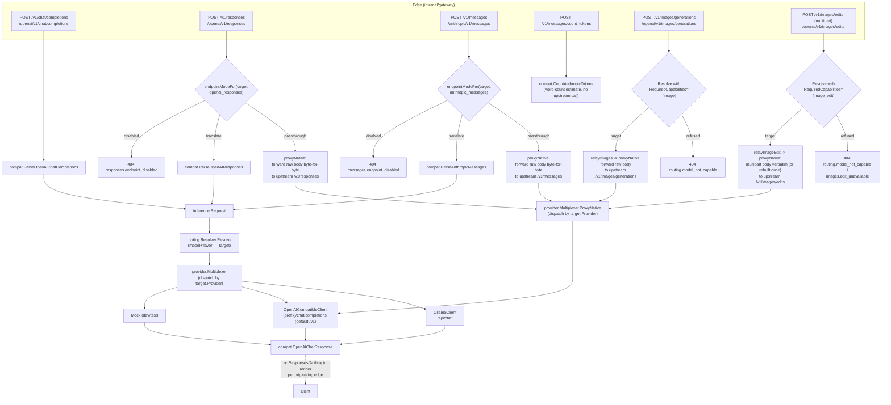
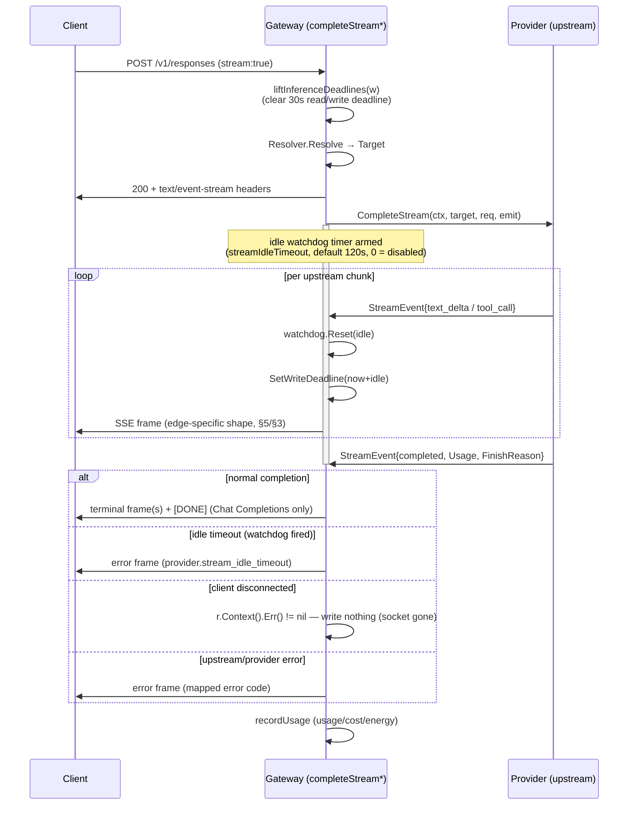

# API Compatibility & Inference

How OnPrem AI Gateway speaks three client protocols (OpenAI, OpenAI Responses,
Anthropic Messages) and two upstream dialects (Ollama, OpenAI-compatible) through
one provider-neutral internal model, and how streaming, tool-calling, multimodal
bodies, and model discovery are kept consistent across all of them.

## 1. The provider-neutral inference model

Every client request — regardless of which wire protocol it arrived on — is
parsed into one Go type before anything else happens: `inference.Request`
(`internal/inference/types.go`). It is the sole boundary between "edge" code
(protocol parsing/rendering) and "provider" code (upstream HTTP dialects); no
provider client ever sees a raw client body, and no edge handler ever builds an
upstream HTTP request directly.

| Field | Purpose |
|---|---|
| `APIFlavor` | fine-grained source protocol: `openai_chat_completions`, `openai_responses`, `anthropic_messages` |
| `Model` | the gateway model name the request is actually routed under — after the token's model-override rules, catch-all, and unknown-model redirect (see [Routing & Model Selection §2.1](routing-and-model-selection.md)) |
| `RequestedModel` | the client's original model name, before any of that; recorded on the usage event |
| `Messages []Message` | role + `[]ContentPart` (text/image/tool_result) + optional `ToolCalls`/`ToolCallID`/`Reasoning` |
| `Tools []Tool`, `ToolChoice any` | tool definitions; `ToolChoice` is forwarded upstream verbatim |
| `Stream`, `IncludeUsage` | streaming flag; OpenAI `stream_options.include_usage` |
| `MaxTokens`, `Temperature`, `Stop`, `ReasoningEffort` | sampling parameters, forwarded when set |
| `ClientSessionID`, `SessionSource`, `AgentID` | best-effort session continuity signal (§4) |
| `ServerOverrideID`, `ServerOverrideForceUnreachable` | pins routing to one AI-server (re-authorized per request; see [Routing & Model Selection](routing-and-model-selection.md)) |

`Message.Content` is `[]ContentPart{Type: text|tool_result|image, ...}` — a
message can carry text, one or more images, and (on a tool-result message) is
keyed by `ToolCallID`. `ToolCall.Arguments` is always the **raw JSON string**
exactly as produced by the model or sent by the client — every edge round-trips
it as a string rather than re-parsing, so no argument payload is ever mangled by
re-serialization.

The response side is the mirror: `provider.Response{Text, Usage, ToolCalls,
Reasoning, FinishReason}` (`internal/provider/mock.go`) for a buffered call, or a
sequence of `inference.StreamEvent{Type: text_delta|tool_call|completed|error,
...}` for a streamed one. `inference.Usage` normalizes token accounting to
OpenAI semantics: `InputTokens` **includes** the cached subset;
`CachedTokens`/`CacheWriteTokens` break out the Anthropic-only cache read/write
counts as a subset — `compat.AnthropicInputTokens` (`internal/compat/anthropic.go`)
is the one place that inverts this back to Anthropic's own (cache-exclusive)
convention.

## 2. Edge → translate/native → provider dispatch



Each of the three POST inference edges (chat completions, Responses, Messages)
funnels into exactly one `inference.Request`, one `Resolver.Resolve` call, and
one `provider.Multiplexer` dispatch — the multiplexing is entirely by
`target.Provider` (`internal/provider/multiplexer.go`), never by the client's
`APIFlavor`. That is what makes every upstream (Ollama, vLLM, llama.cpp,
llama-swap, LiteLLM) reachable from every client protocol: a Claude Code session
can be served by an Ollama-backed mapping, and a Codex session by a vLLM one,
with no special-casing.

`routing.NormalizeAPIFlavor` (`internal/routing/resolver.go`) reduces the four
fine-grained `APIFlavor` strings (`openai_chat_completions`, `openai_responses`,
`anthropic_messages`, `openai_images`) to the three coarse buckets (`openai`,
`anthropic`, `openai_images`) that a `model_mapping`'s application declares
support for (§6) — see
[Routing & Model Selection](routing-and-model-selection.md) for how a mapping is
selected. **The Codex/generic-OpenAI split is by ENDPOINT, not by flavor**:
`/v1/chat/completions` and `/v1/responses` both normalize to `openai`, but they
are two distinct handlers (`handleOpenAIChat` / `handleOpenAIResponses`,
`internal/gateway/inference_handlers.go`) reachable at two distinct paths, and the session
extractor (§4) discriminates them by `sessionEndpoint`
(`internal/gateway/session_extract.go`) for exactly this reason.

## 3. Endpoints

| Client protocol | Endpoint(s) | Handler | Auth | Native passthrough |
|---|---|---|---|---|
| OpenAI Chat Completions | `/v1/chat/completions`, `/openai/v1/chat/completions` | `handleOpenAIChat` | `requireWebAnyScope` (session cookie **or** bearer) | none — always translated |
| OpenAI Responses (Codex) | `/v1/responses`, `/openai/v1/responses` | `handleOpenAIResponses` | `requireAnyScope` (bearer only) | `Target.ResponsesMode` (§6) |
| Anthropic Messages (Claude Code) | `/v1/messages`, `/anthropic/v1/messages` | `handleAnthropicMessages` | `requireAnyScope` (bearer only) | `Target.MessagesMode` (§6) |
| OpenAI Images generations | `/v1/images/generations`, `/openai/v1/images/generations` | `handleOpenAIImages` | `requireInternalOrBearerAnyScope` (bearer or internal loopback — never a session cookie) | **always** — there is no translate path (§3.4) |
| OpenAI Images edits (multipart) | `/v1/images/edits`, `/openai/v1/images/edits` | `handleOpenAIImagesEdit` | `requireInternalOrBearerAnyScope` (as generations) | **always** — a multipart relay, no translate path (§3.5) |
| Anthropic token count | `/v1/messages/count_tokens`, `/anthropic/v1/messages/count_tokens` | `handleAnthropicCountTokens` | `requireAnyScope` (bearer only) | n/a — never calls an upstream |
| OpenAI model discovery | `/v1/models`, `/openai/v1/models` | `handleOpenAIModels` | `requireAnyScope` | n/a |
| Anthropic model discovery | `/anthropic/v1/models` | `handleAnthropicModels` | `requireScope("gateway:use")` | n/a |
| LM Studio-shaped discovery | `/api/v0/models` | `handleLMStudioModels` | `requireScope("gateway:use")` | n/a |

`requireAnyScope` accepts **either** a normal `gateway:use` principal **or** a
service token's sole `llm:invoke` scope (service accounts); `requireWebAnyScope`
additionally accepts the portal session cookie (+ CSRF header on state-changing
methods) — `/v1/chat/completions` is deliberately the one inference endpoint
reachable that way (§9). Every body but the edits one is read with
`readRawJSONUnlimited` (§7); the edits body is `multipart/form-data` and is read
by its own capped reader (§3.5, §10). All six POST endpoints call
`liftInferenceDeadlines` before reading the body (§6).

### 3.1 OpenAI Chat Completions

`compat.ParseOpenAIChatCompletions` (`internal/compat/openai.go`) handles the
standard `messages` array (string or typed-block content, `image_url` blocks)
plus the **tool-call replay shape** a coding agent (e.g. opencode) sends on
turn 2+: an assistant message with `content: null` and a `tool_calls` array,
followed by a `role:"tool"` result message keyed by `tool_call_id`. Content is
required on every message *except* such a tool-call turn or a tool-result
message (`parseChatMessageContent`'s `contentOptional`).

### 3.2 OpenAI Responses — Codex continuity

`compat.ParseOpenAIResponses` accepts both the simple string `input` and the
full Responses `input` array: `message`, `function_call`,
`function_call_output`, and `reasoning` items, tolerantly skipping item types it
does not model (built-in tool items, images inside message content, …) rather
than rejecting the request. Two behaviors are specific to Codex continuity:

- **Reasoning replay.** A replayed `reasoning` item (Codex echoing the model's
  prior chain-of-thought) is buffered and attached to the assistant output it
  precedes (`function_call` or `message`) as `Message.Reasoning`, which the
  OpenAI-compatible provider client threads to the upstream as
  `reasoning_content` — this is how a reasoning model (llama.cpp / harmony)
  keeps continuity across a multi-turn agent loop.
- **Parallel tool calls.** Consecutive `function_call` items are merged into
  one assistant message with a `ToolCalls` array (not one message per call), so
  the upstream chat history is always the strict
  `assistant(tool_calls…) → tool… → user` shape a Chat Completions upstream
  expects.

Rendering the non-stream reply (`compat.OpenAIResponsesResponse`) emits, in
order: a `reasoning` output item (if the model reasoned), then a `message`
item (if there is text, or always when there are no tool calls), then one
`function_call` item per tool call.

### 3.3 Anthropic Messages — Claude Code thinking, stop_reason, cache

`compat.ParseAnthropicMessages` (`internal/compat/anthropic.go`) handles
Claude Code's full multi-turn shape: string-or-array `system`, `text` /
`image` / `tool_use` / `tool_result` / `thinking` content blocks, flat `tools`
(`input_schema`, not `parameters`), and `tool_choice`
(`auto`→`"auto"`, `any`→`"required"`, `none`→`"none"`,
`tool`→`{"type":"function","function":{"name":…}}`). A `tool_result` block
(which Anthropic nests inside a `user` message) is split out into its own
`tool`-role message emitted *before* the parent message, matching the
Chat-Completions-canonical `assistant(tool_calls) → tool(result) → user(text)`
ordering. An image block's `source` becomes a `data:<mime>;base64,…` URI (or is
passed through for a `url` source).

**Thinking.** A replayed `thinking` block's text becomes `Message.Reasoning`
(the same field Codex reasoning replay uses) — the Anthropic analog of the
Responses reasoning path. `thinking.signature` is read but never validated on
this path (the gateway never mints a real signature; only `api.anthropic.com`
does, and it is never reached here).

**stop_reason.** `compat.AnthropicStopReason` maps the upstream OpenAI
`finish_reason`: any tool call present (or `finish_reason:"tool_calls"`) →
`tool_use`; `"length"` → `max_tokens`; everything else → `end_turn`.
Anthropic's `stop_sequence` reason is **never produced** on the translate path
— over a generic Chat Completions upstream a stop-sequence match is
indistinguishable from a natural stop (`finish_reason:"stop"`); recovering it
requires native passthrough.

**Cache usage.** `AnthropicUsage.CacheReadInputTokens` is populated from
`inference.Usage.CachedTokens`; `AnthropicInputTokens(usage)` subtracts that
subset from the OpenAI-canonical `InputTokens` so the two numbers never
double-count.

Rendering (`compat.AnthropicMessageResponse`) emits content blocks in
Anthropic's required order: `thinking` (if any) → `text` (if any, or always
when there are no tool calls) → one `tool_use` block per tool call, each with
`input` reconstructed as a JSON **object** from the internal string arguments.

### 3.4 OpenAI Images generations

`POST /v1/images/generations` (`handleOpenAIImages`,
`internal/gateway/images_handler.go`) relays to a natively OpenAI-shaped image
backend — `sd-server` from `leejet/stable-diffusion.cpp`, registered either as
an external application of type `stable_diffusion_cpp`
([Routing & Model Selection §1](routing-and-model-selection.md#1-data-model))
or launched by the agent under the runtime spec type of the same name
([Agent-Managed Model Runtime
§3.4](agent-runtime-manager.md#a-worked-sd-server-launch-under-stable_diffusion_cpp)).
Four things separate it from every other endpoint in §3.

**1. There is NO translate path, and two gates make that honest.** The
gateway proxies image requests; it does not synthesize them. So unlike
`/v1/responses` and `/v1/messages` — where `translate` is the safe fallback for
a backend that cannot speak the native shape (§6) — an application that does
not serve this shape must simply not be a candidate. The first gate is the
**application's**: the request's coarse flavor is `openai_images`, and only an
application that lists that flavor is a candidate (§6 has the two stages, and
the images relay's own post-resolve check for an agent-launched child). The
second is the **model's**: the request declares
`RequiredCapabilities = ["image"]`, and `Resolver.Resolve` refuses a model that
carries no `yes` verdict for it: 404 `routing.model_not_capable` ([Routing &
Model Selection §2.3](routing-and-model-selection.md#23-the-capability-gate)).
Neither refusal needs a gate of its own here — the handler consumes the shared
`inferencePreflight` like every other endpoint, and adds **no** second
`admitPrincipal` call site (there is exactly one in the package, deliberately).
Consequently
`endpointModeFor` has **no case** for this flavor — there is no `images_mode`
column to read — and `upstreamPath` answers the images path directly, before the
mode lookup and provider fallbacks that only chat, Responses and Messages need.
`upstreamPath(target, apiFlavor, endpoint)` is **endpoint-aware**: the images
flavor answers `/v1/images/generations` for every endpoint but
`endpointImagesEdit`, for which it answers `/v1/images/edits` (§3.5), and every
other flavor ignores the endpoint. The same endpoint reaches `recordUsage`
(`usageMeta.Endpoint`, whose zero value is the generations path), because the
usage row recomputes its `provider_path` from the flavor, not from the relay's
path, and would otherwise record the generations path for an edit.

**2. It validates its own shape and never calls
`inference.Request.Validate()`.** That validator requires `len(Messages) > 0`,
and an images request has no messages at all, so calling it would reject every
one of them. `validateImagesRequest` requires a non-empty `prompt`
(`images.prompt_required`) and a non-empty `model`
(`images.model_required`, resolved by the same tolerant `sniffRoutingModel`
probe the other native endpoints use — `sd-server` itself **ignores** the
`model` field, since one process serves one model, so the value is purely the
gateway's routing input). Every other field is the client's own business and
reaches the upstream unexamined, with two exceptions — and both are type-checked
rather than decoded straight into a Go string/bool, because a struct decode that
discards its type error (which this validator does, deliberately, being as
tolerant as `sniffRoutingModel` about everything it does not own) would leave a
non-string `response_format` such as `["url"]` at its zero value and walk past
the very check below.

**3. `response_format` accepts only `b64_json` or an absent value; anything
else is 400 `images.response_format_unsupported`.** The reason is what happens
*after* the relay, not OpenAI conformance: `sd-server` cannot host a URL for
output it generates in-process, and the billable-quantity counter is built
against the `b64_json` key (§13, and [Telemetry, Usage Analytics &
Observability §8.4.1](telemetry-usage-observability.md#841-the-usage-event)),
so a `url`-format request could only ever relay a shape this path does not
expect while billing every image in it as zero produced. Rejecting up front
turns that into a 400 the client can act on instead of a usage row that quietly
under-bills a response that streamed just fine.

**The compatibility cost is real and is stated here rather than discovered.**
`b64_json` is **not** OpenAI's default: the OpenAI Images API defaults
`response_format` to `url` for `dall-e-2`/`dall-e-3`, and `gpt-image-1` does
not accept the parameter at all. So a strict OpenAI client that explicitly
sends the documented OpenAI default now receives a 400 rather than an image.
That is the accepted trade — relaying a base64 body to a client that asked for
URLs is a silent wire-contract violation, and a 400 is the only answer that is
neither wrong nor silent — but a client-side `response_format` of `b64_json`
(or its omission) is a **precondition** for using this endpoint, not a
preference.

**`stream` is the second exception, refused by the same argument: `stream: true`
is 400 `images.stream_unsupported`.** The gateway has pinned this endpoint to
the buffered path — `Stream` is `false` in the request `proxyNative` builds, with
the deadline consequence spelled out below — so relaying the flag unexamined
sends the upstream a `"stream": true` the gateway then ignores and hands the
client a single `application/json` body where it asked for a stream. That is the
same silent wire-contract violation the `response_format` rule exists to
prevent, so it gets the same non-silent answer and its own code. `stream: false`
and an absent `stream` describe what the endpoint already does and are accepted,
which is what makes this a refusal of the *value* rather than of the field. The
case is reachable rather than theoretical: OpenAI's `gpt-image-1` accepts
`stream`/`partial_images`, so a real client has a reason to send it.

**4. A non-2xx upstream response is normalised, and the classification is the
gateway's own.** `sd-server` answers `{"error": "<plain string>"}`; OpenAI
clients expect `{"error": {message, type, code}}`.
`normalizeImagesUpstreamError` converts the first into the second with
`type: "upstream_error"` and `code: "images.upstream_error"` — **ours, not the
backend's**, because `sd-server` states neither and nothing downstream may read
them as an upstream statement. Three branches, and the fall-through matters: a
body that is *already* OpenAI-shaped passes through untouched (re-normalising
would overwrite an attested type/code with a gateway-authored one), a
plain-string body is converted, and a body matching **neither** shape is
relayed byte-unchanged rather than guessed at. The two fixed values are
deliberately independent of the upstream's HTTP status, since a plain string
carries no more information than itself. This normalisation is gated strictly
to this flavor: a non-2xx `/v1/responses` or `/v1/messages` passthrough body
still reaches the client byte-for-byte as before. The error body is read
bounded by `captureMaxBytes`, not by a wider cap.

**Two consequences of the relay's shape, both load-bearing.**

- **`Stream` is pinned `false` (and a client asking otherwise is refused up
  front, above), so this endpoint always takes `proxyNative`'s
  buffered-deadline branch — a *total* timeout, with no idle watchdog.** That
  total is `target.Timeout`, i.e. the serving application's `timeout_ms`.
  The `stable_diffusion_cpp` and `server_agent` types both default it to
  600000 ms (§7.1); on an application of any other type it is the stock
  30000, a value tuned for chat, and **an operator must raise it** before
  that application serves images: a diffusion request producing several
  images at high step counts can exceed a chat-shaped timeout while working
  perfectly, and because there are no frames,
  `OP_AI_GATEWAY_STREAM_IDLE_TIMEOUT` (§7) does not apply and cannot rescue
  it. The pinning is correct for a single-JSON
  backend — there is nothing to stream, and a buffered response gets no live
  TTFT or tokens/sec row either (§6) — but it means the whole generation is
  governed by one number, and that number is the application's.
- **Resolving an image request writes the token's last-used-model marker,
  and an image request is redirected only onto an image-capable model.**
  `relayImages` goes
  through the shared `resolveImagesTarget` (which `relayImageEdit` shares, §3.5)
  and so through `resolveTarget`, so an image model becomes the marker a
  **later chat request**'s unknown-model redirect tries first under
  `UnknownModelRedirect` ([Routing & Model Selection
  §2.1](routing-and-model-selection.md#21-per-token-model-resolution)). That
  redirect asks the `openai` offering, whose `Callable` holds a name only when
  its application declares `openai` and its effective flavors are not
  images-only
  ([ADR-045](../09-architecture-decisions.md#adr-045--a-model-listing-advertises-what-dispatch-serves-one-flavor-rule-read-from-the-spec)):
  an application declaring only `openai_images` (the `stable_diffusion_cpp`
  default) keeps the image model out, and so does an agent-managed child whose
  spec is images-only, under a parent that declares `openai` for its text
  children. What it can still pick is an image model whose effective flavors
  also carry a text flavor; nothing on the chat path requires a capability, so
  the chat request is sent to that upstream. The images request's own redirect
  asks the `openai_images` offering together with the request's required
  capability, and takes a `LastUsedModel` or fallback only when that name
  carries `image` by the portal listing's own image fold
  (`ModelOffering.Capable`, [Routing & Model Selection
  §2.2](routing-and-model-selection.md#22-callable-existing--and-why-the-listing-is-neither)).
  A candidate without it is skipped, so a client that hardcodes `dall-e-3`
  against a token whose fallback generates images is served by the fallback,
  and one whose candidates are all text models gets 404
  `routing.no_model_route` for its own name — never a `model_not_capable`
  about a model it did not send. A requested name is redirected by the narrow
  default when every one of its mappings fails the `openai_images` flavor half
  — the text children of a mixed application, whose specs lack the flavor
  while the application declares it, or a group of only such names — because
  it is then not in `Existing(openai_images)`, like a name whose application
  lacks the flavor; without the redirect it answers 404
  `routing.no_model_route`, or `routing.model_not_capable` when it has no
  verdict.

**Session and affinity.** The endpoint has its own `sessionEndpoint` case and
that case is deliberately empty: an OpenAI images request carries no
`prompt_cache_key`, no `user` and no `metadata`, so there is no session signal
to extract. Image requests also take **no** affinity pin at all, by an explicit
write guard on every capability-carrying request. Their affinity key could not
collide with a chat client's anyway — the key hashes the coarse flavor, and
`openai_images` is its own — so for images the guard only keeps image traffic
pin-free; it exists for a future capability-carrying endpoint that shares a
coarse flavor with a text one ([Routing & Model Selection
§4](routing-and-model-selection.md#4-route-affinity)).

**Payload capture is clipped in practice on this endpoint.** A base64 image
inflates its raw bytes by roughly a third, so a single modest PNG already
occupies hundreds of KB and an `n > 1` response is a multiple of that —
routinely past `OP_AI_GATEWAY_CAPTURE_MAX_BYTES` (default 1 MiB), which stores
the body truncated with its `truncated` flag set ([Security, Authentication &
Authorization §14](security-auth-rbac.md#14-capture-redaction-of-sensitive-headers)).
The cap was **not** widened for this endpoint. The billable image count is
unaffected, because it is scanned off the full byte stream rather than read
back off the capped capture buffer — that independence is the whole reason the
counter exists, and it is documented with the usage event
([§8.4.1](telemetry-usage-observability.md#841-the-usage-event)).

**Per-model option discovery: what the portal composer may offer for an image
model.** The relay above forwards every native knob opaquely, so nothing on the
inference path knows which sampler names, output formats or sizes a given
`sd-server` accepts. The portal composer (§12) learns that from one read-only
endpoint, `GET /api/portal/model-image-options?name=<model>`
(`handlePortalModelImageOptions`, `internal/gateway/portal_model_endpoints.go`;
[API Surface](../reference/api-surface.md#models-servers-applications-mappings)),
which answers what the `sd-server`(s) behind a gateway model state, so the
composer can narrow its advanced dropdowns from the static sd-cpp superset to the
picked model's own options and show the server's defaults. It is a portal
endpoint beside `model-servers`, not part of the inference surface, and it
changes nothing about how a run is sent
([ADR-055](../09-architecture-decisions.md#adr-055--per-model-sd-server-image-options-are-read-live-on-pick-from-two-volatile-caches-and-never-stored)).

- **The source is the document the `image` verdict already reads.**
  `sd-server`'s `GET /sdcpp/v1/capabilities` states `samplers`, `schedulers`,
  `output_formats_by_mode.img_gen`, `limits.{min_width, max_width, min_height,
  max_height, max_batch_count}` and `defaults_by_mode.img_gen`, whose sampling
  defaults are nested under `sample_params` (`sample_method` is the sampler,
  `sample_steps` the step count, `scheduler`, `guidance.txt_cfg` the CFG scale)
  while `clip_skip`, `seed`, `negative_prompt`, `width`, `height` and
  `output_format` sit directly in it (names verified against
  stable-diffusion.cpp's `make_capabilities_json`).
- **Two in-memory caches, one per deployment shape, and nothing durable.**
  An **external** `stable_diffusion_cpp` application is read by the gateway's
  health loop: `probeSdcppCapabilities` (`cmd/gateway/app_health.go`) reads the
  document a second time per tick (skipped when the verdict probe already found
  the server unreachable), through `provider.ProbeSdcppImageOptions` (the
  verdict probe's own transport, credential and 1 MiB bound), and writes the
  decoded options to `AppImageOptionsRegistry` keyed by application id. A failed
  read keeps the last good entry; deleting the application evicts it.
  An **agent-launched** `server_agent` child sits behind the agent's router,
  which the health loop cannot reach, so the agent reads the same document
  itself and carries the decoded options on its telemetry sample as
  `runtimes[].image_options`, cached per (pid, type, model) generation like the
  verdict beside it and behind the same `capability_source_sdcpp` gate; the
  gateway mirrors it into `RuntimeStatusDTO.ImageOptions` in the volatile
  runtime-status registry (keyed by server and spec id, tagged `json:"-"` — it
  is an in-process hand-off and never rides the runtime-status SSE frame). This
  is the established "health loop writes, portal reads" split
  (`AppHealthRegistry`): the portal GET **never probes upstream**, so an
  unreachable server cannot slow or fail it.
- **The options decode is lenient and SEPARATE from the verdict decode.**
  `parseSdcppImageOptions` (`internal/provider/sdcpp_image_options.go`, with a
  verbatim twin in `server-agent/internal/collector/`, pinned by one case table
  duplicated in both modules' tests) reads what it can and leaves everything it
  cannot at zero, which uniformly means *unknown*; only a body that is not JSON
  at all is an error. The strict, fail-closed `parseSdcppCapabilities` that
  answers the routing `image` verdict is untouched, so a malformed options
  document yields partial or empty options and can **never** suppress or alter
  the verdict the images gate depends on.
- **Visibility is decided in the portal layer, before any cache is read.**
  `portal.Service.ModelImageOptionViews` applies the same suppression
  (`model_settings` visibility `hidden`/`locked` for a non-admin, fail-closed on
  a read error) and resource-group filtering as `model-servers`, then keeps only
  the sd-server mappings: an external `stable_diffusion_cpp` application, or a
  `server_agent` mapping whose spec's effective type is `stable_diffusion_cpp`.
  A model the token cannot route to has no views, touches no cache and answers
  `{"data":{}}`, exactly like an unknown model — it neither leaks nor 404s.
- **Aggregation answers "what every backing server can do"**
  (`aggregateImageOptions`, `internal/gateway/model_image_options_aggregate.go`),
  because a request may land on any server behind the model, including one
  external and one agent-launched sd-server in a single set. `samplers`,
  `schedulers` and `output_formats` are the **intersection** of the lists the
  servers state, in the first stated list's order. Size limits are the
  **tightest envelope** per axis (largest stated minimum, smallest stated
  maximum), and `max_batch_count` the smallest positive value; a non-positive
  limit is unknown and never becomes a bound, and an axis whose resulting
  minimum exceeds its maximum is dropped whole, so any emitted bound pair
  satisfies `min <= max` with no negatives. A default is emitted only when
  every server that states it agrees; `clip_skip` and `seed` carry the
  servers' own `-1` ("model default" / "random") faithfully.
- **Fail-open: an absent or empty field is UNKNOWN, never "none supported".**
  Every field of the response is `omitempty`, and a server that has not been
  read, whose probe failed, or whose document states nothing for a field
  contributes nothing to it. Where the aggregate ends up without a value for a
  field, the **client falls back to the static sd-cpp superset** for that field
  (§12). That includes the case a reader would otherwise take for a statement:
  two backing servers whose sampler sets are **disjoint** intersect to the empty
  set, which is omitted and read as unknown, not as "this model supports no
  sampler". The consequence is deliberate: an option the composer offers may be
  one a given build ignores (the gateway forwards every pick opaquely, as
  above), whereas a fail-closed reading would leave an unread model with an
  empty dropdown and no way to set a knob that works.
- **Freshness and the restart warm-up gap are accepted, not hidden.** The caches
  are volatile, so a gateway restart starts them cold. An agent-launched child's
  options reappear on the next telemetry sample (about a second); an external
  application's reappear on its next health tick, which can be up to the
  application's longest probe interval away. Until then the composer shows the
  static superset, which is the fail-open answer above. The endpoint is
  best-effort throughout: it answers `200` whatever the caches hold, and the
  only failure it reports is its own visibility read (`500`
  `model.image_options_failed`).

### 3.5 OpenAI Images edits

`POST /v1/images/edits` (`handleOpenAIImagesEdit`,
`internal/gateway/images_edit_handler.go`) edits an image on the same upstream,
under the same auth, flavor gate and metering as §3.4, and is the gateway's
**first multipart request path**
([ADR-057](../09-architecture-decisions.md#adr-057--image-edit-a-derived-image_edit-capability-a-multipart-passthrough-and-the-attached-image-as-the-edit-affordance)
records why each piece is shaped as it is). Both the public bearer endpoint and
the portal chat (server-side, over the loopback pair, §12) use this one handler.
What differs from §3.4:

**1. The body is `multipart/form-data`, and only a few fields are the gateway's
business.** `model` and `prompt` are required (400 `images.model_required` /
`images.prompt_required`) and at least one **non-empty** part must arrive under
`image` **or** `image[]`, the two spellings OpenAI's clients use (400
`images.image_required`). `response_format` must be `b64_json` or absent (400
`images.response_format_unsupported`) and `stream` may only be false or absent
(400 `images.stream_unsupported`), for the reasons §3.4 gives. `mask` is the one
part with a meaning of its own (below). Everything else — `n`, `size`,
`output_format`, `output_compression`, any other field — reaches the upstream
unexamined. The edit route of `sd-server` produces **png and jpeg** only (a
generation also produces webp); `size`, when absent, is derived from the source
image. **`strength` is not a form field**: `sd-server`'s edit route reads no such
field, and takes the value from the `<sd_cpp_extra_args>{"strength":…}</sd_cpp_extra_args>`
block at the end of `prompt` (the same block §12 describes for the native knobs),
otherwise using its own default of 0.75 — a weak edit for models that edit with
reference images, which want a higher value.

**2. The form is read once, bounded, before anything is admitted.**
`readImageEditBody` reads the whole body into memory, capped by
`OP_AI_GATEWAY_MAX_IMAGE_EDIT_BODY_BYTES` (default 32 MiB, §10; `413
request.body_too_large`, from a declared `Content-Length` without reading a byte
or from `http.MaxBytesReader` when none was declared). `parseImageEditForm` then
walks it **once** with `mime/multipart` and the request's own boundary — never
`ParseMultipartForm`, which spills to temp files and consumes the body this
handler still has to relay — reading `model`, `prompt`, `response_format` and
`stream` (each a single value of at most 1 MiB; a **repeated** one is 400
`request.invalid`, because two `model` fields would be two answers to "which
model" and the agent's router reads it again), counting the image parts, and
reading **every** part to its end (`mime/multipart` swallows the read error of a
part it merely steps over, so a truncated tail would otherwise fail later, after
admission). A body that is not multipart, has no boundary or is malformed is 400
`request.invalid`. All of this, and the mask conversion below, runs **before**
`inferencePreflight`, so a refused request spends no admission.

**3. The model gate is a derived capability, and the target is checked twice
more.** The handler sets `RequiredCapabilities = ["image_edit"]` from its own
identity, never from the body. `image_edit` is **derived** — a mapping with an
`image: yes` verdict is edit-capable unless an operator set `image_edit: no` — and
the one function that says so is read by the gate, by the unknown-model redirect
and by the portal listing alike ([Routing & Model Selection
§2.3](routing-and-model-selection.md#23-the-capability-gate)), so an unknown
edit model is redirected to an edit-capable fallback like an unknown image model
is, and an opted-out one answers 404 `routing.model_not_capable` while the same
model still generates. The candidate must also declare the `openai_images`
flavor, and `resolveImagesTarget` — the resolve and the post-resolve served-flavor
conjunct (§6), **extracted** from `relayImages` so the two relays share one copy —
refuses an agent-launched child whose spec lists only text with 404
`routing.no_model_route`. Then, for a `server_agent` target only, the relay
checks that its agent has **declared `multipart_proxy`**
(`AgentFeatures.Has(serverID, "multipart_proxy")`,
[Agent-Managed Model Runtime
§7](agent-runtime-manager.md#7-feature-negotiation)): an agent that predates it
would answer the multipart body `404 runtime.model_not_managed`, the same answer
it gives an unmanaged model, so trying the route could not tell the two apart. A
target that fails the check is refused **before anything is relayed** with
**404 `images.edit_unavailable`**, recorded as one error row with
`billing_unit: image` and no upstream. The check is fail-closed by construction
— the registry is in memory, so it is also false for an agent that **has not
reported since the gateway restarted**, and for one that was just upgraded until
its first telemetry sample under the new version — and its message names both
causes (an agent older than 0.9.0, or one that has not reported yet), so the
operator is not told to update an agent that is already current. 404, not 409 or a 5xx, because the OpenAI SDKs
retry 408/409/429 and every 5xx and a refusal only a different agent build can
change must not be retried. It gates the **edit** only (generations are JSON,
which every router serves), does not apply to an external target (no agent in
front of it), and, like the conjunct, is **not retried against another
application** that could have served the model.

**4. The relay carries the form's own Content-Type, and rebuilds the body only
when something in it must change.** `provider.NativeProxyClient.ProxyNative`
takes the request's `Content-Type` as a parameter (§8) and `nativeRelay` gains an
optional `upstreamBody`, so the relay can send the **client's bytes verbatim**
(boundary included) or a body built for the upstream. It is **rebuilt once**
(`rebuildImageEditBody`: every part copied with its headers, bytes and position,
a fresh boundary) when either holds: the **`model` field must carry the mapping's
own model name** (`Target.ProviderModel`) and the form's differs — for **every**
target, since the JSON generations relay rewrites it for every provider too, an
agent's router keys the child on that name, and a model-routing upstream would
otherwise route on the gateway's name; the comparison is against the *form's*
value, because a token override or a redirect can land on a mapping whose two
names are equal — or the form carries a **mask**, which is always a rebuild. A
no-mask edit whose model needs no rewrite is relayed verbatim. `nativeRelay.raw`
stays the client's bytes either way, which is what capture records. The usage row
records `/v1/images/edits` as its `provider_path`. A body bound for
an agent-launched target is checked against **the agent's own 32 MiB** *after*
the rebuild (§10); one over it is refused `413 request.body_too_large` and
recorded rather than sent.

**5. The mask: alpha in, luminance out.** An OpenAI edit marks the region to
regenerate by **transparency** (an RGBA PNG whose transparent pixels are the
edit); `sd-server` reads the `mask` field as **luminance** — white regenerates,
black keeps — and drops the alpha channel, so a mask forwarded as sent would edit
the opposite region. The gateway converts it (`convertImageEditMask`,
`internal/gateway/images_edit_mask.go`):

| Mask pixel | Sent to `sd-server` | Meaning |
|---|---|---|
| fully transparent | white (255) | regenerate |
| fully opaque, whatever its colour | black (0) | keep |
| partly transparent | grey, `255 − alpha` | a soft edge stays soft |

The result is an 8-bit grayscale PNG file part named `mask.png` (the field needs a
filename to be read as a file, and a client's own name may not be ASCII).
Everything is checked from the image headers **before** a pixel is decoded, and
each refusal is a 400 of its own: **`images.mask_invalid`** — the mask's size is
not the **first** source image's (the first `image[]` part when there is one,
else the first `image`, as `sd-server` picks; further `image[]` parts are
references and may be any size), the mask is past **16 megapixels** (4096 × 4096,
`sd-server`'s own edge limit; a PNG is a few bytes of header for any pixel count,
so the body cap does not bound a decode's memory), or it has **no transparent
pixel** (it selects nothing to edit — an opaque mask, or an sd-style luminance
mask sent to this endpoint, would otherwise be a silent "edit nothing" that still
costs a full diffusion run); and **`images.edit_unsupported_format`** — a mask that
is not a readable PNG (a JPEG has no alpha) or has cut-off pixel data, or, **when a
mask is sent**, a source that is not a readable PNG or JPEG (all `sd-server`'s edit
route reads, and all the size check can read; with no mask nothing is decoded and
the source's type is the upstream's business). Two `mask` parts are 400
`request.invalid`, and an empty mask part is no mask.

**6. The response, the usage row and the capture are the generations
endpoint's, with three differences.** The upstream answers the same
`{created, output_format, data:[{b64_json}]}` document, so the non-2xx
normalisation (`images.upstream_error`), the `b64_json` counter and the buffered,
`target.Timeout`-bounded relay of §3.4 apply unchanged, and the request takes **no
affinity pin** and has **no session signal** (its own empty `sessionEndpoint`
case). The differences: billing counts **output** images only — the source and
the mask are **unmetered**, so a two-input edit bills like a zero-input generation
([Telemetry §8.4.1](telemetry-usage-observability.md#841-the-usage-event));
the usage row's path is the edits path; and a multipart **request** is not stored
as bytes by capture — the envelope holds a JSON summary of the form with the
text fields and each file part `redacted`
([Security §14](security-auth-rbac.md#14-capture-redaction-of-sensitive-headers)).

## 4. Session / continuity signals

`extractClientSession` (`internal/gateway/session_extract.go`) derives a
best-effort session id per request, gated by `sessionEndpoint` — **the
endpoint, not the `APIFlavor`**, since Codex (`/v1/responses`) and generic
OpenAI (`/v1/chat/completions`) share the flavor `openai`:

| Priority | Signal | Endpoint(s) |
|---|---|---|
| 1 | `X-OP-AI-Gateway-Session-ID` header (explicit override; portal chat loopback sets it to the chat id) | all |
| 2 | `session_id` header | `/v1/responses` (Codex) |
| 2 | `x-claude-code-session-id` header | `/v1/messages` (Claude Code) |
| 3 | `prompt_cache_key` body field | `/v1/responses` |
| 3 | `prompt_cache_key`, then `user`, body field | `/v1/chat/completions` |
| 3 | `metadata.user_id` body field | `/v1/messages` |
| — | `x-claude-code-agent-id` header → `AgentID` | `/v1/messages` only |

The result populates `ClientSessionID`/`SessionSource` (`header`, `chat`,
`codex`, `claude-code`, `openai`, or `anthropic`) on `inference.Request`,
which drives `client_session`-mode route affinity (see [Routing & Model
Selection §4](routing-and-model-selection.md)) and is shown in Activity/live
requests. `AgentID` is the Claude Code **subagent** id, carried separately
because one Claude Code session can fan out into several subagents sharing the
same `ClientSessionID`.

## 5. Tool-calling across edges

| Edge | Non-stream | Stream | Native passthrough |
|---|---|---|---|
| Chat Completions | `tool_calls` array on the assistant message | incremental `tool_calls` deltas (opening id/name delta, then a full-arguments delta) per OpenAI SDK accumulation shape | n/a (never native) |
| Responses (Codex) | `function_call` output item(s) | `response.output_item.added` → `response.function_call_arguments.delta`/`.done` → `response.output_item.done` per call | raw upstream `/v1/responses` body forwarded byte-for-byte |
| Anthropic Messages (Claude Code) | `tool_use` content block(s), `input` as a JSON object | `content_block_start` (type `tool_use`) → one `input_json_delta` (whole-argument fragment) → `content_block_stop` | raw upstream `/v1/messages` body forwarded byte-for-byte |

**Replay** (turn 2+ of a multi-turn tool loop) is handled per-edge: Chat
Completions replays the OpenAI shape (§3.1); Responses replays
`function_call`/`function_call_output` items, merging consecutive calls into
one assistant message (§3.2); Anthropic replays `tool_use`/`tool_result`
blocks split into separate messages (§3.3). Argument JSON is never re-parsed
or re-serialized on the way through — `ToolCall.Arguments` stays the original
string end to end, so a client's exact formatting (key order, whitespace)
survives a round trip.

**opencode.** As an OpenAI-compatible coding agent, opencode drives the plain
Chat Completions edge and is the primary tested case for the null-content
tool-call-replay shape (§3.1) and for context-window reporting: it auto-detects
a model's context window via the LM-Studio-shaped `GET /api/v0/models`
(`handleLMStudioModels`, `internal/gateway/server.go`), which reports, for
each model offered under `openai` (the names `/v1/models` lists, §9), its
`max_context_length` (and, when currently loaded, `loaded_context_length`)
alongside an LM-Studio `state` (`loaded`/`not-loaded`) — metadata only; chat
still flows over `/v1/chat/completions`.

## 6. Endpoint modes and native passthrough

For Codex and Claude Code, translation is inherently lossy (it can represent
only text + simple tool calls). Each of these two coding-agent endpoints is
governed by a three-state `routing.EndpointMode`
(`internal/routing/endpoint_mode.go`), replacing the two booleans
`Application.NativeResponses`/`NativeMessages` this design superseded
(`true`→`passthrough`, `false`→`translate`, per the migration backfill in
[Data Model §4](../reference/data-model.md)):

| Mode | Meaning |
|---|---|
| `disabled` | the endpoint is not served — a client gets a stable 404 (below) |
| `translate` | the client body is translated to `/v1/chat/completions`, exactly the lossy compat path described in §1–§5 |
| `passthrough` | the gateway proxies the **raw client body** to the upstream's own native endpoint and streams the raw response back unmodified |

An absent or blank mode defaults to `passthrough`
(`routing.EndpointModePassthrough`) — substituted at write time by the portal
service, on an application's create and on every runtime-spec write
(`writeRuntimeSpec`) — for every application type, because every supported
upstream now serves both native endpoints (see [Agent-Managed Model
Runtime](agent-runtime-manager.md) for the researched matrix and rationale).

**Where the effective mode lives.** An ordinary application carries
`ResponsesMode`/`MessagesMode` directly on `routing.Application`
(`internal/routing/store.go`). A `server_agent` application's **resolved
runtime spec** is instead the sole authority for its model:
`RuntimeSpec.APIFlavors`/`ResponsesMode`/`MessagesMode` are a per-spec
snapshot — independent of the parent application once created — documented in
[Agent-Managed Model Runtime §11.5](agent-runtime-manager.md#115-what-each-remaining-tab-shows).
`Resolver.targetFrom` (`internal/routing/resolver.go`) surfaces whichever is
authoritative onto the routing `Target` (the spec's values when the mapping
has one, the application's otherwise), so every downstream reader —
candidacy and dispatch alike — consumes one uniform
`Target.{APIFlavors,ResponsesMode,MessagesMode}`.

**The effective-served rule** is the single source of truth for both
eligibility and the pass-through decision:

```
responsesServed = ("openai"    ∈ APIFlavors) && ResponsesMode != disabled
messagesServed  = ("anthropic" ∈ APIFlavors) && MessagesMode  != disabled
```

**Images have the flavor half of that rule and no mode half.**
`openai_images` is a **coarse** flavor of its own, not a refinement of `openai`
(`routing.APIFlavorOpenAIImages`): `NormalizeAPIFlavor` tests the images prefix
before the generic `openai` one, because every fine images flavor also starts
with `openai`, and `applicationServesEndpoint`'s ordinary default branch then
admits only an application that lists it. So an application listing
`openai_images` and not `openai` serves images and not text, and the reverse,
with no filter case of its own. The flavor is **opt-in everywhere**: an empty
`api_flavors` on save still becomes exactly `[openai, anthropic]`, on the
application and on a runtime spec alike, and so does an absent one, except on
an application update, which keeps the stored list. Were the empty default to gain
`openai_images`, every existing text-only application would become a candidate
for image requests it cannot serve. Every image upstream is therefore given
the flavor explicitly, by the `stable_diffusion_cpp` application type's
default or by the flavor checkbox. No upgrade step gives it to a route that served images
through `openai` before the split: that model answers 404
`routing.no_model_route` until the flavor is ticked on its application and,
for an agent-managed child, on its runtime spec
([ADR-044](../09-architecture-decisions.md#adr-044--stable-diffusioncpp-is-a-first-class-type-and-openai_images-is-a-coarse-opt-in-flavor)).
What images lack is a mode: there is no `EndpointMode` column and no
`imagesServed` rule, so `endpointModeFor` has no case for that flavor and
never sees one (§3.4). That is not "falls through and is treated as
translate" — there is no translate path for images at all — and
a model within an admitted application is admitted by its **capability
verdict**, not by a mode (§3.4).

So an endpoint can be off two independent ways: the coarse `openai`/`anthropic`
flavor is unchecked, or the flavor stays checked and the mode is set to
`disabled` — the latter is what lets an application serve plain
`/v1/chat/completions` while refusing Codex's `/v1/responses` specifically.
Unchecking a flavor does not force its stored mode to `disabled`; the
effective rule already treats it as off, so re-checking the flavor restores
whatever mode was last set. Unchecking **every** flavor is refused by both
forms, the application form and the launch-spec form, with a message at the
flavor group and focus moved to it, so the refusal is announced rather than
silent: an empty list is stored as `[openai, anthropic]`, so the form would
save a text candidate while showing nothing ticked (`ApplicationSection`'s and
`RuntimeAdminSection`'s submits; the launch-spec form refuses before it writes
the mapping).

**Two-tier enforcement**, because a `server_agent` application's authority
only resolves per-model, after a candidate has already been picked:

1. **Candidate eligibility** — `applicationServesEndpoint`
   (`internal/routing/store.go`), consulted wherever the resolver builds its
   candidate list. For an `openai_responses` request, an **ordinary**
   application is a candidate only when `responsesServed` is true; a
   `server_agent` application is gated on the coarse `openai` flavor alone
   here, because its authoritative per-model mode isn't knowable until a
   model has actually been picked — candidacy must not exclude it on the
   (possibly stale) application-level fallback. `anthropic_messages` is the
   `anthropic`/`MessagesMode` analogue. A plain `openai_chat_completions`
   request is unaffected by either mode — only the coarse flavor gates it —
   so a disabled Codex endpoint never removes an application's
   chat-completions eligibility.
2. **Dispatch-time rejection** — `endpointModeFor`/`tryProxyNative`
   (`internal/gateway/native_passthrough.go`), described below. Once a
   `server_agent` mapping's runtime spec has been resolved, a per-model
   `disabled` mode is enforced right there, with a stable error code — the
   only point in the request lifecycle where it is knowable. The spec's
   **flavor** half is enforced at the same point by `targetServesFlavor`: a
   coding-agent endpoint whose coarse flavor the resolved spec no longer lists
   is treated as `disabled`. That check runs after the mode is read but before
   the mode decides the dispatch, so it holds a `translate`-mode endpoint to
   the full rule as well: a request it
   finds lacking the flavor is refused with `*.endpoint_disabled` and never
   reaches the translate path. That holds only for the target it judged; what
   reaches the translate path unjudged is set out below.

**The images relays apply the same flavor conjunct.** `relayImages` and
`relayImageEdit` (`internal/gateway/images_handler.go`,
`images_edit_handler.go`) call `proxyNative` directly rather than through
`tryProxyNative`, so they run `targetServesFlavor` themselves after resolution —
in `resolveImagesTarget`, the one shared step that does both, so the two relays
cannot drift apart on it: an agent-launched child whose spec excludes `openai_images` is
refused with 404 `routing.no_model_route`, the answer candidacy would have
given had it been the model's only route. The usage row records no upstream,
since none was called. **The refusal is not retried against another
application** that could have served the model, which is the same limitation
`tryProxyNative`'s check has for the coding-agent endpoints: a model reachable
through several applications is refused when the resolve picked a candidate
whose spec narrows the flavor, even though a sibling would have served it. An
external application needs no such check, because its flavors are its
candidacy.

**The text translate path applies only an images-only check.** Every
`/v1/chat/completions` request is dispatched by `complete`/`beginStream`
(`internal/gateway/inference_complete.go`, `stream_session.go`) without ever
going through `tryProxyNative`, and so is every `/v1/responses` or
`/v1/messages` request `tryProxyNative` did not handle. It has already held
most of those to the full rule; the ones it has not — a body whose `model` the
routing probe could not read, a request its own resolve failed on, and one
whose translate-path re-resolve lands on a different candidate — reach this
path with the resolved spec unjudged, neither its flavors nor its per-model
mode read. Both functions resolve through `resolveTranslateTarget`, which
refuses exactly one kind of target: an **images-only** one, whose effective
flavors list `openai_images` and neither `openai` nor `anthropic`
(`targetIsImagesOnly`; an empty list is not images-only). The refusal is
candidacy's own answer for a model with no route — 404
`routing.no_model_route`, a usage row with no upstream, and, for a stream, no
byte of the stream — and, like the relay's, it is **not retried** against
another application. It never fires for an external application, whose
images-only flavors already kept it out of text candidacy. **The general
effective-served rule is not enforced on this path**: a spec that keeps a text
flavor is not checked against its list, so a spec narrowed to `["anthropic"]`,
or stored as `[]`, serves `/v1/chat/completions`, and serves those unjudged
Responses and Messages requests too. That is how every spec served before
`openai_images` existed, when this path read no spec flavors at all, and the
listings' `openai` rule mirrors this path rather than the general rule, so the
portal chat and `/v1/models` still offer such models
([ADR-045](../09-architecture-decisions.md#adr-045--a-model-listing-advertises-what-dispatch-serves-one-flavor-rule-read-from-the-spec));
enforcing the general rule here would silently stop working setups. Nor
is the rule's mode half enforced here, since this path has never read the
endpoint's mode: a spec whose Responses or Messages mode is `disabled` serves
those unjudged requests as well. Both are recorded debt
([Risks §11.4](../11-risks-and-technical-debt.md#114-deliberate-design-acceptances)).

`tryProxyNative` (`internal/gateway/native_passthrough.go`) makes the
dispatch-time decision:

1. Peek `model`/`stream` from the raw body (tolerant of a malformed body — falls
   through to the translate path, which produces the proper parse error).
2. Consume the **shared preflight** (`inferencePreflight`) the caller already
   ran: the token's model-override chain and unknown-model redirect
   ([Routing & Model Selection §2.1](routing-and-model-selection.md)), the
   server-override re-authorization, the service-account allowlist gate, and
   the principal admission gate. It is computed exactly once per client
   request — this path used to run its own copy of the same steps in a
   different order — so a rejected request never resolves twice and admission
   budget is never consumed twice.
3. `Resolver.Resolve` the model. An admission-queue rejection here is
   **terminal** (surfaced immediately, never falls through — otherwise the
   translate path would re-queue and wait a second time).
4. Read `endpointModeFor(target, apiFlavor)` — the resolved `Target`'s
   effective mode for this flavor — and switch three ways:
   - `passthrough` → `proxyNative` forwards the body (with only its `model`
     field rewritten to the upstream's mapped name — `rewriteModelField`,
     value-lossless but not byte-identical JSON) and `tryProxyNative` returns
     `true` (handled).
   - `disabled` → reject immediately: a stable error code + HTTP 404
     (`responses.endpoint_disabled` / `messages.endpoint_disabled`, written
     inline like `model.not_allowed` — see §13) and return `true`. This never
     falls through to translate — falling through would silently downgrade an
     operator's explicit "not served" into a lossy best-effort answer.
   - anything else (`translate`, or an unpopulated `""` — treated as the safe
     translate fallback) → return `false`, and the caller's translate handler
     parses and resolves again (an accepted, idempotent double-resolve — the
     one place in the gateway that happens).

The client's own bearer token is **never** forwarded upstream; only
`Content-Type` and — via `provider.WithUpstreamAuth` — the resolved
application's own per-app upstream credential (if configured) are set on the
outbound request. Usage accounting on this path is best-effort: a
`usageScanner` (`internal/gateway/passthrough_usage_scan.go`) merges token
counts out of the response's bytes as they are copied to the client, per-flavor
(`response.usage`/`input_tokens_details.cached_tokens` for Responses;
`message.usage`/`cache_read_input_tokens`/`cache_creation_input_tokens` for
Anthropic, folded back into the OpenAI-canonical `InputTokens`). That is its own
incremental scan rather than a single pass over the capture tee's capped buffer,
which used to drop even the terminal count on a response longer than
`captureMaxBytes`. The scan splits a line-delimited SSE stream into frames (so
counts max-merge across `message_start`/`message_delta` and the live column is
fed per frame) but treats a **buffered** body as one JSON value — held whole and
scanned once at end-of-copy — because its interior newlines are formatting, not
frame boundaries. The two shapes are told apart by the body's first
non-whitespace byte (`{`/`[` for a buffered value; an SSE frame opens with a
field name or `:` comment, never a brace). A buffered body's usage is therefore
recovered regardless of whitespace formatting — compact, or pretty-printed with
interior newlines, with or without a trailing newline; splitting such a body at
an interior newline previously handed the parser a truncated fragment and lost
**all** of its usage, zeroing both the persisted row and the token budget the
request consumed while the request itself still succeeded.

**The panel's live figures are no longer part of the trade-off — except where
the wire cannot honestly supply them.** Choosing `passthrough` used to cost the
running-connections panel's live TTFT and tokens/sec entirely: the per-request
counter was allocated only on the translate path, so every in-flight
`/v1/responses` and `/v1/messages` row read "not measured". A **streaming**
passthrough request now carries that counter, fed from the frames the usage
scanner is already parsing, so what `passthrough` costs is only what its own
wire cannot supply — and on the Responses shape what the wire supplies now
depends on one operator opt-in. Without `timings_per_token` on the outgoing body
there is **no** mid-stream token count and **no** mid-stream rate: the `*.delta`
partials carry no usage object, and the terminal `response.completed` frame is
what finally lands one. With it, those same partials carry llama.cpp's own
`timings`, and the row gets both an upstream-reported rate and an
upstream-reported count while the request is still running — the count on a
column that ships **hidden**, which an operator who has never changed that
panel's columns reveals from its column menu. The flag reaches the body either
because the **client** set it, in which case it is relayed untouched, or because
the application's (or runtime spec's) `responses_live_timings_enabled` opt-in is
on and the request is a streaming `/v1/responses` passthrough to a `llama_cpp`
upstream. A **buffered** response still gets nothing at all, having no frames to
time. The per-flavor detail, the five conditions that gate the injection plus the sixth ANDed at its call site, and
the two rules that keep it honest — a relayed body is augmented only where the
operator asked and never over a value the client set itself, and no in-flight
figure ever becomes a routing input — are in [Telemetry, Usage Analytics &
Observability
§8.4.3](telemetry-usage-observability.md#843-running-connections-active-requests).

## 7. Streaming lifecycle



`completeStream` / `completeStreamResponses` / `completeStreamAnthropic`
(`internal/gateway/inference_complete.go`) share this machinery — the common
per-stream session (`beginStream`/`streamSession`) lives in
`internal/gateway/stream_session.go`; only the SSE frame shapes
differ:

| Edge | Frame shape | Terminal |
|---|---|---|
| Chat Completions | `data: {"object":"chat.completion.chunk",...}` | `data: [DONE]` |
| Responses | named events (`response.created`, `.output_item.added`, `.output_text.delta`, `.reasoning_text.delta`, `.function_call_arguments.delta/.done`, `.output_item.done`, `.completed`/`.failed`), each with an incrementing `sequence_number` | connection close after `response.completed`/`.failed` — **no** `[DONE]` |
| Anthropic Messages | named events (`message_start`, `content_block_start/_delta/_stop`, `message_delta`, `message_stop`) | connection close after `message_stop` — **no** `[DONE]` |

**Idle watchdog vs. total deadline.** `OP_AI_GATEWAY_STREAM_IDLE_TIMEOUT`
(default `120s`; an explicit `0`/negative value disables it — unbounded, ended
only by client disconnect) bounds *inactivity*, not total stream duration: the
watchdog timer is reset on every event the provider emits, so an arbitrarily
long but continuously-producing stream never times out. `http.ResponseController`
(`SetReadDeadline`/`SetWriteDeadline`) is used for two distinct purposes:
`liftInferenceDeadlines` clears the connection's default 30s read/write
deadline entirely for all five inference endpoints at request start (an
uncapped multimodal upload can take longer than 30s to arrive), and the streaming
handlers then re-arm just the write deadline to `now + idle` before every SSE
write — so a stalled real socket (as opposed to an idle *upstream*) is still
caught, without needing a second timer. **No provider `CompleteStream`
implementation applies a total deadline of its own** (`internal/provider/ollama.go`,
`internal/provider/openai_compatible.go`): only `Complete` (the non-streaming
path) wraps `ctx` in `context.WithTimeout(target.Timeout)`; a stream is
cancelled only by its caller or by the client's own disconnect. The caller's
cancellation sources are the idle watchdog above, a benchmark stream's own
watchdog (§7.2), and any deadline or cancellation on the caller's own context,
such as a capacity level's budget or the model warmer's 60 s ceiling.

`/v1/images/generations` and `/v1/images/edits` sit entirely on the *other* side
of that split: each pins `Stream` to `false`, so it always takes the buffered
branch and is bounded by `target.Timeout` alone, with no idle watchdog at all. Because a diffusion
request can legitimately occupy that whole budget without emitting anything,
the application's `timeout_ms` is the only thing standing between a working
long generation and a cancelled one — see §3.4.

The control plane (every `/api/portal/*`, `/api/admin/*`, `/api/system/*`
handler) keeps the server's default 30s `ReadTimeout`/`WriteTimeout` (60s
`IdleTimeout`) unmodified — only the inference/streaming paths, and a handful
of other genuinely long-lived responses (log/usage/benchmark SSE), lift them.

### 7.1 Cold loads and long prefills are the same failure class

A model that is not yet loaded, and a warm model with a very long prefill, both
produce the same thing on the wire: **a silent window with no bytes.** Which
timer bounds that window — and whether raising it helps at all — depends on the
path, and the distinctions below are the reason the
[agent-managed model runtime](agent-runtime-manager.md) exists at all.

- **Non-streaming requests of every upstream type are bounded by
  `Target.Timeout` = the application's `timeout_ms`, a TOTAL deadline that
  upstream activity never resets** (`openai_compatible.go`, `ollama.go`, and the
  buffered `native_passthrough.go`). At the stock 30 s default, the client gets
  `502 provider.timeout` on **every** cold load longer than 30 s. Treating
  `timeout_ms` as an idle timeout leads to the wrong remedy for every cold-load
  report.
- **Streaming requests are bounded by the idle watchdog above.** On the
  *translate* path the client sees a 200 followed by a terminal idle-timeout
  frame (`provider.stream_idle_timeout` on Chat Completions and Responses, an
  Anthropic `error` event on Messages); the *native* path failing before headers
  reports `502 provider.unavailable`, which is **mislabelled** — a separate fix.

Four secondary traps on the same path are still live and explain field symptoms
whose causes are elsewhere than where they appear:

| Trap | Field symptom |
|---|---|
| The application health probe has a **3 s** timeout and flips a *blocking* application unreachable after **one** failed cycle. | A server drops out of routing entirely if that is its only application — and can then never warm up. |
| The benchmark streams' idle budget (**120 s** by default) ends a silent cold load on an upstream that sends nothing before its first event; behind the agent router, whose `: keepalive` comments count until then, the bound is the larger of the application's `timeout_ms` and the idle budget (§7.2). | On such an upstream, a model that loads in more than ~2 minutes never records a `load_time_ms`. |
| `warmCallTimeout` is hardcoded at **60 s**, defeating climb-up warming for large models (spun off as a separate fix). | Large models are never warmed. |
| Swap-protection routes a concurrent same-model request to a **second server**. | The same model is loaded twice. |

Because `timeout_ms` is a total deadline on a non-streaming request, the
**`server_agent` application type defaults it to 600000 ms (10 minutes)**
instead of the stock 30000. At 30000 every non-streaming request that meets a
cold managed-model load longer than 30 s fails reproducibly, and a benchmark
stream (the Load's included) gets no keepalive credit against the default
120 s idle budget, so its silent cold start ends at that budget (§7.2). The
**`stable_diffusion_cpp`** type defaults to the same 600000 ms for its own
reason: an image request is one buffered call governed by this total alone
(§3.4), a 512x512 generation measured about 17 s, and the server's own limits
permit far larger ones.
`normalizeApplicationTimeoutMS(appType, timeoutMS)` preserves any non-zero value
and maps zero to the type's default, so the default is re-applied on a retype and
when an update sends `timeout_ms: 0`; note the ordering dependency, that
`UpdateApplication` calls it **after** assigning the new type, so a single PATCH
that both retypes to `server_agent` and sets `timeout_ms: 0` gets the *new*
type's 600000. Normalising that value back to 30000 "for consistency" brings
both failures back. The portal additionally warns when an application's `timeout_ms`
is below the largest `startup_timeout_seconds` among its enabled
mappings — **the agent runtime alone does not heal the 30 s case**, because the
gateway's timer keeps running while the agent's router holds the request.

The agent's router emits SSE keepalive comments during a silent streaming window,
which re-arms the **native passthrough** watchdog (byte-based), nginx's timer
and, up to a bound, the **benchmark streams'** watchdog (§7.2), but **not** the
translate path's watchdog (event-based, and its scanner skips SSE comment lines)
and **not** the non-streaming total deadline. Whether a live translate stream
actually breaks off on a cold start behind the router has not been measured
([Risks & Technical Debt
§11.1](../11-risks-and-technical-debt.md#111-operational-risks)). The real
gateway-side fix for live requests — deadlines computed from measured
`load_time_ms` and `prompt_tokens_per_second` × a prompt estimate, using the
authoritative loaded-state the agent now provides, plus the double-load vector —
is deliberately deferred to a later routing-integration sub-project.

**Immediate operator relief, independent of that work:** raise `timeout_ms` on
applications serving large models, and raise `OP_AI_GATEWAY_STREAM_IDLE_TIMEOUT`
— at the cost of detecting genuine hangs later.

### 7.2 The benchmark stream watchdog

The streams the gateway sends straight to a provider, outside the inference
endpoints — the load run, the context probe, the VRAM probe, the speed,
capacity and vision benchmarks, the cold pass's sibling swap and the model
warmer — go through one watchdog helper, `watchBenchmarkStream`
(`internal/gateway/benchmark_stream_watchdog.go`), behind `streamOnce` and
`streamCollect` (`internal/gateway/benchmark_runner.go`). Such a stream has no
client whose disconnect could end it, so the helper is always on. A Load or VRAM
probe of an images-only agent child sends no stream, and so passes through no
watchdog (below). The helper works with two timers:

- **The idle timer** runs for `OP_AI_GATEWAY_STREAM_IDLE_TIMEOUT`, or for
  2 minutes (`benchmarkDefaultStreamIdle`) when that is `0` or negative, and
  every event the provider emits resets it, as on the translate path.
- **The first-data timer** runs for the first-data budget, the larger of the
  target's `Timeout` (the application's `timeout_ms`) and the idle budget. It is
  armed only when that budget exceeds the idle budget: by default 600 s for a
  `server_agent` or `stable_diffusion_cpp` application, while a stock
  application's 30000 ms, against the default 120 s idle budget, leaves the
  budget at the idle budget and arms nothing.
  While it is armed and nothing has been emitted, every SSE comment line (the
  router's `: keepalive`, reported by the provider through
  `provider.WithStreamActivity`) also resets the idle timer. The first emitted
  event stops the first-data timer and ends that credit. From then on only
  events count, which matches the router: it sends no keepalive once the
  child's first byte flows. When the budget equals the idle budget, a comment
  counts for nothing, exactly as on the translate path.

So a stream that produces data has no total cap, and a stream that only
keepalives hold open ends at the budget
([ADR-010](../09-architecture-decisions.md#adr-010--streaming-idle-watchdog--lifted-deadlines-no-total-cap)).
That also bounds a start queued with `admission_wait_timeout_seconds: 0`, which
the router heartbeats with no end of its own. The credit needs an idle budget
above the router's 10 s heartbeat interval; with a smaller one the idle timer
fires between two keepalives. Only the OpenAI-compatible client reports comment
lines: an Ollama stream is NDJSON and gets no credit.

The helper maps its own two timers to errors that wrap `provider.ErrTimeout`:

| Text | When |
|---|---|
| `provider.timeout: benchmark stream: no data for <idle> (OP_AI_GATEWAY_STREAM_IDLE_TIMEOUT)` | the idle timer fired, or the first-data timer fired before any keepalive was credited |
| `provider.timeout: benchmark stream: no first data within <budget> although the upstream kept the connection alive (max of the application's timeout_ms and the idle budget)` | the first-data timer fired after at least one credited keepalive |

For a Load or VRAM-probe attempt, `<budget>` in that second row can be less than
max(timeout_ms, idle budget): the load loop (below) cuts each attempt's
first-data budget to what remains of its own bound, so the printed duration
can be shorter than the parenthetical's formula while the parenthetical still
names it.

A cancellation from outside the helper comes back as the provider reported it:
a capacity level's own budget and the warmer's 60 s ceiling (`warmCallTimeout`)
still end their streams on their own terms.

**The load core bounds its whole retry loop with one deadline.**
`ensureResidentForRun`, which the load run and the VRAM probe share, retries a
503 (`ErrUpstreamStarting`) in `loadUntilServable`
(`internal/gateway/load_runner.go`) until the larger of 5 minutes
(`coldLoadResidentMaxWait`) and the first-data budget has passed: 10 minutes at
the 600000 ms default. Each attempt gets the first-data budget cut to what
remains of that deadline, but never less than the idle budget, so an attempt
started near the deadline can overrun it by at most one idle budget. Once no
more than one retry gap remains, the loop returns the last 503. Neither of the
helper's two errors is retried. The run holds the server's benchmark
reservation for as long as it waits: the server is excluded from routing, and
its launch-spec writes are refused, so `admission_wait_timeout_seconds` cannot
be changed until the run ends, and a lower `timeout_ms` applies only to the
next run. A Load of a spec whose `admin_state` is already `force_stopped` is
refused before the reservation, with 409 `benchmark.spec_force_stopped`; one
stored after that check, which the router answers with an immediate 503, keeps
the Load retrying until the deadline.

**A speed run's cold pass after a stop of its own target runs through the same
loop.** When a manual speed or both run has force-stopped its own target before
the cold pass ([Agent-Managed Model Runtime
§11.10](agent-runtime-manager.md#1110-load-time-of-an-agent-model-the-stop-all-the-temporary-unpin-and-the-override-lease)),
the router answers 503 `runtime.admission_blocked` until the clear reaches the
agent. The cold pass is then `loadUntilServable` around one stream per attempt
(`coldPassAfterStop`), under the same bound and with each attempt's first-data
budget cut the same way, and it records the time to first token of the attempt
that was served, which includes the whole start. A failure reads
`cold pass after the benchmark's stop: <provider error text>`. Every other cold
pass is one stream: a model server that answers 503 while it loads would lose
part of its load from the served attempt's time to first token.

**An images-only agent child is loaded through the router's ensure route
instead.** For a Load or VRAM probe of such a mapping on an agent that declares
`runtime_ensure`, each attempt of the same loop is one bodiless
`POST /ensure/{model}` (`provider.RuntimeEnsurer`), which the router answers
once the child is healthy or its start failed
([ADR-046](../09-architecture-decisions.md#adr-046--a-request-scoped-router-ensure-route-start-a-managed-child-without-forwarding-a-request)).
The attempt runs under the loop's deadline itself, through
`context.WithDeadlineCause` with a cause the loop owns (`errLoadLoopBound`), and
the provider arms no timeout of its own. The router sends no keepalive on this
route, so there is nothing for a watchdog to credit, and none of the bundled
hops between the gateway and the router has an idle timer to trip. A proxy an
operator adds in between must allow the whole wait, or it cuts the attempt
([Risks §11.1](../11-risks-and-technical-debt.md#111-operational-risks)).
A 503 is retried as above.
A failed ensure is recorded (`loadEnsureError`) in one of four texts. The
loop's own deadline ends the load with
`provider.timeout: not running within <loop bound> (the larger of 5 min and the stream budget); a start already under way may still come up`,
but only when the provider reports the timeout: a router answer that lands at
that deadline, such as a last 503, keeps its router code. A failure that
carries one of the codes the route answers reads
`<router code>: <hint> (<provider text>)`. A 2xx without `"status":"running"`,
or one cut short, reads
`provider.invalid_response: the agent's ensure route answered without "running"`.
Any other failure keeps the provider's own text, such as
`provider.timeout: ensure route: context deadline exceeded` for a deadline that
is not the loop's own
([Agent-Managed Model Runtime
§11.9](agent-runtime-manager.md#119-manual-runs-on-an-images-only-mapping)).

## 8. Provider clients

| Client | `internal/provider/*.go` | `Complete` | `CompleteStream` | `NativeProxyClient` | `ModelLister` |
|---|---|---|---|---|---|
| Mock | `mock.go` | echoes the request text | word-by-word chunks | canned Responses-shaped SSE; for a `/v1/images/` path, a one-image generations body (`{created, output_format, data:[{b64_json}]}`) | 2 fixed names |
| Ollama | `ollama.go` | `POST /api/chat` | `POST /api/chat` (stream:true, NDJSON) | — | `GET /api/tags` |
| OpenAI-compatible (vLLM, llama.cpp, llama-swap, LiteLLM, the server agent, stable-diffusion.cpp, and the OpenAI-compatible vendor accounts) | `openai_compatible.go` | `POST {prefix}/chat/completions` | `POST {prefix}/chat/completions` (stream:true, SSE) | forwards raw body to `path` with the caller's `Content-Type` (`application/json` on every JSON endpoint) | `GET {prefix}/models`; `GET /sdapi/v1/sd-models` for `stable_diffusion_cpp` (below) |
| Native Google Gemini (a `google_native` vendor account, provider kind `vendor_gemini`) | `gemini.go` | `POST /v1beta/models/{model}:generateContent` | `POST /v1beta/models/{model}:streamGenerateContent?alt=sse` (SSE, no `[DONE]`; complete on a `finishReason`) | forwards raw body to the caller-composed `path` (reserved for the inbound Gemini endpoint, #204) | none (vendor discovery lives in the portal) |

`{prefix}` is `Target.OpenAIPathPrefix`, and **empty means `/v1`**: every self-hosted
and OpenAI vendor target leaves it empty and composes exactly the paths this table
always named, while an OpenAI-compatible vendor account sets its preset's prefix
(`/v1beta/openai` for Gemini's OpenAI shim, `/gateway` for Kilo,
[External Vendor Accounts §4.4](external-vendor-accounts.md#44-openai-compatible-vendors)).

**`ProxyNative` carries the request's `Content-Type`.** The interface is
`ProxyNative(ctx, target, path, body, contentType)`: the value is sent upstream
verbatim as the request's `Content-Type` (there is no empty-string fallback; the
method is still `POST`, and the defaults and `applyUpstreamAuth` ordering are
untouched). Every JSON caller passes `application/json`, the same value the
method used to hard-code, so a JSON passthrough is byte-for-byte what it was; the
image edit relay (§3.5) passes the multipart type **with its boundary**, which the
upstream needs to read the body. All six implementers
(`multiplexer`, `openai_compatible`, `anthropic_messages`, `openai_responses`,
`gemini`, `mock`) thread it through. The **mock** answers any path under
`/v1/images/` — generations and edits alike — with a one-image generations-shaped
body (`{created, output_format, data:[{b64_json}]}`, a real decodable 1×1 PNG) and
`Content-Type: application/json`, so an images request round-trips end to end
without an upstream; every other path keeps its canned Responses-shaped SSE.

The mock, Ollama and OpenAI-compatible clients also implement `Prober` (reachability probe) and, where applicable,
`LoadedModelLister`/`ModelInfoProber`/`MemoryProber`/`ModelUnloader` for the
routing/capacity subsystems — out of this chapter's scope; see [Routing & Model
Selection](routing-and-model-selection.md). One `OpenAICompatibleClient`
instance is shared across vLLM, llama.cpp, llama-swap, LiteLLM, `server_agent`
and `stable_diffusion_cpp` (`cmd/gateway/main.go`) since they all speak the same
OpenAI HTTP dialect; only Ollama gets its own client for its distinct
`/api/chat` NDJSON shape. `stable_diffusion_cpp` cannot borrow the Ollama client
instead: that client does not implement `NativeProxyClient`, and the images
relay is a native passthrough.

The **native Gemini client** (`GeminiClient`) is not an OpenAI-dialect client and
shares none of that path machinery. It translates the neutral request and response
through `internal/geminiwire` (a leaf package that imports only `inference`; both the
Gemini wire structs and the neutral-to-Gemini converters live there so the later
inbound endpoint can reuse them), authenticates with the `x-goog-api-key` header,
puts the model in the URL path, never follows a redirect (a custom credential header
would travel with it) and implements no `ModelLister` or `Prober`, since vendor
model discovery lives in the portal. The `Multiplexer` reaches it by `target.Provider = vendor_gemini`, set by the
resolver for a `google_native` account, which is translate-only
([External Vendor Accounts §4.5](external-vendor-accounts.md#45-native-google-gemini),
[ADR-054](../09-architecture-decisions.md#adr-054--native-google-gemini-dialect-its-own-vendor-id-and-provider-kind-selected-by-the-preset-dialect-field-over-a-leaf-translation-package)).

**Upstream model discovery is derived from the application TYPE.**
`ListModels` asks `provider.modelDiscoveryFor(type)` where to list and how to
decode: `GET /sdapi/v1/sd-models` for `stable_diffusion_cpp`, `GET /v1/models`
for every other OpenAI-compatible type. `sd-server`'s own `/v1/models` reports
the static placeholder `sd-cpp-local`, which the server does not dispatch on
(measured: a real name, a bogus name and an empty `model` return byte-identical
responses), while `/sdapi/v1/sd-models` reports the real model — and
`app_model_name` is what the mapping form, the Runtime view and the Activity
list display. Discovery is **never** derived from `loaded_models_path`: that
field answers "what is loaded right now" and has a stock value for most types
(`/props`, `/running`), so discovery read from it would disable every model
that is merely not loaded at the moment, and permanently, because reconcile
matches an existing mapping by name regardless of its status and never
re-enables one. **This type's** discovery also **fails closed**
(`decodeSdcppModelList`): an unreadable body, a bare JSON `null`, or a
non-empty list in which no entry names a model is an error, which leaves every
mapping unchanged, whereas `[]` is a real answer and disables them all. The
OpenAI decoder every other OpenAI-compatible type uses (`decodeOpenAIModelList`)
is not that strict: a body that is not JSON is an error, but a JSON `null`, an
object without `data`, or a `data` list whose entries carry no `id` decodes to
an empty list without one, and reconcile then disables every mapping of the
application. The loaded-models probe reads the same listing through the
`sdcpp_models` format (the type's default `loaded_models_path` is
`/sdapi/v1/sd-models`), and the two share the one function that extracts a
model name, so a mapping's name and the probe's loaded name agree by
construction — they must, because a mapping counts as loaded only when the
probe lists that same name. The probe's parser stays tolerant in the opposite
direction (an unreadable body reads as nothing loaded); discovery must not
inherit that. **"Loaded" for this type means "the server answers"**: the
server's capability document carries no residency field, and the listing names
the model identically when idle and right after a generation (measured), so an
sd mapping reads as loaded whenever its application is up, and a `loaded_only`
model group cannot constrain one ([Routing & Model Selection
§5](routing-and-model-selection.md#5-model-groups)).

`provider.Multiplexer` (`internal/provider/multiplexer.go`) dispatches every
call by `target.Provider` (never by `APIFlavor`), with **capability-dependent
fallback semantics**:

- `Complete`/`ListModels`/`Probe`/`LoadedModels` fall back to a configured
  `fallback` client (the mock, in practice) when the provider is unknown or the
  matched client lacks that optional interface.
- `CompleteStream`/`ProxyNative` **do not** fall back on a capability mismatch
  — a resolved target that can't stream or can't proxy natively is a hard
  `provider.unavailable` error, since silently downgrading a streaming/native
  request to a different provider's behavior would be surprising.

The OpenAI-compatible client also implements `RuntimeEnsurer`
(`EnsureRuntimeModel`) for the agent router's `POST /ensure/{model}`: a
bodiless POST to `ExpandModelPath("/ensure/{model}", target.ProviderModel)` with
the same upstream credential as every call, no timeout of its own, and success
only for a 2xx whose `status` is `running`. A 2xx that says anything else is
`provider.invalid_response`. A 2xx whose body cannot be read is classified by
the context: `provider.timeout` once its deadline has passed,
`provider.unavailable` when it was cancelled, and `provider.invalid_response`
only while it is live (a body cut short). A non-2xx keeps the tags
`unavailableStatus` sets — 503 `ErrUpstreamStarting`, 401/403
`ErrAuthRejected` — and, when the body is a router envelope, its code, as a
`RouterError` that unwraps to that error; the context deadline gives
`provider.timeout`, with the deadline's cause kept in the chain. The
Multiplexer dispatches it like the sd capability probe, and a provider whose
client lacks it answers `provider.unavailable`
([ADR-046](../09-architecture-decisions.md#adr-046--a-request-scoped-router-ensure-route-start-a-managed-child-without-forwarding-a-request)).

## 9. Model discovery

| Endpoint | Shape | Filtering |
|---|---|---|
| `GET /v1/models`, `/openai/v1/models` | OpenAI `{"object":"list","data":[{"id","object":"model","owned_by":"op-ai-gateway"}]}` | `Portal.ModelsForFlavor(token, "openai")` |
| `GET /anthropic/v1/models` | Anthropic `{"data":[{"id","type":"model","display_name","created_at"}]}` | `Portal.ModelsForFlavor(token, "anthropic")` |
| `GET /api/v0/models` | LM Studio `{"object":"list","data":[{"id","object":"model","type":"llm","state","max_context_length","loaded_context_length"}]}` | `Portal.Models(token)`, kept to the rows whose `flavors` contain `openai`, so it lists exactly the names `/v1/models` lists |

`ModelsForFlavor` (`internal/portal/service.go`) returns the sorted gateway
model names that have at least one **active** mapping that passes the served
rule for that flavor (below), or for a group an offerable member that does,
filtered to what the calling principal may see under
resource-group provisioning visibility — the list is intentionally **not**
filtered by a service token's model allowlist (discovery is unrestricted;
invocation is gated separately, §3/§6). With no routing store configured, all
three fall back to two fixed seed model names so a fresh/dev instance always
answers something. The seeds are text models: they carry `anthropic` and
`openai` and never `openai_images` (`seedAPIFlavors`, kept apart from the
listing's own flavor set on purpose).

**The portal listing's `image` means "the images endpoint would serve this
model".** `modelsResponse` AND-folds it across the model's offering mappings,
fail-closed, and a mapping counts only when it carries an `image` verdict of
`yes` **and** its route passes both flavor stages (§6): its application
declares `openai_images`, and — for a `server_agent` mapping that has a runtime
spec — so does the spec (`viewServesImages`, `internal/portal/service.go`; the
specs are read once per `server_agent` application in the listing, and a
failed read counts as not serving). A verdict alone is not enough, because
candidacy refuses an application without the flavor however capable the
mapping is. A model group's `image` is the AND of its offerable members', and
an offered alias carries its target's.

**The portal listing carries `openai_images`; `/v1/models` deliberately does
not.** Every listing keeps only the coarse flavors it knows
(`knownAPIFlavors`: `anthropic`, `openai`, `openai_images`), so a model that
is served only under `openai_images` reaches the portal's model DTO with
`flavors: ["openai_images"]` — which is what lets the portal chat offer it
(§12). `/v1/models` asks for `openai` alone, so the same model is **not**
listed there: that listing is what an external OpenAI client fills its *chat*
picker from, and an images-only model offered for chat would fail.

**Every listing's flavors follow the rule dispatch follows.** A model's
`flavors`, and the per-flavor filter behind `/v1/models` and
`/anthropic/v1/models`, hold the flavors under which at least one of its
mappings passes the served rule ([Routing & Model Selection
§2.2](routing-and-model-selection.md#22-callable-existing--and-why-the-listing-is-neither),
[ADR-045](../09-architecture-decisions.md#adr-045--a-model-listing-advertises-what-dispatch-serves-one-flavor-rule-read-from-the-spec)):
`openai` when the application declares it and the effective flavors — the
runtime spec's for a `server_agent` mapping with a spec, the application's
otherwise — are not images-only, the one check the text translate dispatch
makes (§6), so a spec of `["anthropic"]` or `[]` stays listed under `openai`;
`anthropic` when the application and the effective flavors both declare it and
the effective messages mode is not `disabled`; and `openai_images` when the
application and the effective flavors both declare it. A group's flavors are
the union of its offerable members'. So an agent-launched child whose spec is
`["openai_images"]` carries at most `openai_images`, whatever else its parent
declares, and appears on neither text listing. When a `server_agent`
application's spec read fails, its models take the application's flavors and
messages mode for as long as the read fails (fail-open, like every listing),
while their `image` stays false. `/api/v0/models` keeps only the portal rows
whose `flavors` contain `openai` and types each `"llm"`; because the portal
listing and the per-flavor sets apply the same views, group overlay,
suppression and override aliases, it lists exactly `/v1/models`' names, groups
and aliases included.

**A name that no flavor serves keeps its row, with `flavors: []`.** No mapping
of it, and for a group no offerable member, passes the served rule for any
flavor — an agent child whose spec lists only `openai_images` under a parent
that lacks that flavor, say, or an `["anthropic"]` application whose messages
mode is `disabled`. Its row stays in the portal listing and in `ManageModels`,
because a service's model **allowlist** is validated against the portal
listing (`validateServiceAllowedModels`), and hiding the row would break every
edit of a service whose allowlist names it. `callableModelNames`, the
configuration-time guard on a token's model-valued settings (the catch-all
override and each rule target on a user or service token, and the redirect's
fallback), unions `Callable` over all three flavors: any of them may name an
images-only model, which every consumer re-checks per request, but none may
name a model that no flavor serves, which is refused with 400
`portal.token_model_override_invalid` ([Routing & Model Selection
§2.1](routing-and-model-selection.md#21-per-token-model-resolution)).

**Per-token override aliases.** A token's model-override rules
(`requested -> {to, offer, hide_target}`) are also a listing overlay
(`applyOverrideAliases`, `internal/portal/service_model_offering.go`), applied
last, over the finished listing:

- `offer` adds the **requested** name to this token's listing, inheriting its
  target's API flavors — and, in the richer portal/LM-Studio shape, the
  target's loaded state, offering servers, context size, vision flag, and
  whether the target is a model *group*, so the alias row looks exactly like
  its target's row filed under a different name. Flavors are read from the
  pre-suppression set, so an alias onto a hidden or locked target is still
  listed: the alias is a different name and does not reveal the target.
- `hide_target` drops the **target's** own name from this token's listing.
  With several rows onto one target, `hide_target` set on any of them hides
  it — a set switch is an instruction, an unset one merely its absence.

A rule whose target does not exist adds nothing (an alias would be a dead
name), and the catch-all `model_override` has no requested name of its own and
therefore no switches. The overlay reaches all three inference listings above
and the portal's own Models view; it is never applied to the admin management
surface (`ManageModels`), which shows the system's real models rather than one
token's aliases.

**This is a display, never an access control.** A target hidden by
`hide_target` stays fully callable under its real name — the three sets that
keep listing and reach apart are
[Routing & Model Selection §2.2](routing-and-model-selection.md).

The portal's own **Models** view (`ModelList.tsx`) is the cross-flavor
counterpart: each row's "Available via" column shows the flavors (`openai`,
`anthropic`, `openai_images`) the model is **offered** under — its `flavors`,
minus `openai_images` unless `image` is true, the helper (`offeredFlavors`)
the chat's picker uses too (§12) — alongside its loaded state, offering
servers, context size, and vision capability: one place to see, per gateway
model name, everything §1–§9 of this chapter routes around. A displayed
`openai_images` therefore means an image request can pass, because the images
gate refuses a model without `image: yes` with `model_not_capable`, and
`image` is the same fold as `Capable`. Two kinds of row show no flavor. A model whose
`flavors` are exactly `["openai_images"]` and whose `image` is false shows a
muted "no image verdict" note, whose tooltip says that image requests are
refused until the model — for a group, every member — has an `image: yes`
verdict. During a capability or runtime-spec read failure the note can also
show for a model that has one, because `image` fails closed there. A row with
`flavors: []` shows a "none" warning chip, whose tooltip says the model (for a
group row, every one of its members) is offered under no API and, for an
admin, names both places to check: the application's API flavors and modes
and, for a model the server agent launches, its launch spec; an override
alias row reads like its target's row. The tooltips are static, because the
DTO carries no agent-launched marker and no member list. The column's text
filter matches the displayed label. A name that mixes an image-capable mapping
with one lacking a verdict hides `openai_images`, although the capable one
would serve — the same fail-closed AND the chat and the redirect use.

## 10. Request bodies and size limits

| Scope | Reader | Cap |
|---|---|---|
| The five inference endpoints (`/v1/chat/completions`, `/v1/responses`, `/v1/messages`, `/v1/messages/count_tokens`, `/v1/images/generations`) | `readRawJSONUnlimited` | none — a large base64-encoded multimodal payload is read in full |
| The image edit endpoint (`/v1/images/edits`), whose body is `multipart/form-data` | `readImageEditBody` (`internal/gateway/images_edit_handler.go`; `readRawJSONLimit` would refuse anything but one JSON value) | `OP_AI_GATEWAY_MAX_IMAGE_EDIT_BODY_BYTES`, default 32 MiB: a declared `Content-Length` over it is refused without a read, an undeclared body is stopped by `http.MaxBytesReader`, both `413 request.body_too_large` |
| The portal chat documents (`POST /api/portal/chats`, `PUT /api/portal/chats/{id}`, `POST /api/portal/chats/{id}/runs`) | `readRawJSONLimit` | `portal.MaxChatRequestBytes` = 5 MiB (the 4 MiB content cap plus the JSON envelope); the bundled nginx allows the same on `/api/portal/chats` |
| Everything else (control plane: `/api/portal/*`, `/api/admin/*`, `/api/system/*`) | `readRawJSON` | `maxJSONBodyBytes` = 1 MiB (`http.MaxBytesReader`) |

This mirrors llama-swap's own behavior of proxying request bodies without a
size limit. The chat documents are bounded, not uncapped: the gateway reads
them at the chat request cap and the service enforces the content cap —
unrelated to the inference size policy documented here.

**The edit endpoint is the one inference body that is capped, and the cap has a
second half** ([ADR-009](../09-architecture-decisions.md#adr-009--no-body-size-cap-on-inference-1-mib-on-control-plane),
[ADR-057](../09-architecture-decisions.md#adr-057--image-edit-a-derived-image_edit-capability-a-multipart-passthrough-and-the-attached-image-as-the-edit-affordance)
(j)). The handler holds the body whole — it peeks the form before routing and may
rebuild it afterwards — so an unbounded read is a memory exposure. The default
equals the **agent router's own** request limit (32 MiB, `runtime.request_too_large`
there), but the setting bounds what the **client** sends, and preparing a body can
**grow** it: a converted mask of a highly compressed one, the longer model name,
the new boundary. So the body actually handed to an **agent-launched** target is
re-checked against the agent's 32 MiB **after** any rebuild, and one over it is
refused `413 request.body_too_large` at the gateway (and recorded) rather than
sent to come back as the agent's own refusal; raising the setting only admits
larger bodies to **external** edit upstreams. Edge nginx is uncapped for `/v1/`
(`client_max_body_size 0`), so the gateway's setting is the effective limit.
A portal edit's body is the source image, the optional mask and a handful of
fields; its source and its mask are each bounded by `MaxChatBlobBytes` (20 MiB,
below), so two maximal files exceed the 32 MiB together — the loopback hop then
answers `request.body_too_large` and the run fails cleanly (the composer
downscales an image above 1568 px, so reaching it takes an unusually heavy file or
a raw API client).

A stored chat image is **not** part of that document: it lives in `chat_blobs`
and the document carries only its URL ([§12](#12-in-portal-chat-playground),
"Images live outside the transcript"). Two further bounds apply to images in
place of the old shared 4 MiB budget — `OP_AI_GATEWAY_MAX_CHAT_BLOB_BYTES`
(default 20 MiB, one decoded payload) and `OP_AI_GATEWAY_MAX_RUN_HISTORY_BYTES`
(default 32 MiB decoded, the stored-image bytes one run's upstream request
carries). A single uploaded image still rides inline in the run-start body, so
the 5 MiB request cap above still bounds one upload.

## 11. Multimodal images

**This section is about images as INPUT.** Image *generation* — a model that
produces images, served at `/v1/images/generations` — is §3.4, and the two are
orthogonal axes that must never be folded into one: the `vision` capability
means a model **accepts** images, the `image` capability means it **generates**
them, and a model can carry both, either or neither. Advertising a generator as
a consumer (or the reverse) fails far from its cause, which is why the two
capability names are kept distinct all the way down to the verdict rows
([ADR-038](../09-architecture-decisions.md#adr-038--capability-detection-one-props-read-three-states-an-open-vocabulary)).
A third name, `image_edit` (§3.5), joins them without folding into either: it
means a generator may be handed an image **as the source of an edit** — an image
*generator* taking an image *input*, which is the case `vision` was never about.
It is derived from `image` rather than probed
([ADR-057](../09-architecture-decisions.md#adr-057--image-edit-a-derived-image_edit-capability-a-multipart-passthrough-and-the-attached-image-as-the-edit-affordance)),
and the portal's attach control reads it, **never `vision`**, on an image thread
(§12): an sd model is `vision: false` and edits, while on a text thread the
control still needs `vision` and still refuses a model that also generates images.

On the wire, an input image is always a `ContentImage` `ContentPart` carrying
either a `data:<mime>;base64,...` URI or a plain URL:

- **OpenAI Chat Completions** accepts `image_url` content blocks
  (`{"type":"image_url","image_url":{"url":...}}`); the same shape is what the
  OpenAI-compatible provider client sends upstream.
- **Anthropic Messages** accepts `image` blocks with a `base64` or `url`
  `source`; `anthropicImageURL` (`internal/compat/anthropic.go`) converts a
  `base64` source into the same `data:` URI form used internally, so images
  cross flavors transparently (an Anthropic-uploaded screenshot can be served
  by a vision-capable OpenAI-compatible upstream).
- **Ollama** takes raw base64 (no `data:` prefix) in an `images` array;
  `stripDataURLPrefix` (`internal/provider/ollama.go`) strips it back out.
- The **Responses** parser is tolerant of image content inside a `message`
  item's `content` array (it is simply skipped — Codex does not send images
  today).

**Frontend capture** (`gateway/frontend/src/components/shared/imageAttach.ts`,
used by the portal chat playground's image attach control): accepts
JPG/PNG/GIF/WEBP directly (`ALLOWED_TYPES`), plus HEIC/HEIF (detected by MIME
type or a `.heic`/`.heif` filename fallback, since browsers often report an
empty type for these) via client-side conversion to JPEG using the `heic-to`
library **before** the normal validation/size checks. `heic-to` inlines the
libheif WASM decoder (~3 MB minified), so it is loaded via dynamic import on
the first HEIC upload and stays out of the eagerly loaded portal bundle. An
accepted image whose longest edge exceeds 1568px is downscaled (canvas
re-encode); one already within it is passed through untouched. A 20 MB cap applies
to the original file before conversion. On an **edit** turn (§12) the picker takes
PNG and JPEG — and HEIC/HEIF, which is converted to JPEG here, so the server
never sees it — and refuses WebP and GIF with its own message, because
`sd-server`'s edit route reads only PNG and JPEG; the mask slot takes a PNG only.

**Where an attached image goes once sent.** In the in-portal chat the image is
stored outside the transcript (`chat_blobs`, [§12](#12-in-portal-chat-playground))
and the transcript keeps a gateway URL, but the **upstream request is
unchanged**: `PrepareChatRun` resolves every stored reference back to a
`data:<mime>;base64,...` part before the history reaches this section's
adapters, so every wire shape above is what a provider still receives.

## 12. In-portal chat playground

The persistent chat feature (`gateway/frontend/src/components/chat/ChatStore.tsx`,
backend `internal/gateway/chat_runs.go`) does not call `/v1/chat/completions`
from the browser. Instead:

1. The frontend `POST`s to `/api/portal/chats/{id}/runs` (portal session, cookie
   + `X-OP-CSRF`; handler `chat_run_endpoints.go`) to start a run, then opens an
   `EventSource` on `/api/portal/chats/{id}/runs/{runId}/events` for live deltas.
2. The gateway's own background run executor (`executeRun`,
   `internal/gateway/chat_runs.go`) makes a **loopback** `POST` to its own
   `/v1/chat/completions` — or, when the run's kind is `image` (below), to
   `/v1/images/generations`, or to `/v1/images/edits` when the turn carries a
   source image — authenticating via the internal trusted-loopback
   header pair (`X-OP-Internal-Auth` + `X-OP-Internal-User` — checked *first*
   by `loopbackPrincipal`, `internal/gateway/auth.go`, which both
   `authenticateWeb` and, for the images hop, `authenticateInternalOrBearer`
   call before anything else; blanked by nginx at the public edge so an
   external client can never inject them), plus the same `X-OP-CSRF` header a
   direct browser call would need.
3. `/v1/chat/completions`, `/v1/images/generations` and `/v1/images/edits` are
   the only three inference endpoints reachable through a token-less,
   session-shaped principal — chat completions via `requireWebAnyScope` →
   `authenticateWeb` (session cookie, internal loopback, or bearer), both images
   endpoints via
   `requireInternalOrBearerAnyScope` → `authenticateInternalOrBearer`
   (`auth_internal_or_bearer.go`, `authenticateWeb` minus its cookie branch:
   internal loopback or bearer, **never** a session cookie). `/v1/responses`
   and `/v1/messages` stay **bearer-only** (`requireAnyScope` →
   `authenticate` → `LookupBearer`, which always yields a populated token id).
   That populated-vs-empty token id — not the headers a request happens to
   carry — is what actually gates the run-as header (`X-OP-Run-As-Token`):
   `handleOpenAIChat`, `handleOpenAIImages` and `handleOpenAIImagesEdit` all
   honour it, guarded on `token.ID == ""`, so it can only ever act on a
   session-shaped principal from one of those three endpoints; it structurally
   cannot reach
   `/v1/responses` or `/v1/messages`, whose bearer-derived token id is never
   empty. `applyServerOverride` runs from `inferencePreflight`
   (`internal/gateway/inference_handlers.go`), which **all four** inference
   flavors call (chat, responses, messages, images), so `server_override` is
   not distinctive of any of them either.
4. The executor relays the resulting SSE deltas into the chat's own live-run
   state, which the browser's `EventSource` streams to the UI — the browser
   itself never opens a fetch stream.

**A run carries a KIND, and the kind chooses the target.**
`portal.ChatRunSettings.Kind` is pinned to the thread at its first send and
forced back on every later one, so what the executor posts to is a property of
the **thread** rather than of the model the picker currently shows
([ADR-043](../09-architecture-decisions.md#adr-043--the-portal-image-turn-the-model-is-the-affordance-the-kind-is-pinned-to-the-thread)).
`""` is text — the default, and every chat that predates the field — and
`image` posts to `/v1/images/generations` instead (or to `/v1/images/edits`,
when the turn is an edit, below), with the prompt built from
the last user message and `response_format: "b64_json"` stated explicitly
rather than inherited from the endpoint's tolerance of an absent value (§3.4).
An image thread also carries a `ChatImageSettings` that the composer's settings
panel edits in place of the text-chat controls (which the images endpoint uses
none of); `buildImagesBody` forwards each field the user actually set, so an
untouched knob is omitted and sd-server keeps its own default. It is persisted
per thread the same way as `kind` — `omitempty` on the wire and in the stored
blob, cleared for any non-image kind — so a text chat's settings stay
byte-identical. Two groups of knobs: the OpenAI-shaped fields sd-server honors as
top-level JSON (`size`, `n`, `output_format`, `output_compression`, §3.4), and —
in a collapsible "advanced" section — sd-server's **native** knobs
(`negative_prompt`, `sampler`, `scheduler`, `steps`, `cfg`, `seed`, `clip_skip`,
and `strength`, the edit knob).
The native ones are **not** top-level fields upstream: `buildImagesBody` renders
the set ones (via `json.Marshal` of a typed struct, in sd-server's native
`sample_params`/`guidance` schema) into a `<sd_cpp_extra_args>{…}</sd_cpp_extra_args>`
block appended to the prompt — sd-server's own extension point — and strips any
literal tag the user typed so the appended block is unambiguous. `strength`
(0–1, how far an edit departs from its source; blank leaves sd-server's own 0.75)
is a pointer in that block so an explicit `0` is a value and blank is omitted;
sd-server's edit route reads no `strength` form field, which is why it travels
here rather than as one, and a generation that carries it simply ignores it
(§3.5). The gateway
forwards every knob opaquely (it does not own sd-server's sampler enum or numeric
caps); the composer offers the static sd-cpp sampler/scheduler superset until the
picked model's own options arrive (next paragraph).

**The image controls follow the picked model.** When the effective model is an
image model, `ChatStore` fetches `GET /api/portal/model-image-options` for it
(`api.modelImageOptions`, exposed as `modelImageOptions`; §3.4 has the
endpoint, its two caches and the aggregation). The state is cleared on every
model change, so one model's options are never selectable while the next
model's fetch is in flight; a stale response is discarded (latest pick wins) and
a failed fetch also clears it. The advanced section then reads each field from
the fetched options and **falls back to the static superset for any field the
response leaves empty or absent** (`optionsOr` in `chatDoc.ts`) — an absent field
is *unknown*, not "none", so the composer never ends up with an empty dropdown
(§3.4, fail-open):

- **Sampler, scheduler and output format** list the fetched values, else
  `IMAGE_SAMPLERS`/`IMAGE_SCHEDULERS`/`IMAGE_OUTPUT_FORMATS`.
- **Size presets** keep only the `WxH` presets inside the reported
  `size_limits` (each bound optional; an unstated bound constrains nothing); the
  empty "model default" entry always stays.
- **The image count** is bounded by `min(8, max_batch_count)`. `IMAGE_N_MAX = 8`
  is the portal's **hard** per-request cap — a portal-side limit, not a model
  limit (it dates from when every generated image counted against the
  transcript's 4 MiB cap; the images now live in `chat_blobs` and the cap was
  left as it was) — so a model's reported batch ceiling may only *narrow* it (a model reporting 16 still gets 8; an
  absent or unusable report leaves 8).
- **The model's defaults are shown as hints and never pre-filled** — placeholder
  text in the free-text/numeric fields, helper text beside the dropdowns.
  Pre-filling would turn an untouched blank-able knob into an explicitly sent
  override and break the "blank = leave sd-server's own default" contract above;
  the client shows any default it receives, including `-1` for `clip_skip` and
  `seed` ("model default" / "random"), as a real reported default. A
  server-reported `0` for either is dropped upstream as "not stated"
  (`agreedDefault` treats zero as unknown and the DTO fields are `omitempty`), so
  it never reaches the client; only `-1` or a positive value does.
- **A persisted value the narrowed list omits stays selectable**, as a synthetic
  trailing option (the trick the model and server-override pickers use), so
  reopening a chat whose saved sampler the current model does not list never
  silently drops it; a saved count above the model's ceiling is kept but
  flagged.

A run is registered before its kind is known (the reservation predates
`PrepareChatRun`), which is why that field is mutex-guarded rather than one of
the run's immutable identity fields.

**The picker offers a model the gateway would serve.** `ChatStore`'s
`chatModels` keeps a model whose **offered** flavors — its `flavors`, minus
`openai_images` unless `image` is true, the helper the Models view's column
uses (§9) — include `openai` or `openai_images`; `anthropic` alone is not
enough, because the chat's text turn is a chat completions request. So it
keeps a model that carries `openai`, or one that carries `openai_images`
**and** `image: true`. The second clause is what makes an images-only model
selectable at all: one on an `sd-server` application that declares only
`openai_images`, or an agent-launched `sd-server` child whose spec lists only
that flavor under a parent that declares it too — neither upstream has a chat
endpoint, and each DTO carries only that flavor, because the listing's flavors
follow the rule dispatch follows (§9). A model that no flavor serves carries
none and is not offered at all. The `image` half keeps out
an `openai_images` model the images gate would refuse, which could not be
chatted with either: offering it could only produce a request that fails. And
`image: true` is what makes the thread an image thread, for any model; the
listing sets it only when the images endpoint would actually serve the model
(§9), so a model with an `image: yes` verdict on an application that does not
declare `openai_images` is offered as the text model it is, not as an image
model every turn of which would 404. A saved model that is no longer listed
still appears, as a synthetic trailing option.

**The attach control follows what the picked model can do with an image, and a
generated image can be refined in place.** `ModelOption.image_edit` carries the
backend's folded `ModelDTO.ImageEdit` (§3.5; the client never re-derives it), and
**one** predicate, `attachModeOf(kind, {vision, image, imageEdit})` in
`chatDoc.ts`, turns the thread's kind and the picked model's flags into
`'edit'`, `'vision'` or `'none'`: on an **image** thread it is `'edit'` exactly
when the model is edit-capable — it never consults `vision`, because an sd model is
`vision: false` and edits — and on a text thread it is `'vision'` for a model that
reads images and does not generate them, as before. It drives the attach button
(disabled while a run is live or in mode `'none'`, with the tooltip for the
reason), the file picker (`multiple` off for an edit), the prompt field's hint, the
clear-on-model-switch effect (an attachment is dropped only when the mode becomes
`'none'`: a switch between a vision and an edit model keeps it, being the operand
either way), `send()`, `handleFiles` (one source for an edit) and the replay
guard. That guard used to exempt image threads on the premise that an image
request carries no history, which is **false for an edit turn** — it carries the
source — so a replay (regenerate, edit a message) whose last user message holds a
source is refused on a model that cannot edit **before** the transcript is
truncated. An edit also needs a prompt: `send()` (and a replay with blank text)
refuses an image with no instruction, leaving the image attached; a vision text
turn keeps its optional prompt.

The **mask slot** is a second attach control, shown in edit mode only, that takes
a PNG, no `multiple`, and is disabled until a source is attached (a mask without a
source is impossible to send three ways: the slot refuses it, an effect drops a
mask whose source goes, and `userTurnContent` never emits one). The user turn is
built in one place, `userTurnContent(text, images, mask, mode)`, which appends the
`purpose: "mask"` part only for an edit with exactly one source; the bubble shows
the mask apart, as its own thumbnail. **Refine** is a per-image control on a
generated result (`ImageTurn`'s `onRefine`, offered on assistant turns and only
where `attachMode` is `'edit'`): it **seeds the composer** — it never sends — with
that image's own `/api/portal/chat-blobs/{id}` reference, replacing whatever was
attached (an edit has one source) and any mask (one drawn for the old source would
not fit), then focuses the prompt. The reference is the transcript's own, string
for string, so nothing is copied or re-embedded and no `data:` URL appears in the
request; because it is chat-bound, switching chats drops it (an uploaded `data:`
attachment still carries across), and an old chat's inline `data:` result is
seeded verbatim and migrates on its run as an upload does.

**`kind` and a server-measured `elapsed_ms` ride on every run shape a client
reads**: the `201` from run start, each row of the active-runs listing, and the
`snapshot` and `done` SSE events — but deliberately **not** the deltas, which
describe an increment rather than the run. The `201` carries them because
between it and the first snapshot the sending tab knows nothing about the run
and would otherwise render the *text* pending state, character counter and all,
on the most common path of the very feature that exists to remove it. The age
is measured by the **server** because a reopened or second tab never witnessed
the moment of Send and must still show the same true number; the client
re-anchors on each snapshot and ticks locally in between. Once a run is
terminal the age **freezes at its duration** — a finished run lingers in the
registry for the eviction grace period, and a late subscriber needs to know how
long the run took, not how long ago it started.

The executor also derives the turn's display metrics (`consumeRunStream`):

- **TTFT** — request start to the first content delta.
- **chars/s** — the visible answer's character rate. Counted in **runes, not
  bytes** (`utf8.RuneCountInString`), over the **content window** (first content
  delta → completion; reasoning text is not in the answer buffer, so its window
  excludes the reasoning phase), and floored: a rate is only reported once that
  window reaches `minGatewayRateWindow` (the same 50 ms floor the passthrough
  surfaces use), so the first delta's microsecond divisor can no longer
  fabricate an absurd rate.
- **tokens/s** — the real output tokens per second. The loopback body sets
  `stream_options.include_usage`, so `/v1/chat/completions` emits a terminal
  usage chunk carrying the exact `completion_tokens`; the executor divides that
  by the **full generation window** (first token of any kind → completion, also
  floored). The window deliberately differs from chars/s: `completion_tokens`
  includes reasoning tokens, so anchoring it on the first *content* delta would
  divide a reasoning-inclusive count by a reasoning-excluding window and inflate
  the rate on reasoning turns. It exists only once a turn has completed, and is
  absent (not zero) mid-turn or when the upstream reported no usage.

  These reach the UI two ways, with deliberately different key casing:
  the live SSE metrics event is snake_case (`ttft_ms`, `reasoning_ms`, `tps`,
  `tokens_per_second`), while the persisted transcript message is camelCase
  (`ttftMs`, `reasoningMs`, `tps`, `tokensPerSecond`) so the portal reads it by
  a direct cast. In **both**, `tps` is the character rate (the key predates the
  tokens/s metric and is kept so old transcripts still render); the real
  tokens/s is always the separate `tokens_per_second`/`tokensPerSecond` key.

**Only an image run is bounded.** `runDeadlineFor` gives the image kind an
end-to-end deadline (`imageRunDeadline`, 10 minutes) and leaves the text kind
unbounded exactly as it is today: a text run streams deltas, so its liveness is
visible, while a process-wide ceiling would newly kill long generations from a
slow local model that complete perfectly well now — a behaviour change to the
text path arriving as a side effect rather than a simplification
([ADR-043](../09-architecture-decisions.md#adr-043--the-portal-image-turn-the-model-is-the-affordance-the-kind-is-pinned-to-the-thread) (e)).
The deadline is applied in `executeRun`, the first point at which the kind is
known, as a child of the reservation's context — so Stop still cancels it — and
it is released on every terminal path, the ordinary success one included.

**A timeout is its own terminal state, never a cancel.** A firing deadline ends
the run `error` with `gateway.chat_run_timeout`, on both branches it can land
on (before the upstream answers, and while the response body is being read),
rather than the empty-message `canceled` the user's Stop produces — which would
tell someone who pressed nothing that they pressed it. And the terminal commit
runs on a context stripped of cancellation (`context.WithoutCancel`), because
it is reached with the run's *own* context: without that, the very timeout that
ended the run would cancel the write recording why it ended.

**That stripped context carries a fresh bound of its own, and it is the one
deadline that applies to a TEXT run too.** `run.finish` and
`chatRunRegistry.retire` both sit *below* the commit, so an unbounded commit
that never returns leaves the run `running` with nothing to evict it, Stop
unable to reach it (the cancel does not reach a context stripped of
cancellation), and — with `PUT /api/portal/chats/{id}` refused during a run
(below) — the chat unsaveable and unrenameable until a restart. So the commit
context is `context.WithTimeout(context.WithoutCancel(ctx),
chatRunCommitTimeout)`: stripped first, so the run's expired deadline still
cannot reach it, then bounded independently at 30 s — two orders of magnitude
above a legitimate 4 MiB gzip+seal+`UPDATE`, 20x below `imageRunDeadline`, and
equal to `runEvictionDelay`.

**The periodic checkpoint carries the same bound, because the commit is not
the only write that can strand a run.** `consumeRunStream`'s checkpoint
goroutine writes to the same store on its own `context.Background()`, and the
`finish:` label **joins that goroutine before** calling the terminal step —
so a checkpoint that never returns means the commit is never entered and the
paragraph above is simply unreachable. It is bounded by the same
`chatRunCommitTimeout`, with its error discarded as before (a lost checkpoint
is recovered by the next tick or by the commit), and still on `Background`
rather than the run's context: a checkpoint records progress that has already
happened, so a cancel must not erase it either.

**That makes TEXT the exposed kind here, the reverse of the run deadline
above.** Only the text executor checkpoints — `executeImageRun` makes one
buffered request and has no periodic write — so a hung store reaches a text
run by two routes and an image run by one. Both bounds applying to text is
therefore required rather than merely tolerated; a kilobyte text write that
has not returned in 30 s is already pathological, so nothing legitimate is cut
short ([§11.1](../11-risks-and-technical-debt.md#111-operational-risks)).

**A failed terminal commit ends the run as an ERROR.** It used to be logged
while the run reported success — leaving the trailing assistant message stuck
at `pending`, which a later restart reads as a false `interrupted`, and telling
the browser a turn succeeded that was never durably saved. That was tolerable
while every turn was a few KB of text; an inline image routinely approaches
`portal.MaxChatContentBytes`, so a too-large image turn rendered in the browser
and then vanished on reload with only a log line behind it. A commit failure
now overrides whatever terminal the run was about to report:
`portal.chat_too_large` is surfaced **verbatim**, being a named and actionable
condition — nothing was stored for this turn, so the one thing that helps is a
new chat, which starts with the whole budget free. It deliberately does **not**
tell the user to download the image: the commit failed, so the terminal event
carries no content parts (below) and there is nothing on screen to save. Any
other store failure degrades to one stable `gateway.chat_run_commit_failed`
rather than reaching a portal bubble as a raw Go error string. **One
exception:** a
run already ending `canceled` whose chat is simply *gone* keeps its own status,
because `DELETE /chats/{id}` cancels that chat's run and removes its row in the
same request and there is nothing left to persist for. The `canceled` half of
that condition is load-bearing — a DELETE landing after the stream ended but
before the commit ran would otherwise let a **successful** run keep reporting
success with nothing stored.

**What `portal.chat_too_large` means changed with the image store
([ADR-056](../09-architecture-decisions.md#adr-056--chat-binary-payloads-live-in-an-owner-scoped-sealed-chat_blobs-store-and-the-transcript-references-them-by-gateway-url)).** The paragraph above
is written from the time an inline image routinely approached
`portal.MaxChatContentBytes`. An image no longer counts against it: it is moved
into `chat_blobs` *before* the cap is checked, so the code now means a too-large
**text** document, and a thread of many images does not reach it. A *generated*
image the store refuses at the commit (one decoded payload over
`MaxChatBlobBytes`, or a media type outside the allow-list) is not one of the
verbatim codes — it degrades to `gateway.chat_run_commit_failed` like any other
store failure — whereas the same refusals on a run-start `POST` are answered by
their own `400` codes (`images.blob_type_unsupported`, `images.blob_too_large`,
`images.blob_not_owned`, and `portal.chat_run_history_too_large`; see "Images
live outside the transcript" below).

**A non-200 on the loopback hop surfaces the upstream error code.** The
executor turned any non-200 into `"upstream status " + resp.Status` without
reading the body at all, discarding every code either endpoint was built to
return — the `images.*` codes and every routing refusal in §13 — and
showing the chat a bare status line instead. It now reads the body bounded by
`OP_AI_GATEWAY_CAPTURE_MAX_BYTES` (an error body has no reason to exceed it,
and this is not the ordinary streamed 200) and lifts `error.code` out of the
gateway's own envelope, falling back to the status line only when there is no
code to find.

**The image half of the executor shares four things with the text half and
nothing else:** the reservation, the deadline, the loopback header set, and the
one terminal commit. The stream consumer is not among them and cannot be partly
reused — it scans a delta stream, drives the periodic checkpoint goroutine and
computes TTFT, chars/s and tokens/s, all of which assume deltas that do not
exist here, and a checkpoint alone would write a `pending` assistant turn with
empty content that the terminal commit then has to replace. Its four added
terminal codes each name a condition a user has to be able to tell apart from
an ordinary failure: `gateway.chat_run_image_dispatch_failed` (the loopback
request never went out — the body could not be marshalled, the request could
not be built, or the round trip failed outright; the Go transport error names
the gateway's own internal base URL, so it goes to the log and the user gets
the code); `gateway.chat_run_no_image` (a 2xx that produced no usable
image — an error, not an empty success, since a committed turn with no image
renders as a blank bubble indistinguishable from a bug);
`gateway.chat_run_image_format_unknown` (a 2xx whose `output_format` is absent
or is not a media subtype that can safely be named — the media type is the one
thing about the image that **must** come from the response, and a default would
stay stated in the transcript, in the download's file name, and in every later
request the part is carried into); and
`gateway.chat_run_image_response_unreadable` (a 2xx body that could not be read
or decoded, which previously reached the browser as Go's own decode message).
That the field is there to be read was, until #130, warranted only by this
repository's own fixtures; it has since been measured against a real
stable-diffusion.cpp server (FLUX.1-dev-FP16 GGUF, model `sd-cpp-local`),
which volunteers `output_format` at the top level although the request never
asks for it. The same server answers `jpeg` and `webp` when asked for them,
with the decoded bytes' magic number agreeing every time — so the field is
genuinely variable and a hardcoded `image/png` would have been wrong, not
merely unwarranted.

**An image turn is an EDIT when its last user message carries an image
(ADR-043 R1,
[ADR-057](../09-architecture-decisions.md#adr-057--image-edit-a-derived-image_edit-capability-a-multipart-passthrough-and-the-attached-image-as-the-edit-affordance)).**
The thread's kind stays `image`; what the executor posts to is a function of the
kind **and** the turn, decided server-side from the prepared history and never
from a client setting. `generateImageTurn` asks `imageEditInputsOf` for the images
of the **last user message only** — an earlier user turn's images were an earlier
turn's and an assistant turn's are its results, and none is ever sent — split by
`portal.MessageImages` (the one definition of an image part) into **sources** and
at most one **mask**, a part tagged `purpose: "mask"` (an ordinary `image_url`
part with that one extra member, so it inherits the source's whole lifecycle —
extraction into `chat_blobs`, owner-scoped resolution, edit and replay). With one
or more sources it posts a **multipart** body to `/v1/images/edits` over the same
loopback (`buildImageEditBody`, the multipart `Content-Type` set after the shared
header helper): the fields `model`, `prompt` (the text plus the
`<sd_cpp_extra_args>` block, `strength` among its knobs, §3.5),
`response_format=b64_json` and whichever of `size`, `n`, `output_format` and
`output_compression` the thread set, then the sources — `image` for one, repeated
`image[]` for several, in order, the mask not counted — each a file part named
after its media type, and the mask as `mask.png`. The part headers use the
canonical `form-data; name="…"; filename="…"` spelling, which `sd-server`'s HTTP
parser matches. With no source it posts the unchanged JSON generation, byte for
byte, and a mask that arrives without a source is **not an edit**: it is ignored,
not even decoded. The edit takes **one** source in the composer (the executor
itself sends several, which lifts the cap with no backend change) and requires a
prompt. The mask is an OpenAI-style alpha PNG (transparent = edit) of the
source's size, which the gateway's endpoint converts (§3.5).

**Run start resolves an edit's source and mask, fail-closed.** For an image run
`PrepareChatRun` calls `resolveImageRunSource` where a text run calls
`resolveChatBlobRefs`: it resolves **only the last user message** to bytes through
the same chat-scoped, size-bounded `ChatBlobsByIDs` batch (a fresh upload is
already an inline `data:` URL and needs no round trip; a stored `/chat-blobs/`
reference becomes the blob's bytes), so a **refine** — whose source is the
existing reference of an earlier generated image, **never copied or re-embedded**
([ADR-057](../09-architecture-decisions.md#adr-057--image-edit-a-derived-image_edit-capability-a-multipart-passthrough-and-the-attached-image-as-the-edit-affordance)
(h)) — reaches the executor exactly as an upload does. It deliberately does
**not** take the text run's `[image unavailable]` placeholder tolerance: a
reference the chat does not hold (another chat's, never stored, evicted) is
refused `400 images.blob_not_owned` **before the turn is stored**, because an
edit that silently lost its source would answer as an unrelated generation.

**Two terminal codes name an edit whose image cannot be sent, and they are
siblings with different remedies.** Each fails the run and sends **nothing** —
the prompt alone, or the edit without the offending image or without its mask
(which would repaint what the user meant to keep), would answer a request the user
did not make:

- `gateway.chat_run_image_source_unreadable` — an image or mask the executor
  cannot turn into bytes it may send: an external link (a run never fetches one),
  a gateway reference that was not resolved, a bad base64, a type outside the
  stored image types, a mask that is not a PNG (the part is labelled `image/png`;
  refusing beats mislabelling), or a second mask. The remedy is to attach it
  again.
- `gateway.chat_run_image_source_unsupported` — a **source** that is a readable
  image of a type the edit route does not read. `sd-server`'s edit route takes
  **PNG and JPEG only**, and nothing on the way checks a whole-image edit's source
  type (the gateway's endpoint looks at it only when a mask is sent), so a webp or
  gif would be forwarded and come back as the generic `images.upstream_error`,
  whose "try again" can never come true. It is refused in the **portal's executor**
  (`imageEditSourceTypes`), before anything is sent, with copy that says what to
  do: set the image format to PNG or JPEG and **regenerate the image first**.
  The usual way to meet it is a **refine** of the webp result of a thread whose
  format is webp, or the replay of an older upload; the composer's own picker
  already refuses a new webp or gif attachment. **The public
  `/v1/images/edits` is deliberately not so restricted** — an external client may
  send what its own `sd-server` build reads.

Both are mapped in `format.ts`'s `errorLabelByCode` with their own German and
English sentence, as are the four `images.*` refusals of the edit endpoint a run
can relay through `upstreamErrorCode` — `images.image_required`,
`images.edit_unavailable`, `images.mask_invalid`,
`images.edit_unsupported_format` (§13), plus the older `request.body_too_large`
for a body past the edits cap. A both-directions test pins the `images.*` set and
the chat-run set, so a code added to the map without being named there fails.

**Known behavior: webp output is silently defaulted on edit turns.** An edit's
form **omits** an `output_format` outside `{png, jpeg}` together with its
`output_compression` (`imageRequestFields(prep, edit)`), because the edit route
cannot produce webp and would otherwise refuse the whole edit as an upstream
error. A thread whose format is **webp** therefore gets the upstream's own default
on its **edit** turns — silently, from the user's point of view — while its stored
setting is untouched and its **generations** still honor webp. The omission lives
in the executor rather than the composer because the executor is the one place
that knows a turn is an edit on every path (send, edit a message, regenerate).
Together with the source limit above it means a webp thread's results cannot be
refined until its format is PNG or JPEG.

**The turn is committed as structured content.** `portal.AssistantTurn` carries
an optional `ContentParts`, written as the message's `content` when it is
non-empty and ignored otherwise, so a text turn's stored shape stays
byte-for-byte what it was. An image turn's parts are OpenAI-style `image_url`
parts carrying `data:` URLs — one per item of the upstream `data[]`, which is
plural by design because the billed quantity comes from the response rather
than from the request's `n` (§3.4). That is the same shape an *uploaded* vision
image already has (§11), so history construction feeds a generated image back
as a vision input on the next turn with no extra code, and the transcript
renderer already understood it.

**Images live outside the transcript ([ADR-056](../09-architecture-decisions.md#adr-056--chat-binary-payloads-live-in-an-owner-scoped-sealed-chat_blobs-store-and-the-transcript-references-them-by-gateway-url)).**
The `data:` parts above exist only until the commit: both an uploaded and a
generated image are moved into the owner-scoped `chat_blobs` store
(`extractChatBlobs`), and the part that is sealed into the chat document carries
`/api/portal/chat-blobs/{id}` instead, so the document stays small and the
4 MiB cap bounds the text only. The extraction runs at exactly the **two run
commits** — `PrepareChatRun` (an upload, an `edited_history` image, an old
inline image not yet migrated) and `writeAssistant` (a generated image) — never
on `POST /api/portal/chats` (the chat row a blob's foreign key points at does
not exist yet) and never on the bare autosave `PUT` (it carries only what a run
already stored). It happens **before** the cap check, so an old, nearly full
inline thread can take its next turn, and the rewritten document and its new
blobs are written in one store transaction (`SaveChatWithBlobs`), so a refused
turn leaves nothing behind. It accepts only a standard-padded base64 `data:`
URL of `image/png`, `image/jpeg`, `image/webp` or `image/gif`, within
`MaxChatBlobBytes` (else `400 images.blob_type_unsupported` /
`images.blob_too_large`); a `/chat-blobs/` URL arriving in request-supplied
content must reference a blob **this chat holds** (`400 images.blob_not_owned`),
verified only from the first message the request supplied (`verifyFrom`), so the
images the chat itself stored are not re-verified on every turn and checkpoint.
Old chats keep their inline `data:` parts, which still render and still run, and
migrate on their next run. Serving and ownership are
[Security, Authentication & Authorization
§13.1](security-auth-rbac.md#131-chat-binary-payloads-a-sealed-store-ownership-on-read-a-hardened-serving-url).

**A run's upstream history carries the bytes, never the URLs.** An upstream
cannot reach a gateway URL, and an adapter drops an image it cannot read without
an error (the Anthropic image-source conversion returns nil for a URL that is
neither `data:` nor `http(s)`), so a reference left in the request would make
the image silently vanish. `PrepareChatRun` therefore resolves the history it
returns (`resolveChatBlobRefs`) for every **non-image** run: all
`/chat-blobs/` URLs become `data:<type>;base64,...` URLs of the real bytes
through **one** batched, **chat-scoped** `ChatBlobsByIDs` call, so a foreign id
grafted into the transcript is simply absent and never resolves to another
user's bytes, and a real remote provider receives real bytes exactly as before.
A reference with no stored bytes (a foreign or never-stored id) is replaced by a `[image unavailable]` text part: the model is told, the
run continues, and the stored document is untouched. The bytes one run carries
are bounded by `MaxRunHistoryBytes`, counted per occurrence; a run over it is
refused `400 portal.chat_run_history_too_large` **before** its turn is stored
(declared sizes are checked first, so a refusal decrypts nothing), so a retry is
not a duplicate turn. The turn being sent keeps the bytes it was uploaded with
and needs no round trip, and an image run skips the **history** step (its
executor reads only the last user message, so decrypting the thread's images
would be wasted and the bound would refuse a thread for bytes never sent). It
resolves that one message instead, so an edit's source and mask arrive as bytes
("An image turn is an EDIT", above).

**The run's terminal event carries what was committed, and only that.** The
SSE `snapshot`/`done` events carry a `content_parts` field alongside `content`.
`content` is the run's streamed **text** buffer, and an image run never writes
a byte into it, so without `content_parts` the terminal event of a perfectly
successful image run carries **no content at all** — the browser sets the
bubble to `""`, its own empty-tail prune (correctly, by its own rule) deletes
the turn, and only the post-`done` refetch of the whole document (multi-megabyte
while images were inline; small now that they are not) puts it back. That made a best-effort optimisation the single thing
standing between the user and a blank thread, and a failed refetch followed by
the portal's ordinary debounced save then wrote the pruned transcript over the
server's good one. The field is set **only when `CommitAssistant` succeeded**,
so the event can never claim a turn the store refused; it rides on
`snapshot` as well as `done`, because a late subscriber inside the eviction
grace is served the terminal state as a snapshot and never sees a `done`.
The parts it carries are the ones as they were **produced** — the `data:`
URL, not the gateway URL the commit rewrote them to — so the bubble renders from
bytes it already has, and the post-`done` canonical refetch then swaps in the
stored form.

**And the portal never PUTs a transcript it cannot vouch for.** The
post-terminal canonical refetch marks the chat *unproven* before its request
and clears the mark only once it has adopted the server's answer. While the
mark stands, **no write may carry that chat's local transcript** — the
invariant, deliberately stated rather than a list of the functions that
currently honour it, because an enumeration goes stale the next time someone
adds a writer. The writers that carry a transcript (the debounced PUT, the
`pagehide` keepalive and the unmount flush) all refuse a stale chat, and the
user is told the tab has stopped persisting it. A rename satisfies the
invariant by carrying no transcript at all: it sends only the new title, and
the backend's PUT keeps the stored content when the body has no `content`
key.

A refetch of an image document can easily outlast the 800 ms save debounce,
so cancelling a pending save on failure would be too late — the mark has to
be armed before the request, not after it. Once set it stands for the rest of
the session: the run stays in the client's registry as a terminal entry, so
re-activating the chat prefers its streamed buffer over the freshly loaded
document and does not re-prove anything. Only a reload, or deleting the chat,
clears it, which is what both locales of the notice say.

**`PUT /api/portal/chats/{id}` is refused while a run is active for that
chat** — 409 `portal.chat_run_active`, the same sentinel the run-start endpoint
returns. That PUT writes the **whole** document, so a save racing a live run
silently overwrites what the run has already checkpointed or is about to
commit. The frontend's own skip is per-tab with no cross-tab signal, so a
second already-open view never learns a run started; the exposure window is the
run's duration, which an image run stretches from seconds to minutes, and what
it clobbers is a just-committed image.

**A rename is the one writer that reaches that 409 with no client-side gate,
so it rolls its optimistic title back.** `renameChat` sets the new title in
the sidebar before the PUT and never consults `isRunning`, so a rename during
a run shows a failure toast next to a title that still looks applied — and
stays that way until a reload silently reverts it. The rollback restores the
previous title (and the active-title ref) on **every** failure code, not only
409: a rename refused with 404 because the chat was deleted in another tab
leaves exactly the same lie on screen, and "which codes revert" is a
distinction nothing downstream could act on.

**`GET /api/portal/chats` still carries `max_content_bytes`, but it is
informational.** It is `portal.MaxChatContentBytes`, the 4 MiB cap on the chat's
**text** document, served rather than duplicated so a client never needs a second
literal that could drift, and deliberately not `omitempty` (a missing field and a
zero are the same thing on the wire). It used to feed the composer's
remaining-image-capacity line and the Send refusal behind it
([ADR-043](../09-architecture-decisions.md#adr-043--the-portal-image-turn-the-model-is-the-affordance-the-kind-is-pinned-to-the-thread)
(d)); with the images out of the document that estimate would have divided into
~60-character references, so it is removed, and **no portal code consumes the
field any more**. A text document that overflows the cap is still the server's
`400 portal.chat_too_large`, and the bounds that now limit images
(`MaxChatBlobBytes`, `MaxRunHistoryBytes`) are enforced server-side with their
own codes, not estimated in the client. Saving a stored image fetches the
serving endpoint with the session cookie and names the file from the response's
`Content-Type` (a `data:` URL from an old chat is still decoded in place).

## 13. Errors

Every inference error response uses the gateway-wide envelope
(`apierror.Response`, `internal/apierror/`):

```json
{"error": {"code": "provider.unavailable", "message": "...", "request_id": "req_..."}}
```

| Error code | HTTP status | Source |
|---|---|---|
| `request.*` (e.g. `request.model_required`, `openai.content_required`, `anthropic.content_unsupported`) | 400 | body failed `compat.Parse*`/`inference.Request.Validate` |
| `model.not_allowed` | 403 | service-token allowlist (§6 step 2) |
| `limit.rate_limited` / `.request_quota_exceeded` / `.token_quota_exceeded` | 429 | `PrincipalLimiter` admission gate |
| `limit.cost_budget_exceeded` | 402 | `PrincipalLimiter` admission gate |
| `server_override.forbidden` | 403 | re-authorization failure (§6) |
| `responses.endpoint_disabled` | 404 | the resolved application/spec's effective `ResponsesMode` is `disabled` (§6) |
| `messages.endpoint_disabled` | 404 | the resolved application/spec's effective `MessagesMode` is `disabled` (§6) |
| `images.model_required` / `images.prompt_required` | 400 | the images body failed `validateImagesRequest` (§3.4), or the edit form failed its twin `validateImageEditRequest` (§3.5) |
| `images.response_format_unsupported` | 400 | a `response_format` other than `b64_json` or absent — including OpenAI's own documented default, `url`, and any non-string value (§3.4) |
| `images.stream_unsupported` | 400 | an images request asking for a streamed response (`stream: true`, or a non-boolean `stream`); this endpoint is pinned to the buffered path (§3.4) |
| `images.image_required` | 400 | an image edit whose form has no non-empty part under `image` or `image[]` (§3.5) |
| `images.mask_invalid` | 400 | an edit's mask that is not the first source's size, is past 16 megapixels, or has no transparent pixel (§3.5) |
| `images.edit_unsupported_format` | 400 | an edit's mask that is not a readable PNG, or — when a mask is sent — a source that is not a readable PNG or JPEG (§3.5) |
| `images.edit_unavailable` | 404 | an edit resolved to an agent-launched model whose agent has not declared `multipart_proxy` (an agent older than 0.9.0, or one that has not reported since the gateway restarted or the agent was upgraded); nothing is relayed (§3.5) |
| `request.body_too_large` | 413 | an edit body over `OP_AI_GATEWAY_MAX_IMAGE_EDIT_BODY_BYTES`, or one that is over the agent router's 32 MiB once the gateway has prepared it (§10) |
| `images.upstream_error` | the upstream's own status | a non-2xx `sd-server` body normalised into the OpenAI error object; `type` and `code` are the **gateway's**, never the backend's (§3.4) — an edit relays it the same way |
| `routing.no_model_route` | **404** | no mapping for the model/flavor — and what an all-chat model **group** answers a capability-carrying request, what the images relays (generations and edits) answer when the resolved agent-launched child's spec excludes `openai_images`, and what the text translate path answers when that child's spec is images-only (§6) |
| `routing.no_healthy_host` | **503** | mappings exist but every candidate is gated |
| `routing.model_not_capable` | 404 | candidates exist for the model but none carries a `yes` verdict for a capability the endpoint requires — for an edit's `image_edit`, one that is not **derived**: no `image: yes`, or an operator's `image_edit: no` ([Routing & Model Selection §2.3](routing-and-model-selection.md#23-the-capability-gate)) |
| `routing.admission_queue_timeout` / `_full` | 503 | admission queue (see [Routing & Model Selection §6.3](routing-and-model-selection.md)) |
| `provider.timeout` / `.invalid_response` / `.unavailable` | 502 | upstream call failed or returned something unparseable |
| `provider.stream_idle_timeout` | mid-stream error frame | idle watchdog fired (§7) |
| `provider.client_disconnected` | (no frame written) | client gone before/during the stream |

**`routing.no_model_route` and `routing.no_healthy_host` were 502 until the
capability gate landed**, because neither had a case in `completionHTTPStatus`
and both fell through to the 502 default that genuine upstream failures use.
Remapping them was folded into the change that added
`routing.model_not_capable` rather than deferred: a refusal that is legible on
the new branch and illegible on the two next to it is not legible at all. **The
remap is global** — every endpoint in §3, prefixed aliases and streaming
variants included — and it is the one externally visible behavior change, so a
consumer whose retry policy distinguishes 502 (retryable) from 404 (terminal)
now gets the correct reading of a fact that used to be misreported
([ADR-042](../09-architecture-decisions.md#adr-042--the-images-gate-keys-on-a-required-capability-and-an-absent-verdict-refuses)).

**Not every rejection becomes a usage event, and the line is `Resolve`.**
`Server.recordUsage` is called only from the paths that have a resolved (or
attempted) `routing.Target`, so a request refused *before* `Resolve` leaves no
`usage_events` row at all:

- **Not recorded** — the four gates `inferencePreflight` and the body parse run
  first: `request.*` (the body failed `compat.Parse*`/`Validate`),
  `model.not_allowed`, every `limit.*` denial from the **principal limiter**,
  and `server_override.forbidden`. Each writes its response and returns; no
  upstream is contacted and nothing reaches `recordUsage`.
- **Recorded**, with `status:"error"` — everything from `Resolve` onward:
  `routing.no_model_route` / `routing.no_healthy_host` /
  `routing.model_not_capable`, both `routing.admission_queue_*` rejections,
  `responses.endpoint_disabled` / `messages.endpoint_disabled` (only knowable
  after model resolution, and recorded against the resolved target), and every
  `provider.*` outcome. The images codes fall on both sides of the line, as the
  rule predicts: the `images.*` 400s of both endpoints (`images.model_required`,
  `images.prompt_required`, `images.response_format_unsupported`,
  `images.stream_unsupported`, and the edit's `images.image_required`,
  `images.mask_invalid` and `images.edit_unsupported_format` — the mask is
  converted before the preflight on purpose), the edit's `request.invalid`
  refusals of a malformed form and its client-body `413` are pre-`Resolve`
  validation and are **not** recorded, while `images.upstream_error`,
  `images.edit_unavailable` and the `413` of a prepared body that is too large for
  the agent are post-`Resolve` and **are** — carrying `billing_unit: "image"` with
  a zero quantity, because nothing was produced
  ([§8.4.1](telemetry-usage-observability.md#841-the-usage-event)).

So the honest answer to "is my 429'd request in Activity?" is *it depends which
429*: a principal-limiter denial is not, a 503 from the capacity queue is.

**Two different gates are called "admission" in this repository, and they fall
on opposite sides of that line.** (1) The **principal limiter**
(`PrincipalLimiter.Admit`) is the per-principal rate/quota/budget gate; it runs
pre-`Resolve`, answers 429/402, and is **not** recorded. (2) The **CP4 capacity
admission queue** (`routing.ErrAdmissionQueueTimeout` / `...Full`) is the
bounded FIFO wait for a serving slot; it runs *inside* `Resolve`, answers 503,
and **is** recorded. A third, unrelated sense — the agent-side co-residency and
VRAM admission for managed model *processes* — belongs to
[Agent-Managed Model Runtime](agent-runtime-manager.md) and never touches an
inference request's usage row. See [Telemetry, Usage Analytics &
Observability §8.4.1](telemetry-usage-observability.md#841-the-usage-event) for
the row itself and [§8.4.5](telemetry-usage-observability.md#845-cost-and-currency)
for what the limiter reads.

## 14. Configuration reference

| Env var | Default | Governs |
|---|---|---|
| `OP_AI_GATEWAY_STREAM_IDLE_TIMEOUT` | `120s` | idle-inactivity watchdog for all streaming/native-passthrough responses (§7); `0`/negative disables it there. The gateway's own benchmark streams fall back to 2 minutes instead, and wait for their first event up to the larger of the application's `timeout_ms` and their idle budget while the upstream sends keepalive comments (§7.2) |

See [Configuration](configuration.md) for the full variable list.

## Related chapters

- [Routing & Model Selection](routing-and-model-selection.md) — how
  `Resolver.Resolve` turns `(model, api_flavor)` into the `routing.Target` this
  chapter dispatches on, and how model groups/affinity/capacity interact with
  an inference request.
- [Security, Authentication & Authorization](security-auth-rbac.md) — bearer
  tokens, service accounts, the portal session/CSRF model, and the
  `PrincipalLimiter` admission gate referenced in §3 and §13.
- [Telemetry, Usage Analytics & Observability](telemetry-usage-observability.md) —
  how every completed/failed/streamed request in this chapter becomes a usage
  event, and the optional encrypted payload capture threaded through
  `complete`/`completeStream*`.
- [Agent-Managed Model Runtime](agent-runtime-manager.md) — the feature built
  around §7.1: on-demand model starts behind one router port, and the timeout
  budget that spans the gateway's deadlines and the agent's per-spec ones.
