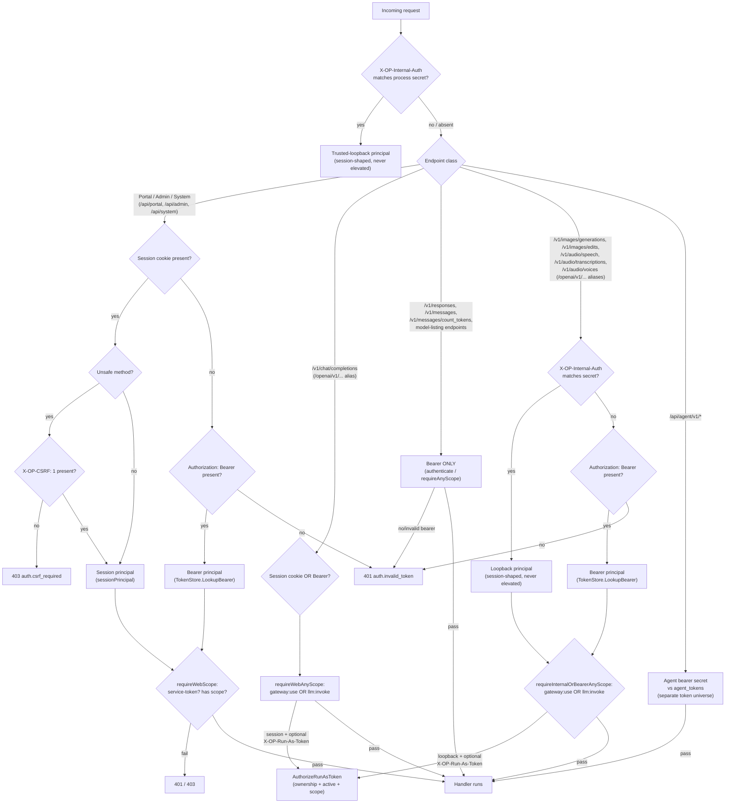
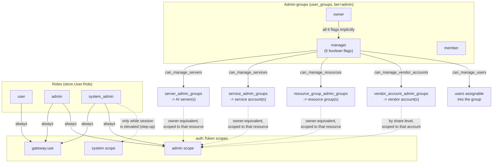
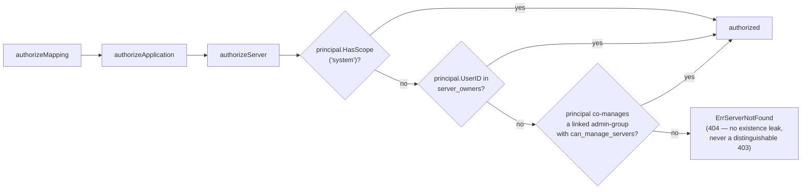

# Security, Authentication & Authorization

How OnPrem AI Gateway identifies a caller, decides what that caller may do, and
keeps secrets, headers, and request bodies safe at rest and in transit.

## 1. Overview: authentication surfaces at a glance

The gateway exposes four distinct authentication surfaces, each with a
different trust boundary:

| Surface | Who uses it | Credential | Handled by |
|---|---|---|---|
| Portal session | The browser SPA | `op_ai_gateway_session` cookie + `X-OP-CSRF` header on unsafe methods | `internal/gateway/auth.go` (`authenticateWeb`) |
| Bearer API token | External OpenAI/Anthropic-compatible clients, Codex, Claude Code, service integrations | `Authorization: Bearer <secret>` | `internal/auth.TokenStore`, `internal/gateway/server.go` (`authenticate`) |
| Internal trusted loopback | The gateway's own background chat-run executor calling itself | `X-OP-Internal-Auth` + `X-OP-Internal-User`, guarded by a per-process secret | `internal/gateway/auth.go` (`authenticateWeb`, for `/v1/chat/completions` and every Portal/Admin/System route) and `internal/gateway/auth_internal_or_bearer.go` (`authenticateInternalOrBearer`, for `/v1/images/generations`, `/v1/images/edits`, `/v1/audio/speech`, `/v1/audio/transcriptions` and `/v1/audio/voices` only) |
| Agent token | The `op-ai-server-agent` reporting/proxy process on each AI server | `Authorization: Bearer <agent-secret>` against a separate token universe | `internal/gateway/agent_auth.go` |

`/v1/chat/completions` (and its `/openai/v1/` alias) is the one inference
endpoint that accepts **either** a portal session (+ CSRF) **or** a bearer
token — see [§7](#7-request-authentication-decision-flow). `/v1/images/generations`,
`/v1/images/edits`, `/v1/audio/speech`, `/v1/audio/transcriptions` and
`/v1/audio/voices` (and their `/openai/v1/` aliases) accept
**either** the internal trusted-loopback pair **or** a bearer token, but never a portal
session cookie: they are reachable by the gateway's own background executor over
loopback, never by a logged-in browser (`requireInternalOrBearerAnyScope` → `authenticateInternalOrBearer`,
`internal/gateway/auth_internal_or_bearer.go`; speech is the third user of that leg,
transcription the fourth and the cache-backed voices listing the fifth: a browser reads
the same cache through the session-cookie `GET /api/portal/model-voices` instead,
[ADR-067](../09-architecture-decisions.md#adr-067--a-persistent-per-mapping-cache-first-used-for-tts-voices-fetched-while-the-model-is-loaded-change-detected-and-read-by-a-picker-and-a-fail-open-routing-filter).
The portal chat's `speech` run kind calls `/v1/audio/speech`
over the loopback pair ([ADR-063](../09-architecture-decisions.md#adr-063--speech-in-the-portal-chat-is-a-third-run-kind-the-model-is-the-affordance-the-run-reuses-the-speech-endpoint-over-loopback-and-the-wav-lives-in-chat_blobs)),
and the `transcription` run kind calls `/v1/audio/transcriptions` over it the same way
([ADR-064](../09-architecture-decisions.md#adr-064--transcription-in-the-portal-chat-is-the-fourth-run-kind-the-model-is-the-affordance-the-audio-input-lives-in-chat_blobs-and-is-relayed-multipart-over-loopback-and-the-reply-is-the-ordinary-text-turn)),
so each of those two audio endpoints now has a portal loopback caller (the voices listing has none),
[ADR-061](../09-architecture-decisions.md#adr-061--speech-is-the-second-endpoint-on-the-capability-gate-a-distinct-speech-capability-a-coarse-openai_audio-flavor-the-audio_cpp-kind-and-a-binary-relay-that-serves-wav-only),
[ADR-062](../09-architecture-decisions.md#adr-062--transcription-is-multipart-in-and-json-out-on-the-shared-openai_audio-flavor-a-distinct-transcription-capability-billing-read-from-the-response-body-and-every-divergence-from-speech-keyed-on-the-endpoint)). Every remaining inference
endpoint (`/v1/responses`, `/v1/messages`, `/v1/messages/count_tokens`, and the
`/v1/models`, `/openai/v1/models`, `/anthropic/v1/models`, `/api/v1/models` and
`/openai/api/v1/models` model-listing endpoints) is **bearer-only**: no session cookie and no loopback pair is
accepted there at all.

## 2. Local password authentication

Users authenticate with an email + password pair (`POST /api/auth/login`,
`internal/gateway/auth.go`). There is no separate password-hashing package per
role — every credential, from the first bootstrap admin to a self-service
password change, flows through `internal/auth/password.go`:

- **Policy**: `ValidatePasswordPolicy` enforces a plaintext length of
  10–200 characters. There are no complexity rules (character classes) —
  length is the only enforced dimension.
- **Hashing**: `HashPassword`/`VerifyPassword` use bcrypt at cost 12. Because
  bcrypt only examines the first 72 bytes of its input, the plaintext is first
  reduced to a fixed-size, ASCII, NUL-free digest — `SHA-256(plaintext)`,
  base64-encoded — before being handed to bcrypt. This lets the 200-character
  policy ceiling be enforced without bcrypt silently truncating (and thus
  ignoring) the tail of a long password.
- Password verification, change (`ChangePassword`), and reset (via the
  set-password token flow, [§6](#6-invite--set-password-one-time-tokens)) all
  call the same two functions — there is exactly one password code path in
  the system.

## 3. Portal sessions and CSRF

A successful login issues a **server-side session**, not a signed/stateless
token: `account.Service.IssueSession` generates a random secret, stores only
`SHA-256(secret)` in the `sessions` table (`internal/auth.HashSecret` — the
same hash function bearer tokens use, see [§4](#4-bearer-api-tokens)), and the
raw secret becomes the cookie value.

**Cookie**: name `op_ai_gateway_session`, `HttpOnly`, `SameSite=Lax`,
`Path=/`. `Secure` is controlled by `OP_AI_GATEWAY_SESSION_COOKIE_SECURE`:
`true`/`false` pins it explicitly; left unset, the gateway defaults it to
`Secure=true` unless the bind address (`OP_AI_GATEWAY_ADDR`) is a loopback
address — i.e. "secure by default, permissive only for local development."

**Two independent expiry clocks**, both re-checked on every
`ResolveSessionDetail` call:

- **Idle TTL** (`OP_AI_GATEWAY_SESSION_IDLE_TTL`, default 12h) — **sliding**.
  Every successful resolution touches `LastSeenAt`; the session dies once it
  has been unused for longer than the idle window, regardless of how much
  total time has passed.
- **Max TTL** (`OP_AI_GATEWAY_SESSION_MAX_TTL`, default 168h / 7 days) — a
  **hard cutoff** fixed at `ExpiresAt = issued_at + maxTTL` at issuance time.
  Activity never extends it; the session dies at that wall-clock instant no
  matter how active it was.

A session is also invalidated immediately if the owning user's status is no
longer `active` (disabling a user calls `DeleteSessionsByUser`, revoking every
outstanding session at once) or if the row simply cannot be found (already
logged out, expired-and-swept, etc.). Any invalid session clears the cookie
and returns `401 auth.session_invalid`.

**A passive read does not slide the idle window.** `ResolveSessionDetail`
touches `LastSeenAt` on every resolution. The one deliberate exception is
`ResolveSessionDetailNoTouch`, used only for the chat-image `` fetches a
browser fans out in bulk (`requireWebScopeNoTouch`): the same validation, no
write, so such a fetch extends nothing ([§13.1](#131-chat-binary-payloads-a-sealed-store-ownership-on-read-a-hardened-serving-url)).

**CSRF**: `authenticateWeb` accepts a session cookie for any method, but for
every *unsafe* method (anything but `GET`/`HEAD`) it additionally requires the
`X-OP-CSRF: 1` header (`csrfOK`), else `403 auth.csrf_required`. Because the
header is not a cookie, it cannot be attached by a cross-site form submission
or ``-style request — only same-origin JavaScript that reads the header
value can set it. Bearer-token requests never need this header (there is no
ambient cookie for a third-party site to ride on).

`GET /api/auth/session` is deliberately public and always returns `200`
(never `401`) — the SPA calls it on every mount to learn its own
authentication state without generating a wall of 401s in the logged-out
case.

## 4. Bearer API tokens

An `auth.Token` (`internal/auth/token_store.go`) is the gateway's single
principal representation — it is what a session, a bearer token, an agent
principal, or the internal loopback all eventually resolve into. Key fields:

| Field | Meaning |
|---|---|
| `Scopes` | see [§10](#10-role-based-access-control) |
| `Kind` | `""`/`"user"` for a normal token, `"service"` for a service-account token (see [§12](#12-delegated--resource-scoped-authorization)) |
| `ModelOverride` / `ModelOverrideRules` | catch-all / per-requested-name rewrite applied before routing; a rule is `{to, offer, hide_target}`, the two switches shaping only this token's model *listing* |
| `UnknownModelRedirect` / `UnknownModelRedirectBlocked` / `UnknownModelFallback` / `LastUsedModel` | the opt-in unknown-model redirect and the marker it aims at — see [Routing & Model Selection §2.1](routing-and-model-selection.md) |
| `ClaudeModelAliases` | the opt-in (default off) that additionally offers the token's eligible local models and groups under generated `anthropic-local-<hash>` ids, in discovery and in resolution — see [below](#claude-model-aliases-are-discovery-and-resolution-not-authorization) |
| `ClaudeEffortCompatibility` | the opt-in (default off) that delivers Claude Code's `output_config.effort` to a llama.cpp or vLLM target as `chat_template_kwargs.reasoning_effort` — and, unlike `ClaudeModelAliases`, is **management-only** to set — see [below](#claude-code-effort-compatibility-is-a-management-only-setting) |
| `AllowedModels` | non-empty only on a service token; a per-model allowlist (empty = every model) |
| `LogCommunication`, `Secret` | this principal's opt-in/secret-visibility flags for [payload capture](#14-capture-redaction-of-sensitive-headers) |
| `ProjectID` | usage-attribution project, user tokens only |
| `ServerOverride`, `ServerOverrideForceUnreachable` | pins every request from this token onto one AI server, bypassing normal routing |

**At rest, a token's secret is never stored** — only
`SHA-256(secret)` (hex-encoded, `auth.HashSecret`) is persisted, and lookup
(`TokenStore.LookupBearer`) re-hashes the presented `Authorization: Bearer
<secret>` value and looks it up by hash. There is no reversible encryption
here because there is nothing to reverse: an active, non-expired match is a
valid token, a miss is not, and the plaintext secret is shown to the operator
exactly once, at creation time.

A user creates their own tokens with `CreateToken`
(`internal/portal/service.go`); requested scopes are validated against what
the creating principal itself already holds
(`gateway:use` requires the owner to already have `gateway:use` or `admin`;
`admin` requires the owner to already have `admin`) — a token can never grant
its creator more than the creator already has. Service tokens
(`CreateServiceTokenResponse`, `internal/portal/service_services.go`) are
different: they are always minted with the single, hardcoded scope
`llm:invoke` — there is no "requested scopes" step for a service token at
all.

#### Claude model aliases are discovery and resolution, not authorization

The per-token `claude_model_aliases` setting (a plain boolean, default off)
exists on user tokens and on service tokens, written at creation for a service
token like every other setting of one ([HTTP API Surface, Token model
settings](../reference/api-surface.md#token-model-settings)). It serves
**external bearer-token clients**, such as Claude Desktop, that cannot select a
local model under its real id: the token's eligible local models and groups
appear a second time as `anthropic-local-<hash>`, with the real id in
`original_model_id`, and a request naming such an id is resolved to its target
([API Compatibility & Inference
§9.1](compatibility-and-inference.md#91-generated-claude-model-aliases), [Routing
& Model Selection §2.4](routing-and-model-selection.md#24-generated-claude-model-aliases)).
It changes **which name** is requested and listed, never **what a token may
reach**:

- **Access checks run on the effective target.** The alias is resolved in the
  shared inference preflight, before every gate, so the service-token allowlist
  (`modelAllowed`), locked models, the server override, resource-group
  provisioning, capability checks and the principal's rate, quota and budget
  limits all judge the real model. `RequestedModel` keeps the alias the client
  sent, so the usage record carries both names.
- **The discovery-versus-invocation distinction is unchanged.** A listing is
  still a display: an allowlist restricts invocation, not discovery, and an alias
  row is listed because its target is offered to this token under its own name.
  Aliasing adds no reach: a model the token is not offered (hidden, locked,
  outside its resource-group provisioning, or hidden by one of its own
  `hide_target` rules) gets no alias, so `original_model_id` discloses no real id
  the token could not already see, and another token cannot use an alias id it
  computes itself to reach a model it is not offered.
- **A session principal gets no aliases.** The portal session principal
  (`sessionPrincipal`, also behind the loopback pair) never carries the setting,
  so the portal UI lists and resolves no alias. A run-as token does carry its
  token's setting onto the run (`AuthorizeRunAsToken`), exactly like its other
  settings.
- **Both gates fail closed.** With the visibility overlay unreadable, or on a
  store error during resolution, no alias is derived — it would otherwise reveal
  what an operator hid.

#### Claude Code effort compatibility is a management-only setting

The per-token `claude_effort_compatibility` setting (a plain boolean, default
off, on user tokens and, at creation, on service tokens) makes Claude Code's
`output_config.effort` reach a llama.cpp or vLLM target as
`chat_template_kwargs.reasoning_effort` ([API Compatibility & Inference
§9.2](compatibility-and-inference.md#92-claude-code-reasoning-effort-compatibility)).
It is documented beside `claude_model_aliases` because it is its sibling, and it
differs from it in exactly one respect: **who may set it**. The alias flag is an
ordinary token setting that any holder of `gateway:use` may change on their own
tokens. The effort flag changes what the gateway sends to the upstream, and an
operator, not an inference credential, decides that, so it is a **management**
operation:

- **Who may set it.** An authenticated **portal session** (cookie and CSRF, which
  `authenticateWebSession` already enforced before the handler body runs) or a
  **bearer holding the `admin` scope**. An **inference-only bearer**
  (`gateway:use` / `llm:invoke` without `admin`) never may, **including on its own
  token** and including by creating a token with the opt-in enabled.
- **Why the HTTP gate cannot decide it.** The token routes are guarded by
  `requireWebScope(gateway:use)`, a baseline every user bearer carries, so the
  route cannot tell an inference-only bearer editing its own settings from a
  management principal. The check therefore lives in the **service layer**, the
  single chokepoint no caller can skip, as
  `principalMayManageTokenSetting(owner)` (`internal/portal/authz.go`):
  `owner.ID == "" || isAdmin(owner)`. A session principal, and the gateway's own
  trusted loopback built the same way, comes from `sessionPrincipal` with an
  **empty** `auth.Token.ID` (no `api_tokens` row stands behind it); a bearer's
  principal always carries its token's non-empty id, and is management-capable
  only if it was minted with `admin`. The predicate is deliberately not
  `hasGatewayUse`, which is exactly the scope the bearer already holds.
- **Where it is enforced.** `CreateToken` refuses **only when the request enables
  the flag** (`false` is the default and needs no privilege); `UpdateToken`
  refuses **any present value**, `true` or `false`, so an inference-only bearer
  can neither turn it on nor strip it off, and the foreign-token case stays a
  plain not-found because ownership is checked first; `CreateServiceToken`
  refuses a `true`, after the object gate, so a principal with no access to the
  service gets the same not-found as without the flag (no existence leak). Service
  tokens themselves are already excluded from the token routes by
  `requireWebScope`'s `IsService` rejection.
- **A refusal has no side effect.** The service returns
  `portal.ErrPrincipalForbidden`, HTTP **403 `portal.principal_forbidden`**, before
  any lookup, any field is applied or anything is written, so a request that
  mixes the flag with other edits writes none of them. `CreateToken`'s POST
  handler lists its errors by hand, so it carries its own `ErrPrincipalForbidden`
  row; without it the refusal fell through to the generic 500 instead of a 403.
  It is the one place the sentinel is expected over HTTP ([HTTP API Surface,
  Authorization refusals](../reference/api-surface.md#authorization-refusals-across-the-portal-surface)).
- **Contrast with `claude_model_aliases`, which stays non-gated.** The alias flag
  is changed with the plain `gateway:use` baseline and no further check, because
  it changes only which name is requested and listed ([above](#claude-model-aliases-are-discovery-and-resolution-not-authorization)).
  The two settings are independent switches, written and gated separately:
  holding the right to flip one confers nothing about the other.
- **It grants no reach.** Like the aliases, the setting adds no access: the
  service-token allowlist, locked models, resource-group provisioning, the
  principal limiter and every other gate judge the request exactly as without it,
  and a run-as token carries its token's setting onto the run
  (`AuthorizeRunAsToken` copies the field), while the portal session principal
  itself never has it, so portal chat gets no effort edit.

## 5. Run-as token (`X-OP-Run-As-Token`)

Portal chat runs as the logged-in **session** principal, but the operator may
want a chat run to inherit a *specific stored API token's* limits, model
overrides, project attribution, or server pin instead of the session's
defaults. `X-OP-Run-As-Token` carries that token's **ID** (not its secret —
the caller is already a CSRF-protected authenticated session, so this header
is a capability *selector*, not a credential) on the requests handled by
`handleOpenAIChat` — `/v1/chat/completions` (the path the loopback run
executor actually posts to) and its `/openai/` alias — **and, since the portal
gained image turns, on `/v1/images/generations`, `/v1/images/edits` and their
`/openai/` aliases too**: `handleOpenAIImages` (`internal/gateway/images_handler.go`)
and `handleOpenAIImagesEdit` (`images_edit_handler.go`) carry the identical
block, guarded the identical way, so an image turn started under a
run-as token bills, captures and routes under that token rather than under the
bare session. `handleOpenAISpeech` (`speech_handler.go`) and
`handleOpenAITranscription` (`transcription_handler.go`) apply the same block too, through the
shared `runAsPrincipal` helper, so a speech or transcription call made over the
loopback pair with a run-as header would bill and capture under the token rather than
under the bare session. The flowchart in [§7](#7-request-authentication-decision-flow)
shows both edges into `AuthorizeRunAsToken`; do not read this section as
naming chat completions exclusively.

The gate is the resolved principal's **token id being empty**, not the path and
not the headers the request carries: `token.ID == ""` is true only for the
loopback/session-shaped principal and never for a bearer principal, so the
header structurally cannot act on `/v1/responses` or `/v1/messages`, whose
bearer-derived id is always populated ([API Compatibility & Inference
§12](compatibility-and-inference.md#12-in-portal-chat-playground)).

`portal.Service.AuthorizeRunAsToken(ctx, principal, tokenID)` is the sole
authorization point:

1. The token record must belong to `principal.UserID` and be
   `store.TokenStatusActive` — one user can never run as another user's
   token.
2. The token must not be expired.
3. The resulting principal must itself carry `gateway:use`.

On success, the request proceeds as that token's `auth.Token` — its scopes,
`ModelOverride`/`ModelOverrideRules` and redirect settings, capture flags,
project, and server override, not the session's. This is the mechanism the gateway's own
background chat-run executor uses when it calls back into itself over the
internal trusted-loopback path (`X-OP-Internal-Auth`): it optionally attaches
`X-OP-Run-As-Token` to run the executed step under a specific token's
identity — on its images hop as well as its chat hop, since
`setRunLoopbackHeaders` (`internal/gateway/chat_runs.go`) sets one header set
for both. If the run-as token itself carries a `ServerOverride`, that takes
precedence over any separately-configured chat server override — the
run-as token's own settings always win.

## 6. Invite & set-password one-time tokens

New users are never given a password directly. An admin (`POST
/api/admin/users`, `admin` scope) creates the user in `invited` status and
the gateway issues a one-time **set-password token**
(`internal/account/service.go`, `set_password_tokens` table):

- Only `SHA-256(secret)` is stored (`SecretHash`) — identical pattern to
  sessions and bearer tokens.
- Expiry: `OP_AI_GATEWAY_...` — the invite TTL defaults to 72h from issuance.
- **Single-use**: redemption does not delete the row, it sets `UsedAt`; a
  second redemption attempt with the same secret is rejected because
  `UsedAt != nil`, exactly as if the token had expired.
- Creating a `system_admin` user through this flow requires the *inviting*
  actor to already hold the `system` scope — an `admin` cannot invite a peer
  `system_admin` into existence.
- `ReissueInvite` (used for both "resend invite" and "admin-triggered password
  reset") first invalidates every other outstanding set-password token for
  that user, then issues a fresh one — only the most recently issued link is
  ever valid.
- Disabling a user invalidates all of that user's outstanding set-password
  tokens in the same step that revokes their sessions.

Redemption (`POST /api/auth/set-password`) validates the new password against
the same policy as any other password change, flips the user's status from
`invited` to `active`, and — unless TOTP is in `required` mode (in which case
enrollment happens first, see [§9](#9-totp-two-factor-authentication)) —
immediately issues a session, so accepting an invite logs the user straight
in.

## 7. Request-authentication decision flow



Note that `/v1/images/generations`, `/v1/images/edits`, `/v1/audio/speech`,
`/v1/audio/transcriptions` and `/v1/audio/voices` resolve their principal through `authenticateInternalOrBearer` (`auth_internal_or_bearer.go`)
rather than through `authenticateWeb`. The `X-OP-Internal-Auth` check itself is **not**
duplicated: both entry points call the same `loopbackPrincipal`
(`internal/gateway/auth.go`), so the constant-time secret comparison and its
fail-closed conditions (no configured secret, no user lookup, unknown user)
exist exactly once and cannot drift apart. What differs is only what each one
falls back to when that check does not match — and this endpoint deliberately
has **no session-cookie branch at all**, never node E/H/M's path.

Two authorization helpers sit behind the session/bearer resolution and are
worth naming explicitly because they differ in an easy-to-miss way:

- `requireWebScope`/`requireWebAnyScope` (`internal/gateway/auth.go`) accept
  **either** a session+CSRF **or** a bearer token, and `requireWebScope`
  additionally rejects a service token outright (`Kind=="service"` may never
  reach a Portal/Admin/System route, regardless of what scope it happens to
  carry) — a defense-in-depth measure against a future handler mistakenly
  granting a service token a scope that opens a Portal route.
- `requireScope`/`requireAnyScope` (`internal/gateway/server.go`) accept
  **only** a bearer token (no session fallback) — this is what backs the
  bearer-only inference endpoints in [§1](#1-overview-authentication-surfaces-at-a-glance).

## 8. Agent authentication

Each AI server runs `op-ai-server-agent`, which authenticates to
`/api/agent/v1/*` with its own bearer secret
(`internal/gateway/agent_auth.go`) against `agent_tokens` — a **separate**
lookup and a separate token universe from user/service bearer tokens; an
agent secret cannot be used against `/v1/chat/completions` and vice versa.

The ten agent endpoints (`telemetry`, `stream` (WebSocket), `system-report`,
`ca`, `certificate`, `proxy-routes`, `features`, `runtime-config`,
`runtime-report`, `download/`) are registered on **both**
the public mux and a dedicated agent mux, so an agent can reach the gateway
either over the public listener or over the NetBird mesh listener. Because
the handler functions are shared, the gateway threads *which listener* served
the request through `r.Context()` (`withAgentListenerContext` /
`isAgentListenerRequest`) rather than relying on anything visible in the
handler itself — this is what lets mesh-only behavior (e.g. gating
`/proxy-routes` to mesh traffic, or only recording a telemetry-transport
"seen over TLS" signal when the mesh listener served the request) stay
correct without duplicating handler code per listener.

### 8.1 The structural rule: an agent endpoint's target comes only from the token

**Any resource id that arrives inside an agent payload must be re-resolved back
to the token's own server before it is used for a write.** The token gives the
server id for free, so trusting an id in the body looks harmless — and it is the
shape the whole agent surface must be reviewed against, because it will recur in
the next agent endpoint that accepts an id.

The worked example is the GPU VRAM write-back on the telemetry path. It
originally took its target from the agent-supplied `spec_id` and checked only
whether that spec's numbers were locked, so **an agent authenticated for server A
could name server B's spec and overwrite B's measured VRAM** — and because the
runtime-config document the gateway assembles prefers a measured value over the
operator's estimate, that changed the figure B's *own* agent did its admission
arithmetic against. The fix resolves spec → mapping → application and requires
`application.ServerID == tokenServerID`; the ownership check runs
**unconditionally and before** the lock check, so a cross-server attempt is
logged at Warn even when the spec happens to be locked.

The same write-back also bounds its store fan-out, because it sits on an endpoint
agents hit every second: the agent-supplied array is truncated (256 entries, 64
GPUs each — clamp, never reject, mirroring the hardware-report clamps) *before*
any resolution is attempted, and the resolve outcome is memoized per distinct
spec id **including failures**. A memo that caches only successes looks correct
and reintroduces the unbounded path: without both, a single 1 MiB telemetry POST
could drive roughly 19,000 store reads.

### 8.2 Free-form text from an agent is redacted safe-by-default

A file-mode agent's runtime report carries the effective configuration with
**env values already masked agent-side**, where the plaintext is; the gateway's
structural re-masking on ingest is defence in depth, not a substitute. (The
redaction *test* correspondingly lives agent-side — a gateway-side test would
assert on values that arrive already masked, looking like coverage while proving
nothing.)

The same agent-side mask covers each spec's **config-file content** (issue #257,
[the runtime chapter §3.5](agent-runtime-manager.md#35-config-files-the-agent-writes-before-it-launches-the-child)):
a hand-written file-mode config file can hold a literal secret, so every file
keeps its name and has its content replaced with the `•••` mask, exactly as an
`env` value is. The gateway's ingest mirror of a spec carries no `config_files`
field at all, so the facet — names included — is dropped by the re-parse before
anything is stored. In gateway mode, by contrast, the content is operator text
stored and shipped in the clear, which is why the secret placeholders (`${API_TOKEN}`, `${AGENT_ENV:…}`) are refused in it at submit time
and again by the agent, and why a written file never carries a secret.

`parse_error` is the second, non-obvious leak path into that table, and it needs
its own rule: **a configuration-loader error routinely quotes the offending
line**, so an unparsed secret-bearing line could reach the report even though
`env` values are masked. The rule is an **allow-list over a closed set of
codes**: the field may only ever be one of the classification codes the agent's
wire contract defines (`json_syntax`, `duplicate_spec_id`,
`invalid_config_file_name`, `file_missing`, `read_failed` — see
[the runtime chapter](agent-runtime-manager.md)), anything else is replaced by
a fixed generic constant, and an **empty** value stays empty, because "this
agent reported no parse failure" is not a redaction case at all. Free text has
no path in, whatever the agent sends.

Two earlier rules were tried and both failed, each a reasonable answer to the
half of the problem it could see, and the pair is worth keeping because a
future reader will otherwise re-derive them:

1. **Keep everything before the first `:`, pass a colon-less string through.**
   Leaked in two shapes: a colon-less message survived verbatim (nothing to
   cut), and a secret sitting *before* the first colon survived too — the split
   kept precisely the wrong half.
2. **Keep that prefix only when it looks like a bare classification token**
   (non-empty, bounded length, no whitespace/quote/`=`). That closed the leak
   and broke the field. The actual producer's every error begins `"runtime: "`,
   so the one reachable non-generic output, for every malformed file an
   operator could write, was the single word `runtime` — a token that looks
   like a meaningful subsystem tag and carries no information at all. Worse, it
   had no empty-input case, and `""` is exactly what a *healthy* agent sends
   (the field is `omitempty`), so it rewrote the healthy case into
   `"config parse error"`: every file-mode agent whose config parsed perfectly
   was stored, and shown in the portal, as one that had failed to parse — with
   the portal suppressing the config view on exactly that field.

The lesson generalises past this field: a redaction heuristic negotiates
between hiding content and reporting a diagnosis, and loses both. Stating what
the field **may contain** ends that negotiation instead of picking a winner,
and it makes both sides readable against the same contract.

### 8.3 What a gateway-authored launch spec may not reach

The [agent-managed model runtime](agent-runtime-manager.md) lets the portal
author a command line that an agent then executes. Three guards make that
acceptable, each of which reads as an arbitrary restriction on a convenience
feature — and removing any one converts portal write access into agent-identity
theft or an allowlist bypass:

1. **`${AGENT_ENV:…}` refuses the agent's own `OP_AGENT_*` namespace**, before
   `getenv` is even consulted. Without it a portal-authored spec could read
   `OP_AGENT_TOKEN` — the bearer secret that authenticates the certificate
   endpoint which issues a **private key** — simply by referencing it in an
   argument or env value that a model process then echoes. The refusal names the
   variable but never a value, and applies identically to `args` and `env`.
2. **The child's environment is built from scratch**: only the spec's expanded
   env plus a small OS-appropriate base — `PATH`, `HOME`, `USERPROFILE`,
   `LOCALAPPDATA`, `SYSTEMROOT`, `WINDIR` — copied from the agent's own
   environment *where present*. Never the agent's full environment, which holds
   that bearer token and every other model's secrets.
3. **A spec `env` key naming one of those base variables is refused outright**,
   in any capitalisation. Permitting the override would reopen the
   relative-binary resolution path the absolute-path allowlist closes, by
   steering a permitted binary's dynamic linker, its Windows DLL search
   (`SystemRoot`) or any helper it shells out to. The reservation set *is* the
   base set — one list in the code, so a name can never be copied into the base
   while remaining spec-overridable.

The hard boundary on *what may execute at all* is the agent-local allowlist, not
the portal's RBAC: `LocalPolicy.Permit` refuses every spec when the binary
allowlist is empty, then matches the binary **exactly** against it, then checks
`work_dir` containment with `filepath.Clean` on both sides plus a
**separator-boundary** comparison — which rejects both `../` traversal and the
sibling-prefix case (`/srv/models-evil` must not pass a `/srv/models` rule; a
naive `strings.HasPrefix` does). Containment is lexical and does **not** resolve
symlinks, deliberately: see
[§11.1 Operational risks](../11-risks-and-technical-debt.md) for why
`EvalSymlinks` would be strictly worse. One operational consequence worth
documenting: **once permitted directories are configured, a spec with an empty
`work_dir` is refused outright**, so configuring them makes `work_dir` mandatory
on every spec — otherwise every spec fails with an inexplicable
`not_permitted`.

Authorization for runtime *writes* introduces no new RBAC rule: it is exactly the
model-mapping write rule — `system` scope, membership in the server's owner list,
or admin-group delegation carrying `can_manage_servers`. **Plain `admin` is not
sufficient.** The portal deliberately gets no new top-level view (no `views.tsx`
entry) so no new RBAC surface appears at all. Every runtime portal method
authorizes **inside `portal.Service`**, never in the gateway handler:
runtime-spec CRUD via `authorizeMapping` (mapping → application → server, with
all failures collapsed to a 404), co-residency and warnings via
`authorizeApplication`, and GPU budgets and the report/SSE views via
`authorizeServer`. The gateway handlers do nothing beyond the web-scope check
and, for the SSE stream, an ownership check **before the first stream byte**. A
new runtime endpoint added at the gateway layer on the assumption that "authz is
handled upstream" would be unauthenticated for resource ownership.

Certificate issuance and mTLS between the gateway and its agents is covered in
[Certificates & TLS](certificates-tls.md); the mesh listener itself in
[Networking & Mesh](networking-mesh.md).

## 9. TOTP two-factor authentication

`internal/totp` implements RFC 6238 (HMAC-SHA1, 6 digits, 30-second step, ±1
step / 30s clock-skew tolerance) using only the standard library for the
algorithm, plus the MIT-licensed `github.com/skip2/go-qrcode` to render the
enrollment QR code. Verification (`Verify`) uses a constant-time comparison
across every candidate step so response timing cannot reveal which step (if
any) matched, and it never panics or returns an error — a malformed secret or
code simply verifies to `false`.

**Pending vs. live secret.** A user has up to two TOTP secrets in play at
once: `TOTPPendingSecret` (freshly generated, unconfirmed) and `TOTPSecret`
(the live secret actually checked at login). `SetPendingTOTP` only ever
writes the pending slot; `ConfirmTOTP` is the *only* path that can promote a
pending secret into the live one (and set `TOTPEnabled=true`). This
separation means a hijacked session cookie alone — which carries no proof of
possessing the physical authenticator — can never rebind or downgrade an
already-enrolled account's 2FA: re-enrolling while already enabled
(`handleTOTPEnroll`) demands a valid **current** TOTP code as step-up proof
before a new pending secret is even generated.

**Sealed at rest.** Both TOTP secret columns are sealed with the same
`enc:`/`plain:` envelope convention described in
[§13](#13-secrets-at-rest), keyed by the capture encryption key — never
stored as plaintext on a disk-backed store.

**Org-wide mode** (`totp_mode`, a system setting: `off` / `optional` /
`required`, default `off`) governs login gating in
`handleAuthLogin` (`internal/gateway/auth.go`):

| Situation | Behavior |
|---|---|
| User already `TOTPEnabled`, mode ≠ `off` | Always challenged for a code — enrollment "sticks" even if the org later relaxes the mode |
| Mode = `required`, user not yet enrolled | Login and first-time enrollment happen in the same round trip: an empty code returns a QR/secret (`totp_enrollment_required`); submitting a valid code confirms enrollment **and** issues the session in one step |
| Mode = `optional`/`off`, user not enrolled | Password alone is sufficient |

Self-service disable (`DELETE /api/portal/totp`) is blocked with `409
auth.totp_disable_forbidden` only while mode is `required`; it is always
allowed under `optional`/`off` — including removing a now-stale enrollment
after an org turns TOTP off entirely. An admin can also force-clear a user's
TOTP (`ResetTOTP`) without knowing any code, which — like disabling a user —
revokes all of that user's sessions in the same step.

## 10. Role-based access control

**Roles** are a flat, informal hierarchy — `user` < `admin` < `system_admin`
— expressed only as scope grants and a handful of role-string comparisons;
there is no numeric rank function anywhere in the codebase. Every session
resolves to an `auth.Token` via `sessionPrincipal`
(`internal/gateway/auth.go`):

| Role | Base scope | `admin` scope | `system` scope |
|---|---|---|---|
| `user` | `gateway:use` | — | — |
| `admin` | `gateway:use` | ✓ | — |
| `system_admin` (not elevated) | `gateway:use` | ✓ | — |
| `system_admin` (elevated — [step-up mode](#system-admin-step-up-mode)) | `gateway:use` | ✓ | ✓ |

The `system` scope is the load-bearing distinction: a `system_admin` who has
not stepped up is, for authorization purposes, indistinguishable from a plain
`admin` on every scope check. Only an active step-up elevates them to
`system`.

**Who may create/promote/demote a `system_admin`**: enforced inline in
`account.Service.UpdateUser`/`InviteUser` — if the *current* role is
`system_admin`, or the update would *make* it one, the acting principal must
itself carry the `system` scope, else `ErrForbiddenRole`. An `admin` can
create or manage other `admin`/`user` accounts freely, but can never touch a
`system_admin` account's role, and can never promote anyone into that role.

**Last-active-admin / last-active-system_admin guards**: any role or status
change that would leave zero other *active* admin-capable users
(`admin` **or** `system_admin` — both count) is rejected with `ErrLastAdmin`;
any change that would leave zero other active `system_admin` users is
rejected with `ErrLastSystemAdmin`. Both guards fire on demotion (role change
away from the protected set) and on deactivation alike — you cannot lock
yourself, or anyone else, out of the last administrative account by either
route.

**Self-service vs. admin update** share one `UserUpdate` struct but are
enforced through two different entry points:

- `UpdateUser` (admin-facing) honors `Role`/`Status` in addition to profile
  fields, and runs every guard above.
- `UpdateOwnProfile` (self-service — language, chat-capture flags) **never
  reads** `Role`/`Status` off the same struct at all, even when the caller
  happens to be a `system_admin` editing their own profile — there is nothing
  to guard because those fields are structurally inert on this path.

### System-Admin step-up mode

A `system_admin` does not carry the `system` scope by default — they must
explicitly elevate (`POST /api/portal/system-admin-mode`), optionally proving
their password again (gated by the `system_admin_mode_require_password`
system setting), before scope checks against `system` start passing. The
elevation is stored per-session as `sessions.elevated_until`
(`SetSessionElevation`) — a **hard** expiry (no sliding renewal on activity),
sized by `OP_AI_GATEWAY_SYSTEM_ADMIN_MODE_TTL_SECONDS` (default 900s / 15
minutes). `DELETE /api/portal/system-admin-mode` (or simply letting the TTL
lapse) drops back to unelevated `admin`-only behavior. Because elevation is a
per-*session* property, opening a second browser/tab with the same user does
not inherit it — each session must step up independently.

### Admin-groups and delegated management

Beyond the three roles, `user_groups` forms a three-tier hierarchy —
`system` → `admin` → `user` — with each group having exactly one **owner**,
any number of **managers**, and any number of plain **members**:

- The **owner** (or a `system`-scope caller) is the only one who may promote/
  demote managers, transfer ownership, or change a manager's permission
  flags.
- A **manager** (`user_group_managers` row) carries six independent boolean
  permission flags — `can_manage_users`, `can_manage_group`,
  `can_manage_servers`, `can_manage_services`, `can_manage_resources`,
  `can_manage_vendor_accounts` — not a
  bitmask, six separate columns, each defaulting to `true` for a new
  manager row.
- A plain **member** has no management capability at all.

An `admin`-tier group can then be **linked** to a specific resource — an AI
server (`server_admin_groups`), a service account
(`service_admin_groups`), a resource group
(`resource_group_admin_groups`), or a shared vendor account
(`vendor_account_admin_groups`) — and any owner/manager of that group with
the matching `can_manage_*` flag gets owner-equivalent rights **on that one
resource**, without needing the `admin` scope at all. (A vendor account is the one
exception to "owner-equivalent": what a co-manager may do depends on the account's share
level, [§12](#12-delegated--resource-scoped-authorization).) This is deliberately
narrower than a global admin bypass: see the comparison table in
[§12](#12-delegated--resource-scoped-authorization).

## 11. RBAC structure



## 12. Delegated & resource-scoped authorization

Server/application/model-mapping management deliberately does **not** grant
a bare `admin` scope blanket access. The single choke point is
`portal.Service.authorizeServer`, and application/mapping authorization
delegate straight up to it:



A plain `admin` scope with no ownership and no delegated group reach gets the
exact same 404 as an anonymous stranger — this replaced an earlier "any admin
manages every server" bypass. The per-model server list's `can_load` flag
(`ModelServers`) asks `authorizeServer` too, so a row offers a Load exactly
when the Load starter would authorize it. The same no-existence-leak collapsing pattern
(a missing/forbidden target both surface as "not found") is reused for user
management (`ManageableUserIDs`) and every resource type below.

Authorization reach differs meaningfully by resource type — the following
table is the load-bearing reference for "who can actually touch this":

| Resource | `system` scope | Direct owner list | Admin-group delegation | Plain `admin` scope alone |
|---|---|---|---|---|
| AI server / application / model mapping | always authorized | `server_owners` | `server_admin_groups` + `can_manage_servers` | **not sufficient** |
| Service account | always authorized | — (no owner list; see delegates) | `service_admin_groups` + `can_manage_services` (grant is Full, equivalent to a Full-Delegate) | **not sufficient** (Full-Delegate or the above required) |
| Resource group | always authorized | — (no owner list at all) | `resource_group_admin_groups` + `can_manage_resources` | **not sufficient** |
| Vendor account | **read only**, never a write | `owner_user_id` (exactly one owner) | `vendor_account_admin_groups` + `can_manage_vendor_accounts`, **by share level** (operate at `shared`; credential, assignment, delete and lowering at `full` only) | **not sufficient**, needed only to *raise* the level (and then as the owner) |
| User group (any tier) | always authorized (bypasses group-scoping) | group's own `owner_user_id` | manager flags within the group itself | **not sufficient** for a `system`-tier group |
| Project | — (no distinct check found) | `owner_user_id` (or the coupled group's *current* owner) | not narrowed by admin-groups | **sufficient** — any `admin`-scope caller may manage any project |

Projects are the one deliberate asymmetry: unlike servers, services,
resource groups, and user-groups (all narrowed to admin-group delegation),
project management was never restricted beyond the plain `admin` scope.

**Service accounts** (`services` table) are non-human principals: a bearer
token with `Kind=="service"` carries no `UserID`, only `ServiceID` and an
optional `AllowedModels` allowlist. `service_delegates` rows grant humans
rights over a service at two levels — a plain delegate (**Token-Delegate**)
can view the service and manage its API tokens; a delegate with
`can_manage_settings` (**Full-Delegate**) can additionally change its name,
status, delegate list, model allowlist, and admin-group links.
`AllowedModels` enforcement (`internal/gateway/inference_handlers.go`,
`modelAllowed`) is real, not just documentary: an empty allowlist means every
model is permitted (the default, and the only state a *user* token is ever
in — the check is skipped entirely for `Kind != "service"`), while a
non-empty allowlist is checked **after** the whole per-token model-name
resolution — override rules, generated Claude aliases, catch-all, and
unknown-model redirect alike — so
neither an override nor a redirect can ever be used to route around it. That
is the general invariant of
[Routing & Model Selection §2.1](routing-and-model-selection.md): those
settings change *which* name is requested, never *what* a token may reach.
It is also why a service token's redirect fallback is validated against the
callable models of the principal **issuing** it (a delegate or an authorized
admin-group manager) rather than against the service's own allowlist — the
write-time check is a usability guard, and the allowlist still refuses the
request at inference time if the two disagree. A service token has no update
endpoint, so those settings are fixed when it is created.

**Projects** attribute usage, not access. A project has plain members
(`project_members`), assigned groups (`project_groups` — any tier, and every
active member of an assigned group counts toward project membership), or, for
a **coupled** project (`coupled_group_id`), no membership of its own at all —
its effective owner and member count are read live off the linked group on
every access, and direct membership edits are rejected
(`ErrProjectCoupled`) in favor of managing the linked group instead. The only
thing project membership gates is whether a user may attribute *their own
token* to that project (`ErrProjectNotMember` on `CreateToken`/`UpdateToken`)
— it has no effect on routing or model access.

**Resource groups** bundle AI servers (`resource_group_servers`) under one
containment root, and their `resource_group_provisions` table controls
**routing eligibility**, not deployment — which principals (user, service,
user-tier group, or admin-tier group) may be *routed to* servers in that
group. This is gated by the `resource_provisioning_enforce` system setting
(default `false`):

- **Opt-in** (`enforce=false`): a server outside every resource group remains
  usable by anyone; a server that *is* in a provisioned resource group is
  usable only by a principal provisioned into (one of) that group.
- **Deny-by-default** (`enforce=true`): a server is usable only if the
  principal is explicitly provisioned into a resource group containing it —
  everything else is denied.

Notably, this check currently has **no role bypass** — even a `system`-scope
principal is subject to the same allow/deny evaluation as anyone else; the
code marks a bypass as a deliberate future extension point, not present
behavior today. A resource group can also offer shared **vendor accounts**
(`resource_group_vendor_accounts`), but their eligibility is a separate, pure
grant that `resource_provisioning_enforce` does not govern (see **Vendor
accounts** below).

**Vendor accounts** (`vendor_accounts`) are the one resource whose authorization is
**by share level**, because the thing delegated is a credential: the owner's sealed
key or OAuth token set is sent upstream by the gateway on the owner's behalf. Each
account has exactly one owner and a `share_level` of `none` (personal, the default),
`shared` or `full`; the owner, an admin, raises it and assigns it to management groups
(`vendor_account_admin_groups`) and resource groups
(`resource_group_vendor_accounts`), and a **co-manager (CM)**, an owner or co-manager
holding `can_manage_vendor_accounts` of a management group, then acts at the level's
reach ([External Vendor Accounts §8](external-vendor-accounts.md#8-authorization-by-share-level)
has the full matrix):

| Operation | `none` | `shared` | `full` |
|---|---|---|---|
| Read (key-free) | owner, system scope | owner, CM, member (minimal view), system scope | owner, CM, member (minimal view), system scope |
| Operate: status, prefix, rename, test, model refresh, usage refresh | owner | owner, CM | owner, CM |
| Credential, management-group and resource-group assignment, delete, lowering | owner | **owner only** | owner, CM |
| Raise | owner who is an admin | owner who is an admin | nobody (already the top) |

A **subscription** account is capped at `shared` and its token-opening operate calls
(test, model refresh, usage refresh) stay owner-only even there, because they can rotate
the owner's single-use refresh token. The properties that matter for the security model:

- **System scope is read-only here and never bypasses a write**, the credential-bearing
  calls included; it is a stranger for them, because they send the owner's credential
  upstream. A plain `admin` scope is never sufficient on its own: it matters only to
  *raise* a level, and then the caller must be the **owner** and an admin **right now**
  (the token carries the admin scope **and** the user's current role is admin, so a
  token minted before a demotion stops working at once). An owner who lost the admin
  role can still lower the level.
- **Two denials, deliberately.** A caller with no business knowing the account exists
  (a stranger, system scope on a write, a co-manager without the flag) gets the
  `404 vendor_account.not_found` of an unknown id; a CM or a member (a principal that
  reads the account through a resource group), who can already see the account, gets
  `403 vendor_account.forbidden` for an operation that is not theirs, because "not found"
  would be a lie. The member's `403` is gated on exactly the read gate's disclosure
  predicate, so it reaches nobody who could not read the account. This is the one resource where a 403 is a normal
  by-level answer, in contrast to the servers above, where every object-level denial is a
  404 (`server.forbidden` is only a create or a field the caller may not set).
- **Field-level, deny-by-default PATCH**: `name`, `status`, `model_prefix` take the
  operate gate and every other field takes the credential gate, so an overlooked field
  can never fall through to the weaker gate.
- **The effective level.** While `vendor_account_sharing_enabled` is off, every gate
  reads every account as `none`: a CM is a stranger and only the owner can act. The
  switch is a pause, not an un-share, and it fails closed.
- **No credential ever reaches a delegate.** Every read DTO, the owner's, a CM's and a
  member's, carries presence booleans only; the CM-reachable operate endpoints scrub
  their results and errors of credential material; a **member**, a principal that can
  only route to the account through a resource group, gets an allowlist-built minimal
  view and cannot operate anything; and dispatch is owner-agnostic and opens the sealed
  credential only at the dispatch edge.
- **Routing eligibility is not the resource-group model above.** Shared vendor accounts
  are offered through `resource_group_vendor_accounts` and
  `resource_group_provisions`, but the grant is a **pure grant**: it does not read
  `resource_provisioning_enforce`, has no open pool (an account in no group is usable
  **only by its owner**), re-reads the live level on every resolve, **fails closed** on
  the shared arm (the owner's own accounts are always kept), and an unwired seam falls
  back to owner-only, never allow-all. It decides *reach* only: a token still *uses* a
  shared account only when its policy **names** it (`all: true` and a portal session
  cover only the principal's own accounts), for a user token and, create-only, a service
  token, and a service reaches one only through a **direct** service provision
  ([External Vendor Accounts §4.6](external-vendor-accounts.md#46-routing-to-a-shared-account-the-pure-grant),
  [§11](external-vendor-accounts.md#11-per-token-vendor-access),
  [ADR-060](../09-architecture-decisions.md#adr-060--shared-vendor-accounts-a-tiered-share-level-a-pure-routing-grant-authorization-by-level-and-a-per-account-opt-in)).

**Principal limits** (`principal_limits`; rate limit, request quota, token
quota, cost budget — each an independent threshold/period pair) apply to
exactly two principal types, `user` and `service`; there is no project- or
token-level limit row. **The two are written through different surfaces with
different gates, and neither is "HTTP-layer wiring over a service that
enforces nothing".**

- **User limits** ride one admin route, `GET/PUT
  /api/portal/admin/users/{id}/limits`. `handlePortalAdminUserLimits`
  requires the blanket `admin` scope at the HTTP layer and additionally
  narrows a non-`system` caller to its `ManageableUserIDs` set — checked once,
  before the method switch, so GET and PUT 404 identically on a target outside
  it. There is deliberately no self-service path, not even for one's own
  limits. Behind that gate the two service methods differ: the **read**,
  `UserLimits(ctx, userID)`, takes no `auth.Token` and checks nothing, so its
  route's gate really is its only gate; the **write**,
  `SetUserLimits(ctx, principal, …)`, opens with `isAdmin(principal)` and
  returns `ErrPrincipalForbidden` otherwise. Both checks stand, deliberately:
  the HTTP gate is unchanged and is the only one a real request meets, and the
  in-service check is defense in depth so a future internal (non-HTTP) caller
  cannot write limits unauthorized. The check was *added* below the gate, not
  moved out of it.
- **Service limits** are not admin-gated at the HTTP layer at all. They ride
  the optional `limits` field of `POST /api/portal/services` and
  `PUT /api/portal/services/{id}`, whose handlers require only the
  `gateway:use` baseline; `CreateService`/`UpdateService` both take the
  `auth.Token` and authorize it themselves — `isSystem`, else, on create,
  managing at least one admin group, and on update `authorizeServiceSettings`
  (a full delegate of that service, or a manager of one of its admin groups).
  An unauthorized update is the usual no-existence-leak `ErrServiceNotFound`;
  an unauthorized create is `ErrServiceForbidden` (403 `service.forbidden`),
  there being no object yet to hide.

So the rule to carry away is the opposite of "enforces nothing internally":
every *mutating* principal-limit path re-checks its own principal inside
`portal.Service`, and only the user-limits **read** relies on its route alone.

**A principal with no limits is not merely unlimited — it is never
consulted.** `PrincipalLimiter.Admit` resolves the config once per principal
per cache window and returns *allow* the moment it is the zero
`routing.LimitConfig`, which covers both "no `principal_limits` row" (the
store reports `found=false` and the zero config is cached as that principal's
entry, so a missing row costs one read per TTL window, not one per request)
and "a row whose every field is zero". Do not read that `found` as
`configFor`'s own second return, which means something different and narrower:
a *store error*, which fails open for the single call and is deliberately
never cached, so a transient blip cannot entrench a false "no limits" verdict
for the rest of the window. No rate bucket is touched and no `UsageAggregateSince` read is
issued on that path, so zero-config is a genuine short-circuit rather than
four checks that each happen to pass — and that is what makes an all-zero PUT
the supported way to *clear* limits, a stored all-zero row being behaviorally
identical to no row. What the memory driver can and cannot enforce once limits
*are* set is a separate question, answered in [Telemetry, Usage Analytics &
Observability §8.4.5](telemetry-usage-observability.md#845-cost-and-currency).

## 13. Secrets at rest

Every secret the gateway must be able to *read back* (as opposed to a
password or token secret, which is only ever hashed) — the application
upstream API token, the SMTP password, the NetBird admin token, and TOTP
secrets — is sealed with the same envelope convention
(`internal/capture/secret.go`, reimplemented locally in a couple of packages
against their own cipher field but byte-for-byte identical):

```
SealSecret(cipher, volatile, plaintext):
    "" if plaintext == ""
    "enc:" + base64(AES-256-GCM seal)   if a cipher is configured
    "plain:" + plaintext                if no cipher AND the store is volatile (in-memory)
    ErrKeyRequired                      if no cipher AND the store is disk-backed
```

The `plain:` fallback exists purely for the in-memory driver used in
development/tests/e2e — it is never written to disk, and disappears when the
process exits. The important fail-closed property is the third case: a
**disk**-backed store with no encryption key configured refuses to persist
the secret at all, rather than silently writing plaintext to a file that
outlives the process. Reading (`OpenSecret`) mirrors this — an unrecognized
prefix is treated as "key required," never as a chance to leak a possibly
corrupt raw value.

**Two independent keys, deliberately not shared.**
`OP_AI_GATEWAY_CAPTURE_ENCRYPTION_KEY` seals payload captures, chat
transcripts, chat binary payloads (the stored images, §13.1), the SMTP
password, the NetBird admin token, and TOTP secrets.
`OP_AI_GATEWAY_CERT_ENCRYPTION_KEY` seals every certificate private key (leaf
keys, the ACME account key, the internal CA key — see
[Certificates & TLS](certificates-tls.md)) and *only* those — there is
deliberately no fallback from the certificate cipher to the capture cipher.
Both are built into an identical AES-256-GCM `capture.Cipher` via
`capture.New`, but the gateway logs a startup warning (never a hard failure)
if the two are ever set to the same value, since that silently defeats the
whole point of scoping and rotating certificate keys independently from
captures.

**Never round-tripped to the client.** Once a secret is sealed, the read-back
API for its owning resource exposes only a boolean presence flag, never the
value (nor even a masked form of it) — e.g. `smtp_password_set`,
`netbird_token_set`, `api_token_set` (an application's upstream API token),
`otlp_endpoint_set`. A settings PATCH/PUT either omits the field (leave
unchanged) or supplies a fresh plaintext value to reseal; there is no read-
modify-write of an existing secret through the API.

Bearer secrets and password credentials follow the *other* pattern described
in [§3](#3-portal-sessions-and-csrf)/[§4](#4-bearer-api-tokens): they are
one-way hashed (`SHA-256` for token/session secrets, bcrypt for passwords),
never sealed for later retrieval, because the gateway never needs to read
them back — only to compare a freshly hashed presented value.

### 13.1 Chat binary payloads: a sealed store, ownership on read, a hardened serving URL

A portal chat's binary payloads (generated and uploaded images, a speech reply's
WAV, and a transcription run's **input** audio clip) are **not** inside the sealed
transcript: each is a row of `chat_blobs`, and the
transcript's `image_url.url` (`audio_url.url` for a speech WAV or a transcription clip)
is the gateway path `/api/portal/chat-blobs/{id}`
([ADR-063](../09-architecture-decisions.md#adr-063--speech-in-the-portal-chat-is-a-third-run-kind-the-model-is-the-affordance-the-run-reuses-the-speech-endpoint-over-loopback-and-the-wav-lives-in-chat_blobs),
[ADR-064](../09-architecture-decisions.md#adr-064--transcription-in-the-portal-chat-is-the-fourth-run-kind-the-model-is-the-affordance-the-audio-input-lives-in-chat_blobs-and-is-relayed-multipart-over-loopback-and-the-reply-is-the-ordinary-text-turn),
[ADR-056](../09-architecture-decisions.md#adr-056--chat-binary-payloads-live-in-an-owner-scoped-sealed-chat_blobs-store-and-the-transcript-references-them-by-gateway-url),
[Data Model](../reference/data-model.md#portal-chat)).

- **Sealed with the same key, no new secret.** The decoded bytes are sealed with
  the capture cipher exactly as the transcript is (`nonce‖AES-256-GCM`,
  `KeyVersion` 1, no gzip), or held plain with `KeyVersion` 0 on the volatile
  RAM store, which never reaches disk. The persistent chat store is selected only
  when the cipher is configured (otherwise chats and their images live in the
  volatile RAM store), so the at-rest guarantee for an image is the one it had
  inline. The
  `content_type` and `byte_len` columns are plaintext metadata so ownership and
  type checks never decrypt.
- **Ownership is derived and checked on read.** A blob has no owner column: its
  owner is its chat's owner (`chat_id → chats.user_id`), so it cannot disagree
  with the chat and the delete cascade from users reaches it through `chats`.
  `GET /api/portal/chat-blobs/{id}` decides authorization on the **blob**, with
  two metadata-only lookups before any bytes are read or decrypted, never on a
  transcript that mentions it: a transcript can carry any id (create and a bare
  autosave store the URLs they are given), so a chat that merely references
  another user's id grants nothing. A missing, foreign, deleted, evicted or
  non-servable blob is one answer, `404 portal.chat_blob_not_found`, with no
  existence leak; a store or cipher failure is `500 portal.chat_blob_failed`,
  never a 404. The same rule holds on the write and resolve paths: a gateway
  URL in request-supplied content must reference a blob **the chat holds**
  (`images.blob_not_owned`), and the resolution that feeds a run's upstream is
  scoped to the chat inside the query, so a grafted foreign id never resolves
  to bytes ([API Compatibility & Inference
  §12](compatibility-and-inference.md#12-in-portal-chat-playground)).
- **The content type is attacker-influenced, so it is allow-listed twice.** It
  originates in a client's `data:` URL and becomes the `Content-Type` of a
  same-origin, cookie-authenticated, navigable URL, which is the classic
  stored-XSS shape. Only `image/png`, `image/jpeg`, `image/webp` and `image/gif`
  (in an `image_url` part) and the audio types in an `audio_url` part — `audio/wav`
  (the one type a speech reply is normalised to, and the one type the portal's
  transcription composer produces, since it converts every clip to WAV) plus the broader
  input family `audio/webm`, `audio/mpeg`, `audio/mp4` and `audio/ogg`, which stays
  allow-listed on purpose (the store is payload-type-agnostic, so it is harmless
  forward compatibility, [ADR-064 (e)](../09-architecture-decisions.md#adr-064--transcription-in-the-portal-chat-is-the-fourth-run-kind-the-model-is-the-affordance-the-audio-input-lives-in-chat_blobs-and-is-relayed-multipart-over-loopback-and-the-reply-is-the-ordinary-text-turn)); a part kind takes only its own media family, so
  audio cannot be filed as a picture — are accepted at store time (anything else,
  `text/html` and `image/svg+xml` included, is `400 images.blob_type_unsupported`, and
  a non-standard base64 form is refused too), and the type is checked **again at read
  time**, exactly as stored, so a row that somehow differs is never served. The type
  returned is therefore always one of those nine strings.
- **The response is locked down.** `X-Content-Type-Options: nosniff`,
  `Content-Security-Policy: default-src 'none'`, `Content-Disposition: inline`
  (an `` renders it; a navigation to it cannot execute anything) and
  `Cache-Control: private, no-store`: the id is immutable, but the bytes are
  decrypted and private, so they are not parked in a browser's disk cache. The body is
  written whole with a `Content-Length` and the handler answers **no `Range` request**
  (it does not go through `http.ServeContent`), which an `` does not need and an
  audio player on Safari and iOS likely does; the portal's `AudioTurn` therefore fetches the
  blob once and plays an object URL it revokes on unmount, rather than pointing
  `<audio>` at this URL.
- **The client's fetch guard is a literal prefix (a hardening note).** The audio
  player's fetch and the image and audio download share `isFetchableUrl`
  (`downloadBinary.ts`), which accepts a URL from a persisted transcript only when it
  starts with `/api/portal/chat-blobs/`. That names no host, since `//host/x`, `/\host/x`
  and every absolute URL fail the prefix, but it does not normalise path segments, so a
  stored `/api/portal/chat-blobs/../…` would resolve to another path **on the same
  origin**. It stays a relative, same-origin `GET` carrying the user's own cookie, the
  planted URL needs write access to that user's own transcript, and the response only ever
  reaches an object URL that is played or a download saved under an allow-listed
  extension: not SSRF and not a cross-user read. Tightening it to the exact blob-id shape
  is a deferred hardening, and no code changes with
  [ADR-063](../09-architecture-decisions.md#adr-063--speech-in-the-portal-chat-is-a-third-run-kind-the-model-is-the-affordance-the-run-reuses-the-speech-endpoint-over-loopback-and-the-wav-lives-in-chat_blobs) (d).
- **Standard portal auth, with a passive cookie check, deliberately.** The
  route is guarded like any portal read (`requireWebScopeNoTouch` →
  `authenticateWebSession`): the internal loopback principal first, else the
  session cookie, else a bearer token, with scope `gateway:use` (`401` without a
  valid credential, `403 auth.insufficient_scope` without the scope). The
  per-blob ownership check above applies whatever the principal, so a loopback
  or foreign principal simply owns no blob and gets the `404`. The cookie leg
  uses `ResolveSessionDetailNoTouch`: the same validation as §3 (known secret,
  absolute and idle expiry, active user), but no `TouchSession` write, so an
  `` load does not extend the idle window. A chat of N images opens N of
  these in parallel and a write each would stampede the connection pool;
  skipping it is sound because the chat load that issued them already refreshed
  the session, and a passive fetch must not be able to keep a session alive on
  its own. Everything interactive keeps the touching variant. The route is
  **not** an inference endpoint, and `GET` only (`405` otherwise).

## 14. Capture redaction of sensitive headers

Payload capture (opt-in per token via `LogCommunication`, or forced globally
by the `capture_override` system setting) stores the request/response
exchange for later review in the portal. Before anything is persisted,
`internal/gateway/capture.go` redacts the **request** headers most likely to
carry a live credential — matched case-insensitively since `net/http`
canonicalizes header casing:

| Header | Why it is redacted |
|---|---|
| `Authorization` | bearer token secret |
| `Cookie` | session secret |
| `X-OP-CSRF` | CSRF token |
| `X-OP-Run-As-Token` | run-as token selector |
| `x-api-key` | native Anthropic vendor-account credential (the header it travels in on the translated upstream request) |
| `x-goog-api-key` | native Gemini vendor-account credential (the header it travels in on the translated upstream request) |

Each matched header's value is replaced with the literal marker
`[redacted]`; the header *name* is kept so the capture viewer can still show
that the header was present. Response headers are stored verbatim (a
response never carries an inbound credential). On the **translate** path —
where the gateway rewrites a client request into a different upstream
protocol (e.g. Anthropic-shaped in, Chat-Completions-shaped out) — the
translated *upstream* request headers are redacted with the exact same list,
so an upstream API key injected by the gateway itself never leaks into a
capture either; native passthrough has no separate translated headers to
redact because **nothing upstream-side is captured on that path at all** —
neither the per-application upstream credential (carried on the request context
by `upstreamAuthCtx`, and set on the outgoing request by the provider layer's
`applyUpstreamAuth`) nor the upstream request body. The operative guarantee is
therefore stronger than a redaction rule, and it is worth being precise about
what it is not: a
native-passthrough capture holds the **client's** bytes, which are not the
upstream's. They differ whenever the model rewrite fires (it re-serializes the
object, reordering keys and HTML-escaping `<>&`) and, since the Responses
live-timings opt-in, whenever the gateway adds `timings_per_token` to a
streaming `/v1/responses` body. That divergence is recorded in the request log
rather than closed in the capture
([Telemetry, Usage & Observability
§8.4.3](telemetry-usage-observability.md#843-running-connections-active-requests)).

Bodies are independently size-capped: `OP_AI_GATEWAY_CAPTURE_MAX_BYTES`
(default 1 MiB) truncates each individual captured request/response body
(a `truncated` flag is stored alongside), while
`OP_AI_GATEWAY_CAPTURE_MEMORY_MAX_BYTES` (default 64 MiB) is a separate,
unrelated ceiling on the *total* size of the in-memory capture/chat store
used only by the `memory` storage driver.

A `multipart/form-data` **request** body — an image edit,
`POST /v1/images/edits`, or an audio transcription, `POST /v1/audio/transcriptions` —
is binary and is not stored as bytes: the
envelope holds the body as a string that is then JSON-marshalled, which
would turn every invalid UTF-8 byte into U+FFFD and clip a file mid-way.
The stored request body is instead a JSON summary
(`buildCaptureEnvelope` → `summarizeMultipartBody`,
`internal/gateway/capture_multipart.go`) of the form: each part's name,
file name, content type and size; the **value** of each text field (the
prompt, the model, the `<sd_cpp_extra_args>` block), cut on a rune boundary
to the same `OP_AI_GATEWAY_CAPTURE_MAX_BYTES` budget (`truncated` is set
when it bites); and `"redacted": true` in place of the content of every
file part — the source image(s), the mask and the uploaded audio are never captured, and a part
that merely *claims* to be a text field but is not valid UTF-8 is redacted
too. It fails closed: a body whose Content-Type names no boundary, or that
breaks off part-way, is summarised with an `error` and the parts read so
far, never stored raw. Header redaction is unchanged, and the captured
request is still the **client's** form, not the rebuilt one the upstream was
sent (a mask conversion, a model-name rewrite, or the removal of an empty `file` part
from a transcription changes the latter).

A binary **response** body is treated the same way, on the response side. A speech
relay's `audio/wav` clip would be stored as a string that `json.Marshal` rewrites to
valid UTF-8 (every invalid byte becomes U+FFFD) and the cap clips mid-file, and
megabytes of it would bloat every capture for nothing the viewer could show. So when
the **response's own `Content-Type`** is `audio/*` (any case, with or without
parameters), `captureResponseBody` stores a small JSON summary in place of the body:
its `content_type`, its `size` (the number of bytes the relay actually wrote, counted by
the copier, not the length of the bounded tee buffer, which stops at the cap and would
record any longer clip as the cap), `"redacted": true` (so a reader does not take the
summary for the body), and the upstream's `X-AudioCPP-*` metering headers. Those
headers are the upstream's: the relay does not forward them to the client, so the
client headers the capture holds carry none of them, and they reach the summary
through their own field at the relay's terminal step. `truncated` is not set, since
nothing was cut off. The gate is the response's type, **not the request flavor** (bar the 2xx backstop below): a
speech request whose upstream answered an error (`application/json`) is stored like
any other JSON body, and so is every other response. The request side is untouched:
the speech request JSON, which carries the `input` text the opt-in exists to capture,
is stored as usual. One backstop sits behind the type test: `proxyNative` relays a
missing upstream `Content-Type` as `application/json`, so a 2xx response of the speech
flavor is treated as binary whatever its type says (`isBinarySpeechResponse`: the
flavor and a 2xx status), and only an error answer is decided by its `Content-Type`
alone. That backstop is keyed on the flavor, which transcription shares, so it needs
the endpoint carve-out described next, and the carve-out's dependence on a stamp is the
residual that is accepted and recorded
([ADR-061](../09-architecture-decisions.md#adr-061--speech-is-the-second-endpoint-on-the-capability-gate-a-distinct-speech-capability-a-coarse-openai_audio-flavor-the-audio_cpp-kind-and-a-binary-relay-that-serves-wav-only),
[Risks §11.4](../11-risks-and-technical-debt.md#114-deliberate-design-acceptances)).

**A transcription is the opposite case on the response side, and its transcript is
output-sensitive.** `POST /v1/audio/transcriptions` shares speech's `openai_audio`
flavor, and the backstop behind the `audio/*` test, `isBinarySpeechResponse`, was keyed on
that flavor plus a 2xx status, which would have stored **every** transcript as a redacted
metadata stub. The capture input therefore carries the **endpoint** (`captureInput.Endpoint`,
stamped by the transcription success relay) and the backstop skips a transcription. The
carve-out is negative, so a speech capture built without an endpoint stays redacted: the
way it can fail is a transcript lost to a summary, never a WAV in the envelope. The
response is the JSON document `{"text", "timing"}`, and it is stored **like any other
response body** under the opt-in: no transcription-specific redaction applies, the
`truncated` flag and the capture cap apply (a long transcript is stored clipped while the
client receives all of it), and the sealing at rest described below applies. What
the operator should know is that **the transcript is the user's spoken content**: with
capture on (a token's `LogCommunication`, or `capture_override`), what was said in
the audio is stored as text in the capture envelope (sealed at rest when a capture cipher
is configured) and is readable by whoever may read captures, even though the audio itself
never is. The upload side is the multipart
rule above: the model, language and prompt fields are kept, the `file` part is
`redacted`, and the captured request is the client's form
([ADR-062](../09-architecture-decisions.md#adr-062--transcription-is-multipart-in-and-json-out-on-the-shared-openai_audio-flavor-a-distinct-transcription-capability-billing-read-from-the-response-body-and-every-divergence-from-speech-keyed-on-the-endpoint)).

**A STREAMED transcription is captured the same way, from the assembled transcript.** When
the gateway relays audio.cpp's SSE instead of a buffered JSON body (a `mode=streaming` model,
[ADR-065](../09-architecture-decisions.md#adr-065--streaming-transcription-the-gateway-relays-the-sse-for-a-streaming-model-gated-by-a-transcription_streaming-verdict-with-a-retry-buffered-on-500-safety-net-bills-the-streamed-call-from-the-wav-header-and-the-portal-chat-run-streams-the-transcript)),
the captured response body is the transcript **assembled from the `transcript.text.delta`
events**, not the raw event stream, stored as an ordinary text body under the opt-in,
**capped and sealed** exactly like the buffered transcript, and the multipart request is
captured as above (the `file` part redacted). The endpoint stamp still matters, and more
so: an `event-stream` body would otherwise be caught by the `isBinarySpeechResponse`
backstop (the shared `openai_audio` flavor and a 2xx status) and stored as a redacted binary
stub rather than the text it is, so `captureInput.Endpoint` is stamped on the streaming
success relay as well. The same operator caution holds — with capture on, the transcript
(the user's spoken content) is stored as readable text, even though the audio never is.

The resulting envelope is gzip-compressed, then — following the scheme in
[§13](#13-secrets-at-rest) — sealed with the capture cipher when one is
configured (`KeyVersion` 1), or stored as plain gzip bytes when running the
volatile in-memory fallback with no cipher configured (`KeyVersion` 0, RAM
only, never written to disk in that mode either).

## 15. Security-relevant request limits

**Control-plane body cap.** Every Portal/Admin/System JSON body is read
through `http.MaxBytesReader` capped at exactly 1 MiB
(`maxJSONBodyBytes = 1 << 20`, `internal/gateway/server.go`) — an oversized
body gets `413` before JSON decoding is even attempted.

**The chat documents are the exception.** `POST /api/portal/chats`,
`PUT /api/portal/chats/{id}` and `POST /api/portal/chats/{id}/runs` read at
`portal.MaxChatRequestBytes` (5 MiB: the 4 MiB content cap plus the JSON
envelope) and answer the same `413 request.body_too_large` over it; the
service then enforces the content cap itself (`400 portal.chat_too_large`).

**Two server-side bounds replaced the old shared image budget.** With images
out of the 4 MiB document, `MaxChatBlobBytes`
(`OP_AI_GATEWAY_MAX_CHAT_BLOB_BYTES`, default 20 MiB) caps one stored payload
(`400 images.blob_too_large`) and `MaxRunHistoryBytes`
(`OP_AI_GATEWAY_MAX_RUN_HISTORY_BYTES`, default 32 MiB decoded, counted per
occurrence) caps the stored-image bytes one run's upstream request carries
(`400 portal.chat_run_history_too_large`, before the turn is stored). The text
document cap and the 5 MiB request cap are unchanged.

**Inference bodies are intentionally uncapped.** `/v1/chat/completions`,
`/v1/responses`, `/v1/messages`, `/v1/messages/count_tokens`,
`/v1/images/generations` and `/v1/audio/speech` read their body with no
`MaxBytesReader` limit at all,
matching the reality that a chat/completions request can legitimately carry
large base64-encoded image data. The body is still fully buffered into memory — "uncapped" means no
*size* ceiling, not streamed processing. The two exceptions are the multipart
endpoints. `/v1/images/edits`: its `multipart/form-data` body is held whole and capped by
`OP_AI_GATEWAY_MAX_IMAGE_EDIT_BODY_BYTES` (default 32 MiB, `413
request.body_too_large`), and re-checked against the agent router's own 32 MiB
after the gateway has prepared it. `/v1/audio/transcriptions` is capped the same way
by its own `OP_AI_GATEWAY_MAX_AUDIO_TRANSCRIPTION_BODY_BYTES`, and the same value also
bounds the response the relay buffers to read its trailing billing field, so a 2xx response
over it is refused 502 `transcription.upstream_error` instead of being clipped
([ADR-009](../09-architecture-decisions.md#adr-009--no-body-size-cap-on-inference-1-mib-on-control-plane)).

**Streaming idle watchdog.** A streamed inference response
(`OP_AI_GATEWAY_STREAM_IDLE_TIMEOUT`, default 120s; `0` disables it and
leaves the stream bounded only by client disconnect) is guarded by a
`time.AfterFunc` timer that is reset on every event received from upstream.
If upstream stalls for longer than the idle window with no new event, the
timer fires, cancels the request context, and unwinds the stream cleanly.
Independently, before every SSE chunk is written to the client, the gateway
arms a matching per-write deadline via `http.NewResponseController`, so a
dead/slow *client* connection is caught even between idle-timer resets.

**Lifted deadlines.** Because inference bodies and streams are meant to run
far longer than a typical control-plane request, every inference handler
first clears the HTTP server's own connection-level `ReadTimeout`/
`WriteTimeout` (both 30s by default) for that response
(`liftInferenceDeadlines`), before the stream-specific idle watchdog above
re-imposes its own, purpose-built bound on top. A non-streaming inference
response is left with no write deadline at all — it is bounded only by the
upstream call's own timeout.

## 16. OIDC readiness

The gateway's only implemented authentication method today is local
email+password (optionally gated by TOTP, [§9](#9-totp-two-factor-authentication)).
There is no OIDC/SSO integration, interface, or stub anywhere in the current
codebase — a deployment that needs federated identity must front the gateway
with its own identity-aware proxy for now. The session and scope model
(cookie-carried opaque session ID, resolved server-side to an `auth.Token`)
places no protocol-specific assumption in the request path, which keeps the
door open for an OIDC login method to be added as an additional way to reach
`IssueSession` without touching how sessions, CSRF, or scopes work once
issued.

---

Related: [Certificates & TLS](certificates-tls.md) ·
[Networking & Mesh (NetBird)](networking-mesh.md) ·
[Persistence](persistence.md) · [Configuration](configuration.md) ·
[Configuration & Environment Variables reference](../reference/config-env.md) ·
[HTTP API Surface reference](../reference/api-surface.md)
