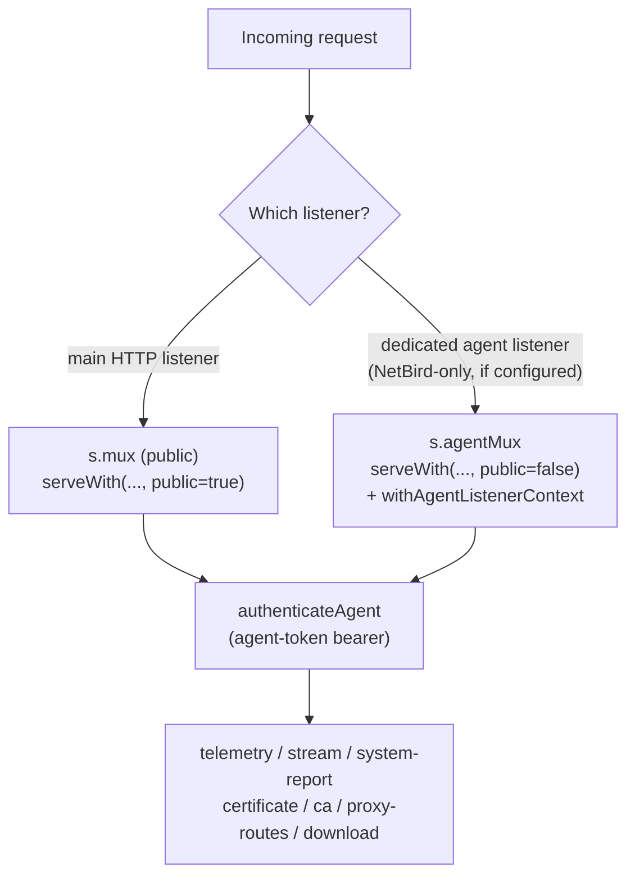

# HTTP API Surface (Reference)

Grouped reference for every HTTP route registered by the gateway (`internal/gateway/server.go` and its per-feature files), the auth mode each group expects, and a one-line purpose per endpoint. For the configuration that drives these routes, see [Configuration](../cross-cutting/configuration.md); for the underlying RBAC/session model, see the security & auth chapter.

## Auth modes

| Mode | How it's presented | Resolved by |
|---|---|---|
| **Public** | No credential | handler reads nothing auth-related |
| **Session + CSRF** | `op_ai_gateway_session` cookie; unsafe methods (non-GET/HEAD/OPTIONS) additionally require header `X-OP-CSRF: 1` | `authenticateWeb` |
| **Bearer** | `Authorization: Bearer <token>` — a user API token or a service token | `authenticate` |
| **Session-or-bearer** | Either of the above, resolved by the same call | `authenticateWeb` (used by every `requireWebScope`/`requireWebAnyScope` check) |
| **Bearer-only (any scope)** | Bearer only, accepting one of several scopes — used where a session principal must not be allowed (service-account-only paths) | `authenticate` via `requireAnyScope` |
| **Bearer-or-loopback (any scope)** | Bearer, **or** the internal trusted-loopback header pair (`X-OP-Internal-Auth` + `X-OP-Internal-User`) — never a session cookie | `authenticateInternalOrBearer` via `requireInternalOrBearerAnyScope`; used only by `/v1/images/generations`, `/v1/images/edits`, `/v1/audio/speech`, `/v1/audio/transcriptions`, `/v1/audio/transcriptions/live` and `/v1/audio/voices` |
| **Live-transcription ticket** | An encrypted, single-use ticket of about 30 s, minted by `POST /api/portal/transcription-live-ticket` and presented as a `Sec-WebSocket-Protocol` value (never in the URL); no cookie and no header is read; the **browser's WebSocket only**, the bearer `/v1/audio/transcriptions/live` mints and redeems none | `liveTicketStore.Redeem` in `handleLiveTranscription`, **before** `websocket.Accept` ([ADR-072](../09-architecture-decisions.md#adr-072--live-transcription-a-ticket-gated-websocket-carries-the-browsers-pcm-to-the-gateway-which-relays-it-full-duplex-through-a-new-agent-livemodel-route-and-bills-the-input-audio-it-counted-on-a-clean-end-of-input)) |
| **Voice-chat ticket** | The twin of the live-transcription ticket: an encrypted, single-use ticket of about 30 s, minted by `POST /api/portal/voice-chat-ticket` and presented as the second `Sec-WebSocket-Protocol` value (the first is the fixed `op-voice-chat`), never in the URL; it carries **three** resolved targets, the chat, its speech settings and the principal's attribution; no cookie and no header is read; the **browser's WebSocket only** (Voice Chat has no bearer API) | `voiceTicketStore.Redeem` in `handleVoiceChat`, **before** `websocket.Accept` ([ADR-078](../09-architecture-decisions.md#adr-078--voice-chat-one-orchestration-websocket-composes-the-three-v1-cores-as-a-server-side-state-machine-with-a-pause-tolerant-continuation-window-a-deferred-commit-and-a-playout-aware-half-duplex-gate)) |
| **Agent token** | `Authorization: Bearer <agent-secret>`, a separate per-AI-server credential (hashed lookup against `agent_tokens`, unrelated to user API tokens) | `authenticateAgent` |

On top of the auth mode, most session/bearer routes additionally require a **scope**:

| Scope | Granted to | Notes |
|---|---|---|
| `gateway:use` | every active user session; every ordinary API token | baseline — required by nearly all `/api/portal/*` and the inference/compat endpoints |
| `llm:invoke` | service tokens (service accounts) | narrower alternative accepted by inference/compat endpoints alongside `gateway:use`, per `requireAnyScope`/`requireWebAnyScope` |
| `admin` | user role `admin` or `system_admin` | required by global-admin management endpoints (servers/applications/mappings, model groups, model visibility, admin user-limits, `/api/admin/*`) |
| `system` | `system_admin` role **and** an elevated (step-up) session | required by every `/api/system/*` endpoint except the two public theme routes |

Many `/api/portal/*` endpoints (servers, applications, mappings, services, projects, groups, resource-groups) are gated at the HTTP layer only by the `gateway:use` baseline; **object-level authorization** (ownership, admin-group co-management, project/service delegate tiers) is then enforced inside `internal/portal.Service` itself, with a consistent no-existence-leak 404 for anything outside the caller's manageable set. The tables below note the small set of endpoints that additionally require the blanket `admin` or `system` scope at the HTTP layer.

## Dual-mux dispatch (agent endpoints)

The five `/api/agent/v1/*` handlers are registered identically on **both** the public mux (`s.mux`) and the dedicated mesh/agent mux (`s.agentMux`, served on a separate NetBird-facing listener when configured — see [Configuration §"Agent listener"](../cross-cutting/configuration.md)). Per-listener behavior (e.g. mesh-only enforcement, observed-TLS transport reporting) is threaded through the request context, not the handler function, since the same Go function backs both registrations.



Only requests that actually arrived on `agentMux` get `r.TLS` transport-hop reporting recorded (a public-mux request may be proxied over plaintext loopback internally and would misrepresent the real mesh transport).

## 1. Inference / compatibility endpoints

Client-facing, OpenAI/Anthropic/Codex/Claude-Code-compatible completion, image-generation, speech-synthesis, speech-transcription and model-listing routes. All require **session-or-bearer**, **bearer-only**, or (for the two image endpoints and the four audio endpoints alone, `/v1/images/generations`, `/v1/images/edits`, `/v1/audio/speech`, `/v1/audio/transcriptions`, `/v1/audio/transcriptions/live` and `/v1/audio/voices`) **bearer-or-loopback** auth with scope `gateway:use` or `llm:invoke` (service tokens); see the table for which variant each path uses. `/v1/responses` and `/v1/messages` also attempt **native passthrough** first (proxying the raw body straight to an upstream that natively speaks Codex/Claude Code) before falling back to translation. `/v1/images/generations` and `/v1/images/edits` are passthrough-**only** — they have no translate path, and admission to them takes an application that declares the `openai_images` flavor and a mapping whose `image` capability verdict is `yes` (for an edit: whose derived `image_edit` capability holds, below) — plus, for an agent-launched model, a runtime spec that declares the flavor too. `/v1/audio/speech` is passthrough-**only** the same way, and its admission takes an application that declares the `openai_audio` flavor and a mapping whose `speech` capability verdict is `yes` ([ADR-061](../09-architecture-decisions.md#adr-061--speech-is-the-second-endpoint-on-the-capability-gate-a-distinct-speech-capability-a-coarse-openai_audio-flavor-the-audio_cpp-kind-and-a-binary-relay-that-serves-wav-only)). `/v1/audio/transcriptions` is passthrough-**only** too, under the same `openai_audio` flavor, and its admission takes a mapping whose `transcription` capability verdict is `yes` ([ADR-062](../09-architecture-decisions.md#adr-062--transcription-is-multipart-in-and-json-out-on-the-shared-openai_audio-flavor-a-distinct-transcription-capability-billing-read-from-the-response-body-and-every-divergence-from-speech-keyed-on-the-endpoint)).

| Path(s) | Method | Auth | Purpose |
|---|---|---|---|
| `/v1/chat/completions`, `/openai/v1/chat/completions` | POST | Session-or-bearer, `gateway:use`\|`llm:invoke` | OpenAI-compatible chat completions (streaming supported) |
| `/v1/responses`, `/openai/v1/responses` | POST | Bearer-only, `gateway:use`\|`llm:invoke` | OpenAI Responses API (Codex); native passthrough when the target app supports it, or when the target is an OpenAI vendor account the calling token may use (the caller's own, or one shared with the caller; per-token opt-in, [§11](../cross-cutting/external-vendor-accounts.md#11-per-token-vendor-access)), subscription or api-key ([External Vendor Accounts §4.2](../cross-cutting/external-vendor-accounts.md#42-openai)) |
| `/v1/messages`, `/anthropic/v1/messages` | POST | Bearer-only, `gateway:use`\|`llm:invoke` | Anthropic Messages API (Claude Code); native passthrough when the target app supports it, or when the target is an Anthropic vendor account the calling token may use (the caller's own, or one shared with the caller; per-token opt-in, [§11](../cross-cutting/external-vendor-accounts.md#11-per-token-vendor-access)), **api-key or subscription** ([External Vendor Accounts §4.1](../cross-cutting/external-vendor-accounts.md#41-anthropic); a subscription account has the Claude-Code system block injected first, the client's `anthropic-beta` is forwarded verbatim on either, and an `openai_*` request to either account still translates) — the only path where Anthropic streaming works end-to-end |
| `/v1/images/generations`, `/openai/v1/images/generations` | POST | Bearer-or-loopback, `gateway:use`\|`llm:invoke` | OpenAI-compatible image generation, relayed to a natively image-shaped upstream (`sd-server`). No translate path: only an application declaring `openai_images` is a candidate (otherwise 404 `routing.no_model_route`, also the answer when a resolved agent-launched child's spec excludes the flavor), and a mapping without an `image` capability verdict of `yes` is refused with 404 `routing.model_not_capable`. Non-streaming only — a `stream: true` is refused with 400 `images.stream_unsupported`, and `response_format` must be `b64_json` or absent. Metered in images, not tokens |
| `/v1/images/edits`, `/openai/v1/images/edits` | POST | Bearer-or-loopback, `gateway:use`\|`llm:invoke` | OpenAI-compatible image **edit**, relayed as `multipart/form-data` to a natively image-shaped upstream (`sd-server`) — the gateway's first multipart request path ([API Compatibility & Inference §3.5](../cross-cutting/compatibility-and-inference.md#35-openai-images-edits), [ADR-057](../09-architecture-decisions.md#adr-057--image-edit-a-derived-image_edit-capability-a-multipart-passthrough-and-the-attached-image-as-the-edit-affordance)). Form fields: `model` and `prompt` (required), `image` and/or `image[]` (at least one non-empty source image — the public endpoint passes the source through and does not check its type, except that a source sent **with a mask** must be a readable PNG or JPEG; `sd-server`'s edit route itself reads PNG and JPEG only, and the webp/gif refusal described under the chat run rows below is the portal executor's alone), `mask`, `n`, `size`, `response_format` (`b64_json` or absent), `output_format` (`png`/`jpeg`), `output_compression`; every field but `model`, `prompt`, `response_format`, `stream` and the image/mask parts reaches the upstream unexamined, and `strength` is not a form field but rides the `<sd_cpp_extra_args>` block at the end of `prompt`. An OpenAI-style `mask` (an RGBA PNG whose **transparent** pixels mark the region to edit) is converted to the luminance mask `sd-server` reads, and must be a PNG of exactly the first source's size, at most 16 megapixels, with at least one transparent pixel. Admission: an application declaring `openai_images` (else 404 `routing.no_model_route`, also for an agent-launched child whose spec lacks the flavor) and a mapping whose **derived `image_edit` capability** holds — `image: yes` unless an operator set `image_edit: no` (else 404 `routing.model_not_capable`, [Routing & Model Selection §2.3](../cross-cutting/routing-and-model-selection.md#23-the-capability-gate)). **Error codes** (all `400` unless noted): `images.model_required`, `images.prompt_required`, `images.image_required` (no non-empty `image`/`image[]` part), `images.response_format_unsupported`, `images.stream_unsupported`, `images.mask_invalid` (size not the source's, past 16 MP, or no transparent pixel), `images.edit_unsupported_format` (a mask that is not a readable PNG, or — only when a mask is sent — a source that is not a readable PNG/JPEG), `request.invalid` (not multipart, no boundary, a malformed or truncated form, or a repeated `model`/`prompt`/`response_format`/`stream`/`mask` field); `404` `images.edit_unavailable` (the resolved model is agent-launched and its agent has not declared the `multipart_proxy` feature — an agent older than 0.9.0, or one that has not reported since the gateway restarted or the agent was upgraded; nothing is relayed, and it is not retried against a sibling application); `413` `request.body_too_large` (a body over `OP_AI_GATEWAY_MAX_IMAGE_EDIT_BODY_BYTES`, default 32 MiB, or one over the agent router's own 32 MiB once the gateway has prepared it — a mask conversion or model-name rewrite can grow it). Non-streaming only; metered in **output** images (`billing_unit: image`, the source and mask are not metered), usage `provider_path` `/v1/images/edits`. A portal image turn whose last user message carries an image reaches this endpoint over loopback (below, the chat run rows) |
| `/v1/audio/speech`, `/openai/v1/audio/speech` | POST | Bearer-or-loopback, `gateway:use`\|`llm:invoke` | OpenAI-compatible text-to-speech, relayed to a natively OpenAI-shaped speech upstream (audio.cpp's `audiocpp_server`) — the gateway's first **binary inference** response ([API Compatibility & Inference §3.6](../cross-cutting/compatibility-and-inference.md#36-openai-audio-speech), [ADR-061](../09-architecture-decisions.md#adr-061--speech-is-the-second-endpoint-on-the-capability-gate-a-distinct-speech-capability-a-coarse-openai_audio-flavor-the-audio_cpp-kind-and-a-binary-relay-that-serves-wav-only)). JSON body: `model` and `input` (both required, non-empty), `voice`, `language` (the transcript language, a top-level audio.cpp field applied per model and silently dropped where a model takes none, so the gateway neither reads nor gates on it; [API Compatibility & Inference §3.6](../cross-cutting/compatibility-and-inference.md#36-openai-audio-speech) item 11), and any other field the upstream honours, which reaches it unexamined. **Response:** for a one-shot request `200` with `Content-Type: audio/wav` and the upstream's `Content-Length`, the body streamed without being buffered, or, when the request named `response_format: "pcm"`, `200` with `Content-Type: application/octet-stream` and a `Content-Length` of the data chunk alone — the upstream WAV with its RIFF/WAVE header stripped, **headerless signed 16-bit little-endian mono PCM at the model's native sample rate**, which the client learns out of band; for a **streamed** request (below) `200` with `Content-Type: text/event-stream` (the default) or `application/octet-stream` (`stream_format: "audio"`), chunked, with no `Content-Length`. No translate path: only an application declaring `openai_audio` is a candidate (otherwise 404 `routing.no_model_route`, also the answer when a resolved agent-launched child's spec excludes the flavor), and a mapping without a `speech` capability verdict of `yes` is refused with 404 `routing.model_not_capable`. **Accepted `response_format`: for a request that does not stream, `wav`, `pcm` or absent**; every other value (`mp3`, `opus`, `flac`, `aac`, `json`, `b64_json`) is refused with 400 `speech.response_format_unsupported`. `pcm` is served by a **WAV-header strip, not a transcode** ([ADR-069](../09-architecture-decisions.md#adr-069--non-stream-speech-pcm-is-a-wav-header-strip-not-a-transcode-the-gateway-relays-the-data-chunk-of-a-16-bit-mono-wav-as-headerless-pcm-refuses-any-other-clip-after-synthesis-and-leaves-mp3opusflacaac-to-264), issue #253 part 1): the gateway asks audio.cpp for its WAV, checks it is 16-bit mono PCM, and relays only the `data` chunk, so no codec or resample is involved; `mp3`, `opus`, `flac` and `aac` stay refused because audio.cpp has no encoder (it answers a plain WAV for every one of them) and producing them is server-side transcoding, issue #264. A clip that cannot be served as raw PCM (a model whose native audio is not 16-bit mono, an unsound WAV, or an upstream that declared no `Content-Length`) is refused after synthesis with **502 `speech.pcm_unavailable`**. A `stream: true` request answered buffered (below) is still a one-shot `audio/wav`, even with `response_format: "pcm"`. **Streaming is served for a `mode=streaming` model** ([ADR-068](../09-architecture-decisions.md#adr-068--streaming-speech-synthesis-the-gateway-relays-the-pcm-stream-of-a-streaming-model-meters-it-from-the-bytes-it-relayed-audio_bytes-or-audio_second-over-a-benchmark-learned-byte-rate-and-the-portal-composer-plays-it-as-it-arrives), issues #253 and #263): `stream: true` against a mapping whose `speech_streaming` capability verdict is `yes` is relayed as audio.cpp's own stream, passed through unbuffered — by default (or `stream_format: "sse"`) the OpenAI-style SSE `speech.audio.delta` (the base64 PCM in `audio`: signed 16-bit little-endian mono, **headerless, and the stream states neither a sample rate nor a duration**) → `speech.audio.done` (only `timing.ttft_ms`) → `[DONE]`, and with `stream_format: "audio"` the raw headerless PCM as `application/octet-stream`. A streamed request must ask `response_format` `pcm` or leave it out: `wav` beside a stream is refused with 400 `speech.stream_unsupported` (audio.cpp serves streaming only as `pcm`), and any other value with 400 `speech.response_format_unsupported`. Against an offline, unprobed or not-yet-reported model the same `stream: true` is answered **buffered** — one complete `audio/wav` clip, never an error, whatever `response_format` the request named — and on a stale-`yes` mode-mismatch `500` the gateway retries the request buffered once. A **non-boolean** `stream`, a `stream_format` other than `sse` or `audio`, and a `stream_format` on a request that does not stream are refused with 400 `speech.stream_unsupported`. **Error codes** (`400` unless noted): `speech.model_required`, `speech.input_required`, `speech.response_format_unsupported`, `speech.stream_unsupported`, and the post-synthesis `speech.pcm_unavailable` (`502`). A non-2xx upstream answer is normalised to the OpenAI error shape at the upstream's own status: an OpenAI error object passes through unchanged, a plain-string error is wrapped with `type: upstream_error` and `code: speech.upstream_error`, and any other body is relayed as it came. Metered in seconds of audio, not tokens (`billing_unit: audio_second`, read from the upstream's `X-AudioCPP-Audio-Duration-Ms`, a one-shot `pcm` answer included, and `audio_second` with quantity 0 for a `speech.pcm_unavailable` row); a **streamed** call carries no such header, so on a clean completion (`speech.audio.done` then `[DONE]`, or a raw body the upstream closed cleanly) it is billed from the PCM bytes the relay counted — `audio_second` = bytes ÷ the mapping's cached output byte rate (learned by the speech benchmark), or, while none is cached, `billing_unit: audio_bytes` with the byte count — and every other streamed outcome is `audio_second` with quantity 0, usage `provider_path` `/v1/audio/speech`. **`voice` is a fail-open routing preference** ([Routing & Model Selection §2.5](../cross-cutting/routing-and-model-selection.md#25-the-voice-filter-speech-only-fail-open), [ADR-067](../09-architecture-decisions.md#adr-067--a-persistent-per-mapping-cache-first-used-for-tts-voices-fetched-while-the-model-is-loaded-change-detected-and-read-by-a-picker-and-a-fail-open-routing-filter)): the body is still relayed unchanged, but when at least one candidate's cached voice list (the next row) offers the requested `voice`, routing is restricted to the candidates that do, and otherwise it is unfiltered, so a free-text or unknown voice reaches the upstream as before (audio.cpp answers an unknown voice with HTTP 500). When the voice **narrowed** the candidates and none of those is usable the answer is **`503` `routing.voice_unavailable`** (instead of `routing.no_healthy_host`, and only then). Voice names are listed by `GET /v1/audio/voices` (the next row); the portal chat's speech composer, which calls this endpoint over loopback, offers them in a combobox that still takes free text ([ADR-063](../09-architecture-decisions.md#adr-063--speech-in-the-portal-chat-is-a-third-run-kind-the-model-is-the-affordance-the-run-reuses-the-speech-endpoint-over-loopback-and-the-wav-lives-in-chat_blobs) (f) amendment) |
| `/v1/audio/voices`, `/openai/v1/audio/voices` | GET | Bearer-or-loopback, `gateway:use`\|`llm:invoke` | The voice names the gateway has **cached** for a speech model, so a client can learn what `voice` a `/v1/audio/speech` request may name ([API Compatibility & Inference §3.6](../cross-cutting/compatibility-and-inference.md#36-openai-audio-speech) item 8, [ADR-067](../09-architecture-decisions.md#adr-067--a-persistent-per-mapping-cache-first-used-for-tts-voices-fetched-while-the-model-is-loaded-change-detected-and-read-by-a-picker-and-a-fail-open-routing-filter)). Bearer token **or** the internal loopback pair, **never the session cookie** (a browser uses `/api/portal/model-voices`). The gateway model name is the `model` query parameter; it selects which cached rows to read, and audio.cpp's own `?model=` is moot (it ignores it and lists the model it has loaded). A **read of the persistent cache only**: no model is loaded and no upstream is contacted, so the list is available while the model is unloaded. **Response:** `200 {"model": "<name as asked>", "voices": ["..."]}`, the deduplicated, sorted union across the model name's reachable mappings (a group name is expanded to its members), restricted to mappings that are **offerable** now (`(speech, yes)` and either not `(speech_clone, yes)` or a non-empty cached list, read at request time), so **a voice-clone model with configured presets now lists its preset names** (it answered `[]` before [ADR-075](../09-architecture-decisions.md#adr-075--offering-a-configured-voice-clone-speech-model-the-gateway-fetches-a-clone-models-preset-voices-a-non-empty-cached-list-is-the-offer-signal-for-both-portal-pickers-a-fail-closed-and-covers-mixed-names-and-streaming-for-clone-stays-deferred), issue #301). Visibility is routing-consistent: the token's model override and a service token's allowlist, then exactly the mappings a speech dispatch for this token could reach (resource-group provisioning, the locked/group-only rule). **No-leak:** every "nothing to show" case (an unknown name, a model the token cannot route to or may not use, a non-speech model, a clone model without presets, or one with nothing cached yet) is the same `200` with `"voices": []`. **Errors:** `400` `model.name_required` (a missing or blank `model`), `500` `model.voices_failed` (a store failure, never read as empty). Non-`GET` is `405`. Voices are deliberately not part of `/v1/models` |
| `/v1/audio/transcriptions`, `/openai/v1/audio/transcriptions` | POST | Bearer-or-loopback, `gateway:use`\|`llm:invoke` | OpenAI-compatible speech-to-text, relayed as `multipart/form-data` to a natively OpenAI-shaped upstream (audio.cpp's `audiocpp_server`) — **multipart in, JSON out** ([API Compatibility & Inference §3.7](../cross-cutting/compatibility-and-inference.md#37-openai-audio-transcriptions), [ADR-062](../09-architecture-decisions.md#adr-062--transcription-is-multipart-in-and-json-out-on-the-shared-openai_audio-flavor-a-distinct-transcription-capability-billing-read-from-the-response-body-and-every-divergence-from-speech-keyed-on-the-endpoint)). Form fields: `model` (required, non-empty) and **exactly one non-empty part named `file`** (the audio; only `file` counts, there is no `file[]`, and an empty `file` part beside the real one is dropped before the relay); `language`, `prompt`, `response_format` (`json` or absent), `temperature` and so on; every field but `model`, `file`, `response_format`, `stream` and `stream_format` reaches the upstream unexamined (`language` and `prompt` are read but not checked), and a valid `response_format` is relayed with the rest. A JSON body is not served. **Response:** `200` `application/json`, audio.cpp's `{"text": ..., "timing": {"wall_ms", "audio_duration_ms", "rtf"}}` document written through **verbatim**, the `timing` extension included (the gateway proxies and does not translate); it is buffered whole up to the body cap first, to read the trailing `timing`, so a 2xx response over the cap or one that breaks off mid-read is `502` `transcription.upstream_error` with nothing written. No translate path: only an application declaring `openai_audio` is a candidate (otherwise 404 `routing.no_model_route`, also the answer when a resolved agent-launched child's spec excludes the flavor), and a mapping without a `transcription` capability verdict of `yes` is refused with 404 `routing.model_not_capable`. **Accepted `response_format`: `json` or absent only**; `verbose_json`, `text`, `srt`, `vtt` and every other value is refused with 400 `transcription.response_format_unsupported`. **Streaming is served for a `mode=streaming` model** ([ADR-065](../09-architecture-decisions.md#adr-065--streaming-transcription-the-gateway-relays-the-sse-for-a-streaming-model-gated-by-a-transcription_streaming-verdict-with-a-retry-buffered-on-500-safety-net-bills-the-streamed-call-from-the-wav-header-and-the-portal-chat-run-streams-the-transcript), issue #262): `stream: true` against a mapping whose `transcription_streaming` capability verdict is `yes` is relayed as audio.cpp's own OpenAI-style SSE — `transcript.text.delta` (incremental) → `transcript.text.done` (full `text` + `timing.ttft_ms`) → `[DONE]` — passed through unbuffered, with `Content-Type: text/event-stream`, and billed `audio_second` from the **uploaded WAV header** on a clean completion (loud-zero otherwise). Against an offline, unprobed or not-yet-reported model the same `stream: true` is served **buffered** (the complete JSON, never an error), and on a stale-`yes` mode-mismatch `500` the gateway retries the request buffered once. A **non-boolean** `stream` or **any** `stream_format` is still refused with 400 `transcription.stream_unsupported`. **Error codes** (all `400` unless noted): `transcription.model_required`, `transcription.file_required` (no non-empty `file` part), `transcription.response_format_unsupported`, `transcription.stream_unsupported`, `transcription.invalid` (not multipart or no boundary, a malformed or truncated form, a field over 1 MiB, a repeated single-use field, or more than one non-empty `file`); `404` `transcription.unavailable` (the resolved model is agent-launched and its agent has not declared `multipart_proxy` — an agent older than 0.9.0, or one that has not reported since the gateway restarted or the agent was upgraded; nothing is relayed, and it is not retried against a sibling application); `413` `request.body_too_large` (a body over `OP_AI_GATEWAY_MAX_AUDIO_TRANSCRIPTION_BODY_BYTES`, default 32 MiB, or one over the agent router's own 32 MiB once the gateway has prepared it); `502` `transcription.upstream_error` (a 2xx response over the buffer bound or broken off mid-read). A non-2xx upstream answer is normalised to the OpenAI error shape at the upstream's own status: an OpenAI error object passes through unchanged, a plain-string error is wrapped with `type: upstream_error` and `code: transcription.upstream_error`, and any other body is relayed as it came. Metered in seconds of audio, not tokens (`billing_unit: audio_second`; a buffered call reads the quantity from the response body's `timing.audio_duration_ms`, not a header, while a **streamed** call has no such field and is billed from the uploaded WAV header on a clean completion), usage `provider_path` `/v1/audio/transcriptions`. The portal chat's `transcription` run kind calls this endpoint over the internal loopback pair (a recorded or attached clip as the `file` part), [ADR-064](../09-architecture-decisions.md#adr-064--transcription-in-the-portal-chat-is-the-fourth-run-kind-the-model-is-the-affordance-the-audio-input-lives-in-chat_blobs-and-is-relayed-multipart-over-loopback-and-the-reply-is-the-ordinary-text-turn) |
| `/v1/audio/transcriptions/live`, `/openai/v1/audio/transcriptions/live` | POST | Bearer-or-loopback, `gateway:use`\|`llm:invoke` | **Live transcription: a chunked, full-duplex HTTP request** that mirrors audio.cpp's own native `/live`, so a programmatic client can treat the gateway as a drop-in; the **canonical relay** of live transcription, which the portal's WebSocket loops back to ([ADR-073](../09-architecture-decisions.md#adr-073--portal-live-transcription-loops-back-through-the-public-v1audiotranscriptionslive-one-canonical-relay-that-resolves-admits-guards-and-bills-once), [ADR-072](../09-architecture-decisions.md#adr-072--live-transcription-a-ticket-gated-websocket-carries-the-browsers-pcm-to-the-gateway-which-relays-it-full-duplex-through-a-new-agent-livemodel-route-and-bills-the-input-audio-it-counted-on-a-clean-end-of-input), [API Compatibility & Inference §3.8](../cross-cutting/compatibility-and-inference.md#38-live-transcription-the-bearer-v1-endpoint-and-the-portal-websocket), [exchange and codes](#live-transcription-the-bearer-endpoint-the-ticket-and-the-websocket)). **Request:** the **body is raw interleaved PCM**, streamed chunked, and the client ends the session by finishing it (the terminating chunk): no WebSocket, no ticket, no `{"type":"end"}`; the parameters are in the **query string**: `model` (required, trimmed), `sample_rate` (integer 1000 to 384000), `channels` (integer 1 to 16), `sample_format` (`s16le` or `f32le`) and `language` (optional: empty, or `[A-Za-z0-9_-]` up to 64 characters). Auth is a **bearer** (a user's or a service's token) or the loopback pair, **never** the session cookie, so there is **no CSRF** and no ticket. **Response:** `200` `text/event-stream`, headers flushed before the first body byte, the upstream's SSE relayed verbatim and flushed: `transcript.text.delta` (append), `transcript.text.partial` (replace), `transcript.text.done`, an `error` event, then `data: [DONE]`. **Refusals**, all before a byte of PCM moves: `405` (not `POST`), `401` (no or invalid bearer; a session cookie alone), `403 auth.insufficient_scope`, `400 transcription.model_required`, `400 transcription.live_params_invalid`, then the buffered transcription's shared gate and the principal's **one** admission (`403 model.not_allowed`/`server_override.forbidden`, `429 limit.rate_limited` with `Retry-After`/`limit.request_quota_exceeded`/`limit.token_quota_exceeded`, `402 limit.cost_budget_exceeded`, `404 routing.no_model_route`/`routing.model_not_capable`, `503 routing.no_healthy_host`/`routing.admission_queue_timeout`/`_full`), `409 transcription.live_not_streaming` (no stored `transcription_streaming = yes` verdict), `409 transcription.live_agent_unsupported` (an agent-launched model whose agent has not declared `fullduplex_proxy`) and `503 transcription.live_busy` (audio.cpp serves one `/live` per model: the route's slot is taken, retry when that session ends; no usage row). A dial failure is the mapped provider error, and a non-2xx upstream answer (the agent's `404`/`503`, a child error) is relayed under its own status with its bounded body. **Guards:** the 30 s deadlines are lifted, and the streamed relays' **idle watchdog** and per-chunk write deadline (`OP_AI_GATEWAY_STREAM_IDLE_TIMEOUT`) apply: a client that keeps sending PCM but stops reading the SSE is cut, its slot released and its session billed a loud zero. **Billing:** `audio_second` = PCM bytes received ÷ (`sample_rate` × `channels` × bytes per sample) on a clean end (the client's terminating chunk, then `transcript.text.done` and `[DONE]`), and `(audio_second, 0)` with an `Error` log line on any other (a truncated body, an idle reap, an upstream error); the row is attributed to the **bearer token** (its `TokenID` and, for a service token, its service and project), whereas a portal session that loops back here is attributed to the loopback user. A reverse proxy in front must **not buffer the request body** (the bundled nginx has an unbuffered location for it; a Kubernetes Ingress buffers per Ingress and does not stream it full-duplex, [Deployment View §7.3](../07-deployment-view.md#73-kubernetes)) |
| `/v1/messages/count_tokens`, `/anthropic/v1/messages/count_tokens` | POST | Bearer-only, `gateway:use`\|`llm:invoke` | Anthropic token counting (utility call, no upstream inference, no billing) |
| `/v1/models`, `/openai/v1/models` | GET | Bearer-only, `gateway:use`\|`llm:invoke` | OpenAI-shaped model listing of the models offered under the `openai` flavor: a mapping whose application declares `openai` and whose effective flavors (for an agent-launched model with a runtime spec, the spec's) are neither images-only nor audio-only ([ADR-045](../09-architecture-decisions.md#adr-045--a-model-listing-advertises-what-dispatch-serves-one-flavor-rule-read-from-the-spec), [ADR-061](../09-architecture-decisions.md#adr-061--speech-is-the-second-endpoint-on-the-capability-gate-a-distinct-speech-capability-a-coarse-openai_audio-flavor-the-audio_cpp-kind-and-a-binary-relay-that-serves-wav-only)) — so an images-only or audio-only model is not listed, whether its application or its spec makes it so; discovery is unfiltered by a service token's own allowlist, but IS filtered by resource-group provisioning visibility. Each entry is `{id, object: "model", owned_by: "op-ai-gateway", capabilities, context_length?}`; `context_length` is the model's usable context window in tokens (the minimum known across its offering mappings) and is **omitted**, not `0`, when no mapping reports one; `capabilities` is `{vision, image, image_edit, trained_for_tool_use}` — the same object `/api/v1/models` carries, built by one shared helper so the two listings stay identical ([ADR-045](../09-architecture-decisions.md#adr-045--a-model-listing-advertises-what-dispatch-serves-one-flavor-rule-read-from-the-spec) (h), issue #222) — always present. A [generated Claude alias row](#generated-claude-model-aliases) — only such a row — adds `original_model_id` (the real gateway model or group id) and the honest `display_name` as top-level siblings of `capabilities`; an ordinary row has neither |
| `/anthropic/v1/models` | GET | Bearer-only, `gateway:use` | Anthropic-shaped model listing of the models offered under the `anthropic` flavor: a mapping whose application and effective flavors both declare `anthropic` and whose effective messages mode is not `disabled`. Body `{"data": [...]}`; each entry is `{id, type: "model", display_name, created_at, original_model_id?}`, where `created_at` is a fixed placeholder and `display_name` is the id, except on a [generated Claude alias row](#generated-claude-model-aliases), whose `display_name` is the honest label and which alone carries `original_model_id`. The rows are the portal `Models()` rows narrowed to the `anthropic` flavor (so they can carry the alias metadata), exactly the names `ModelsForFlavor(anthropic)` lists |
| `/api/v1/models`, `/openai/api/v1/models` | GET | Bearer-only, `gateway:use`\|`llm:invoke` | LM Studio v2-shaped model listing — the native listing LM Studio's own clients read each model's context window from (metadata only; actual chat still goes over `/v1/chat/completions`). It lists exactly the names `/v1/models` lists — the portal rows whose `flavors` contain `openai`, groups and offered aliases included. Body `{"models": [...]}`; each entry is `{type: "llm", key, display_name, max_context_length, loaded_instances, capabilities}`: `max_context_length` is **always** present (`0` when the window is unknown, unlike `/v1/models`), `loaded_instances` is `[{"config": {"context_length": N}}]` while the model is loaded and `[]` otherwise, and `capabilities` is `{vision, image, image_edit, trained_for_tool_use}` (`vision`/`image`/`image_edit` from the fail-closed folds; `trained_for_tool_use` is always `true`, see [ADR-045](../09-architecture-decisions.md#adr-045--a-model-listing-advertises-what-dispatch-serves-one-flavor-rule-read-from-the-spec) (h)). `vision` and `trained_for_tool_use` are the keys an LM Studio client / opencode read; `image` and `image_edit` are gateway extensions beyond those two keys (issue #222). A [generated Claude alias row](#generated-claude-model-aliases) alone adds `original_model_id` (its `display_name` is already on every row). There is no `/anthropic/api/v1/models`. LM Studio's earlier `/api/v0/models` was removed and answers 404 `request.not_found` |

## 2. Auth endpoints (`/api/auth/*`)

| Path | Method | Auth | Purpose |
|---|---|---|---|
| `/api/auth/login` | POST | Public + CSRF header | Password login; sets the session cookie on success |
| `/api/auth/logout` | POST | Session + CSRF | Clears the current session |
| `/api/auth/session` | GET | Public | Reports current auth state (`authenticated`, current-user DTO, default language) — used by the SPA on load; never errors on "not logged in" |
| `/api/auth/set-password` | POST | Public + CSRF header | Consumes a one-time set-password/invite token to set a password |

## 3. Portal endpoints (`/api/portal/*`)

Session-or-bearer, scope `gateway:use` unless noted. This is the bulk of the authenticated application API.

### Account, session, preferences

| Path | Methods | Purpose |
|---|---|---|
| `/api/portal/me` | GET | Current user DTO (role, elevation state, TOTP mode, etc.) |
| `/api/portal/password` | POST | Change own password (CSRF-enforced) |
| `/api/portal/language`, `/api/portal/currency` | GET/PUT, GET | Own preferred language; system-wide EUR→USD display factor |
| `/api/portal/preferences`, `/api/portal/preferences/{key}` | GET, GET/PUT | Opaque per-key UI preference storage |
| `/api/portal/chat-settings` | PUT | Own default chat run settings |
| `/api/portal/system-admin-mode` | POST/DELETE | Enter/leave System-Admin step-up elevation (requires role `system_admin`; may require re-entering the password per system setting) |
| `/api/portal/totp`, `/api/portal/totp/{action}` | GET/DELETE, POST | TOTP 2FA status/disable; enroll/confirm |

### Tokens, chats, usage

| Path | Methods | Purpose |
|---|---|---|
| `/api/portal/tokens`, `/api/portal/tokens/{id}[/rotate]` | GET/POST, PATCH/DELETE/POST | Own API token CRUD + rotate. A token carries its **vendor-account access policy** (`vendor_access`, a strict opt-in: absent = no vendor accounts) on the list, create and update; see [Token vendor access](#token-vendor-access). The opt-in `claude_model_aliases` flag is writable on create and update and always read back; see [Generated Claude model aliases](#generated-claude-model-aliases). The opt-in `claude_effort_compatibility` flag is likewise writable on create and update and always read back, **but only by a portal session or an admin-scope bearer**: an inference-only bearer that sets it, on its own token or another, is refused `403 portal.principal_forbidden`; see [Claude Code effort compatibility](#claude-code-effort-compatibility) |
| `/api/portal/chats`, `/api/portal/chats/{id}[/runs...]` | GET/POST, GET/PUT/DELETE + run sub-paths | Portal built-in chat CRUD, run start/SSE events/cancel. The **listing** also carries `max_content_bytes` (`portal.MaxChatContentBytes`, the 4 MiB pre-seal cap on the chat's **text** document). It is **informational**: it used to feed the composer's remaining-image-capacity line, which is gone now that images are stored outside the document (see the next row), and no portal code consumes it. The chat's binary payloads are not part of that document: after a run commit an image part carries `/api/portal/chat-blobs/{id}` instead of a `data:` URL, and so does a speech reply's or a transcription clip's `audio_url` part (old chats keep inline `data:` parts until their next run). A run start (`POST …/runs`) can answer `400` `images.blob_type_unsupported` (an inline image is not a standard-padded base64 `data:` URL of `image/png`, `image/jpeg`, `image/webp` or `image/gif`, or an inline `audio_url` part is not one of the allow-listed audio types — `audio/wav`, or a transcription clip's `audio/webm`, `audio/mpeg`, `audio/mp4` or `audio/ogg` — the portal composer converts every clip to WAV, so it produces only `audio/wav`; the broader types are retained on the allow-list for forward compatibility and are not produced by the portal today; the code keeps its image wording), `images.blob_too_large` (one decoded image over `MaxChatBlobBytes`), `images.blob_not_owned` (a `/chat-blobs/` URL in the request that this chat does not hold; for an **image** run also one in the last user message of the stored transcript — an edit's source or mask — and for a **transcription** run the last user message's audio clip, which the run-start resolution refuses rather than replacing with a placeholder, so an edit never silently turns into a generation and a transcription never silently runs on a clip the chat does not hold) or `portal.chat_run_history_too_large` (the stored images the run would send upstream exceed `MaxRunHistoryBytes`); none of them stores the turn. **PUT is refused with 409 `portal.chat_run_active` while a run is active for that chat**, because it replaces the whole document and would overwrite what the run has checkpointed or is about to commit. A run's `201`, the active-runs rows and the `snapshot`/`done` SSE events carry the run's `kind` (`""` text, `"image"`, `"speech"`, `"transcription"`) and a server-measured `elapsed_ms`. A `speech` run (settings `kind: "speech"` plus `settings.audio`, `{voice?, speed?, stream?, keep_last_audio?, language?, passthrough?}`: a voice (picked from the cached list or typed as free text, the composer's combobox over `/api/portal/model-voices`), a speed, a **language** (free text, an ISO-639-1-style code such as `de`, merged into the request as a top-level `language`; the composer offers it only where `/api/portal/model-speech-language` says the model takes one, [ADR-074](../09-architecture-decisions.md#adr-074--portal-speech-language-a-per-thread-composer-control-injected-as-a-top-level-language-gated-by-a-cached-include_params-fact-with-a-fail-closed-agent-v1models-passthrough); omitted leaves the model on its default), the thread's choice to hear the audio while it is generated (`stream`, default on, only an explicit `false` is stored), the thread's **retention of its answers' audio** (`keep_last_audio`: omitted keeps every answer, the default and what every older chat reads as; `N >= 1` keeps the audio of the newest N answers and prunes older ones in the commit that adds a new answer; `0` stores no answer audio, honored for a run that streamed and overridden by keeping the one answer when the run fell back to a buffered clip; a negative value is read as omitted; an answer whose audio is gone carries an `audio_removed` content part; [ADR-071](../09-architecture-decisions.md#adr-071--audio-answer-lifecycle-a-per-chat-retention-knob-keep-all-keep-the-last-n-or-do-not-store-one-atomic-delete-that-leaves-an-audio_removed-marker-a-lazy-and-a-confirmed-retroactive-prune-a-manual-per-answer-delete-and-live-mute-and-abort-with-no-migration-and-no-agent-bump)), and an advanced JSON object merged into the request body) posts the last user message's text to `/v1/audio/speech` over loopback and commits one or more ordered `audio_url` parts holding the WAV (one for a clip at or under the per-part target (`min(8 MiB, MaxChatBlobBytes/2)` of PCM), several for a longer one, each part under the per-blob cap, all under a total audio cap; [ADR-070](../09-architecture-decisions.md#adr-070--long-speech-is-stored-as-multiple-ordered-wav-blobs-under-a-total-audio-cap-positional-order-with-no-migration-one-atomic-commit-an-honest-audio-too-large-error-that-still-bills-the-delivered-call-named-commit-failure-codes-and-a-gapless-client-side-stitch)); when the gateway can stream the model (`GET /api/portal/model-speech-streaming`, below, which the run re-evaluates server-side) it asks for a stream, and the run's SSE stream then carries one extra **`audio`** event per chunk, `{"audio": {"seq", "rate", "data"}}` (the chunk's base64 PCM, a sequence number from 0 and the sample rate to play it at), sent to live subscribers only, never part of a `snapshot` and not replayed to a late subscriber, who is served the committed audio instead ([ADR-068](../09-architecture-decisions.md#adr-068--streaming-speech-synthesis-the-gateway-relays-the-pcm-stream-of-a-streaming-model-meters-it-from-the-bytes-it-relayed-audio_bytes-or-audio_second-over-a-benchmark-learned-byte-rate-and-the-portal-composer-plays-it-as-it-arrives)); a user **cancel** of a speech run commits the not-stored `audio_removed` marker in place of an empty canceled turn (a deadline is still an `error`, with no marker); it ends `error` with `gateway.chat_run_speech_dispatch_failed` (the loopback request never completed), `gateway.chat_run_no_audio` (an empty 2xx), `gateway.chat_run_speech_response_unreadable` (a 2xx body that could not be read, or is not labelled WAV) or `gateway.chat_run_speech_reserved_field` (a passthrough key named `model`, `input`, `stream`, `stream_format` or `response_format`, case-insensitively: nothing is sent), or `gateway.chat_run_audio_too_large` (the synthesized audio is longer than the total a turn may store, `OP_AI_GATEWAY_MAX_CHAT_AUDIO_BYTES`: nothing is committed), or with the endpoint's own code (`speech.input_required`, `speech.response_format_unsupported`, `speech.stream_unsupported`, `speech.upstream_error`), every one labelled in German and English by the portal; a buffered speech run is bounded at 10 minutes like an image run, while a **streaming** one is bounded by that deadline only until its first chunk of audio, after which the relay's idle watchdog applies, and it commits only a stream that ended with its terminal events (a cut stream is `gateway.chat_run_speech_response_unreadable`) ([ADR-063](../09-architecture-decisions.md#adr-063--speech-in-the-portal-chat-is-a-third-run-kind-the-model-is-the-affordance-the-run-reuses-the-speech-endpoint-over-loopback-and-the-wav-lives-in-chat_blobs)). A `transcription` run (settings `kind: "transcription"` plus `settings.transcription`, `{language?, prompt?, temperature?, passthrough?}`) relays the last user message's audio clip as the `file` part of a `multipart/form-data` POST to `/v1/audio/transcriptions` over loopback and commits the transcript as an ordinary text turn (no new part, no output blob); `response_format` is never sent (the endpoint forces JSON); it ends `error` with `gateway.chat_run_transcription_dispatch_failed` (the loopback request never completed), `gateway.chat_run_transcription_source_unreadable` (the clip could not be turned into bytes), `gateway.chat_run_transcription_response_unreadable` (a 2xx body that could not be read), `gateway.chat_run_transcription_no_transcript` (an empty or absent `text`) or `gateway.chat_run_transcription_reserved_field` (a passthrough key named `model`, `file`, `stream` or `response_format`, case-insensitively: nothing is sent), or with the endpoint's own relayed code (`transcription.file_required`, `transcription.response_format_unsupported`, `transcription.stream_unsupported`, `transcription.upstream_error`, `transcription.unavailable`); the run codes and these are labelled in German and English by the portal, while `transcription.model_required` and `transcription.invalid` are left unmapped on purpose (as the speech and image `model_required` codes are — a run always sends its pinned model); a buffered transcription run is bounded at 10 minutes like a speech run, while a **streaming** one is bounded by that deadline only until the first delta — after which the deadline is lifted and the relay's idle watchdog applies, like a text run ([ADR-064](../09-architecture-decisions.md#adr-064--transcription-in-the-portal-chat-is-the-fourth-run-kind-the-model-is-the-affordance-the-audio-input-lives-in-chat_blobs-and-is-relayed-multipart-over-loopback-and-the-reply-is-the-ordinary-text-turn), [ADR-065](../09-architecture-decisions.md#adr-065--streaming-transcription-the-gateway-relays-the-sse-for-a-streaming-model-gated-by-a-transcription_streaming-verdict-with-a-retry-buffered-on-500-safety-net-bills-the-streamed-call-from-the-wav-header-and-the-portal-chat-run-streams-the-transcript)). An `image` run whose last user message carries an image is an **edit**: the executor posts it to `/v1/images/edits` (an image part tagged `"purpose": "mask"` is the mask), and sends nothing upstream and ends the run `error` with `gateway.chat_run_image_source_unreadable` (an image or mask that cannot be turned into bytes: an external link, an unresolved reference, bad base64, a non-image type, a mask that is not a PNG, a second mask) or `gateway.chat_run_image_source_unsupported` (a readable source that is not PNG or JPEG — typically the webp result of a thread whose format is webp being refined, or an older upload; the label says to set the thread's image format to PNG or JPEG and regenerate first; the public edits endpoint is not so restricted); the edit endpoint's own refusals reach the run as their codes (`images.image_required`, `images.edit_unavailable`, `images.mask_invalid`, `images.edit_unsupported_format`, `request.body_too_large`), every one of them labelled in German and English by the portal, and a webp `output_format` is left out of an edit's form (the upstream default applies on edit turns); see [API Compatibility & Inference §12](../cross-cutting/compatibility-and-inference.md#12-in-portal-chat-playground) |
| `/api/portal/chats/{id}/messages/{messageID}/audio` | DELETE | Deletes the stored audio of **one** spoken answer ([ADR-071](../09-architecture-decisions.md#adr-071--audio-answer-lifecycle-a-per-chat-retention-knob-keep-all-keep-the-last-n-or-do-not-store-one-atomic-delete-that-leaves-an-audio_removed-marker-a-lazy-and-a-confirmed-retroactive-prune-a-manual-per-answer-delete-and-live-mute-and-abort-with-no-migration-and-no-agent-bump), issue #281): every audio part of the message (all the ordered parts of a long answer), the `chat_blobs` rows behind them and the `audio_url` parts in the sealed document go in **one atomic save**, and the message keeps its id and place and gains one `audio_removed` content part (the portal renders it as the not-stored bubble with a regenerate). **Standard portal auth** (session cookie plus the `X-OP-CSRF` header, or a bearer token; scope `gateway:use`). `200 {"ok": true}`; a message with no stored audio of its own (a text answer, an answer whose audio is already gone, a user turn) is a `200` no-op that writes nothing, so a repeat is safe. **`404 portal.chat_not_found` covers BOTH a missing chat (or another owner's, no existence leak) AND a message id the chat does not hold**; **`409 portal.chat_run_active` while a run is active for the chat**, as for `PUT /api/portal/chats/{id}`, because the call rewrites the whole document and would race the run's checkpoint or terminal commit; `405` for any other method. See [Compatibility & Inference §12](../cross-cutting/compatibility-and-inference.md#12-in-portal-chat-playground) |
| `/api/portal/chats/{id}/audio/prune` | POST | The retroactive half of the audio retention setting ([ADR-071](../09-architecture-decisions.md#adr-071--audio-answer-lifecycle-a-per-chat-retention-knob-keep-all-keep-the-last-n-or-do-not-store-one-atomic-delete-that-leaves-an-audio_removed-marker-a-lazy-and-a-confirmed-retroactive-prune-a-manual-per-answer-delete-and-live-mute-and-abort-with-no-migration-and-no-agent-bump)): prunes the chat's stored audio down to the **newest `keep_last` answers that hold any**, older answers becoming `audio_removed` markers with all their blobs deleted in one atomic save. Body `{"keep_last": N}`: `0` removes every answer's audio, and the client states **only the count** (which answers and blobs go is computed server-side from the stored document, so a stale client cannot name another answer's audio). The call does not change the thread's stored `keep_last_audio` (the portal saves that itself, after the prune succeeds). Same auth as the delete above. `200 {"ok": true}`; a chat already within the count is a `200` no-op. **`400 portal.chat_audio_keep_last_invalid`** for a missing, `null` or negative `keep_last` (a value that is not a whole number is the decoder's `400 request.invalid_json`); **`404 portal.chat_not_found`** for a missing chat or another owner's (the same answer, no leak); **`409 portal.chat_run_active`** while a run is active for the chat; `405` for any other method. See [Compatibility & Inference §12](../cross-cutting/compatibility-and-inference.md#12-in-portal-chat-playground) |
| `/api/portal/chat-blobs/{id}` | GET | The raw bytes of one chat image, of a speech reply's WAV, or of a transcription run's **input** audio clip, as referenced by an `image_url.url` or `audio_url.url` of `/api/portal/chat-blobs/{id}` in a stored transcript ([ADR-056](../09-architecture-decisions.md#adr-056--chat-binary-payloads-live-in-an-owner-scoped-sealed-chat_blobs-store-and-the-transcript-references-them-by-gateway-url), [ADR-064](../09-architecture-decisions.md#adr-064--transcription-in-the-portal-chat-is-the-fourth-run-kind-the-model-is-the-affordance-the-audio-input-lives-in-chat_blobs-and-is-relayed-multipart-over-loopback-and-the-reply-is-the-ordinary-text-turn)). **Standard portal auth** (`requireWebScopeNoTouch` → `authenticateWebSession`: the internal loopback principal, else the session cookie, else a bearer token; scope `gateway:use`), with the **passive** variant for the cookie: it validates the session without the idle-window touch, so an `` load does not extend the idle window and a chat of N images does not fan out N session writes onto the connection pool. It is not an inference endpoint. **Owner-scoped on the blob, not on a transcript that mentions it**: the blob's chat must belong to the authenticated user (whatever the credential kind), else `404 portal.chat_blob_not_found`, which is also the answer for a missing, deleted, evicted or non-servable blob (no existence leak, and a code distinct from `portal.chat_not_found`; a blob removed by the audio delete or prune routes above reads the same, and the atomic rewrite leaves no stored message pointing at it); `401` without a valid credential; `403 auth.insufficient_scope` without `gateway:use`; `405` for any other method (`Allow: GET`); `500 portal.chat_blob_failed` when the store or the cipher fails (never a 404). The `Content-Type` is always one of the allow-listed image types (`image/png`, `image/jpeg`, `image/webp`, `image/gif`) or audio types (`audio/wav` for a speech reply and for a transcription clip, which the portal composer always converts to WAV, plus the broader input family `audio/webm`, `audio/mpeg`, `audio/mp4`, `audio/ogg` that the allow-list deliberately keeps), re-checked at read time whatever the row says, each content-part kind taking only its own family; and the response is locked down: `X-Content-Type-Options: nosniff`, `Content-Security-Policy: default-src 'none'`, `Content-Disposition: inline`, `Cache-Control: private, no-store`; the body is written whole with a `Content-Length` and **no `Range` request is answered**, which is why the portal's audio player fetches it once and plays an object URL. See [Security, Authentication & Authorization §13.1](../cross-cutting/security-auth-rbac.md#131-chat-binary-payloads-a-sealed-store-ownership-on-read-a-hardened-serving-url) |
| `/api/portal/usage`, `/usage/stats`, `/usage/groups`, `/usage/timeseries`, `/usage/events` | GET | Own (or, with `admin` scope + `scope=all`, fleet-wide) usage analytics in various shapes. A listed row for a vendor-account request carries the persisted `account_id` and, read-time only, `account_name` (`omitempty`; resolved only for the account's owner or a system admin, empty for everyone else and for a deleted account — [Telemetry §8.4.1](../cross-cutting/telemetry-usage-observability.md#841-the-usage-event)) |
| `/api/portal/usage/active` | GET | Currently in-flight requests (own, or all with `admin` scope) |
| `/api/portal/usage/captures/{id}` | GET/PATCH/DELETE | One request's captured payload, keyed by its **usage-event** id. **GET** returns the decrypted detail (both header/body pairs, the translated upstream exchange when the built-in translation ran, and `secret`/`can_toggle_secret`); **PATCH** `{"secret": bool}` sets or clears that capture's *secret* flag; **DELETE** drops the stored blob and leaves the `usage_events` row untouched. `capture_enabled` is **not** consulted here — it gates whether new captures are *written* on the inference path (`capturingEnabled`), so turning it off hides nothing already stored. What governs a read is the row itself: GET and DELETE are owner-**or**-`admin`, except that a `secret` row is strictly owner-only (an admin gets the same 404 as a stranger), while PATCH is owner-only always — which is exactly what `can_toggle_secret` reports. A missing row, an unauthorized principal and a gateway with no capture store wired are one indistinguishable answer, `404 capture.not_found`; a decrypt/parse failure is `500 capture.detail_failed`, never a 404, so a client must not read "gone" into it |
| `/api/portal/benchmarks/active` | GET | Currently running benchmark jobs, visibility-filtered like server ownership |
| `/api/portal/dashboard` | GET | Aggregated dashboard payload. Its live-routes table lists the self-hosted routes the caller may use **plus the caller's own vendor-account models**, one row each: the prefixed model name, the vendor as `provider`, the account's name as `host`, and `id` = account id + `:` + model ([External Vendor Accounts §6.7](../cross-cutting/external-vendor-accounts.md#67-where-an-accounts-models-show-up)). The portal's flag-gated "Anbieter — Nutzung & Limits" section is **not** part of this payload: it is built from the `usage` that each row of `GET /api/portal/vendor-accounts` carries ([External Vendor Accounts §5.4](../cross-cutting/external-vendor-accounts.md#54-reading-it-and-what-is-deferred)). |

#### Live per-request progress (`/api/portal/usage/active`)

Each in-flight row carries four additional fields, live counters resolved at
read time from the request's own in-memory progress
(`activeRequestDTO`/`liveProgressDTO`, `active_requests.go`/`request_progress.go`
— see [Telemetry, Usage Analytics & Observability
§8.4.3](../cross-cutting/telemetry-usage-observability.md#843-running-connections-active-requests)
for the provenance rule and why some paths never populate them):

| Field | Shape | "Not measured" value | Meaning |
|---|---|---|---|
| `output_tokens` | int | `0` | The upstream's own cumulative generated-token count; never a gateway guess. |
| `tokens_per_second` | float | `0` | The live throughput; present only alongside a non-empty `tokens_per_second_source`. |
| `tokens_per_second_source` | string | `""` | How the rate was obtained: `upstream` (the inference server reported it), `gateway` (computed here from the upstream's exact token count), or `""` (not measured). Always present, never omitted. |
| `ttft_ms` | int | `0` | Milliseconds from request start to the first content delta. |

Every in-flight row also carries `billing_unit` (string, always present, never
omitted): the unit the request will be metered in, as the usage event's own field
([Telemetry §8.4.1](../cross-cutting/telemetry-usage-observability.md#841-the-usage-event)).
It is `""` for a token-metered request (chat, Responses, Messages), `image` for
`/v1/images/*` and `audio_second` for `/v1/audio/speech` and `/v1/audio/transcriptions` (the unit the request is *registered* in; a streamed speech call that completes with no cached output byte rate is *recorded* as `audio_bytes`, which the in-flight row cannot know yet), and it is set for every
API flavor, on both the translate and the passthrough registration sites. The
portal reads it to render the output-tokens cell of a non-token row as an em dash
with a "not token-metered" tooltip instead of a count, the per-row rule the
completed-request table already applies.

All four counters are **reachable** for a **streaming native-passthrough** request as
well as a translated one, read out of the relayed response's own frames. A
**buffered** passthrough request carries no progress at all and reports the
"not measured" column above. What each API flavor can supply *mid-stream*
differs, and `openai_responses` differs again on its terminal frame — see the
per-flavor table in
[§8.4.3](../cross-cutting/telemetry-usage-observability.md#843-running-connections-active-requests).

#### Token model settings

User tokens and service tokens carry the same per-token model-settings **fields**,
but not the same write surface:

| Surface | Where the fields are writable | Where they are readable |
|---|---|---|
| User token | `POST /api/portal/tokens` (create) and `PATCH /api/portal/tokens/{id}` (update) | `GET /api/portal/tokens` |
| Service token | `POST /api/portal/services/{id}/tokens` (create) **only** — there is no update endpoint; `{tid}` accepts `DELETE`, and `{tid}/rotate` accepts `POST`, which replaces the secret and nothing else | `GET /api/portal/services/{id}/tokens` |

So a service token's model settings are **fixed at creation**: changing them
means deleting the token and creating a new one.

Every model-valued field is validated on write and an unroutable name is
rejected with `400 portal.token_model_override_invalid`. The set it is validated
against is the **writing principal's** callable models — the owner for a user
token, and for a service token the principal issuing it (a service delegate or
an authorized admin-group manager), never the service's own allowed-model list. That is a usability guard, not the security boundary: the
service allowlist still refuses the request at inference time if the two
disagree (see
[Security, Authentication & Authorization](../cross-cutting/security-auth-rbac.md)).

| Field | Shape | Meaning |
|---|---|---|
| `model_override` | string | catch-all: rewrites any requested model that has no rule of its own (`""` = off) |
| `model_override_map` | object, `requested -> {"to","offer","hide_target"}` | per-requested-name rules. `to` is the gateway model or group to route to; `offer` advertises the requested name in this token's model listing, inheriting the target's flavors; `hide_target` drops the target's own name from that listing. Both switches are listing-only |
| `unknown_model_redirect` | bool | opt into the unknown-model redirect |
| `unknown_model_redirect_blocked` | bool | widen "unknown" from "no such model" to "also models this token may not use"; ignored (stored `false`) while the redirect is off |
| `unknown_model_fallback` | string | model or group used when the marker below is empty or no longer routable; cleared while the redirect is off |
| `claude_model_aliases` | bool | opt into the [generated Claude model aliases](#generated-claude-model-aliases): the token's eligible local models and groups are additionally offered, and resolved, under `anthropic-local-<hash>` ids. Off by default; **always emitted** on a token read (never `omitempty`), so a client that reads a token and writes it back keeps it. Create: absent = off. Update (user token): absent keeps the stored value, a present value replaces it. A service token takes it on create only and reads it back |
| `claude_effort_compatibility` | bool | opt into [Claude Code effort compatibility](#claude-code-effort-compatibility): Claude Code's `output_config.effort` is also delivered to a llama.cpp or vLLM target as `chat_template_kwargs.reasoning_effort`, which is the only field a Qwen chat template reads. Off by default; **always emitted** on a token read (never `omitempty`), so a client that reads a token and writes it back keeps it. Create: absent = off. Update (user token): absent keeps the stored value, a present value, `true` **or** `false`, replaces it. A service token takes it on create only and reads it back. Independent of `claude_model_aliases`: enabling one never enables the other. **Management-only to set**, unlike every other field in this table: a request that creates a token with it `true`, or that carries it at all on an update, is `403 portal.principal_forbidden` unless the caller is a portal session (cookie and CSRF) or a bearer holding the `admin` scope, and nothing is written; a service-token create with it `true` follows the same rule ([Security, Authentication & Authorization §4](../cross-cutting/security-auth-rbac.md#claude-code-effort-compatibility-is-a-management-only-setting)) |
| `last_used_model` | string, **read-only** | the gateway model or group of this token's last successfully routed request. Present on token DTOs, accepted on no request body — a writable marker would let a client choose where its own unknown requests go |

The rule object is the only accepted wire shape; the legacy
`requested -> "target"` string map is tolerated when *reading* the stored
column, which is why the feature needed no data migration. Semantics — the
resolution order, the three model sets, and the invariant that a redirected
request still passes every admission gate — are in
[Routing & Model Selection §2.1–2.2](../cross-cutting/routing-and-model-selection.md).

#### Generated Claude model aliases

With `claude_model_aliases` on, the token's model listings and its inference
routing gain, for every eligible local model or group, a second name of the form
`anthropic-local-<12 hex>` — a hash of the gateway model or group id, so it is
stable — beside the real one, which stays listed and callable. It exists for
Claude Desktop and Claude Code, which filter a discovered model's id and reject
some family names. The alias id and its fallback, the collision policy and the
discovery contract are in [API Compatibility & Inference
§9.1](../cross-cutting/compatibility-and-inference.md#91-generated-claude-model-aliases);
which names are eligible, the precedence against manual override rules and the
catch-all, and the single resolution are in [Routing & Model Selection
§2.4](../cross-cutting/routing-and-model-selection.md#24-generated-claude-model-aliases);
and that it grants no reach beyond the target is in [Security, Authentication &
Authorization §4](../cross-cutting/security-auth-rbac.md#claude-model-aliases-are-discovery-and-resolution-not-authorization).
On the wire:

| Where | What |
|---|---|
| `GET /v1/models`, `/openai/v1/models`, `/api/v1/models`, `/openai/api/v1/models`, `GET /anthropic/v1/models` | A generated alias row is a normal row of the listing under the alias id, plus `original_model_id` (the real gateway id) and `display_name` (the honest label, never a Claude product name) as **top-level siblings of `capabilities`**. Only generated alias rows carry them; a manual override alias never does. The row follows its target's flavors, so an `anthropic`-only model's alias appears only on `/anthropic/v1/models`. |
| `GET /api/portal/models` | The same `original_model_id` (omitted when empty) for an API token with the setting. The portal session and `?manage=1` never list an alias. |
| The inference endpoints (`POST /v1/messages`, `/v1/chat/completions`, `/v1/responses`, …) | A request whose `model` is a generated alias is resolved once to its target before any gate; an explicit `model_override_map` row for that id wins, and the alias beats the catch-all. |

#### Claude Code effort compatibility

With `claude_effort_compatibility` on, the reasoning effort Claude Code selects
(`/effort low|medium|xhigh`, sent on every Messages request as
`output_config.effort`) reaches a chat-template-driven local backend, Qwen on
llama.cpp or vLLM, as `chat_template_kwargs.reasoning_effort`, the one field
that backend's chat template reads. Without it the level never reaches the
model's template at all. It rides `POST /v1/messages` and its alias
`/anthropic/v1/messages` and adds no field to any other endpoint. The setting is
**independent of `claude_model_aliases`** (either, both or neither may be on),
and the full contract (the research behind the single mechanism, the
per-backend table, the validation and the on/off guarantee) is in [API
Compatibility & Inference
§9.2](../cross-cutting/compatibility-and-inference.md#92-claude-code-reasoning-effort-compatibility).
On the wire:

| Where | What |
|---|---|
| `POST /v1/messages` served by **native passthrough** to a llama.cpp or vLLM target | The relayed body gains `chat_template_kwargs.reasoning_effort` set to `output_config.effort`; `output_config`, `thinking`, `messages`, `tools` and every other field are kept as the client sent them (apart from the existing `model` rewrite). A relay that has no effort, or any other target, is forwarded exactly as before. |
| `POST /v1/messages` served by **translation** to an OpenAI-compatible llama.cpp or vLLM target | The upstream `/v1/chat/completions` request carries `chat_template_kwargs.reasoning_effort` **and** the top-level `reasoning_effort`. A translate target of any other kind gets **no** effort at all. |

Scope: llama.cpp and vLLM, whether registered directly or launched by an
agent-managed runtime. Ollama, `llama_swap`, a generic OpenAI-compatible
application and a native Anthropic application or vendor account are outside
it and keep their unchanged behavior with the flag on. The effort is forwarded
**verbatim** (trimmed of surrounding whitespace, never remapped).

Error codes on this surface (the first is new):

| Code | Status | Source |
|---|---|---|
| `messages.invalid_output_config` | 400 | an opted-in token's `/v1/messages` request whose effort cannot be delivered without guessing. **Native passthrough** to a llama.cpp or vLLM target: `output_config.effort` is present and not a string, `chat_template_kwargs` is present and not an object (a JSON `null` counts as absent), or `chat_template_kwargs.reasoning_effort` already holds a value different from the effort. The rejection happens before anything is sent upstream, and it is **captured** like any other recorded request, so it appears in Activity and Logs. **Translation**: `output_config` is neither an object nor `null`, or its `effort` is not a string, for the opted-in token whatever the resolved backend; that rejection is a plain parse failure and, like every other `request.*`-class body error, leaves no usage row |
| `portal.principal_forbidden` | 403 | `POST /api/portal/tokens` with `claude_effort_compatibility: true`, `PATCH /api/portal/tokens/{id}` carrying the field, or `POST /api/portal/services/{id}/tokens` with it `true`, from an inference-only bearer ([Authorization refusals](#authorization-refusals-across-the-portal-surface)) |

#### Token vendor access

An API token also carries a vendor-account ("Anbieter") access policy,
`vendor_access`: which of the [vendor accounts](#vendor-accounts-anbieter) the token's
principal can reach the token may use, and under which model-name prefix. For a
**user** token the principal is the owning user: the accounts it owns and the accounts
**shared** with it through a resource group it is provisioned into. It is writable on
`POST /api/portal/tokens` and
`PATCH /api/portal/tokens/{id}` and returned wherever a token DTO is: on
`GET /api/portal/tokens`, in the create response (`{token, secret}`) and in the
update response. A **service** token carries the same field, **create-only**: it is
accepted on `POST /api/portal/services/{id}/tokens` and returned on that token's DTO
and on the service's token list, there is no field-level update (changing it means
creating a new token, like every other service-token setting), and a rotation
**preserves** it. The principal of a service token is the service itself, which owns
no account and reaches a shared one only when it is provisioned **directly** into a
resource group that contains it (the service-side
[resource-group self-service](#groups-projects-services-resource-groups-governance-model)
or the group's provisions editor writes that provision). A principal that is
neither a user nor a service with an id has no vendor access.

| Field | Shape | Meaning |
|---|---|---|
| `vendor_access` | object, or absent | **Strict opt-in.** Absent on create is the default — the token has **no** vendor access — and a token with no access reads back with the field omitted. On update, absent **keeps** the stored policy; a present value **replaces it wholesale**, and an empty one (`{"all": false, "accounts": []}`) resets to the default. |
| `vendor_access.all` | bool | `true` grants **every active account the principal owns**, future ones included, each under its **own** `model_prefix`. It **never covers an account shared with the principal**: a shared account is used only when an `accounts` entry names it (the per-account opt-in). Under `all: true` an entry naming one of the principal's own accounts is ignored for access and is not validated (all wins, as before sharing), while an entry naming any other account is a live opt-in to a shared one and is validated like an `all: false` entry. The server stores whatever was sent and a read returns what was stored (an empty array if none was sent). |
| `vendor_access.accounts` | array of `{account_id, prefix_override?}` | With `all` false, only these accounts; an empty list means no vendor access. A read always returns an array, never `null`. |
| `vendor_access.accounts[].account_id` | string | The id of an account the token's principal **can reach**: one it owns, or one shared with it (live `shared`/`full`, linked to a resource group the principal is provisioned into; a subscription account also needs `vendor_subscription_sharing_enabled`). At most once per list. Reachability is computed against the **token's own principal** (the owning user, or the service), never the admin or delegate saving the token, and the check is **advisory**: routing re-evaluates the grant on every request, so a policy that names an account that later stops being reachable simply routes nothing. |
| `vendor_access.accounts[].prefix_override` | `{enabled: bool, value: string}`, or absent | Replaces the account's `model_prefix` for **this token** only while `enabled` is true (an absent object, or `enabled: false`, uses the account's own prefix; the client should omit the object rather than send `enabled: false`). `enabled` with an **empty `value`** serves the account's models under their original vendor names, with **no prefix**. A non-empty value follows the `model_prefix` rule (at most 64 bytes from `A-Z a-z 0-9 - _ . ~ : / @ +`, no `..`). |

The policy is **enforced**, not just stored: the token's model listings
(`/v1/models`, `/openai/v1/models`, `/anthropic/v1/models`, `/api/v1/models`, `/openai/api/v1/models`) and
its request routing both honor it through one shared helper, so a name a token is
shown is a name it can call. The interactive portal session is not an API token
and is not restricted by it, but it behaves as `all: true`, which covers the caller's
**own** accounts only: an account shared with the caller is reached through a token
that names it, never automatically. The semantics, the collision policy and the
session-versus-token distinction are in
[External Vendor Accounts §11](../cross-cutting/external-vendor-accounts.md#11-per-token-vendor-access);
the decision is [ADR-050](../09-architecture-decisions.md#adr-050--vendor-account-access-is-a-per-token-opt-in-enforced-in-listing-and-routing-through-one-prefix-helper).

Two stable error codes, both `400`, apply to create and update:

| Code | Status | Meaning |
|---|---|---|
| `portal.token_vendor_access_invalid` | 400 | An entry that is checked (every entry with `all` false; under `all` true only an entry naming an account that is **not** one of the principal's own) names an `account_id` the principal cannot reach (unknown, someone else's and not shared with it, the same answer for each, so nothing leaks), appears more than once, or carries an **enabled** override `value` that is not a valid prefix. Under `all` true it is raised **only** for such a non-own entry; a policy that carries nothing but own-account entries, or no entries, is stored unchecked. |
| `portal.token_vendor_access_conflict` | 400 | Two of the checked accounts would offer the **same public model name** under their effective prefixes (for example two accounts of one vendor, both without a prefix, both serving the same model). Give one of them a distinct override. Under `all` true only the explicitly named non-own accounts are checked. |

Both are the user-token routes' codes (`POST`/`PATCH /api/portal/tokens`). The
service-token create (`POST /api/portal/services/{id}/tokens`) runs the same advisory
check against the **service** as principal and answers with the same two `400` codes (a
service owns no account, so an `account_id` not shared with it is unreachable); only the
service-token **create** takes a `vendor_access` policy.

Neither code is a read failure: an infrastructure error while reading the
principal's own accounts is a `500`, not a `400`. A store error while computing the
**shared** candidates is not an error at all: the shared arm fails closed, so those
accounts read as "not reachable" (the same answer routing gives in that window). A failure to read one selected
account's models is different: it is logged and **skipped** (fail-open), so the
collision check may miss that account and the routing backstop below covers it.
The collision check sees each selected account's **current** model list, so a collision that appears
only later (a vendor ships a model after the token was saved) is not caught here;
routing resolves it deterministically instead (first account in id order wins).

### Models, servers, applications, mappings

| Path | Methods | Auth notes | Purpose |
|---|---|---|---|
| `/api/portal/models` | GET | `gateway:use` | Model catalog visible to the caller, **including the caller's own vendor-account models** under their prefixed names (for an API token only the accounts it has been granted, under the prefix it was granted them with — [Token vendor access](#token-vendor-access); a session sees all of its own; not in the admin management view `?manage=1`, which shows the system's models only, [External Vendor Accounts §6.7](../cross-cutting/external-vendor-accounts.md#67-where-an-accounts-models-show-up)); an API token with `claude_model_aliases` also gets its [generated alias rows](#generated-claude-model-aliases), the only rows that carry `original_model_id`; each row's `flavors` lists the coarse flavors the model is served under, `openai_images` and `openai_audio` included (unlike `/v1/models`, which lists per flavor) — per mapping, its application's flavors narrowed by the runtime spec's for an agent-launched model with a spec (`openai` is dropped when the spec is images-only or audio-only), and for `anthropic` by the effective messages mode, the rule dispatch follows ([Routing & Model Selection §2.2](../cross-cutting/routing-and-model-selection.md#22-callable-existing--and-why-the-listing-is-neither)) — and it is always an array: `[]` for a model offered under no API, whose row stays listed; its `image` is true only when the images endpoint would serve the model — every offering mapping carries an `image: yes` verdict and declares `openai_images` on its application and, for an agent-launched model with a spec, on the spec; its `image_edit` (always present, never `omitempty`) is true only when the edits endpoint would serve the model, i.e. the `image` conditions plus the **derived** capability on every offering mapping — `image: yes` and no operator `image_edit: no` row, read through the one shared predicate `routing.ImpliedImageEdit`, so the portal's attach control never offers an edit the gate refuses (a model on servers that disagree is advertised `false` while the gate still serves it from the server that did not opt out; it ignores the agent's `multipart_proxy`, whose refusal `images.edit_unavailable` is labelled instead); its `speech` (always present, never `omitempty`) is true only when the speech endpoint would serve the model — every offering mapping carries a `(speech, yes)` verdict and declares `openai_audio` on its application and, for an agent-launched model with a spec, on the spec, the one fold (`speechFlagsByName`) the unknown-model redirect reads too, independent of `image` and `vision`, and (like the other flags) AND-ed across a model's mappings and a group's offerable members, inherited by an alias from its target, and `false` for every model when the capability read fails; the portal chat reads it to switch its composer to a speech turn, and it is not carried by `/v1/models` or the LM Studio listing; its `transcription` (always present, never `omitempty`) is that flag's twin for `/v1/audio/transcriptions` — true only when the transcription endpoint would serve the model (every offering mapping carries a `(transcription, yes)` verdict and declares `openai_audio` on its application and, for an agent-launched model with a spec, on the spec), the fold `transcriptionFlagsByName` the unknown-model redirect reads too, AND-ed across a model's mappings and a group's offerable members, inherited by an alias, and `false` for every model when the capability read fails; the portal chat reads it to switch its composer to a transcription turn, and it too is absent from `/v1/models` and the LM Studio listing ([ADR-064](../09-architecture-decisions.md#adr-064--transcription-in-the-portal-chat-is-the-fourth-run-kind-the-model-is-the-affordance-the-audio-input-lives-in-chat_blobs-and-is-relayed-multipart-over-loopback-and-the-reply-is-the-ordinary-text-turn)); its `speech_clone` (always present, never `omitempty`) marks a voice-CLONE speech model (audio.cpp task `clon`) that the portal chat picker EXCLUDES **unless it has configured presets** — the deliberate INVERSE of the `speech` fold (`speechCloneFlagsByName`), an OR across a model's mappings and a group's offerable members and fail-OPEN (an unknown task leaves it offered), inherited by an alias, while `speech` itself stays `true` so the direct `/v1/audio/speech` endpoint still serves a clone model to a bearer client that can supply a reference voice; its `speech_clone_voices` (always present, never `omitempty`; [ADR-075](../09-architecture-decisions.md#adr-075--offering-a-configured-voice-clone-speech-model-the-gateway-fetches-a-clone-models-preset-voices-a-non-empty-cached-list-is-the-offer-signal-for-both-portal-pickers-a-fail-closed-and-covers-mixed-names-and-streaming-for-clone-stays-deferred), issue #301) is the offer-direction twin and the **fail-closed AND** (`speechCloneVoicesByName`): true only when **every** clone-audio mapping of the name (`(speech_clone, yes)` and serving audio) has a non-empty cached voices list, AND-ed across a group's offerable members (`groupCapabilityFlags`, not the OR twin) and inherited by an alias, read by the portal as `speech && (!speech_clone || speech_clone_voices)` so a preset clone model is offered while a reference-only or mixed one is not, and `true` vacuously for a name with no clone mapping (the portal reads it only beside `speech_clone`); a failed voices read leaves it `false` for every clone model; both flags gate no route and are absent from `/v1/models` and the LM Studio listing ([ADR-063](../09-architecture-decisions.md#adr-063--speech-in-the-portal-chat-is-a-third-run-kind-the-model-is-the-affordance-the-run-reuses-the-speech-endpoint-over-loopback-and-the-wav-lives-in-chat_blobs) (h), issue #252); and each row also carries `loading_on_count` — servers that currently OFFER the model (the same conditions `offered_on_count` applies, so it never exceeds it) and whose managed spec is `starting` — gateway-injected from the volatile runtime-status registry (`?manage=1` too, where it is unfiltered like its sibling counts, while the plain listing applies the same resource-group filter its siblings do), registry-availability-gated only, **not** on `runtime_model_probe`; always `0` on a model-GROUP row (see [Agent-Managed Model Runtime §11.8](../cross-cutting/agent-runtime-manager.md#118-the-models-overviews-loading-count)) |
| `/api/portal/model-servers`, `/model-servers/events` | GET, GET (SSE) | `gateway:use` | Servers offering a given model + live benchmark/loaded state; for a `server_agent` mapping, also its live per-instance `state`/`active_requests`/`queue_depth`/`metrics_probe`/`context_probe` (gateway-injected from the volatile runtime-status registry, both on the plain GET and the SSE compute closure — `state` unconditionally, the other four only when the reporting agent declared `runtime_model_probe`); every row also carries `capabilities` — the mapping's DETERMINED capability rows (`model_mapping_capabilities`, migration 78), one object per row with `capability`, `verdict` (`"yes"`/`"no"` only), `source` and `checked_at`, alphabetical by capability and **always an array, never `null`**, empty when nothing has been determined; an absent entry is UNKNOWN, so a consumer must not read a missing capability as `"no"` beyond its own fail-closed intent. Three folded conveniences come from the same rows rather than from the mapping (which since migration 79 has no capability column to read): `is_mtp` and `vision_capable` (each `true` only for that capability's `"yes"` row — a missing row is NOT capable, the same fail-closed rule), and `live_progress_support` (`""`/`supported`/`unsupported`, always present, no `omitempty`, so "never determined" is an explicit `""` and not a missing key) with `live_progress_checked_at` (that row's own `checked_at`; omitted when never determined, and omitted rather than sent as a year-0001 timestamp). All of these are filled by the service from ONE batched capability read, so unlike the runtime-status fields above they need no gateway-injection seam and no `runtime_model_probe` gate; SSE push on load-state change. A failed capability read logs a warning and withholds these fields from the whole listing — every row then reads as nothing-determined — rather than failing the request. `can_load` is whether the caller may Load the row's mapping: the Load starter's own authorization (system scope, a server owner, or a `can_manage_servers` manager of one of the server's linked admin groups), so the admin scope alone does not grant it; a store error in that check reads as `false`. Each row also carries `load_refusal`, omitted when empty: why a Load of the row's mapping would be refused — `images_only`, `audio_only`, `agent_ensure_unsupported` or `spec_force_stopped`, the Load's refusal codes below without their `benchmark.` prefix — computed by the Load starter's own helper; it is empty on a row the caller cannot Load (`can_load` false), while a run holds the row's server, and when a read it needs fails ([Agent-Managed Model Runtime §11.7](../cross-cutting/agent-runtime-manager.md#117-live-runtime-state-on-the-models-catalog)) |
| `/api/portal/model-image-options?name=<model>` | GET | `gateway:use` | The image options the `sd-server`(s) behind one gateway model state, so the portal image composer can narrow its advanced dropdowns from the static sd-cpp superset to the picked model's own options and show the server's defaults as hints ([API Compatibility & Inference §3.4](../cross-cutting/compatibility-and-inference.md#34-openai-images-generations), [§12](../cross-cutting/compatibility-and-inference.md#12-in-portal-chat-playground), [ADR-055](../09-architecture-decisions.md#adr-055--per-model-sd-server-image-options-are-read-live-on-pick-from-two-volatile-caches-and-never-stored)). The model name is the `name` query parameter, for the same reason `model-servers` uses one (a gateway model name may contain `/`). Non-`GET` is `405`; unlike `model-servers`, a missing or empty `name` is `400` `model.name_required`, because an empty name would otherwise read as "no options" and hide a client bug behind a normal-looking answer; `500` `model.image_options_failed` is only a failed visibility read. Returns `{"data": <ModelImageOptionsDTO>}` — `{samplers?, schedulers?, output_formats?: string[]; size_limits?: {min_width?, max_width?, min_height?, max_height?}; max_batch_count?; defaults?: {sampler?, scheduler?, output_format?, negative_prompt?, steps?, clip_skip?, seed?, width?, height?, cfg?}}` — with **every field `omitempty` and the two objects omitted when empty**, so an unconfigured, unknown or fully-suppressed model answers `{"data": {}}` (200, never a 404, so a model the token cannot route to is indistinguishable from one with no cached options). **An absent or empty field means UNKNOWN (fail-open), never "none supported":** a consumer must fall back to its own static superset for that field, and must not read a missing list as "the model offers nothing" — which includes the case where the model's backing servers' sets are DISJOINT, whose intersection is empty and is omitted like any unknown. The values are an aggregate over every sd-server backing the model that the caller may route to (an external `stable_diffusion_cpp` application and an agent-launched `stable_diffusion_cpp` child count alike): the three lists are the **intersection** across servers, `size_limits` the **tightest envelope** (largest stated minimum, smallest stated maximum, per axis; any emitted pair satisfies `min_* <= max_*` and no bound is negative or zero — an inverted axis is dropped whole), `max_batch_count` the smallest positive value (a consumer must still apply its own hard cap of 8 images per request, which this value may only narrow), and a `defaults` entry appears only when every server that states it agrees. `clip_skip` and `seed` may legitimately be `-1` ("model default" / "random"), and every numeric default — `steps`, `width`, `height`, `cfg`, `clip_skip` and `seed` alike — is `omitempty`, so a server-reported `0` is omitted rather than sent as `0`: only a `-1` (for `clip_skip`/`seed`) or a positive value ever reaches the client. A client shows `defaults` as hints, never as pre-filled values: a blank knob must stay blank so the run leaves the sd-server's own default. Served from two volatile in-memory caches — the health loop's read of external applications and the agent's telemetry sample for agent-launched children — with **no upstream probe on the request**, so right after a gateway restart the answer can be empty until the next health tick (external, up to that application's longest interval) or telemetry sample (agent-launched, about a second); nothing is persisted. Visibility is the `model-servers` rule: a `hidden`/`locked` model is suppressed for a non-admin and only servers the caller may use contribute |
| `/api/portal/model-voices?name=<model>` | GET | `gateway:use` | The voice names the gateway has cached for one speech model, so the portal chat's speech composer can offer them in its `voice` combobox ([API Compatibility & Inference §3.6](../cross-cutting/compatibility-and-inference.md#36-openai-audio-speech) item 8 and [§12](../cross-cutting/compatibility-and-inference.md#12-in-portal-chat-playground), [ADR-067](../09-architecture-decisions.md#adr-067--a-persistent-per-mapping-cache-first-used-for-tts-voices-fetched-while-the-model-is-loaded-change-detected-and-read-by-a-picker-and-a-fail-open-routing-filter)). It is the browser's twin of the public `GET /v1/audio/voices` (which refuses the session cookie) and reads the **same persistent cache**, through one shared union core, under the **portal's** visibility rule rather than the routing-consistent one. The model name is the `name` query parameter, for the same reason `model-servers` uses one (a gateway model name may contain `/`). Non-`GET` is `405`; a missing or blank `name` is `400` `model.name_required` (an empty name would read as "no voices" and hide a client bug); `500` `model.voices_failed` is a failed read, never reported as an empty list. Returns `{"voices": ["..."]}` (no `model` echo, `voices` never `null`), the deduplicated, sorted union across the model's visible mappings, restricted to mappings that are **offerable** now (a plain tts model, or a clone model whose cached list is non-empty, so a configured clone model's preset voices are listed, [ADR-075](../09-architecture-decisions.md#adr-075--offering-a-configured-voice-clone-speech-model-the-gateway-fetches-a-clone-models-preset-voices-a-non-empty-cached-list-is-the-offer-signal-for-both-portal-pickers-a-fail-closed-and-covers-mixed-names-and-streaming-for-clone-stays-deferred)). **The visibility gate, precisely:** for a non-admin, a requested name whose `model_settings.visibility` is `hidden` or `locked` answers the empty list (an admin bypasses it) — this suppression applies to the **requested name only**, the name of a group included; a group name is expanded to its leaf members and **its members are filtered by resource-group provisioning only, never by their own visibility** (a hidden or locked model is a full member of a group, and `locked` means "reachable through a group, not directly", so a locked member's voices are still listed through its group); every mapping must also sit on a server the caller may use and be one a speech request could route to (an application declaring `openai_audio`). Every "nothing to show" case (an unknown, hidden, locked, restricted or not-yet-cached model, a non-speech model, a clone model without presets) is the same `200 {"voices": []}`, so the answer cannot probe which models exist. Reads the cache only: no model is loaded and no upstream is contacted. The composer treats a failure and an empty list alike and falls back to plain free text |
| `/api/portal/model-speech-streaming?name=<model>` | GET | `gateway:use` | Whether the portal chat's speech composer may offer **streaming playback** for one speech model, and the sample rate to play it at ([API Compatibility & Inference §12](../cross-cutting/compatibility-and-inference.md#12-in-portal-chat-playground), [ADR-068](../09-architecture-decisions.md#adr-068--streaming-speech-synthesis-the-gateway-relays-the-pcm-stream-of-a-streaming-model-meters-it-from-the-bytes-it-relayed-audio_bytes-or-audio_second-over-a-benchmark-learned-byte-rate-and-the-portal-composer-plays-it-as-it-arrives)). Returns `{"streaming": true, "sample_rate": <Hz>}` when the gate is open and `{"streaming": false}` otherwise. The gate is open only when **every** mapping a speech request for the model could be routed to (the portal-visible **offerable** ones, the voice picker's set: a plain tts model, or a configured clone model with cached preset voices, which is rate-benchmarked with a preset voice since [ADR-076](../09-architecture-decisions.md#adr-076--a-configured-preset-clone-streams-in-the-portal-the-speech-benchmark-names-a-cached-preset-voice-both-exclusion-layers-relax-for-a-clone-model-with-presets-only-and-the-output-byte-rate-is-assumed-voice-independent) and so streams once its rate is cached, and until then has none and closes the gate for any name that can reach it, [ADR-075](../09-architecture-decisions.md#adr-075--offering-a-configured-voice-clone-speech-model-the-gateway-fetches-a-clone-models-preset-voices-a-non-empty-cached-list-is-the-offer-signal-for-both-portal-pickers-a-fail-closed-and-covers-mixed-names-and-streaming-for-clone-stays-deferred)) has a `speech_streaming` verdict of `yes` **and** a usable cached output byte rate, and they agree on it; the sample rate is half that byte rate (the cache only ever holds a rate read from a mono 16-bit PCM WAV). The model name is the `name` query parameter, as for `model-voices`. Non-`GET` is `405`; a missing or blank `name` is `400` `model.name_required`; `500` `model.speech_streaming_failed` is a failed read, never reported as `streaming: false`. Every other "no" (an unknown, hidden, locked, restricted, non-speech, reference-only-clone, offline or not-yet-benchmarked model) is the same `200 {"streaming": false}`, so the answer cannot probe which models exist. Reads the stores only: no model is loaded and no upstream is contacted. The run does not trust the answer: it evaluates the same gate again server-side when it starts. |
| `/api/portal/model-speech-language?name=<model>` | GET | `gateway:use` | Whether the portal chat's speech composer may offer a **language control** for one speech model, and the default the model declares for it ([API Compatibility & Inference §3.6](../cross-cutting/compatibility-and-inference.md#36-openai-audio-speech) item 11 and [§12](../cross-cutting/compatibility-and-inference.md#12-in-portal-chat-playground), [Routing & Model Selection §2.6](../cross-cutting/routing-and-model-selection.md#26-the-speech-language-fact-a-composer-gate-not-a-routing-filter), [ADR-074](../09-architecture-decisions.md#adr-074--portal-speech-language-a-per-thread-composer-control-injected-as-a-top-level-language-gated-by-a-cached-include_params-fact-with-a-fail-closed-agent-v1models-passthrough)). Returns `{"accepts": true, "default": "zh"}` when the gate is open (`default` present only when the model declares one, the value audio.cpp states for its `language` param, e.g. `auto` or `zh`) and `{"accepts": false}` otherwise. It reads the `speech_language` rows of the persistent per-mapping cache that the health loop writes while the model is loaded (static `audio_cpp` application, or an agent-launched child through the router's `/upstream/{model}/v1/models`), for the mappings a speech request for the model could be routed to (the portal-visible **offerable** ones: a plain tts model, or a clone model with cached preset voices, the set the voice picker offers, [ADR-075](../09-architecture-decisions.md#adr-075--offering-a-configured-voice-clone-speech-model-the-gateway-fetches-a-clone-models-preset-voices-a-non-empty-cached-list-is-the-offer-signal-for-both-portal-pickers-a-fail-closed-and-covers-mixed-names-and-streaming-for-clone-stays-deferred); the streaming gate reads the same set, where a clone model closes it for lack of a cached rate). **It opens when ANY candidate accepts a language** (the streaming gate needs every candidate to agree): audio.cpp silently drops a `language` a model does not take, so offering the control costs nothing where the request lands elsewhere; the `default` is the first accepting candidate's, a pre-fill and not a promise. The model name is the `name` query parameter, as for `model-voices`. Non-`GET` is `405`; a missing or blank `name` is `400` `model.name_required`; `500` `model.speech_language_failed` is a failed read, never reported as `accepts: false`. Every other "no" (an unknown, hidden, locked, restricted or non-speech model, a clone model without presets, one whose language no probe has stated yet, one that states it takes none) is the same `200 {"accepts": false}`, so the answer cannot probe which models exist. Reads the stores only: no model is loaded and no upstream is contacted. It is the composer's question and not the run's authority: the run injects the thread's `language` without consulting it, and audio.cpp decides what the field means |
| `/api/portal/model-transcription-streaming?name=<model>` | GET | `gateway:use` | Whether the portal chat's transcription composer may offer its **live** record mode for one transcription model ([API Compatibility & Inference §3.8](../cross-cutting/compatibility-and-inference.md#38-live-transcription-the-bearer-v1-endpoint-and-the-portal-websocket) item 2, [ADR-073](../09-architecture-decisions.md#adr-073--portal-live-transcription-loops-back-through-the-public-v1audiotranscriptionslive-one-canonical-relay-that-resolves-admits-guards-and-bills-once), [ADR-072](../09-architecture-decisions.md#adr-072--live-transcription-a-ticket-gated-websocket-carries-the-browsers-pcm-to-the-gateway-which-relays-it-full-duplex-through-a-new-agent-livemodel-route-and-bills-the-input-audio-it-counted-on-a-clean-end-of-input)). Returns `{"streaming": true}` when the gate is open and `{"streaming": false}` otherwise; unlike `model-speech-streaming` it carries **no sample rate** (the live client fixes 16 kHz mono `s16le`, and the ticket validates it). The gate is open only when the model has at least one portal-visible mapping with a `transcription` verdict of `yes` **and every** such mapping also carries `transcription_streaming = yes` (fail-closed). The model name is the `name` query parameter, as for `model-voices`. Non-`GET` is `405`; a missing or blank `name` is `400` `model.name_required`; `500` `model.transcription_streaming_failed` is a failed read, never reported as `streaming: false`. Every other "no" (an unknown, hidden, locked, restricted, non-transcription, offline or not-yet-probed model) is the same `200 {"streaming": false}`, so the answer cannot probe which models exist. Reads the stores only: no model is loaded and no upstream is contacted. The ticket evaluates the model again when it is minted. |
| `/api/portal/transcription-live-ticket` | POST | `gateway:use`; a **session cookie also needs `X-OP-CSRF`** (a bearer does not), as for every portal mutation | Step one of the portal's live transcription ([ADR-073](../09-architecture-decisions.md#adr-073--portal-live-transcription-loops-back-through-the-public-v1audiotranscriptionslive-one-canonical-relay-that-resolves-admits-guards-and-bills-once), [ADR-072](../09-architecture-decisions.md#adr-072--live-transcription-a-ticket-gated-websocket-carries-the-browsers-pcm-to-the-gateway-which-relays-it-full-duplex-through-a-new-agent-livemodel-route-and-bills-the-input-audio-it-counted-on-a-clean-end-of-input), [API Compatibility & Inference §3.8](../cross-cutting/compatibility-and-inference.md#38-live-transcription-the-bearer-v1-endpoint-and-the-portal-websocket)): the authenticated, CSRF-protected request that decides what the WebSocket then redeems. Body `{"model", "sample_rate", "channels", "sample_format", "language"?}`; answers `200 {"ticket": "..."}`. It **validates** first (blank `model` → `400 model.name_required`; `sample_rate` outside 1000–384000, `channels` outside 1–16, `sample_format` not `s16le`/`f32le`, or a `language` outside `[A-Za-z0-9_-]` up to 64 characters → `400 transcription.live_params_invalid`; a body that is not JSON → `400 request.invalid_json`), then sends the model through the **buffered transcription's own gate and resolve** (the token's model and server overrides, the user's reachable servers, the `transcription` capability and the effective-flavor rule), so a refusal is that endpoint's own (`404 routing.no_model_route`/`routing.model_not_capable`, and the shared gate's `403 model.not_allowed`/`server_override.forbidden`, `503 routing.no_healthy_host`/`routing.admission_queue_timeout`/`_full`), then requires a stored `transcription_streaming = yes` verdict (`409 transcription.live_not_streaming`) and, for a `server_agent` target, positive evidence the agent declared `fullduplex_proxy` (`409 transcription.live_agent_unsupported`; a direct `audio_cpp` target is exempt). It **spends no rate/quota/budget admission**: that happens once, at `/v1/audio/transcriptions/live`, which the WebSocket loops back to. It is a **gate, not a relay**: no admission, no usage row, no capture, no upstream contact. The ticket (about 30 s, single-use, AES-256-GCM-encrypted under a per-process key) carries the resolved target, the validated params and the `UserID` (plus the `TokenID`, service and project as a record), and **opens only on the gateway process that minted it** (issue #285); a failed mint is `500 portal.live_transcription_ticket_failed`. Non-`POST` is `405`. |
| `/api/portal/transcription-live` | GET (WebSocket upgrade) | **The ticket only**: `Sec-WebSocket-Protocol: op-live-transcription, <ticket>`; no cookie and no CSRF header is read, and the default same-origin check applies | Step two of the portal's live transcription (see the [Live transcription](#live-transcription-the-bearer-endpoint-the-ticket-and-the-websocket) subsection below). The ticket is redeemed **before** `websocket.Accept`: absent, malformed, expired, replayed or foreign → `401`, **no upgrade**; a cross-origin upgrade → `403` from the library (its default check compares `Origin` host **and port** with `Host`, so a reverse proxy in front of the gateway must forward the original `Host` with its port); non-`GET` → `405`. After the upgrade the browser streams binary PCM frames up (at most 1 MiB each) and one text `{"type":"end"}`; the gateway relays typed JSON messages (`delta`, `partial`, `done`, `error`) down. The handler is a thin adapter: it **loops back** over the internal trusted-loopback pair to `POST /v1/audio/transcriptions/live` (the ticket's `UserID`, `Expect: 100-continue`), which does the admission, takes the per-route slot, relays upstream and records the one usage row, so a refusal there (a denied admission, a busy route) reaches the browser as one `error` message after the upgrade — carrying the loopback's code and message — never as a 1013 close. Billed as `audio_second` from the received PCM on a clean end, to the loopback user ([Telemetry §8.4.1](../cross-cutting/telemetry-usage-observability.md#841-the-usage-event)). Not subject to the 30 s deadlines (the upgrade hijacks the connection). |
| `/api/portal/voice-chat-ticket` | POST | `gateway:use`; a **session cookie also needs `X-OP-CSRF`** (a bearer does not), a service token is refused `401` | Step one of the portal's Voice Chat ([ADR-078](../09-architecture-decisions.md#adr-078--voice-chat-one-orchestration-websocket-composes-the-three-v1-cores-as-a-server-side-state-machine-with-a-pause-tolerant-continuation-window-a-deferred-commit-and-a-playout-aware-half-duplex-gate), [Runtime View §6.1.6](../06-runtime-view.md#616-voice-chat-browser-websocket-per-chunk-live-asr-speculative-llm-deferred-commit-streamed-tts), [Voice Chat](#voice-chat-the-ticket-and-the-orchestration-websocket) below): the authenticated, CSRF-protected request that runs the **co-load gate** and decides what the WebSocket then redeems. Body `{"chat_id", "asr_model", "llm_model", "tts_model", "voice"?}` (the chat and the three models required, models trimmed: a blank model is `400 model.name_required`, a body that is not one JSON object of that shape `400 request.invalid_json`; `voice` optional, the voice the speech model answers in, trimmed, blank = none); answers `200 {"ticket": "..."}`. In order: the caller's own chat is read (a blank, unknown or another user's chat is `404 portal.chat_not_found`, before anything is started) and its stored speech settings (`settings.audio`) are snapshotted into the ticket, with the request's `voice`, when it names one, laid over the stored voice (undecodable, or over 1 KiB of JSON voice included → `400 portal.voice_chat_audio_settings_invalid`); then the **co-load gate** runs under `OP_AI_GATEWAY_VOICE_COLOAD_TIMEOUT`: each leg is resolved and gated **without** admission (an unusable transcription, chat or speech model → `400 portal.voice_chat_asr_unavailable` / `_llm_unavailable` / `_tts_unavailable`), each agent-managed leg is ensured one at a time, and the agents' **live** loaded sets must then hold all of them at once (an agent that will not admit a model, a start that evicted another leg, a residency that cannot be read, or a deadline → `409 portal.voice_chat_coload_failed`). A preset-clone speech leg with no voice named by the request or the chat is minted on its first preset voice (the voices cache's smallest named voice), never a blank one. A mint that fails, or a token over 7 KiB, is `500 portal.voice_chat_ticket_failed`. It is a **gate, not a relay**: no admission, no usage row, no capture. It can wait on a cold start, so it lifts the server's 30 s read and write deadlines. Non-`POST` is `405`. |
| `/api/portal/voice-chat` | GET (WebSocket upgrade) | **The ticket only**: `Sec-WebSocket-Protocol: op-voice-chat, <ticket>`; no cookie and no CSRF header is read, and the default same-origin check applies | Step two of Voice Chat (the frames and codes are in [Voice Chat](#voice-chat-the-ticket-and-the-orchestration-websocket) below). The ticket is redeemed **before** `websocket.Accept`: absent, malformed, expired, replayed or foreign → `401` with one body for every cause, **no upgrade**; cross-origin → `403` (the check compares `Origin` host **and port** with `Host`, so a reverse proxy must forward the original `Host` with its port); non-`GET` → `405`. After the upgrade the browser streams binary PCM up (at most 1 MiB per frame) and the text controls `push_start`, `push_end`, `cancel`, `playback_done`, `pause`, `resume`, `stop`, `mic_mute`, `mic_unmute` and `bye`; the gateway sends typed JSON frames down (`state`, `asr_partial`, `asr_final`, `answer_delta`, `answer_done`, `answer_reset`, `audio_delta`, `audio_done`, `error`). The handler is a server-side state machine that loops back, as the ticket's user, to three `/v1` cores (the live ASR relay per chunk, chat completions and streaming speech), each of which admits, guards and bills for itself; it takes no admission and writes no row. Not subject to the 30 s deadlines (the upgrade hijacks the connection). |
| `/api/portal/model-group-servers` | GET | `gateway:use` | Candidate servers for a model group, ranked by the group's **manual** traversal order + live per-mapping score (it does not model `member_order`, `loaded_only` or `min_tokens_per_second`, so such a group may be served in a different order than shown) |
| `/api/portal/model-groups`, `/model-groups/{id}` | GET/POST, GET/PUT/DELETE | **`admin`** | Model-group CRUD (global-admin capability) |
| `/api/portal/model-settings/{name}` | PUT | **`admin`** | Set a model's visibility |
| `/api/portal/servers`, `/servers/{id}[/...]` | GET/POST, GET/PATCH/DELETE + sub-paths (energy, admin-groups, applications, agent-token, resource-groups, models, certificate, https-switch-override, ping) | `gateway:use` + object-level ownership inside `portal.Service` | AI server CRUD and per-server management surface |
| `/api/portal/applications/{id}` | GET/PATCH/DELETE | `gateway:use` + ownership | Application (inference backend) CRUD |
| `/api/portal/mappings/{id}` | PATCH/DELETE | `gateway:use` + ownership | Model-mapping CRUD. The mapping DTO — here and on the create/list responses — carries `capabilities` in exactly the shape the model-servers rows use (`capability`, `verdict` `"yes"`/`"no"` only, `source`, `checked_at`), alphabetical and **always an array, never `null`**; an absent entry is UNKNOWN, which is the one thing the folded `is_mtp`/`vision_capable` booleans beside it cannot express (both fold a `"no"` row and a missing row to `false`). PATCH and POST both accept `capability_verdicts`, a map keyed by capability name and the authoritative per-capability field: `"yes"`/`"no"` writes a `manual` row when it differs from the STORED row (a missing row counts as different, which is what makes unknown → `"no"` a real transition rather than a silent no-op); `""` DELETES the row, returning the capability to unknown — the only way back out of a `manual` verdict, which outranks every probe and the vision benchmark for as long as it stands; an absent key states nothing, so a save made for an unrelated reason cannot touch a capability. It rides on this PATCH rather than on a DELETE of its own because the mapping form seeds once and never re-syncs, so a reset applied separately would be undone by the operator's next unrelated edit; the response is therefore post-write truth. The `is_mtp`/`vision_capable` booleans beside it are the LEGACY compatibility path and are compared against the two-state fold instead, so an unconditional `vision_capable: false` from a client that submits every field on every save writes nothing — which is deliberate, and is why they cannot state a negative or reach unknown. Any capability name may be RESET (the vocabulary is open) and names are trimmed; the one narrowing is keyed on the (name, verdict) PAIR rather than the name: `live_progress: "no"` and either verdict on `speculation_observed` may not be STATED, because a `manual` row outranks every probe permanently and a manual `live_progress: "no"` would silently disable the operator's own `responses_live_timings_enabled` switch on a different endpoint, with no way to repair it from the mapping form. `live_progress: "yes"` stays accepted on purpose — it is the only opt-in a `llama_swap`/`litellm`/`tgi`/`custom` mapping ever had for an exact mid-stream count on `/v1/chat/completions`, where the same verdict is read in both directions. Five rejections are `400`s: a blank name (`mapping.capability_name_required`), a value outside `"yes"`/`"no"`/`""` (`mapping.capability_verdict_invalid`, so a typo is refused rather than read as a reset), a reserved (name, verdict) pair (`mapping.capability_reserved` — the RESET `""` is never refused, so a row stored by an older build stays correctable), stating a capability whose `is_mtp`/`vision_capable` boolean the same request also sends (`mapping.capability_conflict`), and two keys that name the same capability once trimmed (`mapping.capability_duplicate` — the same conflict in another shape, refused rather than resolved, because both intents would reach one last-write-wins upsert and the verdict that landed would follow Go's map iteration order). Unlike the capability upsert on this path, which is best-effort, a failing delete fails the request. The DTO also carries `images_only`: `true` when the mapping's effective flavors — the spec's for an agent-launched child with a spec, the application's otherwise — name `openai_images` and neither text flavor, the rule the benchmark starters refuse on (below). It carries `audio_only` beside it, the speech twin: `true` when the effective flavors name `openai_audio` and neither text flavor (a list naming both non-text flavors sets both markers), always sent, never omitted, from the same single spec read. Each costs no read of its own: one `RuntimeSpecsByApplication` read on a `server_agent` application's list and one spec read on the create and update returns serve both; a failed read gives `false` for both and a warning log, because the markers are advisory and the starters' own check fails closed. `capability_verdicts.image_edit` is the operator's **edit opt-out**: edit capability is derived from `image: yes` ([ADR-057](../09-architecture-decisions.md#adr-057--image-edit-a-derived-image_edit-capability-a-multipart-passthrough-and-the-attached-image-as-the-edit-affordance)), so `"no"` removes it for that mapping while generation keeps working, `""` returns it to derived, and `"yes"` is stored but inert (it cannot grant what `image` does not); `(image_edit, no)` is **not** a reserved pair (it is the opt-out), `(image, no)` still is, and so are `(speech, no)`, `(transcription, no)`, `(transcription_streaming, no)` and `(speech_clone, no)` (`reservedManualVerdicts[speech][no]`, `[transcription][no]`, `[transcription_streaming][no]` and `[speech_clone][no]`: a manual `no` would outrank the audio.cpp probe entitled to write it; the `yes` direction of each is writable). `transcription_streaming` is the mode-derived verdict streaming transcription keys on (`yes` = the model is `mode=streaming`, `no` = offline, absent = unknown; ASR models only), written by the same two producers — the gateway health loop for a static `audio_cpp` app, and the agent (0.9.2) for an agent-launched child — as the other audio verdicts ([ADR-065](../09-architecture-decisions.md#adr-065--streaming-transcription-the-gateway-relays-the-sse-for-a-streaming-model-gated-by-a-transcription_streaming-verdict-with-a-retry-buffered-on-500-safety-net-bills-the-streamed-call-from-the-wav-header-and-the-portal-chat-run-streams-the-transcript)); `speech_clone` is the task-derived refinement the chat picker excludes a voice-clone model on (`yes` = `clon`, `no` = `tts`, absent = unknown; speech models only), written by those same two producers (the agent since 0.10.1, issue #252, [ADR-063](../09-architecture-decisions.md#adr-063--speech-in-the-portal-chat-is-a-third-run-kind-the-model-is-the-affordance-the-run-reuses-the-speech-endpoint-over-loopback-and-the-wav-lives-in-chat_blobs)); and an agent cannot report `image_edit` at all (it is on the ingest's reserved agent names) |
| `/api/portal/agent-binaries`, `/agent-binaries/{...}` | GET | `gateway:use` | List / download ServerAgent release binaries for manual install |

#### Live transcription: the bearer endpoint, the ticket and the WebSocket

Live transcription ([ADR-072](../09-architecture-decisions.md#adr-072--live-transcription-a-ticket-gated-websocket-carries-the-browsers-pcm-to-the-gateway-which-relays-it-full-duplex-through-a-new-agent-livemodel-route-and-bills-the-input-audio-it-counted-on-a-clean-end-of-input), [ADR-073](../09-architecture-decisions.md#adr-073--portal-live-transcription-loops-back-through-the-public-v1audiotranscriptionslive-one-canonical-relay-that-resolves-admits-guards-and-bills-once), issue #266) has **two client surfaces over one relay**:

- **`POST /v1/audio/transcriptions/live`** (the row in §1) is for programmatic clients: bearer auth, raw PCM up as a chunked
  body, SSE down, the parameters in the query. It is the **canonical relay**: it resolves the model, spends the one
  admission, holds the per-route session slot and records the usage row.
- **`/api/portal/model-transcription-streaming`, `/api/portal/transcription-live-ticket` and
  `/api/portal/transcription-live`** (the rows above) are the portal composer's. The browser asks the gate whether to offer
  "live", POSTs for a ticket (so the routing decision and the audio parameters are made under the portal's session + CSRF,
  without spending the admission), then opens a WebSocket that presents it. The WebSocket handler **loops back**, over the
  internal trusted-loopback pair, to `/v1/audio/transcriptions/live`: a portal session is one more client of the public
  endpoint, so its admission, slot and usage row are there, attributed to the loopback user.

**The bearer exchange** is one HTTP/1.1 request whose body and response are open at the same time (the same shape as audio.cpp's own
`/live`):

```
POST /v1/audio/transcriptions/live?model=my-asr&sample_rate=16000&channels=1&sample_format=s16le&language=de HTTP/1.1
Host: gateway.example
Authorization: Bearer <token>
Transfer-Encoding: chunked
Content-Type: application/octet-stream

<chunk: raw s16le PCM> <chunk: raw s16le PCM> ... 0<CRLF><CRLF>     <- the terminating chunk ends the session

HTTP/1.1 200 OK                       <- headers are flushed first, so the client may start sending audio
Content-Type: text/event-stream

data: {"type":"transcript.text.delta","delta":"hello "}
data: {"type":"transcript.text.partial","text":"hello wor"}     <- a revisable-hypothesis model: REPLACE the transcript
data: {"type":"transcript.text.done","text":"hello world"}      <- after the terminating chunk
data: [DONE]
```

Closing the connection without the terminating chunk is a **truncated** session: the upstream body is aborted, no
`transcript.text.done` follows and the usage row is a loud zero. A proxy in front must not buffer the request body.

**The portal exchange:**

```js
// 0. gate: offer "live" only when this is true (every "no" is { streaming: false })
const { streaming } = await (await fetch('/api/portal/model-transcription-streaming?name=my-asr')).json();
// 1. ticket (session cookie + X-OP-CSRF)
const { ticket } = await (await fetch('/api/portal/transcription-live-ticket', {
  method: 'POST',
  headers: { 'Content-Type': 'application/json', 'X-OP-CSRF': '1' },
  body: JSON.stringify({ model: 'my-asr', sample_rate: 16000, channels: 1, sample_format: 's16le' }),
})).json();
// 2. upgrade: the ticket rides the subprotocol list, never the URL
const ws = new WebSocket(`wss://gateway.example/api/portal/transcription-live`, ['op-live-transcription', ticket]);
ws.binaryType = 'arraybuffer';
// 3. send PCM as binary frames (<= 1 MiB each), then the explicit end-of-input
ws.send(pcmChunk);                       // ArrayBuffer of s16le samples
ws.send(JSON.stringify({ type: 'end' })); // NOT ws.close(): a close without 'end' is a truncated session
```

| Message | Direction | Shape | Client action |
|---|---|---|---|
| PCM | up | binary frame, raw interleaved samples in the ticket's format | counted by the gateway as payload bytes only |
| `end` | up | text `{"type":"end"}` | the explicit end-of-input: the loopback body ends with a terminating chunk, audio.cpp emits `transcript.text.done` and `[DONE]`, and the session bills |
| `delta` | down | `{"type":"delta","text":"..."}` | **append** `text` |
| `partial` | down | `{"type":"partial","text":"..."}` | **replace** the provisional transcript with `text` (a revisable-hypothesis model) |
| `done` | down | `{"type":"done","text":"..."}` | the final transcript (an empty `text` means keep what you have); audio.cpp sends **one** terminal `done` after end-of-input, not per utterance ([verified live](../09-architecture-decisions.md#adr-072--live-transcription-a-ticket-gated-websocket-carries-the-browsers-pcm-to-the-gateway-which-relays-it-full-duplex-through-a-new-agent-livemodel-route-and-bills-the-input-audio-it-counted-on-a-clean-end-of-input)), so a `done` here is the last transcript message |
| `error` | down | `{"type":"error","message":"...","code":"..."}` | terminal: an upstream error event, an unreachable or non-2xx upstream, or a refusal by the `/v1` loopback (an admission denial, a busy route); `code` carries the loopback's error code when it parsed one (a busy slot and the unsupported family map to a specific composer message, other codes to a generic sentence) |

**Refusals.** The ticket POST's refusals are listed in its row above and in the table below; they are plain HTTP responses.
The upgrade's own are an HTTP `401` (no valid ticket, no upgrade) and `403` (cross-origin). Once upgraded, **a
refusal by the `/v1` loopback** (a rate, quota or budget denial, `transcription.live_busy`, anything non-2xx after the
ticket was minted) is delivered as one `error` message — carrying the loopback's `code` and `message` from a bounded
read of its body — and the socket then closes; the `StatusTryAgainLater` (1013)
close of phase 1 is **no longer sent**, and an oversized frame closes the socket `1009`. The bearer endpoint answers the
same refusals as plain HTTP statuses before any PCM moves (§1's row).

| Code | Status | Raised by |
|---|---|---|
| `model.name_required` | 400 | the ticket request, or the gate's `name`, is blank (the voices and speech-streaming gates answer the same code) |
| `request.invalid_json` | 400 | the ticket request body is not JSON |
| `transcription.model_required` | 400 | the bearer endpoint's `model` query parameter is blank |
| `transcription.live_params_invalid` | 400 | `sample_rate`, `channels`, `sample_format` or `language` outside the accepted set, on **either** transport (phase 1 namespaced it under `portal.`; the shared gate's codes are surface-neutral now) |
| `transcription.live_not_streaming` | 409 | the model's mapping has no stored `transcription_streaming = yes` verdict (either transport) |
| `transcription.live_agent_unsupported` | 409 | the model is agent-launched and its agent has not declared `fullduplex_proxy` (an agent older than 0.12.0, or one that has not reported since the gateway restarted or the agent was upgraded), on either transport |
| `transcription.live_busy` | 503 | the bearer endpoint: the route already has an active live session (one per model); transient, no usage row |
| `portal.live_transcription_ticket_failed` | 500 | the ticket could not be minted (portal-only: the bearer endpoint mints none) |
| `model.transcription_streaming_failed` | 500 | the gate's store read failed (never reported as `streaming: false`) |
| `auth.csrf_required` / `auth.insufficient_scope` | 403 | a session cookie without `X-OP-CSRF` on the ticket POST / a principal without the scope |
| `routing.no_model_route` / `routing.model_not_capable` | 404 | the buffered transcription's own routing refusals, unchanged |
| `model.not_allowed` / `server_override.forbidden` | 403 | the shared gate: the effective model is outside a service account's allowlist / the token's server override is forbidden |
| `limit.rate_limited` (with `Retry-After`) / `limit.request_quota_exceeded` / `limit.token_quota_exceeded` | 429 | the shared preflight's **one** rate or quota admission, spent at **`/v1/audio/transcriptions/live`** (not at the ticket) |
| `limit.cost_budget_exceeded` | 402 | the shared preflight's cost budget, at `/v1/audio/transcriptions/live` |
| `routing.no_healthy_host` / `routing.admission_queue_timeout` / `routing.admission_queue_full` | 503 | the resolve: every candidate gated, or the admission queue timed out or is full (the ticket's resolve and `/v1`'s) |

**What the ticket's holder can and cannot do.** The ticket is redeemed **once**, within about 30 seconds, on the
process that minted it; it names no model, route or rate the client could alter (they are the ticket's), and the
handler reads no cookie: the ticket is bound to the **principal** by its encrypted `UserID` claim, which the
loopback replays, and the browser `Origin` is checked by the upgrade independently of it. A ticket does **not** spend the
admission: minting many tickets costs the caller nothing against its rate or quota, and a ticket that is never redeemed
is never billed. The upstream exchange begins as soon as the loopback is dispatched (the gateway's chunked upstream
request sends its headers up front, and the first PCM frame follows immediately in the real microphone flow); a refusal or
non-2xx from the agent or the child then reaches the browser promptly as an `error` message.

#### Voice Chat: the ticket and the orchestration WebSocket

Voice Chat ([ADR-078](../09-architecture-decisions.md#adr-078--voice-chat-one-orchestration-websocket-composes-the-three-v1-cores-as-a-server-side-state-machine-with-a-pause-tolerant-continuation-window-a-deferred-commit-and-a-playout-aware-half-duplex-gate), [Runtime View §6.1.6](../06-runtime-view.md#616-voice-chat-browser-websocket-per-chunk-live-asr-speculative-llm-deferred-commit-streamed-tts), issue #312) is the portal's hands-free spoken conversation. It is **portal-only**: there is no bearer API for the orchestration, and the three `/v1` cores it composes over loopback (the live ASR relay, chat completions, streaming speech) keep their own public APIs and do their own admission and billing. It is two routes, the ticket and the WebSocket, the twins of the live-transcription pair above:

```js
// 1. ticket (session cookie + X-OP-CSRF): runs the co-load gate, so it can take a while on a cold start
const { ticket } = await (await fetch('/api/portal/voice-chat-ticket', {
  method: 'POST',
  headers: { 'Content-Type': 'application/json', 'X-OP-CSRF': '1' },
  body: JSON.stringify({ chat_id: chatId, asr_model: 'my-asr', llm_model: 'my-llm', tts_model: 'my-tts', voice: 'alba' }),
})).json();
// 2. upgrade: the ticket rides the subprotocol list, never the URL
const ws = new WebSocket('wss://gateway.example/api/portal/voice-chat', ['op-voice-chat', ticket]);
ws.binaryType = 'arraybuffer';
// 3. stream the microphone as binary PCM (16 kHz mono s16le, about 100 ms per frame) for as long as the session lasts:
//    the gateway discards it while the answer is spoken. Send the text controls below as JSON.
ws.send(pcmBatch);
ws.send(JSON.stringify({ type: 'playback_done', played_through: chunksReceived })); // when the player has drained the answer; played_through (optional) counts the audio chunks received this turn
ws.send(JSON.stringify({ type: 'pause' }));  // while the answer is being heard: holds the gateway's drain, so the mic stays shut
ws.send(JSON.stringify({ type: 'resume' })); // continues it
ws.send(JSON.stringify({ type: 'stop' }));   // stop speaking: back to listening, the mic opens
ws.send(JSON.stringify({ type: 'mic_mute' }));   // the user muted the microphone (send no PCM while it is): the gateway keeps its ASR loopback alive on silence of its own and ignores what it recognizes
ws.send(JSON.stringify({ type: 'mic_unmute' })); // the microphone is live again
```

| Message | Direction | Shape | Meaning |
|---|---|---|---|
| PCM | up | binary frame, raw `s16le` mono 16 kHz (the ticket's fixed shape, never the client's choice), about 100 ms each, at most 1 MiB (a larger frame closes the socket `1009`) | piped to the turn's ASR relay **only while the gateway's mic gate is open** (`listening`, and `thinking` until the continuation window closes); discarded in `idle`, `speaking`, `draining` and while a chunk is being finalized. A client may also send none, but then it should say so with `mic_mute` below (the portal's own microphone mute sends no PCM and that control): a client that merely goes quiet leaves an open ASR relay with no data, which the upstream's request-body idle timeout (about 30 s) can abort, ending the turn with `transcription.stream_error` |
| `push_start` | up | `{"type":"push_start"}` | push-to-talk: starts listening from `idle` (what is left after a failed turn); ignored in every other state, so it can never open the gate during the answer |
| `push_end` | up | `{"type":"push_end"}` | push-to-talk release: ends the current voiced chunk now (bypassing the minimum-utterance guard); only while `listening` with a voiced chunk in flight |
| `cancel` | up | `{"type":"cancel"}` | the user's immediate stop: abandons the in-flight turn and returns the session to `listening` from **any** state, including `speaking` and `draining`, which re-opens the mic at once (a client stops its own playback before sending it). The speculative run is cancelled and the pending text dropped; nothing is persisted **before the commit**: a `cancel` while the answer is still being synthesized stores nothing, but one in `draining` (which follows the commit) leaves the committed turn in place. `stop` below is the narrower control for the answer's playout |
| `playback_done` | up | `{"type":"playback_done"}` or `{"type":"playback_done","played_through":3}` | the client's player has played the answer out. The optional integer `played_through` is the count of `audio_delta` frames the client has received for the turn (all sections together) (additive: a client that omits it, or sends `null`, is served as before). The server honors the signal as the end of audio only when `played_through` is at least the number of `audio_delta` frames it relayed; a smaller count is a stale mid-stream gap signal and is ignored, so the drain keeps waiting (for the genuine signal, or the 30 s ceiling) with the mic still gated. It lets the server end `draining`, but the server stays authoritative: an early signal is clamped up to the relayed audio's own duration, a later one extends the drain up to the 30 s ceiling, and none at all leaves the ceiling (which never cuts below the audio's own duration). The server **remembers** the signal whenever it arrives, also while still `speaking` (with `<speak>` sections their audio is relayed early, so the player's queue can empty before the commit), and **clears it on every relayed `audio_delta`** (the secondary guard, and the whole mechanism for a signal with no counter): a remembered signal counts only if no audio was relayed after it, so the genuine end-of-audio signal ends the drain at the floor, while a gap between two chunks (the queue emptying when the TTS runs slower than real time) is invalidated by the next chunk, or by its smaller `played_through`, and cannot re-open the mic while audio is still arriving. The floor always clamps, so a too-early or forged signal never re-opens the mic before the audio's real-time duration |
| `pause` | up | `{"type":"pause"}` | phase 3 ([ADR-080](../09-architecture-decisions.md#adr-080--voice-chat-phase-3-several-ordered-spoken-sections-each-its-own-speech-leg-relayed-in-document-order-with-playback-and-microphone-controls-and-a-combined-system-prompt)): the client has paused the answer's playout. Honored only while audio is playing out: in `speaking`, or in `draining` before its wait has ended, and only once a first `audio_delta` has been relayed; ignored in every other state, and a second `pause` is ignored. The gateway freezes its playout drain, so the mic cannot reopen over audio the user has paused: the mic stays gated for as long as the pause lasts, and **the gateway sets no timeout of its own on a pause** (a `resume`, a `stop`, a `cancel` or the end of the session ends it). Nothing is sent back |
| `resume` | up | `{"type":"resume"}` | continues a paused playout: the gateway moves its clock origin forward by the paused interval, so the drain's floor and the 30 s ceiling (both measured from it) extend by exactly that interval and the mic reopens no earlier than it would have without the pause, then re-arms the drain. Ignored when nothing is paused. A player that has nothing queued after a resume will not fire the drain by itself, so the in-tree client then sends `playback_done` (with its counter) after the `resume` |
| `stop` | up | `{"type":"stop"}` | "stop speaking" (phase 3, [ADR-080](../09-architecture-decisions.md#adr-080--voice-chat-phase-3-several-ordered-spoken-sections-each-its-own-speech-leg-relayed-in-document-order-with-playback-and-microphone-controls-and-a-combined-system-prompt)): cut the answer's playout short and reopen the mic. From `speaking` or `draining` the gateway drops the rest of the playout, clears the pending text and returns the session to `listening`; the only reply is the `state` frame (no `answer_reset`, no `audio_done`, so a client that cut the answer short reloads the thread itself). What becomes of the turn is decided by the run's one commit/cancel arbitration: a run that **has not committed** is cancelled and stores nothing (neither the user's utterance nor the answer, as for `cancel`), and a run that **already won its commit** is left to finish it and stores every synthesized section whatever the playback position was. The run is normally still uncommitted while the session is `speaking` (the commit is what starts `draining`), so a `stop` there is in effect a `cancel` of the turn; only a `stop` in `draining` leaves the stored turn in place. Ignored in `idle`, `listening` and `thinking` (use `cancel` to abandon a turn that is still being answered). Unlike `cancel` it is not honored from every state |
| `mic_mute` | up | `{"type":"mic_mute"}` | the user muted the microphone (issue #335, [ADR-078](../09-architecture-decisions.md#adr-078--voice-chat-one-orchestration-websocket-composes-the-three-v1-cores-as-a-server-side-state-machine-with-a-pause-tolerant-continuation-window-a-deferred-commit-and-a-playout-aware-half-duplex-gate)); the client sends no PCM from here on, which the gateway could not otherwise tell from a quiet microphone. Honored in every state and latched until `mic_unmute` (a repeated `mic_mute` is ignored and does not slide the teardown clock below). While muted: **(1)** the ASR's output (partials, finals) is **discarded**, so a model that invents text on silence cannot reach the turn: no `asr_*` frame, no pending text, and in the continuation window no resumed speech that would cancel the speculative answer (bar one exception, below); **(2)** an open ASR relay is fed **keepalive silence generated by the gateway** (a 100 ms frame of zeroed PCM in the ticket's shape every 10 s, through the same drop-oldest queue real PCM uses), so the upstream's idle timeout does not abort it; **(3)** unless `OP_AI_GATEWAY_VOICE_MUTE_TEARDOWN` is `0` (keepalive), the relay is closed with a **clean end-of-input** once the mute has lasted that long (default 10 s), which frees its admission, the route's live slot and the model's pin, and the relay's usage row is billed as for any clean end. A mute that finds no relay open has nothing to keep alive or free (a relay opens only on the next real frame). **A loopback that ends while muted ends quietly:** the mute teardown, the relay closing, a dial that fails or is refused, an ASR `error` event, and the gateway's own stream-idle watchdog cutting a keepalive relay whose ASR answered silence with nothing (a cut has no end-of-input, so it bills the loud zero server-side) are all dropped toward the browser without an `error` frame and without a state change (the one exception is a chunk that is already finalizing when the mute lands: it is a real pre-mute turn, so an ASR `error` for it is still reported, and its clean final is discarded with the rest, so it completes from its last partial, which means an `asr_final` and the answer can follow the mute and its last words can be lost), and the half-built chunk goes with them, so a persistent failure (for example `transcription.live_busy` or `runtime.admission_blocked`) surfaces only when the first real frame after the unmute redials. Nothing is sent back, and the mute never touches the half-duplex gate |
| `mic_unmute` | up | `{"type":"mic_unmute"}` | the microphone is live again: the ASR filter, the keepalive and the teardown timer stop. A relay still open simply carries the next real PCM; one the teardown already ended reopens lazily on the next PCM frame, as after any chunk end; one the teardown is still closing is torn down at once, so the first real frame redials instead of being dropped. Harmless when the microphone was not muted. A mute toggled before the socket is open is not replayed on open: the client sent no PCM, so no relay exists to starve, and its next toggle brings the gateway into line |
| `bye` | up | `{"type":"bye"}` | ends the session cleanly (close handshake `1000`) |
| `state` | down | `{"type":"state","state":"idle"\|"listening"\|"thinking"\|"speaking"\|"draining"}` | the server's state machine, which the portal's listening indicator mirrors. The session opens in `listening`; `idle` is the rest state after a failed turn |
| `asr_partial` | down | `{"type":"asr_partial","text":"..."}` | the **current chunk's** provisional text; **replace** the previous partial. It is **not** the whole turn: across a pause the client shows the finalized chunks so far plus this partial |
| `asr_final` | down | `{"type":"asr_final","text":"..."}` | the finalized text of **one chunk**; append it to the turn's text. No `message_id`: nothing is persisted at a chunk boundary |
| `answer_delta` | down | `{"type":"answer_delta","text":"..."}` | an increment of the answer text; **append**. A preview until the turn commits. The `<speak>` tags of the spoken sections are stripped before the delta is sent ([ADR-079](../09-architecture-decisions.md#adr-079--voice-chat-phase-2-a-spoken-summary-marked-by-a-speak-tag-in-the-stream-is-spoken-concurrently-while-the-detail-streams-under-an-editable-per-thread-voice-prompt-with-a-per-answer-language)), so it never carries markup |
| `answer_done` | down | `{"type":"answer_done"}` | **provisional**, sent before the commit; a later `answer_reset` can still void it. It goes out at the first audio event (which, since issue #339, can itself be a gap-silence frame: any first-chunk wait longer than the 150 ms cadence, a slow first synthesis or a pre-stream retry), so for an answer with `<speak>` sections it can **precede the end of the text** (the first section's audio starts while the rest still streams) and further `answer_delta` frames can follow it; a client keeps appending them |
| `answer_reset` | down | `{"type":"answer_reset"}` | the speculative run was cancelled because the user resumed speaking: discard the answer preview, keep showing the growing transcript |
| `audio_delta` | down | `{"type":"audio_delta","seq":0,"rate":24000,"audio":"<base64 s16le PCM>"}` or, for a later section, `{"type":"audio_delta","seq":57,"section":1,"rate":24000,"audio":"..."}` | a chunk of the spoken answer; `seq` counts from 0 (and is on the wire for chunk 0), `rate` is the sample rate in Hz. **An answer's sections ride ONE stream** (phase 3, [ADR-080](../09-architecture-decisions.md#adr-080--voice-chat-phase-3-several-ordered-spoken-sections-each-its-own-speech-leg-relayed-in-document-order-with-playback-and-microphone-controls-and-a-combined-system-prompt)): the gateway sends section k+1's audio only after section k's, in document order, and numbers one `seq` across all of them, so a client that plays chunks in `seq` order plays the sections back to back, and `seq` never restarts within an answer. The optional integer **`section`** is the index of the spoken section the chunk belongs to and is **attribution only**, which transcript block the audio being received is for; it is omitted when `0` (so a one-section answer's frames are byte-identical to phase 2's), it is the section's launch order, so it can skip when a section's speech failed, and a client must not rely on it for ordering. **A chunk can also be gateway-generated keepalive silence** (issue #339, [ADR-080](../09-architecture-decisions.md#adr-080--voice-chat-phase-3-several-ordered-spoken-sections-each-its-own-speech-leg-relayed-in-document-order-with-playback-and-microphone-controls-and-a-combined-system-prompt)): over a quiet gap in a streamed answer (a speech retry's backoff, a section still waiting for its first chunk, the wait between two sections) the gateway sends a 200 ms frame of zeroed PCM every 150 ms, at the answer's rate, as an ordinary `audio_delta` with the next `seq` and no field of its own, so a client plays it (inaudibly), counts it in `played_through` and re-arms its playing-gap timer on it exactly as for any chunk, and needs no special case; it is never stored or billed. Chunk 0 can itself be silence (a first-chunk wait: a slow first synthesis or a pre-stream retry), and the gateway's playout clock starts at whichever chunk is first. Sent only once the continuation window has closed, so nothing is audible while the mic is open |
| `audio_done` | down | `{"type":"audio_done"}` | the answer's audio is complete **and the turn is committed**: reload the chat thread to show the stored user and assistant turns (no frame carries a message id) |
| `error` | down | `{"type":"error","code":"...","message":"..."}` | a leg of the turn failed: the turn stops and the state returns to `idle` with the session **still open** (no automatic retry of the turn; a speech leg has already retried its own transient pre-stream failures, issue #337; the client re-engages with `push_start`). `code` is the failing core's own stable code (for example `transcription.live_busy`, `limit.rate_limited`, `runtime.admission_blocked`, `provider.unavailable`, `speech.upstream_error`) or a gateway fallback where no core returned one (`transcription.unavailable`, `transcription.stream_error`, `gateway.voice_run_start_failed`, `gateway.voice_run_closed`, `gateway.voice_run_failed`); `message` is diagnostic English and not for display. While the microphone is muted a relay that ends is **not** reported this way (see `mic_mute`) |

A frame that is not JSON, or whose `type` the gateway does not know (including live transcription's `end`), is ignored.
A text control is advice to the state machine, never something a session can be wedged by.

**Refusals.** The ticket POST's refusals are plain HTTP responses; the upgrade's own are `401` (no valid ticket, one body for
every cause so a replay cannot be told from a forgery, no upgrade) and `403` (cross-origin). Once upgraded, a failure of a leg is
the `error` frame above, never a status or a close.

| Code | Status | Raised by |
|---|---|---|
| `model.name_required` | 400 | the ticket request: `asr_model`, `llm_model` or `tts_model` is blank (the message names the field) |
| `request.invalid_json` | 400 | the ticket request body is not one JSON object of the documented shape |
| `portal.voice_chat_asr_unavailable` | 400 | the chosen transcription model cannot take a voice chat: unknown or not reachable by the caller, not transcription-capable, no `transcription_streaming = yes` verdict, behind an agent that has not declared `fullduplex_proxy`, or its child could not be started |
| `portal.voice_chat_llm_unavailable` | 400 | the chosen chat model is unknown, not reachable by the caller, serves no chat (an audio- or images-only target), or its child could not be started |
| `portal.voice_chat_tts_unavailable` | 400 | the chosen speech model is unknown, not reachable by the caller, not speech-capable, has no `speech_streaming = yes` verdict, is a clone model with no named preset voice (not offerable), or its child could not be started |
| `portal.voice_chat_audio_settings_invalid` | 400 | the chat's stored speech settings (`settings.audio`) do not decode, or their JSON is over 1 KiB: the ticket rides one header line, and a proxy drops one past its limit |
| `portal.voice_chat_coload_failed` | 409 | the three models cannot be held resident together: an agent refused to admit one (`runtime.admission_blocked`), starting one evicted another, residency could not be verified, or the gate outlived `OP_AI_GATEWAY_VOICE_COLOAD_TIMEOUT`. The remedy is the operator's (the co-residency matrix and the GPU VRAM budgets) |
| `portal.voice_chat_ticket_failed` | 500 | the server has no ticket store or portal service, the mint failed, or the token is over 7 KiB (it would not fit a proxy's header line); also the answer for a gate code nobody mapped |
| `portal.chat_not_found` | 404 | a blank, unknown or another user's chat (owner-scoped; checked before any model is started) |
| `auth.csrf_required` / `auth.insufficient_scope` | 403 | a session cookie without `X-OP-CSRF` on the ticket POST / a principal without `gateway:use` |

The wording of each `portal.voice_chat_*` response is the endpoint's own, built from the code alone: the cause the gate carried
(an agent's reply, an internal model or server name) is logged and never sent. The portal maps every one of these six codes to a
bilingual user-facing message (the `chatVoiceError*` keys of `i18n.ts`); an unmapped refusal shows a generic sentence with the
code appended, and a failed turn (`error` frame) shows one generic sentence with the core's code.

**What the ticket's holder can and cannot do.** The ticket is redeemed **once**, within about 30 seconds, on the process that
minted it; it names the three models, the chat, the PCM shape and the speech settings, none of which the client can alter, and
the handler reads no cookie. Minting spends **no** admission and records **no** usage row: each turn's three cores admit and bill
for themselves, as the loopback user ([Telemetry §8.4.1](../cross-cutting/telemetry-usage-observability.md#841-the-usage-event)).

#### Application `type`, `api_flavors` and `loaded_models_format`

Three vocabularies on `ApplicationDTO`/`CreateApplicationRequest`/
`UpdateApplicationRequest`:

- **`type`**: `ollama` | `vllm` | `llama_cpp` | `llama_swap` | `litellm` |
  `server_agent` | `stable_diffusion_cpp` | `audio_cpp`. Anything else is refused as
  `application.type_invalid` (400). `stable_diffusion_cpp` is an external
  stable-diffusion.cpp `sd-server`; its model discovery reads
  `/sdapi/v1/sd-models`, derived from the type, and its backend `timeout_ms`
  default is 600000, like `server_agent`'s. The portal form's other defaults
  for it (`model_sync`, `["openai_images"]`, both endpoint modes `disabled`, …)
  are filled in by the form, not by the API
  ([Routing & Model Selection §1](../cross-cutting/routing-and-model-selection.md#1-data-model)).
  `audio_cpp` is a static, operator-run audio.cpp `audiocpp_server` (no runtime
  spec, so not the agent-launched kind of the same name below); it discovers
  models from the default `/v1/models`, its backend `timeout_ms` default is
  600000, and the gateway's health loop reads that same listing for each model's
  `speech` and `transcription` verdicts. The form fills in `["openai_audio"]`, both endpoint modes
  `disabled`, and the `health_path` mode with the path `/health`, because
  audio.cpp answers `/v1/health` with 404.
- **`api_flavors`**: a subset of `["openai","anthropic","openai_images","openai_audio"]`, the
  coarse flavors a request is matched against. On **create** an absent or
  empty list becomes exactly `["openai","anthropic"]`. On **update** an absent
  list keeps the stored one, and an empty list becomes
  `["openai","anthropic"]`. The default applies only when a list is saved: a
  list stored empty is read back empty, and such an application is a candidate
  for no flavor at all. `openai_images` and `openai_audio` are never implied, so an
  application serves images (or speech and transcription) only when it names that flavor, and serves
  no text when it names nothing else. An unrecognised value is refused as
  `application.flavor_invalid` (400)
  ([Compatibility & Inference §6](../cross-cutting/compatibility-and-inference.md#6-endpoint-modes-and-native-passthrough)).
- **`loaded_models_format`**: `openai` | `llama_swap` | `llama_cpp` |
  `litellm` | `sdcpp_models` | `auto` (or empty, also auto). `sdcpp_models`
  parses stable-diffusion.cpp's `/sdapi/v1/sd-models`. Lenient by design: an
  unrecognised value is stored as `auto` rather than refused.

#### Benchmark, load and context-probe runs

| Path | Methods | Purpose |
|---|---|---|
| `/api/portal/servers/{id}/benchmark`, `/api/portal/applications/{id}/benchmark`, `/api/portal/mappings/{id}/benchmark` | POST, `?mode=speed\|capacity\|both\|vision\|speech` (default `speed`) | A benchmark run over the scope's mappings. `mode=speech` is the **speech benchmark** ([ADR-068](../09-architecture-decisions.md#adr-068--streaming-speech-synthesis-the-gateway-relays-the-pcm-stream-of-a-streaming-model-meters-it-from-the-bytes-it-relayed-audio_bytes-or-audio_second-over-a-benchmark-learned-byte-rate-and-the-portal-composer-plays-it-as-it-arrives)): the one mode that runs on audio mappings and sends no chat prompt. It synthesizes one short non-stream clip on each plain text-to-speech mapping, and on each configured **clone model that lists a preset voice** (the first cached preset is named in the request's `voice`, [ADR-076](../09-architecture-decisions.md#adr-076--a-configured-preset-clone-streams-in-the-portal-the-speech-benchmark-names-a-cached-preset-voice-both-exclusion-layers-relax-for-a-clone-model-with-presets-only-and-the-output-byte-rate-is-assumed-voice-independent)), straight to its upstream, reads the **output byte rate** from the clip's WAV `fmt` chunk (cached for the mapping only from a mono 16-bit PCM WAV) and appends a `kind: "speech"` history row carrying `ttft_ms`, `wall_ms` and `rtf`; the run's `results[]` carry the same three figures and `output_byte_rate`, each omitted unless measured. The health loop also starts it on its own for a loaded, streaming-capable mapping (a plain one, or a clone model with cached presets) with no cached rate. A manual run on a preset clone is accepted: a **mapping-scope** run answers `202` where it answered `409 benchmark.speech_unavailable` before issue #306, and an application or server scope includes preset clones instead of skipping them as `speech_clone`; a **reference-only** clone (no cached preset) keeps the 409 and the skip |
| `/api/portal/mappings/{id}/probe-context` | POST | The standalone context probe |
| `/api/portal/mappings/{id}/load` | POST | Load the mapping's model on its server |
| `/api/portal/servers/{id}/benchmark/status`, `/benchmark/events` | GET, GET (SSE) | The server's current `BenchmarkStatus` |

Each run authorizes with `AuthorizeBenchmarkScope` (an unauthorized mapping,
application or server is a 404 that leaks nothing), reserves the server — which
excludes it from routing — and answers `202` with the initial
`BenchmarkStatus`; results arrive on the status poll and the SSE stream. The
VRAM benchmark (`/probe-vram`, below) shares the reservation, its two
refusals (`benchmark.already_running`, `benchmark.server_in_use`), the
fail-closed spec read and `benchmark.agent_ensure_unsupported`, and has
refusals of its own. The refusals, all stable codes:

| Code | Status | When |
|---|---|---|
| `benchmark.already_running` | 409 | A run already holds the server. Every starter checks it right after authorization, before it reads a spec |
| `benchmark.server_in_use` | 409 | The server has live in-flight requests, checked once the server is reserved (the reservation is released) |
| `benchmark.images_only` | 409 | A context probe or a mapping-scope benchmark of an images-only mapping; a Load of one whose application is not `server_agent`; an application or server scope whose every mapping is images-only |
| `benchmark.audio_only` | 409 | The same refusals as `benchmark.images_only`, for a mapping whose effective flavors name `openai_audio` and neither text flavor (a speech-only or transcription-only server): a context probe or a mapping-scope benchmark of one, a Load of one whose application is not `server_agent`, an application or server scope whose every mapping is audio-only. A scope that holds both kinds answers `benchmark.images_only` |
| `benchmark.speech_unavailable` | 409 | A **speech** benchmark (`?mode=speech`) with no target in its scope: a mapping that does not synthesize speech, or a voice-cloning (`speech_clone`) model that lists **no** preset voice (a reference-only clone), which needs a reference voice the benchmark does not have. A clone model with a cached preset is a target since issue #306 ([ADR-076](../09-architecture-decisions.md#adr-076--a-configured-preset-clone-streams-in-the-portal-the-speech-benchmark-names-a-cached-preset-voice-both-exclusion-layers-relax-for-a-clone-model-with-presets-only-and-the-output-byte-rate-is-assumed-voice-independent)), so this wording stays correct for a reference-only clone alone. An application or server scope answers it only when **every** mapping in its scope is skipped |
| `benchmark.agent_ensure_unsupported` | 409 | A Load or VRAM benchmark of an images-only (or audio-only) `server_agent` mapping whose agent has not declared `runtime_ensure`, including one that has not reported since the gateway restarted |
| `benchmark.spec_force_stopped` | 409 | A Load of a mapping whose launch spec's `admin_state` is `force_stopped` |
| `benchmark.request_failed` | 500 | A store read failed before the run started. Among them: for a mapping-scope starter on a `server_agent` application, the spec read, which fails closed; for an application or server scope with nothing runnable, a spec read that failed while not every mapping is images-only; for a speech benchmark, the voices-cache read of a clone mapping (the only mapping whose benchmark reads that cache), which fails a mapping-scope run, while an application or server scope records it as that mapping's error result and answers 500 only when nothing else is runnable |
| `benchmark.no_models` | 400 | The scope has no mappings |
| `benchmark.mode_invalid`, `benchmark.scope_invalid` | 400 | An unknown `mode` or scope |

"Images-only" is the rule of
[ADR-045](../09-architecture-decisions.md#adr-045--a-model-listing-advertises-what-dispatch-serves-one-flavor-rule-read-from-the-spec):
the mapping's effective flavors name `openai_images` and neither text flavor.
An images-only Load on an agent that declares `runtime_ensure` starts the child
through the router's `POST /ensure/{model}` (§5.3) without generating. An
application or server scope skips each images-only mapping instead of refusing:
`results[]` carries a result with `skipped: "images_only"` for it, whose
`gen_tokens_per_second`, `prompt_tokens_per_second` and `load_time_ms` are `0`
rather than measurements (they are not omitted), and a mapping whose spec read
failed gets a result whose `error` starts
`runtime spec unreadable; not benchmarked (no chat prompt sent): `. Neither gets
a history row; `total` counts them and `done` includes them. `skipped` is a
closed set, `{"images_only","audio_only","not_speech","speech_clone"}` — the first two for a chat-prompt run (`audio_only` for a mapping that serves only audio, speech or transcription, by the same rule), the last two for a speech run (`not_speech` for a mapping that does not synthesize speech, `speech_clone` for a voice-cloning model that lists no preset voice) — omitted otherwise. A Load's result carries
`loaded: true` on success and `error` on failure; the error texts and the order
of the checks are in [Agent-Managed Model Runtime
§11.9](../cross-cutting/agent-runtime-manager.md#119-manual-runs-on-an-images-only-mapping).

A manual `speed` or `both` run on a server with a `server_agent` application
can carry three more lists on `BenchmarkStatus`, each omitted when empty
([Agent-Managed Model Runtime
§11.10](../cross-cutting/agent-runtime-manager.md#1110-load-time-of-an-agent-model-the-stop-all-the-temporary-unpin-and-the-override-lease)):
`unpinned_spec_ids`, the launch specs the run unpinned for its duration, or may
have, set once before its first target; `stopped_spec_ids`, every launch spec a
stop of the run force-stopped, or may have, before a measurement, which only
grows; and `repin_failed`, the launch specs the run could not pin again at its
end. A failed re-pin also adds
`launch specs may still be unpinned after the benchmark: <ids>; pin them in the runtime section`
to the run's `error`, after any earlier text and a `; `, and a clear that
failed after a stop makes the target's `results[].error`
`launch specs may still be force_stopped after the benchmark: <ids>; clear the overrides in the runtime section`.
A scheduled run sets none of them.

#### Agent-managed model runtime

All of these authorize **inside `portal.Service`** with the model-mapping write
rule (`system` scope, server ownership, or admin-group delegation carrying
`can_manage_servers` — plain `admin` is *not* sufficient); authorization failures
on a mapping collapse to `404 mapping.not_found` so nothing leaks existence. See
[Agent-Managed Model Runtime](../cross-cutting/agent-runtime-manager.md) for
semantics.

| Path | Methods | Scope | Purpose |
|---|---|---|---|
| `/api/portal/mappings/{id}/runtime-spec` | GET/PUT/DELETE | mapping | The launch specification for one mapping |
| `/api/portal/mappings/{id}/probe-vram` | POST | mapping (`AuthorizeBenchmarkScope`, **not** the mapping write rule above) | The **VRAM benchmark**: force-stop every managed spec on the server (*the target included*), load this one model, and report its VRAM. `202` + the initial `BenchmarkStatus`; the result arrives on the benchmark status poll / SSE as `results[].vram`. Reserves the server like any benchmark (`409 benchmark.already_running`, checked before the refusals below, and `409 benchmark.server_in_use`). See the six refusals below and [§11.6](../cross-cutting/agent-runtime-manager.md#116-the-vram-benchmark-load-one-model-alone-and-measure-what-it-costs) |
| `/api/portal/applications/{id}/runtime/coresidency` | GET/PUT | application | The application's complete co-residency pair list |
| `/api/portal/applications/{id}/runtime/warnings` | GET | application | `{"warnings":[…]}` — opaque codes; today `timeout_ms_below_startup_timeout`, `binary_path_os_mismatch`, `api_flavors_not_on_application` and `api_flavors_text_on_stable_diffusion` ([Agent-Managed Model Runtime §11.5](../cross-cutting/agent-runtime-manager.md#115-what-each-remaining-tab-shows)) |
| `/api/portal/servers/{id}/gpu-budgets` | GET/PUT | server | `{"budgets":[…]}` on both GET and PUT — the server's complete per-GPU budget list |
| `/api/portal/servers/{id}/runtime/report` | GET | server | The file-mode agent's reported effective configuration |
| `/api/portal/servers/{id}/runtime/events` | GET (SSE) | server | Live per-spec runtime status (`GetServer` ownership check runs **before the first stream byte**) |
| `/api/portal/servers/{id}/runtime/logs?spec_id=…` | GET (SSE) | server | Live stdout+stderr of ONE managed process. Each generation's **opening marker entry** additionally carries the **resolved launch command** (`command`: binary, argv, work_dir and the complete effective environment, with every `${AGENT_ENV:NAME}`-derived value masked agent-side as its own placeholder). Same ownership check, before the first stream byte — argv is closer to user data than status, and the boundary is the same one, not a laxer one. `spec_id` is validated as well as authorized, because it is also shipped to the agent inside the watch command: `400 runtime_logs.spec_required` without it, `400 runtime_logs.spec_invalid` when it is over-long (rejected, never clamped), and `503 runtime_logs.too_many_specs` when the server already has the maximum number of distinct specs under view. Subscribing is what makes the agent stream, and unsubscribing is what stops it. |

Conventions worth stating, because each is a judgement call a client depends on:

- **Every write is a full-document replace, not a delta** — the spec PUT applies
  the whole spec verbatim (never merged against the stored row), and the two list
  PUTs replace the entire list. See
  [ADR-029](../09-architecture-decisions.md#adr-029--runtime-domain-writes-are-full-document-replaces-gated-on-their-own-get).
- **There is no bulk "list runtime specs for an application" endpoint.** The spec
  is mapping-scoped, so a client fans out one GET per mapping.
  `configured: false` is the *only* signal for "this mapping has no spec row
  yet". The document is then synthesized: `id` is absent and `mapping_id` is
  set; the spec's own fields are zero values (`gpus`/`args`/`env`/`api_flavors`/`config_files`
  non-nil but empty, `responses_mode`/`messages_mode` `""`), except
  `visible_devices_mode` (`env`) and `api_token_mode`/`api_token_header_source`
  (`app`), which carry their defaults; `app_api_token_set`/`app_api_token_header`
  echo the parent application; and `effective_type` is `custom`, what the empty
  `binary` detects as, whose resolved probe paths are empty. A PUT never
  re-keys the row: the returned spec keeps its `id`.
- **`DELETE` returns `200 {"ok":true}`, never 204**; a wrong method returns 405
  with an `Allow` header.
- **`expected_uuid` / `expected_name` on a budget row are never
  client-writable** — a request's values are ignored, on first creation and on
  every later PUT. The server snapshots them from the latest telemetry sample for
  a brand-new GPU index (left empty when no sample exists) and preserves the
  stored values verbatim afterwards, because drift detection is only meaningful
  against the *original* snapshot. So on real hardware a created row comes back
  carrying the actual GPU identity, and an assertion must match only the subset
  under the caller's control (`index`, `budget_mb`).
- **`spec.vram_measured_mb` is agent-owned and always ignored on write**, even
  though the request shape carries it. The operator-owned figure is
  `vram_estimate_mb`. `spec.vram_locked` is how an operator opts out of being
  *governed* by the measurement without being able to forge it: locked, the
  write-back stops **and** the agent is served `vram_estimate_mb` in its
  runtime-config document. It is the documented recovery for a spec that a
  measurement above its GPU budget has left permanently `not_permitted`.
- **The VRAM benchmark writes neither of those two fields**, and its six
  refusals are all `409` — none of them is a malformed request; each is a
  conflict with the server's current state. They are checked **before** the
  server is reserved, so a refused run writes no spec and reserves nothing:

  | Code | Condition |
  |---|---|
  | `benchmark.vram_not_agent_managed` | The target's application is not `server_agent`, or the target has no *enabled* launch spec — so it is not in the spec set the run drains, and "the target among them" is false |
  | `benchmark.vram_isolation_unavailable` | File mode, or an agent that has not declared `runtime_manager`: every `admin_state` write would return 200 and stop nothing |
  | `benchmark.vram_no_gpu_samples` | The server's latest telemetry carries no GPU sample, so there is nothing to difference and no per-process measurer either |
  | `benchmark.vram_isolation_blocked` | A spec already carries an operator override (the target's own included), or a spec *other than the target* is pinned. The message names the spec |
  | `benchmark.agent_ensure_unsupported` | The target is images-only and its agent has not declared `runtime_ensure`, so the run could load it only by generating, which its upstream cannot serve. It is the Load's code; with the name declared, the run loads through the router's ensure route instead, and its report carries the warning `first_generation_not_measured` |
  | `benchmark.vram_declared_gpu_missing` | The target's launch spec declares a GPU index the host does not report. A card the run cannot see never holds still, so every stability window would burn its bound and the run could reach no number. The message names the index |

  The result rides `BenchmarkStatus.results[].vram`, and `vram` **absent** means
  the run never reached the measurement phase, while `vram` **present** with
  `inconclusive` set means it ran and reached no number — two different next
  actions for the operator, so a client must not collapse them. `gpus` is
  always an array (never `null`), and `0` means *unknown* in both `delta_mb`
  and `measured_mb`, never a real zero.

  `isolated` is qualified by **`isolation_proof`**, which a client must read
  beside it rather than folding into it: `"config_acknowledged"` means the agent
  reported having applied a runtime-config document the run had verified
  force-stops the whole fleet, `"bind_delay"` means the agent never reports that
  (it does not declare `runtime_config_ack`) so the run waited out its
  guaranteed poll interval and observed no process. Those are different
  *strengths* of evidence. The field is present whether or not the isolation was
  confirmed — a failure then says which standard failed — and **absent** on a
  row written before the acknowledgement shipped, which a client must render as
  "not recorded" and never as `bind_delay`.

  `isolation_unacknowledged` is the matching `inconclusive` reason: the agent
  declared that it acknowledges and then never acknowledged a document that
  drains the fleet. Distinct from `isolation_timeout` on purpose — that one says
  the document landed and a *model* would not go quiet, this one says the
  document never landed, so the operator inspects the agent rather than the
  fleet.
- **`PUT /api/portal/mappings/{id}/runtime-spec` answers `409
  runtime_spec.server_benchmarking` while a benchmark run holds that mapping's
  server** — and this is the *only* write it gates, which a client
  reasoning about a run's isolation has to know. The endpoint is a full-document replace with `admin_state` among
  its fields, so it is an override action as much as an edit, and one
  "Force start" on a spec a VRAM run has drained puts a sibling's allocation
  inside the measurement window. The gate is the benchmark reservation — the
  same fact that already excludes the server from routing — checked after
  authorization, so an unauthorized caller learns nothing from it. `GET` and
  `DELETE` are ungated, and so is a write to any other server. Per-GPU budgets,
  the co-residency list, `runtime_max_processes`, mapping renames, the agent
  application's router port and the agent's own measured-VRAM write-back are all
  ungated too, so the runtime-config document — and therefore its `etag` — really
  does move during a run. The isolation wait handles that by re-deriving rather
  than by pinning one value; see
  [agent-runtime-manager §11.6](../cross-cutting/agent-runtime-manager.md#116-the-vram-benchmark-load-one-model-alone-and-measure-what-it-costs).
- **The SSE stream wraps every frame as `{"runtimes":[…]}` — not `{"data":[…]}`**
  like the model-servers and performance streams on this same portal. Both the
  initial `snapshot` frame and every later `update` frame carry the **complete**
  row set, so a consumer must *replace* its rows, never append; a `: ping`
  comment keeps the connection alive. Parsing the wrong key with a `?? []`
  fallback produces an eternally empty list with no error and no crash.
- **Status rows carry `spec_id` and never an `application_id`**, and the stream is
  authorized and keyed per **server** — so a client receives one flat,
  server-wide list with no per-application filter, and must join rows back to
  operator-facing names itself via `spec_id → spec.mapping_id → mapping`. Row
  shape: `{spec_id, model, state, since, pid?, port?, in_flight, restarts,
  context_size, active_requests, queue_depth, metrics_probe, context_probe,
  live_progress_support, gpus?, measured_at?, last_error?}` with `last_error =
  {message, at, exit_code, failures, stderr_tail?}` and `gpus = [{index,
  vram_measured_mb}]`. Unlike `gpus`/`measured_at` (below),
  `context_size`/`active_requests`/`queue_depth`/`metrics_probe`/
  `context_probe`/`live_progress_support` are **never omitted** — they are the
  per-child probe's result (§10 of
  [Agent-Managed Model Runtime](../cross-cutting/agent-runtime-manager.md#10-runtime-status-volatile-and-a-full-snapshot-every-time)),
  and `0`/`""` is their honest pre-probe/unsupported value, not an absence to
  special-case. `metrics_probe`/`context_probe` are one of
  `ok`/`unreachable`/`na` (`context_probe` additionally `router` for a llama.cpp
  multi-model router server, issue #55), or `""` when this frame never ran the probe (a
  non-running child, or an agent that predates the field) — the
  reachability that says whether the two request-count fields and this
  frame's `context_size` are real measurements or just unprobed zeros. (In
  THIS row `context_size` is the probe's own result. The same-named field on
  the model-servers row above is a different thing — the persisted mapping
  value — and is therefore not probe-gated; see
  [Agent-Managed Model Runtime §11.7](../cross-cutting/agent-runtime-manager.md#117-live-runtime-state-on-the-models-catalog).)
  `live_progress_support` on THIS row mirrors the same probe's verdict for
  this pid — no current consumer reads it here, since the durable copy a
  client actually wants is the model-servers row's PERSISTED verdict above,
  which survives a restart and is what the portal renders. The row also does
  **not** carry an agent-launched `stable_diffusion_cpp` child's image options,
  although the registry holds them for that child: they are an in-process
  hand-off to `GET /api/portal/model-image-options` (above), kept off this
  frame on purpose, and a client wanting them reads that endpoint.
- **`gpus`/`measured_at` are a watermark, and they are omitted together.**
  `measured_at` is the **gateway's** arrival time for the frame that carried the
  measurement, not the agent's self-reported `reported_at`; a frame that measured
  nothing (no measurer on the host, or a spec with no live process) carries
  neither key, and a measured `0` — *unknown*, everywhere in this feature — is
  dropped rather than published. This is the only way to learn a measurement's
  AGE: the durable value on the spec's `gpus[].vram_measured_mb` carries no
  timestamp and is not rewritten when it does not change, so polling the spec
  reads an arbitrarily old number as a fresh one. A consumer that needs a
  measurement it can attribute to something it just did must take it from a frame
  that arrived after that event.
- **The runtime-report response deliberately reuses the hardware panel's
  envelope**: `{available, collected_at?, updated_at?, report?, agent_version,
  agent_features}`. `available: false` means no report has ever been stored, not
  an error. The file-mode payload is **nested** under `report` —
  `{source, collected_at, parse_error?, config}` — **not** flattened as siblings
  of `available`; a client modelled on the flattened shape reads
  `source`/`parse_error`/`config` as `undefined` forever and concludes the server
  is in gateway mode. `agent_version` and `agent_features` are read from the
  server's latest telemetry row regardless of whether a report was ever stored
  (so no extra endpoint is needed for a feature-mismatch check) and are always
  present, possibly empty.
- **`report` is both optional *and* nullable on the wire.** A Go
  `json.RawMessage` with `omitempty` omits the field only when the blob is
  **empty**, and an empty stored blob is written out as the JSON literal `null`
  (length 4, so `omitempty` does not fire) — so *absent*, `null` and an object
  are all legal, and a type naming only two of the three is a lie. The same
  applies to the hardware response's `report`.
- **Every runtime collection is non-nil on the wire**: `args`, `env`, `gpus`,
  `specs`, `gpu_budgets`, `coresident`, `warnings`, `budgets` and
  `agent_features` serialise as `[]`/`{}` and never `null`, including on the
  empty and cleared paths.

Error codes and their statuses (the sentinel's own message string **is** the wire
code, and the gateway's error table repeats the same literal — so renaming a
sentinel is a breaking API change that must be applied in both places):

| Code | Status |
|---|---|
| `runtime_spec.not_found` | 404 |
| `runtime_spec.binary_required`, `.args_invalid`, `.env_invalid`, `.gpu_invalid`, `.tuning_invalid`, `.admin_state_invalid`, `.visible_devices_no_gpus`, `.visible_devices_conflict`, `.visible_devices_mode_invalid`, `.visible_devices_args_no_placeholder`, `.application_not_server_agent`, `.api_token_mode_invalid`, `.api_token_no_placeholder`, `.api_token_placeholder_without_mode`, `.api_token_header_invalid`, `.type_invalid`, `.config_files_invalid` | 400 |
| `runtime_spec.api_token_key_required` | 400 — not a validation sentinel: `capture.SealSecret` returned `capture.ErrKeyRequired` while sealing a `set`/`random` token (a disk-backed store with no encryption key configured). Mapped from the shared `capture.ErrKeyRequired`, not a `portal.Err*` value of its own, and checked **before any persist** — a `set`/`random` write that cannot be sealed writes nothing, never a `plain:` fallback |
| `runtime_coresidency.pair_invalid`, `server.gpu_budget_invalid`, `server.runtime_limit_invalid` | 400 |
| `application.managed_runtime_only`, `application.server_agent_exists` | **409** — the request shape is valid, it conflicts with the server's existing configuration |
| `application.api_token_key_required` | 400 — the application-surface twin of `runtime_spec.api_token_key_required` above: `capture.SealSecret` returned `capture.ErrKeyRequired` sealing a non-empty `api_token` on a disk-backed store with no encryption key. Mapped from the shared `capture.ErrKeyRequired`; before #85 it had no row here (nor in `sharedErrorMap`) and fell through to the 500 `application.request_failed` fallback below |
| `application.proxy_listen_port_invalid` | 400 |
| `application.proxy_excluded_port_conflict`, `application.proxy_entry_scheme`, `application.proxy_listen_port_conflict` | **409** — the request shape is valid, it conflicts with the target's own state |
| unmapped | 500 `runtime_spec.request_failed` |

The application endpoints' unmapped fallback is **500 `application.request_failed`**
(`writePortalApplicationError`), not the `runtime_spec.request_failed` in the row
above. `application.proxy_listen_port_invalid` and
`application.proxy_listen_port_conflict` have existed as service sentinels since
migration 59 but appeared in neither `portalApplicationErrRows` nor
`sharedErrorMap`, so both fell through to that 500 until this branch mapped them
— a caller's own bad port reported as a server fault. A direct API consumer that
sends `proxy_listen_port` therefore sees 400/409 where it used to see 500; the
portal form never sends the field, so no first-party consumer changes.
`proxy_excluded_port_conflict` and `proxy_entry_scheme` are new with the
per-application proxy opt-out ([certificates-tls §7](../cross-cutting/certificates-tls.md#7-automatic-https-switch-of-applications)).
`application.api_token_key_required` is the same class fixed again by #85:
`capture.ErrKeyRequired` had a row on the runtime-spec table but none here, so an
`api_token` write on a keyless disk store fell through to that 500 while the
runtime-spec surface already answered 400 — a consumer that sets `api_token` now
sees the same 400 on both surfaces.

`application.server_agent_exists` (message `server already has a server_agent
application`) is returned by both the application **create** (POST) and
**update** (PATCH) endpoints, since retyping an existing application is the easy
way past a create-only gate.

The spec PUT's validation, all applied **before any mutation**: `binary` is
required and must be **absolute under Go's `filepath.IsAbs` for *either* target
platform**: POSIX (`/opt/llama/llama-server`) or Windows (a drive letter with
either separator, `C:\llama\llama-server.exe` / `c:/llama/…`; the UNC form
`\\host\share\…`; the `\\?\` / `\\.\` / `\??\` device forms). Refused: the empty
string, a relative path, a **drive-relative** path (`C:foo`, `c:`), and a
**root-relative** one (`\foo`, `\` — rooted on the current drive, so it names no
volume). The gateway is OS-agnostic and cannot execute the path, so this rule is
the **early-feedback mirror** of the agent's own `filepath.IsAbs` check
([§3.1](../cross-cutting/agent-runtime-manager.md#31-the-agent-local-policy)),
which remains the authority — deliberately neither stricter (a POSIX-only
`HasPrefix(binary, "/")` made a Windows AI server unconfigurable through the
portal) nor laxer (a spec the portal accepts and the agent then refuses becomes
a terminal `not_permitted` instead of a form error). Every tuning integer
(`listen_port`,
`health_timeout_seconds`, `startup_timeout_seconds`, `idle_timeout_seconds`,
`admission_wait_timeout_seconds`) must be `>= 0`; `admin_state` must be one of
the three valid values; GPU index `>= 0`, unique, `vram_estimate_mb >= 0`; and env
**keys** must match `^[A-Z_][A-Z0-9_]*$`.

`RuntimeSpecDTO`/`PutRuntimeSpecRequest` carry `visible_devices_mode`
(`"env"` | `"args"`, empty on the request defaults to `"env"` in
`validateRuntimeSpecRequest`, and the GET always echoes the resolved value,
never empty).
`set_visible_devices` adds four refusals of its own, all returned **before any
mutation** and all validated regardless of whether `set_visible_devices` is
even on for the mode-value check:
`runtime_spec.visible_devices_mode_invalid` when `visible_devices_mode` is
neither `env` nor `args`; `runtime_spec.visible_devices_no_gpus` when the
option is on with an empty `gpus` (an empty visibility value hides *every*
card rather than restricting none); `runtime_spec.visible_devices_conflict`
when the option is on while `env` already sets one of
`CUDA_VISIBLE_DEVICES` / `ROCR_VISIBLE_DEVICES` / `HIP_VISIBLE_DEVICES`
(compared case-insensitively, and refused in **both** modes — the mode
changes what the agent injects, never whether a hand-set entry may coexist
with the option); and
`runtime_spec.visible_devices_args_no_placeholder` when the option is on,
`visible_devices_mode` is `args`, and `args` contains none of
`${CUDA_DEVICES}` / `${VULKAN_DEVICES}` / `${METAL_DEVICES}`. All four rules
are **vendor-independent** — this gateway cannot know the target host's
hardware. Of the four, only the two that predate the mode split — the
empty-`gpus` refusal and the hand-set conflict — are re-enforced by the agent
again at launch, which is what covers the file-mode path that never reaches
this endpoint; the two mode rules (`visible_devices_mode_invalid`,
`visible_devices_args_no_placeholder`) are **portal-only**, and the agent
instead degrades an unknown or empty `visible_devices_mode` to `env` rather
than refusing it. See
[agent-runtime-manager.md §3.3](../cross-cutting/agent-runtime-manager.md#33-set_visible_devices-turning-the-gpu-list-into-an-enforcement).

`RuntimeSpecDTO`/`PutRuntimeSpecRequest` carry `type` (`""` | `"vllm"` |
`"llama_cpp"` | `"tgi"` | `"ollama"` | `"stable_diffusion_cpp"` | `"audio_cpp"` |
`"custom"`, empty = auto-detect from `binary`) and the operator's own raw
`metrics_path`/`context_probe_path` overrides (empty = use the resolved type's own default). The **GET**
response additionally echoes three **read-only** fields —
`effective_type`, `resolved_metrics_path`, `resolved_context_probe_path` —
the outcome of `routing.EffectiveRuntimeSpecType` +
`routing.DeriveProbePaths` against the stored `type`/overrides, so a client
relying on auto-detect can render what the agent will actually use without
recomputing the per-type table itself; these three are never accepted on the
PUT. `runtime_spec.type_invalid` (400) rejects a `type` that is neither empty
(auto-detect) nor one of the seven named kinds above, checked before any
mutation like every other spec validation rule. See [Agent-Managed Model
Runtime
§3.4](../cross-cutting/agent-runtime-manager.md#34-runtime-server-kind-and-per-kind-probe-path-derivation).

`RuntimeSpecDTO`/`PutRuntimeSpecRequest` carry `config_files`, an array of
`{name, content}` objects (issue #257, [ADR-066](../09-architecture-decisions.md#adr-066--agent-provisioned-config-files-one-child-per-spec-a-0n-config-files-facet-written-to-an-agent-owned-directory-a-config_dir-placeholder-and-non-secret-content-only)): up to 16 plain-text files the
agent writes into its own per-spec directory before it launches the child, which
the spec's `args`/`env` reach through the `${CONFIG_DIR}` placeholder
([Agent-Managed Model Runtime §3.5](../cross-cutting/agent-runtime-manager.md#35-config-files-the-agent-writes-before-it-launches-the-child)). The **GET** response always carries the
array (`[]` for none, never `null`). The PUT is a full document like every other
field, so an **absent** `config_files` clears the stored set — a client that
builds a body from a loaded spec must carry it through. `content` may use the
non-secret placeholders (`${PORT}`, `${MODEL}`, `${HOST_GPU_IDS}`, the three
`*_DEVICES` lists, `${CONFIG_DIR}`) and never `${API_TOKEN}` or `${AGENT_ENV:…}`.
`runtime_spec.config_files_invalid` (400) rejects a list with more than 16 files; a
`name` that is not a single file name (separator of either OS, `:`, `.`/`..`,
blank, control character) or repeats another case-insensitively; a `content` over
64 KiB; or a content naming one of the two secret placeholders. Its message names
the file and the rule, **never the content**, and the check runs before any
mutation like every other spec validation rule.

`RuntimeSpecDTO` additionally carries the runtime-spec **API token** fields —
see [agent-runtime-manager.md](../cross-cutting/agent-runtime-manager.md#the-runtime-spec-api-token-a-deliberate-one-off-exception-to-no-secret-enters-the-gateway)
for the four modes and the security posture, and
[Data Model §4](data-model.md#runtime-spec-api-token) for the underlying
columns. On the **GET** response: `api_token_mode` (`"app"` | `"set"` |
`"random"` | `"off"`, default `"app"`), `api_token_set` (presence of a
per-spec `set`/`random` token — the value is never on the wire),
`api_token_header_source` (`"app"` | `"custom"`), `api_token_header` (the
custom header, empty ⇒ `Authorization: Bearer`), and two **read-only echoes**
of the parent application's own token state — `app_api_token_set` and
`app_api_token_header` — so the portal can render the header a spec inherits
under `app`-sourced mode and the "application has no token ⇒ auth is off for
this mapping" hint without a second round-trip. On the **PUT** request:
`api_token_mode`/`api_token_header_source`/`api_token_header` (blank on the
request defaults both mode and header source to `"app"`, mirroring
`visible_devices_mode`'s empty→`env`); `api_token` is the same **write-only
sentinel** shape as `applications.api_token` —
`nil`/absent keeps the stored token, `""` clears it, a value replaces and
reseals it — and `api_token_rotate: true` under mode `random` forces a fresh
server-generated value regardless of what `api_token` carries. `api_token`
and `api_token_rotate` are the only two spec fields excluded from the
"full-document replace" rule's literal reading: every other field is applied
verbatim from the request, these two are write-only instructions rather than
stored values, so a GET response can never round-trip back into a PUT request
unmodified the way it can for the rest of the spec.

Validation, mirroring the `${..._DEVICES}`/`visible_devices_mode` shape
above and returned **before any mutation**: `runtime_spec.api_token_mode_invalid` when
`api_token_mode` is outside the four values;
`runtime_spec.api_token_no_placeholder` when the mode is `set` or `random`
but the literal `${API_TOKEN}` appears in neither an `env` value nor `args`
— **scoped to `set`/`random` only**, so a pre-feature spec now defaulted to
`app` is never tripped by it, and `${API_TOKEN}` in `args` is accepted here
(it is a portal *warning*, not a 400 — see agent-runtime-manager.md);
`runtime_spec.api_token_placeholder_without_mode` when `${API_TOKEN}` is
used while `api_token_mode` is `off` — the one mode where the placeholder
can never resolve; and `runtime_spec.api_token_header_invalid` when
`api_token_header_source` is outside `{app, custom}`, or `custom` pairs with
an `api_token_header` that fails the application token's own header-name
shape check (token characters, no colon or space; empty is valid and means
Bearer). There is deliberately **no** "app-mode-with-no-app-token" error —
that combination is valid and means auth is off for this mapping, exactly
like the application itself. A `set` write or a `random` generation on a
disk-backed store with no encryption key fails closed as
`runtime_spec.api_token_key_required` (`capture.ErrKeyRequired`), checked
**before any persist** so no half-written mode or plaintext `plain:` token
ever lands — `Rotate` follows the identical gate.

**Env values are never validated** —
that is load-bearing, since validating them would break the `${AGENT_ENV:NAME}`,
`${PORT}`, `${MODEL}`, `${HOST_GPU_IDS}`, `${CONFIG_DIR}` and `${CUDA_DEVICES}`/
`${VULKAN_DEVICES}`/`${METAL_DEVICES}` placeholder mechanism, and it means an env key naming an
agent-reserved base variable (`PATH`, `HOME`, `USERPROFILE`, `LOCALAPPDATA`,
`SYSTEMROOT`, `WINDIR`) and `${AGENT_ENV:OP_AGENT_*}` references are *accepted
and persisted* here, with the real refusal happening agent-side at process
start. Defaults applied on
zero/empty: `health_path` by the spec's **effective** type (the explicit
`type`, else the one detected from `binary`): `/v1/models` for
`stable_diffusion_cpp`, whose server answers `/health` with 404, else
`/health` (audio.cpp serves `/health`, so `audio_cpp` takes the stock default); `health_timeout_seconds` 5; `startup_timeout_seconds` 180. A
duplicate GPU index is refused as a **whole-write
failure, not deduped**, so no filled-in row is silently discarded.

#### API-variant endpoint modes (`responses_mode` / `messages_mode`)

`ApplicationDTO`/`CreateApplicationRequest`/`UpdateApplicationRequest` and
`RuntimeSpecDTO`/`PutRuntimeSpecRequest` each carry a `responses_mode`/
`messages_mode` string pair (`disabled` | `translate` | `passthrough`), which
replaced the two `native_responses`/`native_messages` booleans; the
runtime-spec shapes additionally carry `api_flavors` (a subset of
`["openai","anthropic","openai_images","openai_audio"]`, the same shape and vocabulary as the
application DTO's).
Full semantics — the effective-served rule, why a `server_agent` model's
resolved spec is the sole authority for its own trio, and the dispatch-time
404 — are in [Compatibility & Inference
§6](../cross-cutting/compatibility-and-inference.md#6-endpoint-modes-and-native-passthrough)
and [Agent-Managed Model Runtime
§11.5](../cross-cutting/agent-runtime-manager.md#115-what-each-remaining-tab-shows).
Wire notes a client must know:

- **Create, and every runtime-spec write** (`CreateApplicationRequest`,
  `PutRuntimeSpecRequest`): an absent or blank mode defaults to `passthrough`;
  an absent or empty `api_flavors` on the runtime-spec shape defaults to the
  two text flavors, `openai` and `anthropic` (never `openai_images` or `openai_audio`) — the
  same "every supported upstream now serves both endpoints" default the
  application side has always used. An unrecognized mode or flavor is
  rejected before any write.
- **Update** (`UpdateApplicationRequest`): the two modes are `*string`,
  keep-if-absent like every other pointer field on this DTO — but unlike a
  plain optional string there is no "clear to empty" for a three-state enum:
  a **present** pointer must name one of the three values, and an explicit
  `""` is rejected exactly like an unrecognized string rather than read as
  "leave unchanged" or "reset to default".
- `PutRuntimeSpecRequest` is a full-document replace like the rest of this
  surface (conventions above): a PUT that omits the trio does **not** inherit
  the parent application's current values — it gets the same
  passthrough/both-flavors default a brand-new application would. The portal
  form performs the "start from the parent application's current values"
  snapshot itself, once, when a spec's first write is opened — the create
  form, or Edit of a mapping that has no spec yet
  ([Agent-Managed Model Runtime
  §11.5](../cross-cutting/agent-runtime-manager.md#115-what-each-remaining-tab-shows));
  a direct API client gets no such convenience. That snapshot has one
  exception: `openai_images` and `openai_audio` are left out of it, UNLESS the
  parent's flavors are exactly `[openai_images]` (or `[openai_audio]`), in which
  case it is snapshotted as is (see §11.5 for why — dropping it there would leave
  every flavor unticked, which the form refuses to save).
- **`responses_live_timings_enabled`** is a separate opt-in that rides the
  same two surfaces: it is a `bool` on `ApplicationDTO` and on
  `RuntimeSpecDTO`, and a `*bool` on `CreateApplicationRequest`,
  `UpdateApplicationRequest` and `PutRuntimeSpecRequest`. It is **orthogonal
  to `responses_mode`**, not a fourth value of it, and it is offered on the
  Responses side only — there is no `/v1/messages` equivalent.
  - **What the value does.** On a **streaming** `/v1/responses` request that this
    application — or, for a `server_agent` model, its runtime spec — serves in
    `passthrough` mode to a `llama_cpp` upstream, the gateway adds
    `"timings_per_token": true` to the body it forwards. llama.cpp then attaches
    a `timings` object to the partial frames, and the running-connections panel
    shows an upstream-reported output-token count and — once the first
    timings-bearing partial carries a positive rate — an upstream-reported
    tokens/sec for the whole request, instead of a blank cell. Until that first
    rate arrives the row carries the exact count with a `gateway`-labelled rate
    derived over it. **The count's column ships hidden**: an operator who has
    never changed that panel's columns sees the rate cell fill and no count
    column at all until they reveal `Generated (live)` from the panel's column
    menu. The stored value is resolved onto the request's routing target
    spec-over-application, the same precedence `responses_mode` uses. **Five
    conditions gate the injection, a sixth is ANDed at the call site, and
    nothing retries without it** — an upstream that rejects the key answers that
    client's request with its own 4xx, and the gateway then records the refusal
    in its rejection memo (the sixth condition), so both endpoints stop asking
    that mapping for the memo's 5-minute TTL rather than earning a 4xx per
    request
    ([Telemetry, Usage & Observability
    §8.4.3](../cross-cutting/telemetry-usage-observability.md#843-running-connections-active-requests)).
    A body that already carries `timings_per_token`, `true` **or** `false`, is
    forwarded unchanged, so a client that sends `false` makes the flag
    ineffective for its own requests. Nothing else about the request changes,
    and no response field the client sees is removed or rewritten — the client
    receives llama.cpp's frames as llama.cpp emits them, extra `timings` objects
    included. **While the flag is on, an encrypted payload capture for such a
    request shows the body the CLIENT sent, not the body that was sent
    upstream**; the injection is recorded on the gateway's per-request **debug**
    log line instead (visible only once the log level is raised), while an
    upstream 400/422 answered to an injected body is announced at **Warn**, which
    a default deployment does print.
  - On all three request shapes **absent is not the same as `false`**. Absent
    on a create — or on a **first** spec write, which is what a full-document
    upsert means by "create" — takes the kind-dependent default: `true` for
    `llama_cpp`, `false` for every other kind. An explicit `false` is a
    deliberate off, honoured on any kind. `vllm` was on that list until
    2026-09-12, when a streamed vLLM `/v1/responses` request carrying
    `timings_per_token` was measured to produce 48 frames and **no** `timings`
    object at all: vLLM accepts the key and does nothing with it, so the
    default promised a figure that never arrives — and, for the same reason,
    an explicit `true` on a `vllm` application or on a spec whose effective
    type is `vllm` is now **refused** by the same three error codes below.
    Nothing pins that refusal on `vllm` by name, deliberately: it is two
    already-pinned facts composed. The predicate answers `false` for `vllm`
    (`TestLiveTimingsCapableKind`, with `TestLiveTimingsCapableKindsSizeIsPinned`
    on the set's size), and each refusal arm is a kind-generic read of that one
    predicate, pinned per code on another incapable kind —
    `TestCreateApplicationResponsesLiveTimingsRejectsTrueOnAnIncapableKind`
    (400),
    `TestUpdateApplicationResponsesLiveTimingsRejectsTrueOnAStoredIncapableKind`
    (409) and
    `TestPutRuntimeSpecResponsesLiveTimingsRejectsTrueOnAnIncapableKind` (400).
    A `vllm` copy of any of them would be a third instance of one rule. What
    that composition cannot survive is a **kind-specific** arm added to any of
    those three paths: every test named here would stay green while this
    sentence quietly stopped being true. The gateway's own shape clause for the
    `/v1/chat/completions` live-progress parameters still lists `vllm`; the two
    lists are no longer one list.
  - Absent on an update keeps the stored value, **except** that it is
    **cleared** whenever the *resulting* type cannot honour the flag. That is
    a property of the row the write leaves behind, not of a retype: an
    application `PATCH` that sends no `type` at all still clears a stored
    `true` when the application's own type is incapable (the clear reads the
    post-mutation type, unguarded by whether the request sent one — pinned by
    `TestUpdateApplicationLiveTimingsClearIsAPropertyOfTheStoredRowNotTheRequest`),
    and a spec `PUT` clears one whenever its **effective** type — the explicit
    `type` when set, else detected from `binary` — is not capable.
  - An explicit `true` against such a resulting type is **refused**, never
    stored as `false`, so a caller always ends up with either the value it
    asked for or an error naming the kind that refused it.
  - The refusal's status depends on where the offending type came from:
    **400** when the request supplied it (every create, an application `PATCH`
    that also sends `type`, and every runtime-spec `PUT`, which always
    restates its own `type`/`binary`), and **409** on the one shape where it
    did not — an application `PATCH` that asserts the flag while sending no
    `type`, which is well-formed and conflicts only with stored state.

New stable error codes:

| Code | Status | Source |
|---|---|---|
| `responses.endpoint_disabled` | 404 | an inference request to `/v1/responses` resolved to an application/spec whose effective `responses_mode` is `disabled` — an inference-time rejection, never returned by a portal write ([Compatibility & Inference §13](../cross-cutting/compatibility-and-inference.md#13-errors)) |
| `messages.endpoint_disabled` | 404 | the `/v1/messages` analogue |
| `application.endpoint_mode_invalid` | 400 | `CreateApplicationRequest`/`UpdateApplicationRequest` carries an unrecognized `responses_mode`/`messages_mode` |
| `runtime_spec.endpoint_mode_invalid` | 400 | `PutRuntimeSpecRequest` carries an unrecognized `responses_mode`/`messages_mode` |
| `runtime_spec.flavor_invalid` | 400 | `PutRuntimeSpecRequest.api_flavors` carries a value other than `openai`/`anthropic`/`openai_images`/`openai_audio` |
| `application.responses_live_timings_unsupported` | 400 | the request sent an incapable `type` alongside `responses_live_timings_enabled: true` — every create, whose `type` is always the request's own, and a `PATCH` that sends both. The message names the type |
| `application.responses_live_timings_conflict` | 409 | a `PATCH` asserts `responses_live_timings_enabled: true`, sends no `type`, and the application's **stored** type cannot honour it: the request is well-formed and conflicts with the application's own state. The message names that stored type |
| `runtime_spec.responses_live_timings_unsupported` | 400 | a spec `PUT` asserts `true` and its **effective** type — the explicit `type` when set, else detected from `binary` — cannot honour it. The message names the effective type, which may be one the caller never typed. There is no 409 on this surface: a spec `PUT` is a full document and always carries the type it is judged against |

All eight codes above are wired end to end and answer the listed status.
`internal/portal.Service` returns the three validation sentinels
(`ErrApplicationEndpointModeInvalid`, `ErrRuntimeSpecEndpointModeInvalid`,
`ErrRuntimeSpecFlavorInvalid`), and each is mapped to 400 in the corresponding
gateway HTTP error-code table — the first in `portalApplicationErrRows`, the
other two in `portalRuntimeSpecErrRows` — mirroring
`application.flavor_invalid`, which was already wired the same way. This
closed the same class of gap this document already records having found and
fixed once, for `application.proxy_listen_port_invalid`/`_conflict` (above): a
service-layer sentinel existed and was unit-tested at the `internal/portal`
level without initially being added to the gateway's HTTP error-code table, so
a request that tripped one of the three fell through to the generic 500
fallback instead (`application.request_failed` for the application write,
`runtime_spec.request_failed` for the runtime-spec write) until the rows
above were added. The three live-timings codes are wired on the same pattern:
`internal/portal.Service` returns
`ErrApplicationResponsesLiveTimingsUnsupported`,
`ErrApplicationResponsesLiveTimingsConflict` and
`ErrRuntimeSpecResponsesLiveTimingsUnsupported`, mapped in
`portalApplicationErrRows` (400 and 409) and `portalRuntimeSpecErrRows` (400)
— each of those three rows with an `msgFn` rather than a static `msg`, so the
message names the offending type.

### Vendor accounts (Anbieter)

External AI vendor accounts ("Anbieter") owned by one user: a plain API key or an
experimental consumer-subscription OAuth connection, plus five OpenAI-compatible
hosted vendors (`xai`, `openrouter`, `kilo`, `google`, `openai_compatible`) and the
native Google Gemini vendor (`google_native`, distinct from the shim `google`), all
of which are api-key only
([External Vendor Accounts](../cross-cutting/external-vendor-accounts.md),
[ADR-049](../09-architecture-decisions.md#adr-049--vendor-accounts-are-a-first-class-entity-the-subscription-oauth-path-is-experimental-and-tos-restricted),
[ADR-052](../09-architecture-decisions.md#adr-052--openai-compatible-vendors-are-presets-over-one-openai-client-a-stored-root-url-plus-a-registry-derived-path-prefix),
[ADR-054](../09-architecture-decisions.md#adr-054--native-google-gemini-dialect-its-own-vendor-id-and-provider-kind-selected-by-the-preset-dialect-field-over-a-leaf-translation-package)).
All routes take scope `gateway:use`; **object-level authorization is by share level
inside `portal.Service`** ([External Vendor Accounts
§8](../cross-cutting/external-vendor-accounts.md#8-authorization-by-share-level)). An
account is **personal** (`share_level: none`) until its owner, who must be an admin,
raises it to `shared` or `full` and assigns it to management groups and resource groups.
Three kinds of principal then reach it: the **owner** (every level), a **co-manager
(CM)**, an owner or co-manager holding `can_manage_vendor_accounts` of a management
group the account is assigned to (the *operate* calls at `shared` and `full`, the
*credential* calls, the delete, the management-group and resource-group assignment and
the lowering at `full` only), and a **member**, a principal provisioned into a resource
group that contains the account, who gets a minimal key-free **read** and may *use* the
account once its token opts in. A stranger gets `404 vendor_account.not_found`, the same
no-existence-leak posture as servers; a CM or a member who can already see the account but
may not do the thing gets `403 vendor_account.forbidden` (a member on every write: an
operate or api-key PATCH, a connect, a delete, an assignment), because "not found" would be
a lie. The
`system` scope may **read** any account (GET, in the management view) but gains no reach
otherwise: it lists only its own accounts, and for every write on someone else's account
(update, delete, connect, share) and for the connection test, the model refresh and the
usage refresh it is a stranger, because those calls open or act on the owner's sealed
credential. Secrets are
**write-only**: no response ever carries the API key or an OAuth token, for any viewer.
The whole surface is gated by the
`vendor_accounts_enabled` master flag — every CRUD/connect/check/models-refresh/usage-refresh/sharing route
answers `409 vendor_accounts.module_disabled` while it is off. A second, narrower system
setting, `vendor_subscriptions_enabled` (default **on**), gates only the **subscription**
auth type inside an enabled module: while it is off, creating a `subscription` account and
every connect route answer `409 vendor_accounts.subscriptions_disabled`, existing
subscription accounts are kept but are neither routed nor listed, and an api-key account is
never affected ([External Vendor Accounts §7](../cross-cutting/external-vendor-accounts.md#7-feature-flag-and-routing-mode)).
Two further switches govern **sharing**, both default **off** and fail closed:
`vendor_account_sharing_enabled` (the sharing master switch) and the
`vendor_subscription_sharing_enabled` switch, which only narrows it. While the master
switch is off every account behaves as personal (the stored level, links and root are kept
and ignored), and every share-level, management-group and resource-group endpoint below
answers `409 vendor_accounts.sharing_disabled` before looking at any account.

| Path | Methods | Purpose |
|---|---|---|
| `/api/portal/vendor-accounts` | GET/POST | List the accounts the caller can see (`{data:[…]}`): the accounts they **own** (oldest first), then, for a non-system caller, the shared accounts they **manage** as a CM, then the shared accounts they can only **route to as a member** (each arm oldest first, an account listed once in the first arm that holds it; system scope does not widen it, the page is a personal one; while the sharing master switch is off the list is the caller's own accounts only). An own or managed row is the management view (below) and carries the account's `usage` snapshot when one has been stored (`omitempty`, the same object as the detail `GET`, spend-control fields included; read per row and **fail-soft**: a snapshot that cannot be read leaves that row's `usage` out rather than failing the list), so the dashboard's usage section needs one call; create one (`{vendor, auth_type, name, status?, api_key?, model_prefix?, base_url?}` → `201` with the credential-free DTO). `vendor` is `openai`, `anthropic`, one of the five OpenAI-compatible ids `xai`, `openrouter`, `kilo`, `google`, `openai_compatible` (Custom), or `google_native` (Google Gemini through its own `generateContent` wire, a separate account from the shim `google`). `api_key` is meaningful only for an `api_key` account; a `subscription` account is created unconnected. **An OpenAI-compatible vendor, like `google_native`, accepts only `auth_type: api_key`** (`400 vendor_account.auth_type_invalid` otherwise) and carries `base_url`, its upstream **root** URL without `/v1` or any other path prefix: optional for `xai` / `openrouter` / `kilo` / `google` / `google_native` (empty = the preset's default root), required for `openai_compatible`, https only with no userinfo, query or fragment (`400 vendor_account.base_url_required` / `.base_url_invalid`); for `openai` and `anthropic` it is ignored. Creating an OpenAI-compatible or `google_native` account with its key also runs one best-effort model discovery (bounded to 5 s, never failing the create), since these accounts have no static seed; for `openrouter` and `kilo` the same bound also covers one trailing usage pull (below), so the new account can show its limit or balance at once. `model_prefix` is the optional per-account namespace for the account's model ids (trimmed; at most 64 characters from `A-Z a-z 0-9 - _ . ~ : / @ +`, no `..`; `""` = none; anything else is `400 vendor_account.model_prefix_invalid`) and is **applied**: a model is requested as the prefix plus the vendor's id. An `openai` or `anthropic` account is created with a small static model set under that prefix (none for an OpenAI-compatible or `google_native` account, whose catalog starts empty), which the connect flows and `/models/refresh` replace with the vendor's real list ([Dynamic model discovery](../cross-cutting/external-vendor-accounts.md#6-dynamic-model-discovery-and-the-model-prefix)). The DTO always carries `model_prefix` and `base_url` (`""` for `openai` / `anthropic`) and, per entry of `models`, `{gateway_model, upstream_model, api_flavor, display_name}`: `gateway_model` is the id a client requests (`model_prefix` + `upstream_model`), `upstream_model` the vendor's own id, `display_name` the vendor's human-readable name (`""` when it supplied none). |
| `/api/portal/vendor-accounts/{id}` | GET/PATCH/DELETE | Detail, in the view the caller's relation to the account earns (the owner's, a CM's, a member's minimal one; `404` for a stranger; see [the DTO and its three views](#the-vendoraccount-dto-and-its-three-views)); GET also fills the `usage` snapshot for a management view, never for a member (the snapshot is kept current by the upstream response headers and, for an OpenAI subscription or an OpenRouter or Kilo api key, the active pulls — the usage refresh below, a models refresh, a connect or create; the list rows carry the same object: `five_hour_pct`/`five_hour_reset_at`, `weekly_pct`/`weekly_reset_at`, `credit_balance` (Kilo's balance), a Codex Business plan's spend control or an OpenRouter key's USD limit `spend_unit`/`spend_limit`/`spend_used`/`spend_remaining` (the vendor's raw strings, a plain decimal for OpenRouter), `spend_used_pct`/`spend_reset_at` and `credit_status` (`unlimited`/`has_credits`/`none`), and `updated_at`; every field is always present, an unknown one reading `-1` / `null` / `""`: [Usage & limits](../cross-cutting/external-vendor-accounts.md#5-usage--limits)); partial update (`{name?, status?, api_key?, model_prefix?}`, `api_key` and `model_prefix` both the `null`=keep / `""`=clear / value=replace sentinel; vendor, auth type and `base_url` are immutable, and `base_url` is not an update field). **PATCH is authorized per field, deny by default**: a body whose every present field is `name`, `status` or `model_prefix` needs the **operate** gate (the owner, or a CM of a `shared` or `full` account); a body that carries **anything else** (`api_key` above all, and `base_url` or `auth_type` even when merely echoed) needs the **credential** gate (the owner, or a CM of a `full` account; a CM of a `shared` account is `403 vendor_account.forbidden` and nothing is written), and a body that mixes both takes the stricter. `base_url` and `auth_type` are create-only: a PATCH that tries to change either is `400 vendor_account.field_immutable` (a value equal to the stored one is not an attempt to change it). A request that carries `model_prefix` **re-labels** the account's stored model rows to the prefix plus each vendor id, without asking the vendor again; `400 vendor_account.model_prefix_invalid` on a bad prefix. An operate-only PATCH writes **only** the columns it names (`name`, `status`, `model_prefix`, plus `updated_at`), never a credential column. Delete is the **credential** gate (the owner, or a CM of a `full` account, `403` for a CM at `shared` and for a member, `404` for anyone else, system scope included) and answers `{ok:true}`; it cascades the account's models, usage, management-group links and resource-group links, and so revokes every borrower. |
| `/api/portal/vendor-accounts/enabled` | GET | **Four booleans** and nothing else: `module_enabled`, whether the vendor-accounts master flag is on; `subscriptions_enabled`, the `vendor_subscriptions_enabled` switch (default on; a transient read error reads as on); and `sharing_enabled`, the `vendor_account_sharing_enabled` master switch **as stored** (default **off**, fail closed; the module flag is checked first by the endpoints themselves and the consumer combines the two); and `subscription_sharing_enabled`, the subordinate `vendor_subscription_sharing_enabled` switch **as stored** (default **off**, fail closed, whether a subscription account may be raised to `shared`; it only narrows `sharing_enabled`, and the consumer combines the two). It never reports the routing mode or any other setting. Readable by any user **even while the module is off** — it exists so the shell can show/hide the "Anbieter" nav item, the Anbieter page can mark inert subscription accounts, and the Anbieter page and the resource-group manager can hide the sharing controls that would answer `409` (including the raise of a subscription account to `shared`, which answers `409 vendor_accounts.subscription_sharing_disabled` while `subscription_sharing_enabled` is off), without the system-scoped settings read. The exact path wins over the `{id}` subtree because account ids are `va_`-prefixed. |
| `/api/portal/vendor-accounts/{id}/connect/import` | POST | Token-import connect: `{access_token, refresh_token?, expires_at?}` (write-only). The access token is validated **fail-soft** against the vendor before it is stored: a definitive rejection is `400 vendor_account.connect_invalid_credentials` (nothing stored), while an unreachable vendor or an inconclusive answer still stores. A missing `expires_at` is derived from the token's JWT `exp` claim, and an OpenAI account id the token lacks is backfilled from the vendor's answer ([Credential validation](../cross-cutting/external-vendor-accounts.md#35-credential-validation)). The portal's file-assisted import parses a Codex `auth.json` / Claude Code `.credentials.json` in the browser and sends only these three fields here; there is no endpoint that accepts a credential file. Answers with the credential-free account; once the tokens are stored a best-effort model discovery (bounded to 5 s, never failing the connect) replaces the seeded models with the vendor's real list, so the answer carries them when it succeeded. Every connect route (import, begin, complete, device begin and poll) is the **credential** gate: the owner, or a CM of a `full` account; a CM of a `shared` account gets `403 vendor_account.forbidden`, anyone else `404`, system scope included. A subscription account is shared at most at `shared`, so its connect is in practice owner-only. |
| `/api/portal/vendor-accounts/{id}/connect/begin` | POST | Start the authorization-code-paste flow; no body, returns `{authorize_url}`. |
| `/api/portal/vendor-accounts/{id}/connect/complete` | POST | Finish the code-paste flow: `{code}` (a bare code, `code#state`, or a whole callback URL). Answers with the credential-free account, carrying the models a best-effort discovery found, like the import. |
| `/api/portal/vendor-accounts/{id}/connect/device/begin` | POST | Start the OpenAI-only Codex device-code login; no body, returns `{user_code, verification_url}`. |
| `/api/portal/vendor-accounts/{id}/connect/device/poll` | POST | One poll of a begun device login; no body, returns `{connected}`; never returns a token. The poll that connects the account also runs the best-effort model discovery, but reports only `connected`; the portal re-reads the account for the models. |
| `/api/portal/vendor-accounts/{id}/check` | POST | **Test connection.** No body; asks the vendor, through a model-independent probe, whether the account's stored credential (API key or subscription access token) is accepted, and returns `VendorConnectionCheck` (below). Changes nothing, refreshes nothing, never returns a credential. For an OpenAI-compatible account the probe is per vendor (x.ai, Google and Custom list their models, OpenRouter asks its key endpoint, Kilo has no offline key check and always answers `unverifiable`), a `google_native` account lists the native `GET {base_url}/v1beta/models` with its `x-goog-api-key`, and a wrong key reads `unverifiable` rather than `invalid` where the provider answers it with a 400 (x.ai, Gemini; [Credential validation](../cross-cutting/external-vendor-accounts.md#35-credential-validation)). An **operate** call: the owner, or a CM of a `shared` or `full` account (it sends the owner's sealed credential to the vendor, so system scope is **not** let through; a stranger gets `404 vendor_account.not_found`). On a **subscription** account it is **owner-only even at `shared`** (it opens the single-use OAuth token set): a CM who can see the account gets `403 vendor_account.forbidden`. The detail is scrubbed of the credential for every caller. |
| `/api/portal/vendor-accounts/{id}/models/refresh` | POST | **Refresh models.** No body; the gateway asks the vendor which models the account's stored credential can use and, when it answers with a usable list, replaces the account's models with it (each served as `model_prefix` + the vendor's id). A subscription access token already past its expiry is renewed first through the gateway's own locked token refresh (the one the dispatch uses; the portal never refreshes by itself). Returns `{account, refresh}`: `account` is the credential-free account DTO as it now serves its models; `refresh` is `{status, discovered, detail}` — `status` is `ok` (the models were replaced) or `unverifiable` (nothing usable could be had, the models were kept and `detail` says why), `discovered` is the number of models stored (`0` when `unverifiable`), `detail` a short English phrase that never contains a credential or vendor text. **Fail-soft:** an `unverifiable` refresh — the vendor unreachable, answering with an error or a body that is not a catalog, listing nothing usable, no credential to ask with, or an expired token that could not be renewed — is still a `200`, and when the vendor rejected the refresh token the returned `account` already reads `status: needs_reconnect`. At most 1000 models are stored, and each slug and display name is validated and capped first. The vendor is asked with its own listing endpoint per credential kind (for an OpenAI-compatible account `GET {base_url}{prefix}/models` with its Bearer key, the prefix being the vendor's preset, [External Vendor Accounts §4.4](../cross-cutting/external-vendor-accounts.md#44-openai-compatible-vendors); for a `google_native` account the paged `GET {base_url}/v1beta/models` with its `x-goog-api-key`, keeping only models that support `generateContent`, [§4.5](../cross-cutting/external-vendor-accounts.md#45-native-google-gemini)); for an OpenAI subscription the Codex `client_version` comes from the `vendor_openai_codex_client_version` system setting. **It also refreshes the account's usage snapshot** — best-effort and for an OpenAI **subscription** account or an **OpenRouter or Kilo `api_key`** account only: after the models, the gateway asks the ChatGPT backend's usage endpoint (`GET /backend-api/wham/usage`, reverse-engineered, VERIFY-LIVE) and merges the rate-limit windows and credit balance it learns into the stored `usage` snapshot, never blanking a field it does not know; for an OpenRouter or Kilo account it asks the provider's usage endpoint with the stored key (`GET {base_url}/v1/key`, `GET {base_url}/profile/balance`) and stores the answer as fetched, with no merge (the pull is that account's only usage writer) ([Active pull](../cross-cutting/external-vendor-accounts.md#52-active-pull-openai-subscription-openrouter-and-kilo-api-keys), [merge rule](../cross-cutting/external-vendor-accounts.md#53-the-merge-rule)). The usage step is invisible in the response: `account` carries no `usage` (the detail `GET` and the list do), `refresh` reports the models alone, and a failed pull changes nothing, the status code included. The pull also counts as the account's last active usage pull for the lazy TTL of `/usage/refresh`. Any other account (a native, x.ai, Google, Google (native) or Custom `api_key`, an Anthropic subscription) is unaffected. For an OpenAI subscription or an OpenRouter or Kilo key the call can therefore take up to about twice the vendor client's 10 s timeout (the model list, then usage; the server's write timeout is 30 s). The connect flows and the create run the same step inside their shared 5 s budget. An **operate** call, gated exactly like the connection test: the owner, or a CM of a `shared` or `full` account, never system scope alone (`404 vendor_account.not_found` for a stranger), and **owner-only even at `shared` for a subscription account**, because the refresh can renew and so rotate the single-use token (`403 vendor_account.forbidden` for a CM); `409 vendor_account.credential_unreadable` when the stored credential cannot be opened, `409 vendor_accounts.module_disabled` while the master flag is off. |
| `/api/portal/vendor-accounts/{id}/usage/refresh` | POST | **Refresh usage.** No body; pulls the account's usage snapshot from the vendor **without** re-listing its models, and answers the stored snapshot as it is after the pull. Three kinds of account have an active pull: an **OpenAI subscription** (the ChatGPT backend's usage endpoint), an **OpenRouter `api_key`** account (`GET {base_url}/v1/key`: the **key's** limit and usage in USD, not an account balance; a capped key fills `spend_unit` `USD` and `spend_limit`/`spend_used`/`spend_remaining`/`spend_used_pct`, a key without a cap reads `credit_status: unlimited`) and a **Kilo `api_key`** account (`GET {base_url}/profile/balance`, **undocumented and best effort**: `credit_balance` and `credit_status`, and `unverifiable` whenever the endpoint does not accept the stored key; [Active pull](../cross-cutting/external-vendor-accounts.md#52-active-pull-openai-subscription-openrouter-and-kilo-api-keys)). Any other account (a native OpenAI or Anthropic `api_key`, x.ai, Google, Google (native), Custom, an Anthropic subscription) answers `refresh.status: unsupported` and no credential is opened. An `api_key` account with no key set answers `unverifiable`; one whose stored key cannot be opened is the `409` below. No second credential is involved and no wire field is added: the request, the answer and the `usage` object are the ones the OpenAI subscription already uses. **Without a query it is the on-view-lazy call:** the server keeps an in-memory last-pull time per account and, when the last active pull is younger than its TTL (5 minutes), does not ask the vendor and answers `fresh`. **`?force=1`** (or `true`; any other value is the lazy call) is the manual button: it bypasses the TTL and always asks. Returns `200` `{usage, refresh}`: `usage` is the same object as the detail `GET`'s `usage` (`null` when none is stored), `refresh` is `{status, detail}` with `status` one of `ok` / `fresh` / `unverifiable` / `unsupported` (below) and `detail` a short English phrase that never contains a credential or vendor text; key off `status`, not `detail`. **Fail-soft:** a vendor that cannot be asked is a `200` with `unverifiable`, never an error, and the stored snapshot is kept. An expired subscription token is renewed first through the gateway's locked refresher; an api-key account has nothing to renew. An **operate** call, gated like the connection test: the owner, or a CM of a `shared` or `full` account, never system scope alone, and owner-only even at `shared` for a subscription account (the pull renews the token first; the lazy on-view pull included): a stranger or an unknown id gets `404 vendor_account.not_found`, a CM of a subscription account `403 vendor_account.forbidden`; `409 vendor_account.credential_unreadable` when the stored credential cannot be opened, `409 vendor_accounts.module_disabled` while the master flag is off, `405` (`Allow: POST`) for any other method, `500 vendor_account.usage_refresh_failed` for a store failure. |
| `/api/portal/vendor-accounts/{id}/share-level` | PUT | **Move the account to a share level** (`none` / `shared` / `full`). Body `{level, admin_group_ids?}`; `level` is the **target**. The service compares it with the stored level: a level **above** it is a **raise**, anything else (below, or equal) a **lower**. **Raise**: the **owner**, who must be an admin *right now* (the token carries the admin scope **and** the user's current role is `admin` or `system_admin`), on an owned account, carrying `admin_group_ids` with **at least one** management group (existing admin-tier groups; a non-system caller may name only groups they manage vendor accounts through, as owner or as a co-manager holding `can_manage_vendor_accounts`; all under one parent system group, which becomes the account's `system_group_id`, the containment root, immutable while the account stays shared). A **subscription** account may be raised to `shared` only, never `full` (`400 vendor_account.subscription_share_capped`), and only while `vendor_subscription_sharing_enabled` is on (`409 vendor_accounts.subscription_sharing_disabled`). The carried groups replace the stored ones, and the writes are ordered root, groups, level **last**, so a failed raise leaves the account private. **Lower**: the **credential** gate, so the **owner at every level** (ownership alone, an owner who lost the admin role can still un-share) and a **CM at `full` only**; it never looks at the subscription flag. Lowering to `none` is `ClearVendorAccountSharing`, one transaction (level to `none` first, then every management-group link and resource-group link deleted and the root cleared; it always runs, so it is idempotent and scrubs a leftover link); `full` to `shared` changes only the level. Answers the credential-free account. The order of refusals: `409` for the module and sharing switches (global, before any account is read), `400 vendor_account.share_level_invalid` (the level's own shape, account-independent), then the account: `404 vendor_account.not_found` for a stranger, an unknown id and system scope, `403 vendor_account.forbidden` for a caller who can see the account but may not raise or lower it (a CM trying to raise, an owner who is no longer an admin, a CM of a `shared` account lowering it), `400 vendor_account.share_level_unchanged` when the request does not move the level in the direction asked, then the subscription cap and flag and the group validation (`400 vendor_account.admin_group_required` / `.admin_group_invalid` / `.admin_group_parent_mismatch` / `.root_mismatch`). |
| `/api/portal/vendor-accounts/{id}/admin-groups` | PUT | **Replace the management groups** of an account that is already shared. Body `{admin_group_ids: [...]}`; the credential gate's shape: the **owner at every level**, a **CM at `full` only** (`403 vendor_account.forbidden` for a CM of a `shared` account, `404` for a stranger, system scope included). The account must be `shared` or `full` (`400 vendor_account.not_shared`), the set must hold **at least one** group (`400 vendor_account.admin_group_required`), each an existing admin-tier group the caller may name (`400 vendor_account.admin_group_invalid`), all under one parent (`400 vendor_account.admin_group_parent_mismatch`) **which must be the account's retained root** (`400 vendor_account.root_mismatch`, checked for **every** principal, so nobody relocates a shared account by swapping its groups for ones under another system group; the root survives the last management group vanishing). Additions are written first, so the account never has zero groups mid-write. Answers the credential-free account. `409` while the module or sharing switch is off. |
| `/api/portal/vendor-account-admin-group-candidates` | GET | The admin-tier groups the caller may name as management groups (`{data:[{id, name, parent_group_id, parent_group_name}]}`, sorted by name): **system scope** every admin-tier group; anyone else exactly the groups they manage vendor accounts through (owner of the group, or a co-manager holding `can_manage_vendor_accounts`), so a plain user gets `[]`. Drives the share dialog and the management-group editor; not narrowed to one root (the assignment itself enforces an existing account's root). `409` while the module or sharing switch is off. |
| `/api/portal/vendor-accounts/{id}/resource-groups` | GET | The **owner's** resource-group self-service, the read: the resource groups the owner may enter the account into, `{data:[{id, name, member}]}` sorted by name: every group linked to an admin group the owner is a **member** of (system scope: every group) **and whose root is the account's**, with `member` = the account is in it. A group the account is in but the owner cannot reach is not listed. Owner only (`403 vendor_account.forbidden` for a CM who can see the account, `404` for everyone else, system scope included), on a `shared` or `full` account (`400 vendor_account.not_shared`). `409` while the module or sharing switch is off. |
| `/api/portal/vendor-accounts/{id}/resource-groups/{rgId}` | PUT, DELETE | Join (PUT) or leave (DELETE) **one** resource group, both **idempotent**, answering `{ok:true}`. They write the single `resource_group_vendor_accounts` row, never a whole-set replace, so the group's other accounts are untouched. Same account gate as the GET (owner only, `shared` or `full`); the group must be reachable by the owner (`404 resource_group.not_found`, also what a non-existent id gets) and, on a **join**, under the account's root (`400 resource_group.vendor_account_system_group_mismatch`; a leave needs no root check, so a link to another root can always be dropped). A co-manager of a `full` account links through the resource-group manager side below, not here. This only **links**: whether a member of the group can use the account is the routing grant's decision (live share level, provisioning, and the member token's per-account opt-in). `409` while the module or sharing switch is off. |

#### The `VendorAccount` DTO and its three views

The account DTO is rendered **for the viewer** (`portal.VendorAccountDTO`), in the view
its relation to the account earns. Whoever the viewer is, it carries **no credential
material**: the sealed key and token set are reduced to the `api_key_set` /
`subscription_connected` booleans, and a test pins the field set to an explicit
credential-free allowlist. The sharing fields, always on the wire:

| Field | Meaning |
|---|---|
| `share_level` | `none` \| `shared` \| `full`, the account's **stored** level (anything unrecognised reads `none`). With the sharing master switch off it keeps reporting what is stored: the pause is a global switch, not a property of the account. |
| `admin_groups` | The management groups, `[{id, name}]`, always an array; empty for an account not stored as shared (a link a torn raise left at `none` is not reported). |
| `system_group_id`, `system_group_name` | The containment root (name best effort, `""` when the group has since vanished). |
| `is_owner` | Whether the viewer owns the account. A CM's answer to any call that returns an account says `false`, not the owner's. |
| `shared_by` | The owner's **display name** (never the e-mail address) for a viewer who is not the owner; `""` for the owner and when the owner's name cannot be resolved. |

The three views, tried **widest first** (so a CM who is also provisioned into the
account's group reads the management view):

- **Management view**: the **owner**, a **CM** of a `shared` or `full` account (by its
  *effective* level: while the sharing switch is off a CM has no read at all) and **system
  scope** (any account, read only). Every field of the DTO, the management fields
  filled, still no secret.
- **Member view** (`memberVendorAccountDTO`): a principal that can only **route** to the
  account through a resource group it is provisioned into. It is built from an allowlist,
  deny by default, and holds only what a borrower needs to find, understand and request
  the account: `id`, `vendor`, `auth_type`, `name`, `status` (it sees that it cannot use a
  disabled account), `model_prefix`, `models` (each only `gateway_model`, `api_flavor`
  and `display_name`), the two credential booleans, `is_owner: false` and `shared_by`.
  **Everything else is withheld** and reads as its zero value on the wire (`usage` is
  omitted): `share_level`, `admin_groups`, `system_group_id` / `system_group_name` (who
  manages the account and where it is rooted), `base_url` (where the owner's key is sent),
  `usage` (the owner's rate-limit and spend figures), each model's `upstream_model` (the
  vendor's own id; the member requests the gateway name) and the timestamps. One builder
  renders it for **both** the single read and the member-only rows of the list, so the two
  cannot differ.
- **Nothing**: a stranger, a member of nothing, a paused or lowered account and an
  unlinked account are all the **same `404 vendor_account.not_found`**. A store error
  while deciding reach fails the read, never grants it.

A member's read needs **reach**, not the per-token opt-in: the read gate admits a
principal iff it can route to the account through the shared arm of the grant (live
`shared`/`full` by its effective level, a subscription account needing subscription
sharing, the principal provisioned into a resource group containing it), the same
predicate the list's member rows use. The opt-in gates *using* an account; reading is how a
member finds an account to opt a token into. A principal without a user identity is never a
member of this page, even a service provisioned into the group.

`VendorConnectionCheck` (the `/check` response, always `200` when the check ran):

| Field | Meaning |
|---|---|
| `status` | `valid` (the vendor accepted the credential), `invalid` (the vendor definitively rejected it, HTTP 401), or `unverifiable` (no clean answer: vendor unreachable, rate-limited or unexpected, or nothing to test — an unset API key, an unconnected subscription, or an access token that is expired but refreshable). `unverifiable` says **nothing** about the credential. |
| `detail` | A short English status phrase (the HTTP status and, when the vendor sent one, its short error code; the "nothing to test" cases carry an explanatory phrase with no HTTP status, since no request was made). Never contains a credential; the portal shows it only as a secondary technical line, the headline being localized from `status`. |
| `checked_at` | RFC 3339 UTC time the verdict was produced. |

The verdict is about the **credential only**: no model is named, so a chat that
fails while the check says `valid` is a model problem, not an authentication one.

The `refresh` object of the `/models/refresh` response (always `200` when the refresh ran; the sibling `account` is the credential-free account DTO as it now serves its models):

| Field | Meaning |
|---|---|
| `status` | `ok` (the vendor served a usable list and it replaced the account's models) or `unverifiable` (nothing usable could be had; the models were kept). `unverifiable` says **nothing** about the credential — a rejected token is the `/check` verdict, not this one. |
| `discovered` | The number of models now served from the discovery; `0` when `unverifiable`. |
| `detail` | A short English phrase: how many models were stored (and how many entries were dropped as unusable), or why nothing was and that the current models were kept. Never contains a credential or vendor text. |

The `refresh` object of the `/usage/refresh` response (always `200` when the call ran; the sibling `usage` is the stored snapshot after the call, or `null`):

| `status` | Meaning |
|---|---|
| `ok` | The vendor was asked, answered usably and the snapshot was stored (for an OpenAI subscription merged over what the passive header scrape stored, never blanking a known field; for an OpenRouter or Kilo api key stored as fetched). |
| `fresh` | The on-view-lazy TTL skipped the pull; the vendor was **not** called and the stored snapshot is answered as it is. It says the pull was skipped, not that the data is current. Never returned with `?force=1`. |
| `unverifiable` | Nothing usable could be had (no usable token or no API key set, the vendor unreachable or answering with an error or an unusable body, which is what Kilo's undocumented balance endpoint is expected to do while the stored key type is unconfirmed, or the snapshot could not be stored); the stored snapshot is kept. Says **nothing** about the credential. |
| `unsupported` | The account has no active usage pull (anything but an OpenAI subscription or an OpenRouter or Kilo api key); no credential was opened. |

The TTL's last-pull time is **recorded only when the vendor was actually reached** (an answer of any kind counts; a missing token or an already-ended request does not), lives in memory only and is forgotten on restart ([External Vendor Accounts §5.5](../cross-cutting/external-vendor-accounts.md#55-the-dedicated-usage-refresh-and-its-lazy-ttl)).

Error codes specific to this surface (all `vendor_account.*` except the feature
switches and the resource-group ones), with their HTTP status:

| Code | Status | Meaning |
|---|---|---|
| `vendor_accounts.module_disabled` | 409 | The master flag is off (like `netbird.module_disabled`). Also answers every sharing endpoint, the module flag being checked before the sharing switch. |
| `vendor_accounts.sharing_disabled` | 409 | The `vendor_account_sharing_enabled` master switch (default **off**) is off, so every share-level, management-group, resource-group-link and RG-manager vendor-account call is refused (`PUT .../share-level`, `PUT .../admin-groups`, `GET /vendor-account-admin-group-candidates`, the owner's `.../resource-groups[/{rgId}]`, and `PUT /resource-groups/{id}/vendor-accounts` with its `GET .../vendor-account-candidates`). It is answered **before any account or group is read**, whoever asks and whatever the ids, so it reveals nothing; while it is on a `403`/`404`/`400` below applies instead. |
| `vendor_accounts.subscription_sharing_disabled` | 409 | Raising a **subscription** account (`PUT .../share-level` to `shared`) while `vendor_subscription_sharing_enabled` (default **off**, subordinate to the master switch) is off. Lowering is never refused by it. |
| `vendor_accounts.subscriptions_disabled` | 409 | The `vendor_subscriptions_enabled` switch is off, so creating a `subscription` account (`POST /api/portal/vendor-accounts`) or any connect (`connect/import`, `connect/begin`, `connect/complete`, `connect/device/begin`, `connect/device/poll`) is refused. It is checked **late**: on a connect after the master-flag, owner and subscription-only checks, so a non-owner or unknown id is still `404 .not_found` and an api-key account still `400 .not_subscription`; on a create after the request validation, so a malformed request, or a preset vendor asked for a `subscription`, is still its `400`. An api-key account is never refused with it. Reading, renaming and deleting an existing account are unaffected, and so are the owner's `/check`, `/models/refresh` and `/usage/refresh` actions ([what the switch does and does not stop](../cross-cutting/external-vendor-accounts.md#7-feature-flag-and-routing-mode)). |
| `vendor_account.not_found` | 404 | No such account, or one the caller may not see: not owned by the caller, and the caller is neither a CM of it (while it is `shared`/`full`) nor, for a read, a member that can route to it (no-existence-leak; the same answer for an unknown id, a stranger, system scope on a write, a co-manager without `can_manage_vendor_accounts`, and an account whose level was lowered or whose sharing is paused). |
| `vendor_account.name_required` | 400 | The name is blank. |
| `vendor_account.vendor_invalid` / `.auth_type_invalid` / `.status_invalid` | 400 | An enum field is outside its allowed set. `.auth_type_invalid` is also what an OpenAI-compatible vendor or `google_native` answers to `auth_type: subscription`, which they do not have. |
| `vendor_account.model_prefix_invalid` | 400 | The model prefix is longer than 64 characters, contains `..`, or contains anything but `A-Z a-z 0-9 - _ . ~ : / @ +`. |
| `vendor_account.base_url_required` | 400 | An `openai_compatible` (Custom) account was created without a `base_url` (the named presets default theirs). |
| `vendor_account.base_url_invalid` | 400 | The `base_url` is not an https URL with a host, or carries userinfo, a query, a fragment or a space. |
| `vendor_account.api_key_not_allowed` | 400 | An API key was sent to a non-`api_key` account. |
| `vendor_account.api_key_invalid` | 400 | A blank (whitespace-only) API key; send `""` to clear instead. |
| `vendor_account.api_key_key_required` | 400 | No encryption key to seal the API key on a disk-backed store. |
| `vendor_account.forbidden` | 403 | Two uses. `CreateVendorAccount` attempted by a principal that is not a user (a service principal has no owner to assign). And, for **sharing**, a caller who **can already see** the account (a CM of a `shared` or `full` one) but may not do this: a credential call, the delete or a management-group or resource-group assignment at `shared`; a raise (only the owner who is an admin may raise); a connection test, model refresh or usage refresh on a **subscription** account (owner-only even at `shared`); the RG-manager side adding a `shared` account (only `full` is linked from there). A stranger reaching an existing account gets `404 .not_found`, not this: "not found" would be a lie to a caller the account is no secret from. |
| `vendor_account.field_immutable` | 400 | A PATCH tried to change `base_url` or `auth_type`, which are create-only. Answered **after** the authorization gate (so a stranger still gets the `404`, a CM at `shared` the `403`) and before anything is applied. |
| `vendor_account.share_level_invalid` | 400 | The requested `level` is not `none`, `shared` or `full`. |
| `vendor_account.share_level_unchanged` | 400 | The request does not move the level in the direction asked: a raise to a level at or below the stored one, or a lower to one at or above it. |
| `vendor_account.subscription_share_capped` | 400 | A **subscription** account may be raised to `shared` at most, never `full`: its OAuth credential stays strictly owner-only. |
| `vendor_account.admin_group_required` | 400 | A raise or a management-group replace with no group (at least one is required). |
| `vendor_account.admin_group_invalid` | 400 | A named group is not an existing admin-tier group the caller may name (for a non-system caller, one they manage vendor accounts through). |
| `vendor_account.admin_group_parent_mismatch` | 400 | The named groups do not share one parent system group. |
| `vendor_account.root_mismatch` | 400 | The named groups' parent differs from the account's retained containment root (immutable while the account stays shared; a downgrade to `none` resets it). |
| `vendor_account.not_shared` | 400 | The call needs a shared account and the account is `none`: assigning management groups, the owner's resource-group self-service, or adding it from the RG-manager side (which accepts only `full`: a `shared` account there is `403 vendor_account.forbidden`, above, and only a `none` one is this `400`). Answered only to a caller the gate has already let through, so it confirms nothing to a stranger. |
| `resource_group.not_found` | 404 | On the **owner's** resource-group self-service: a resource group the owner cannot reach (not linked to an admin group they are a member of), also what a non-existent id gets. |
| `resource_group.vendor_account_system_group_mismatch` | 400 | The account's containment root is not the resource group's, on a join (owner self-service) or an add (RG-manager side). |
| `resource_group.vendor_account_candidates_failed` / `resource_group.update_failed` | 500 | The uncategorized (store-failure) fallbacks of the RG-manager side: `GET /resource-groups/{id}/vendor-account-candidates`, and `PUT /resource-groups/{id}/vendor-accounts`, which answers the `resource_group.update_failed` it shares with the other resource-group writes. |
| `vendor_account.not_subscription` | 400 | A connect was attempted on an `api_key` account. |
| `vendor_account.connect_token_required` / `.connect_code_required` | 400 | The import token / the pasted code is missing. |
| `vendor_account.connect_state` / `.device_connect_state` | 400 | No connect (or device connect) is in progress, it expired, or the pasted state does not match. |
| `vendor_account.connect_rejected` | 400 | The vendor rejected the code. **Never a 401** — the portal treats a 401 from this API as an expired session. |
| `vendor_account.connect_invalid_credentials` | 400 | A token import whose access token the vendor definitively rejected (HTTP 401 from the validation probe); nothing was stored. Never raised for an unreachable or inconclusive vendor. Also a 400, never a 401, for the same reason. |
| `vendor_account.connect_upstream_failed` | 502 | The vendor was unreachable or answered unusably. |
| `vendor_account.connect_key_required` | 400 | No encryption key to seal the OAuth token set on a disk-backed store. |
| `vendor_account.device_not_supported` | 400 | The device-code flow was attempted for a non-OpenAI account. |
| `vendor_account.credential_unreadable` | 409 | The connection test (`/check`), the model refresh (`/models/refresh`) or the usage refresh (`/usage/refresh`) could not open the stored credential (an OAuth token set or an API key, also for the api-key usage pull) — the encryption key is lost or was never configured, or the sealed value no longer decrypts (corrupt, or sealed under another key). A state of the account, deterministic and fixed by reconnecting it: never a `400` (nothing in the request is wrong), never a `401` (the portal reads that as an expired session) and not a `500`. Read-path only; sealing on a keyless disk store stays `.api_key_key_required` / `.connect_key_required`. It is **not** a verdict: a rejected credential is a normal `200` with `status: invalid`. |
| `vendor_account.check_failed` | 500 | The connection test failed for a reason outside the known states above (the uncategorized fallback of `/check`). Not a verdict either. |
| `vendor_account.refresh_failed` | 500 | The model refresh failed for a reason outside the known states above (a store failure; the uncategorized fallback of `/models/refresh`). A vendor that cannot be asked is **not** this: it is a `200` with `refresh.status: unverifiable`. |
| `vendor_account.usage_refresh_failed` | 500 | The usage refresh failed for a reason outside the known states above (a store failure; the uncategorized fallback of `/usage/refresh`). A vendor that cannot be asked is **not** this: it is a `200` with `refresh.status: unverifiable`. |
| `vendor_account.{list,create,get,update,delete,connect}_failed` | 500 | The uncategorized fallback for each operation. |
| `vendor_account.share_level_failed` / `.admin_groups_failed` / `.admin_group_candidates_failed` / `.resource_groups_failed` | 500 | The uncategorized (store-failure) fallbacks of `PUT .../share-level`, `PUT .../admin-groups`, `GET /vendor-account-admin-group-candidates` and the owner's `.../resource-groups[/{rgId}]`. |

### Groups, projects, services, resource-groups (governance model)

| Path | Methods | Purpose |
|---|---|---|
| `/api/portal/groups`, `/groups/{id}[/...]` | GET/POST, GET/PUT/DELETE + members/managers/candidates/accept/decline | User-group CRUD, membership, co-manager permissions, invitations. A co-manager carries **six** independent permission flags (`can_manage_users`, `can_manage_group`, `can_manage_servers`, `can_manage_services`, `can_manage_resources`, `can_manage_vendor_accounts`), accepted on `POST /groups/{id}/managers` and `PATCH /groups/{id}/managers/{userId}`; the group DTO (`UserGroupDTO`) reports each **relative to the caller** (the owner, or a co-manager holding the flag, or a `system_admin`) and the roster row (`UserGroupMemberDTO`) reports the row's **stored** flags, all `false` for a non-manager row. `can_manage_vendor_accounts` (default `true` for a new or pre-existing co-manager row) lets its holder manage the vendor accounts assigned to the group, at the level the share model allows ([External Vendor Accounts §8](../cross-cutting/external-vendor-accounts.md#8-authorization-by-share-level)) |
| `/api/portal/groups/invitations` | GET | Caller's own pending group invitations |
| `/api/portal/projects`, `/projects/mine`, `/projects/{id}[/...]` | GET/POST, GET, GET/PUT/DELETE + members/candidates/groups/tokens | Project CRUD, ownership transfer, member/group/token management (owner/admin only inside the service) |
| `/api/portal/services`, `/services/{id}[/...]` | GET/POST, GET/PUT/DELETE + tokens/admin-groups/resource-groups | Service (service-account) CRUD, delegate-scoped token issuance (a service token takes the vendor-account opt-in `vendor_access` on create only, [Token vendor access](#token-vendor-access)), and the service-side resource-group self-service, the provisioning that lets its tokens reach a shared vendor account: `GET /services/{id}/resource-groups` lists the groups the caller can reach (linked to an admin group they are a member of) with a `member` flag, `PUT`/`DELETE /services/{id}/resource-groups/{rgId}` add/remove the single `service` provision row (the same `resource_group_provisions` row the resource-group provisions editor writes, never its whole-set replace). Caller must manage the service (`can_manage_services` owner/co-manager of a linked admin group, or system scope; a delegate does not qualify) **and** be a member of an admin group the resource group is linked to; anything else is a no-leak 404 |
| `/api/portal/resource-groups`, `/resource-groups/{id}[/...]` | GET/POST, GET/PATCH/DELETE + servers/admin-groups/provisions/candidates/vendor-accounts/vendor-account-candidates | Resource-group CRUD, server membership, provisioning to users/groups/services, and the **vendor-account side**. `ResourceGroupDTO` carries `vendor_accounts` (`[{id, name}]`, credential-free, always an array, every stored link listed, one the manager may not operate and one whose account is no longer shared included; empty while the vendor-accounts module flag is off). `PUT /resource-groups/{id}/vendor-accounts` (`{vendor_account_ids: [...]}`) **replaces** the group's vendor-account set (the delta model of the server membership, all-or-nothing validation, answering the group). The caller must manage the group (`404 resource_group.not_found` otherwise, a stranger and an unknown id alike) and, for **each account they add**, must **operate** it (`404 vendor_account.not_found`, system scope included: it never bypasses an account write), the account must be `full` (`403 vendor_account.forbidden` at `shared`, where only the owner's self-service links it; `400 vendor_account.not_shared` below that) and rooted where the group is (`400 resource_group.vendor_account_system_group_mismatch`); any failure aborts the whole call before a write. **Removal needs only the group**: whoever manages it can drop any link, including one they could not add. `GET /resource-groups/{id}/vendor-account-candidates` lists what that PUT would accept (`{data:[{id, name}]}`: the `full` accounts the caller operates, their own and the ones they co-manage, under the group's root; accounts already in the group included so the picker shows the selection). Both are `409` while the module or sharing switch is off |
| `/api/portal/server-admin-group-candidates`, `/service-admin-group-candidates`, `/resource-group-admin-group-candidates`, `/vendor-account-admin-group-candidates`, `/admin-owner-candidates` | GET | Addable-candidate lists for the respective admin-group/owner pickers |
| `/api/portal/admin/users/{id}/limits` | GET/PUT | Per-user rate/quota/budget limit management — **`admin`** scope (plus a manageable-user-set check for a non-`system` caller), deliberately no self-service path. The PUT additionally re-checks `isAdmin` inside the service; see [Security §12](../cross-cutting/security-auth-rbac.md#12-delegated--resource-scoped-authorization) |

### Feature flags / small read-only status

| Path | Purpose |
|---|---|
| `/api/portal/netbird/enabled` | Whether NetBird integration is enabled (boolean only, no config leak) |
| `/api/portal/certificates/enabled` | Whether the certificate module is enabled |
| `/api/portal/vendor-accounts/enabled` | Whether the vendor-accounts ("Anbieter") module is enabled, whether subscription accounts are allowed and whether sharing is on and whether subscription accounts may be shared (`{module_enabled, subscriptions_enabled, sharing_enabled, subscription_sharing_enabled}`; readable by any user even while off, to gate the nav item and the sharing controls) |
| `/api/portal/health-check-interval` | Live app-health probe cadence (read-only mirror of a system setting) |
| `/api/portal/agent-presence-timeout` | Live agent-presence timeout (read-only mirror of a system setting) |

### Legacy / additional

| Path | Auth | Purpose |
|---|---|---|
| `/api/usage` | Bearer, `gateway:use` | Legacy simple own-usage-by-user endpoint (bearer-only, superseded by `/api/portal/usage*`) |
| `/api/admin/users`, `/api/admin/users/{id}` | Session-or-bearer, **`admin`** | Legacy top-level admin user list/detail (distinct from the portal-namespaced `/api/portal/admin/users/{id}/limits`) |

### Authorization refusals across the portal surface

Four different things answer "not allowed" on these routes, and they are not
interchangeable — a client that cannot tell them apart retries the wrong one:

| Code | Status | Raised by |
|---|---|---|
| `auth.insufficient_scope` | 403 | the HTTP-layer scope gate (`requireWebScope`/`requireScope`/`requireAnyScope`): the session or token does not carry the `gateway:use`/`admin`/`system` scope the route demands. Checked before the handler body runs, so this is what a caller short of a scope actually meets |
| `<domain>.not_found` — `server.not_found`, `service.not_found`, `application.not_found`, `mapping.not_found`, `project.not_found`, … | **404** | object-level authorization inside `internal/portal.Service`: the caller has the scope, but the object is outside its ownership/delegation/admin-group set. Deliberately indistinguishable from "no such object" — the no-existence-leak rule stated at the top of this document |
| `<domain>.forbidden` — `server.forbidden`, `service.forbidden`, `project.forbidden`, `group.forbidden`, `resource_group.forbidden`, `vendor_account.forbidden` | 403 | the same per-domain authorization where there is nothing to hide: a **create** (`CreateServer`/`CreateService` for a principal managing no admin group, `createSystemGroup` for a non-`system` one) or a **field** the caller may not set on an object it already reaches (`UpdateServer` with `owner_ids` from a non-`admin`). `vendor_account.forbidden` is the one that is also a deliberate **by-level** refusal: a co-manager of a shared account can see it, so an operation reserved to the owner (or, at `shared`, a credential call, the delete, an assignment, a raise, a token-opening call on a subscription) is a `403` for them and the `404` of a stranger for everyone else ([External Vendor Accounts §8](../cross-cutting/external-vendor-accounts.md#8-authorization-by-share-level)) |
| `portal.principal_forbidden` | 403 | the domain-less backstop: one shared sentinel (`portal.ErrPrincipalForbidden`, message `not allowed`, mapped in `sharedErrorMap`) for the **fifteen** token-carrying mutating service methods that re-check the blanket scope themselves — `isAdmin` for `SetUserLimits`, `UserTokens`, `AddUserToAdminGroup`, `ReassignGroupsOwnedBy`; `isSystem` for `UpdateSystemSettings`, the NetBird writes (`SetServerNetbird`, `SetNetbirdNetwork`, `RotateNetbirdToken`, `CreateGatewaySetupKey`, `EnrollGatewaySidecar`, `TestNetbird`) and the certificate actions (`ReissueAllCertificates`, `ReissueEdgeCertificate`, `RenewCertificateNow`, `RotateCertificateCA`). They span unrelated domains, so none of the per-domain sentinels above fits them. It has one **second, field-level use that a client can and does meet**: `CreateToken`, `UpdateToken` and `CreateServiceToken` answer it when an inference-only bearer sets `claude_effort_compatibility` (see below and [Claude Code effort compatibility](#claude-code-effort-compatibility)) |

For those fifteen methods `portal.principal_forbidden` is the one a client
should expect **never** to see. Every route that reaches one of them already enforces
the identical scope at the HTTP layer — `requireWebScope(…, "admin")` for the
four `isAdmin` methods, `requireWebScope(…, "system")` for the eleven
`isSystem` ones — so a caller without the scope is answered
`auth.insufficient_scope` and never reaches the service at all. The sentinel
exists so that a future **internal, non-HTTP** caller cannot bypass
authorization entirely; receiving it over HTTP means the route gate and the
service gate disagree, which is a gateway defect and not something a retry
fixes. (The certificate, edge-certificate and system-settings handlers emit
the same code as a literal, `portal.CodePrincipalForbidden`, because their
error paths do not run through `sharedErrorMap` — same status, same string.)

The **token routes are the deliberate exception**, and the only place the
sentinel is expected over HTTP. Their gate is the `gateway:use` baseline, which
every user bearer carries, so the HTTP layer cannot tell an inference-only
bearer from a management principal; `claude_effort_compatibility` is a
management-only setting, so `CreateToken` (only when the opt-in is `true`),
`UpdateToken` (only when the field is present) and `CreateServiceToken` (only
when it is `true`) check `principalMayManageTokenSetting` themselves: a portal
session or a bearer holding `admin` passes, an inference-only bearer does not,
even on its own token. The refusal is `403 portal.principal_forbidden`, raised
before any field is applied, so a request that mixes the flag with other edits
writes none of them. A token create reaches it through its own error ladder (a
row of `handlePortalTokens`' create branch), not `sharedErrorMap`; update and
service-token create map it through `sharedErrorMap`. Here the route gate and
the service gate disagree **on purpose**, so receiving the code is the
documented answer and not a gateway defect.

## 4. System endpoints (`/api/system/*`)

Session-or-bearer, scope **`system`** (role `system_admin` + step-up elevation) for every route **except** the two public theme routes.

| Path | Methods | Auth | Purpose |
|---|---|---|---|
| `/api/system/theme` | GET | **Public** | Active theme descriptor for the pre-login UI |
| `/api/system/themes/{id}/favicon\|logo` | GET | **Public** | External theme asset (favicon/logo); `{id}` resolved only against the loaded theme registry, never joined onto a filesystem path — no traversal surface |
| `/api/system/settings` | GET/PUT | `system` | System-wide settings (SMTP, NetBird, certificate gates, currency, the vendor-accounts master flag `vendor_accounts_enabled`, the narrower subscription-account switch `vendor_subscriptions_enabled`, the two **sharing** switches `vendor_account_sharing_enabled` (the sharing master switch, default **off**) and `vendor_subscription_sharing_enabled` (whether subscription accounts may be shared, default **off**, subordinate to the first), the Anthropic prompt-caching flag `anthropic_prompt_caching_enabled`, precedence `vendor_account_routing_mode` and the Codex discovery `vendor_openai_codex_client_version`, etc.). `vendor_subscriptions_enabled` is a bool in both the GET response (always present, `true` when the store is absent or unreadable) and the PUT body (default **on**; an omitted/`null` PUT field keeps the stored value, and it has no validation error): while off, creating or connecting a subscription vendor account is `409 vendor_accounts.subscriptions_disabled` and existing subscription accounts stop routing and being listed ([External Vendor Accounts §7](../cross-cutting/external-vendor-accounts.md#7-feature-flag-and-routing-mode), [config](config-env.md#vendor-accounts-system-settings-no-env-var-form)). `vendor_account_sharing_enabled` and `vendor_subscription_sharing_enabled` are bools in both the GET (always present, `false` when the store is absent or unreadable) and the PUT (an omitted or `null` field keeps the stored value, and neither has a validation error), default **off** and fail-closed: while the master switch is off the share-level, management-group and resource-group endpoints answer `409 vendor_accounts.sharing_disabled` and every account behaves as personal; `vendor_subscription_sharing_enabled` only matters while the master switch is on, and refuses *raising* a subscription account with `409 vendor_accounts.subscription_sharing_disabled` ([External Vendor Accounts §7](../cross-cutting/external-vendor-accounts.md#7-feature-flag-and-routing-mode)). An unknown routing mode is `400 system.vendor_account_routing_mode_invalid`; a Codex version that is not 1–64 characters of letters, digits, `.`, `_`, `+` or `-` starting with a digit is `400 system.vendor_openai_codex_client_version_invalid` (blank resets it to the default, `26.930.61225`; raise it when OpenAI ships a newer Codex app — [config](config-env.md#vendor-accounts-system-settings-no-env-var-form)). `anthropic_prompt_caching_enabled` is a bool in both the GET response and the PUT body (default **off**, **experimental**; an omitted/`null` PUT field keeps the stored value, and it has no validation error). When on, the gateway directs the Anthropic **translate** request builder to place prompt-cache breakpoints on eligible requests (an Anthropic vendor target, a prefix at or above the model's cacheable minimum, and a conversation with assistant history or a portal-chat session); the native `/v1/messages` passthrough is unaffected. A PUT that carries the key invalidates the gateway's short-TTL cache of the flag, so a toggle applies on the next request ([External Vendor Accounts](../cross-cutting/external-vendor-accounts.md#translate-prompt-caching), [ADR-051](../09-architecture-decisions.md#adr-051--anthropic-translate-prompt-caching-is-flag-gated-decided-at-the-gateway-by-a-hybrid-auto-switch-and-placed-by-the-provider), [config](config-env.md#anthropic-prompt-caching-system-setting-no-env-var-form)). |
| `/api/system/smtp/test` | POST | `system` | Send a test email with the currently configured/pending SMTP settings |
| `/api/system/tracing` | GET/PUT | `system` | OpenTelemetry tracing status/config |
| `/api/system/logs`, `/logs/events`, `/logs/level` | GET, GET (SSE), GET/PUT | `system` | Log buffer snapshot, live tail, runtime log-level control |
| `/api/system/netbird/test`, `/network`, `/groups`, `/peers`, `/gateway-setup-key`, `/enroll-sidecar`, `/status`, `/token-status`, `/rotate-token` | GET/POST (per route) | `system` | NetBird admin API connectivity test, network/group/peer inspection, sidecar self-enrollment, connection status, admin-token rotation |
| `/api/system/servers/{id}/netbird` | PUT | `system` | Per-server NetBird management (distinct from the portal's own-server routes) |
| `/api/system/certificates` | GET | `system` | Certificate module overview |
| `/api/system/certificates/renew` | POST | `system` | Force a renewal pass |
| `/api/system/certificates/ca`, `/ca/rotate` | GET, POST | `system` | Internal CA status; rotate the internal CA |
| `/api/system/certificates/reissue-all` | POST | `system` | Reissue every managed certificate |
| `/api/system/certificates/edge`, `/edge/reissue`, `/edge/bundle`, `/edge/key`, `/edge/proxy-config`, `/edge/probe` | GET/POST (per route) | `system` | The gateway's own edge (nginx-facing) certificate: status, reissue, bundle/key download, generated nginx proxy config, synthetic TLS self-probe |
| `/api/system/certificates/public/{domain}/bundle`, `/public/{domain}/key` | GET | `system` | Export a `kind=public`-managed domain's certificate bundle/key for an upstream reverse proxy; the `{domain}` wildcard resolves only against real `public`-kind rows, so a name collision can never leak a mesh/edge certificate |

## 5. Agent endpoints (`/api/agent/v1/*`)

**Agent-token bearer** auth (`authenticateAgent`) — a per-AI-server secret, distinct from user/service API tokens, hashed and looked up against `agent_tokens`. Registered on **both** the public mux and the dedicated agent mux (see the dual-mux diagram above).

| Path | Method | Purpose |
|---|---|---|
| `/api/agent/v1/telemetry` | POST | Ingest one telemetry sample (POST transport) |
| `/api/agent/v1/stream` | GET (WebSocket upgrade) | Persistent telemetry stream (WebSocket transport) + server-pushed doorbells (e.g. certificate updates) |
| `/api/agent/v1/system-report` | POST | Ingest the static hardware inventory report |
| `/api/agent/v1/certificate` | GET | Fetch the agent's current mesh leaf certificate (cert modes `files`/`proxy`) |
| `/api/agent/v1/ca` | GET | Fetch the internal CA bundle |
| `/api/agent/v1/proxy-routes` | GET | Fetch the gateway-provided TLS proxy route topology (cert mode `proxy`) |
| `/api/agent/v1/features` | GET | The **gateway's** declared feature list, ETag-conditional — the gateway→agent half of capability negotiation |
| `/api/agent/v1/runtime-config` | GET | The desired agent-managed runtime state for the caller's own server, ETag-conditional |
| `/api/agent/v1/runtime-report` | POST | Ingest a file-mode agent's *effective* runtime configuration (env values and config-file content already masked agent-side) |
| `/api/agent/v1/download/{...}` | GET | Agent distribution: download a ServerAgent release binary/manifest/config (fetched by operators or scripts; the agent does not update itself) |

### 5.1 The two managed-runtime GETs

Both are `Cache-Control: no-store` (set on every path, **before** the method and
auth checks) and both accept `If-None-Match` in quoted, unquoted and weak
(`W/"…"`) forms, plus comma-separated lists and `*`, answering `304` with an
empty body on a match. A stricter reimplementation of that matching would break
agents relying on the looser forms.

**They deliberately differ in where the ETag lives**, and an agent implementer
reading only one of them guesses wrong:

| Endpoint | ETag carried in |
|---|---|
| `/features` | the `ETag` **header only** (a sha256 hex digest of the marshalled body) — no in-body field |
| `/runtime-config` | **both** the `ETag` header (quoted) and an in-body `etag` field |

The in-body copy is not redundant: the same runtime-config document also reaches
the agent as a WebSocket frame payload, which has no HTTP headers at all, so a
header-only representation would silently disagree across the two transports.
A pushed frame must therefore carry the full document **including** its `etag`.

`/features` returns the gateway's declared names —
`{"features":["runtime_manager","runtime_logs","runtime_config_ack","capability_source_sdcpp","capability_source_audiocpp"]}`. Gating is
name-based string equality: a flag both sides declare is active only when the
gateway and the agent both declare it. A flag that states a fact about one side
alone need only be on that side's list, and `capability_source_sdcpp` (the ingest accepts
the `sdcpp_capabilities` source, for the `image` row) and `capability_source_audiocpp` (the
ingest accepts the `audiocpp_models` source, for the `speech`, `transcription`,
`transcription_streaming` and `speech_clone` rows) are
on the gateway's alone: the agent reads them here and does not declare them back
([Agent-Managed Model Runtime
§7](../cross-cutting/agent-runtime-manager.md#7-feature-negotiation)). A **404 is
not an error** for an agent — it means an older gateway, and reads as the empty
feature set.

`/runtime-config` returns the desired state **for the server that owns the agent
token**; the server id is never taken from a parameter. Shape rules that two
independent implementations must agree on:

- top-level `router_listen`, `max_processes`, `gpu_budgets[{index, budget_mb}]`,
  `specs[]`, `coresident[[specIdA, specIdB]]`, `etag`;
- each spec carries `id`, `model`, `upstream_model`, `binary`, `args[]`, `env{}`,
  `config_files[{name, content}]` (always an array, `[]` for none, never `null`;
  `content` still carries any `${PORT}`/`${MODEL}`/`${CONFIG_DIR}`-style
  placeholder, which the agent resolves locally — [§3.5](../cross-cutting/agent-runtime-manager.md#35-config-files-the-agent-writes-before-it-launches-the-child)),
  `work_dir`, `gpus[{index, vram_mb}]`, `listen_port`, `health_path`,
  `health_timeout_seconds`, `startup_timeout_seconds`, `idle_timeout_seconds`,
  `admission_wait_timeout_seconds`, `pinned`, `set_visible_devices`,
  `visible_devices_mode`, `admin_state`, `type`, `metrics_path`,
  `context_probe_path` — the last three always **resolved, concrete**
  values (`routing.EffectiveRuntimeSpecType` + `routing.DeriveProbePaths`
  already applied gateway-side), never the raw stored `""` an
  auto-detecting/default-using spec has on file, so the agent never
  re-implements the per-type table itself ([Agent-Managed Model Runtime
  §3.4](../cross-cutting/agent-runtime-manager.md#34-runtime-server-kind-and-per-kind-probe-path-derivation));
- **`coresident` entries are SPEC ids, never mapping ids** — the mistake that
  would type-check and silently break admission;
- **`etag` is a deterministic digest over the document's own content** —
  `sha256` of the marshalled document with the `etag` field blanked — so equal
  content always yields an equal value, and *both* sides can compute it. That is
  not an implementation note: it is what lets the gateway derive the exact value
  an agent holding a given document must report back as
  `runtime_config_applied_etag`, and therefore what makes that acknowledgement a
  proof rather than a shared counter
  ([agent-runtime-manager §7.2](../cross-cutting/agent-runtime-manager.md#72-the-applied-document-acknowledgement));
- `gpus[].vram_mb` is the *measured* value if present, else the estimate, with
  `0` meaning **unknown** — never omitted, never null;
- only **enabled** specs appear, and a spec whose `mapping_id` no longer resolves
  is silently skipped;
- `specs`, `gpu_budgets` and `coresident` are always present arrays.

**A server with no `server_agent` application returns a fully zeroed document**
(`router_listen` 0, `max_processes` 0, all arrays empty) as a normal 200 with a
stable, reproducible ETag — not a partially populated one carrying the server's
real GPU budgets or process limit, and never an error: without a router port
there is nothing to apply budgets against, and it keeps the empty-document ETag
trivially reproducible. `/proxy-routes` answers its own genuinely-empty cases
the same way (unknown server, or a server out of https-auto-switch scope).

**Neither endpoint degrades a store failure into that empty answer.** Both used
to — "reads never fail" — and both now propagate it as a 500 instead, because
on both endpoints a well-formed empty body is not an absence of instruction but
a **teardown**: the runtime agent drops its router listener and drains every
spec, and the proxy agent closes every TLS listener it is running. A 500 is the
safe answer on both, since each client keeps its last known-good state on a
non-200. The empty document is reserved for the cases that genuinely mean
"nothing here".

### 5.2 WebSocket frames and the runtime report

Four frame types join the existing doorbells on `/api/agent/v1/stream`:

| Frame | Direction | Payload |
|---|---|---|
| `runtime_config` | gateway → agent | The **complete** runtime-config document plus its `etag` — the first gateway→agent frame that carries a payload rather than being a content-free doorbell. Never a delta, never a command. Best-effort: a full per-connection queue drops it (logged at Debug) with no error, because the agent's own conditional GET is the authoritative path. |
| `runtime_report` | agent → gateway | The same payload as the POST below. |
| `runtime_log_config` | gateway → agent | `{"spec_ids":[…],"epochs":{…}}` — the **full** set of specs whose managed-process output the gateway currently wants streamed, never a delta. `epochs` is one counter per spec id, bumped whenever a **viewer arrives**; the agent re-snapshots a spec whose epoch differs from the one its last snapshot was taken for, which is how the second viewer of an already-watched spec gets a history at all (the set alone is byte-identical for it). Sent on every subscribe/unsubscribe transition and restated — including as the empty set, and with every epoch bumped — on **every** new agent connection, so neither a watch set nor a history the gateway owes can outlive the connection it was issued on. A list of ids the gateway itself supplied, each with a counter, is the entire expressive power of the frame: it can never carry an instruction. Not feature-gated — an agent that does not understand it discards it, whereas gating the send would skip a freshly started agent whose features are not yet known. |
| `runtime_log` | agent → gateway | `{"spec_id","scrollback","scrollback_more","entries":[{"pid","at","text","dropped_bytes","event","exit_code","command":{"binary","args","work_dir","env","masked","env_redacted","truncated"}}]}` — one spec's output since the previous flush, **or one chunk of a history replay**. A retained history need not fit one frame, so a replay is a sequence of batches, every one flagged `scrollback` and every one but the last also flagged `scrollback_more`; the gateway collapses that sequence back to the portal's one-reset-then-appends contract and never forwards `scrollback_more`. `event` is a closed, allow-listed set (`started`/`exited`/`start_failed`); anything else is stripped on ingest. `command` is the **resolved** launch command of the generation an OPENING marker (`started`/`start_failed`) opens, and is stripped from any other entry by the same allow-list. `start_failed` has no pid and no output: the exec itself failed. `masked` and `env_redacted` are the agent's two withholding reasons — a `${AGENT_ENV:NAME}` span replaced by its own placeholder, and a file-mode agent withholding the values its local document sets — independent, both settable at once, and relayed as they arrive. The gateway clamps `command` lengths and counts, dropping over-long entries whole and setting `truncated`, but never re-masks — only the agent knows which bytes came from which placeholder. Relayed to open portal log views in memory and forgotten: **never stored, never logged**. |

`dropped_bytes` means the same thing wherever it appears: *N bytes the process
printed are missing immediately before this entry's text*. See
[Agent-Managed Model Runtime §14](../cross-cutting/agent-runtime-manager.md#14-managed-process-logs-t3).

The runtime report has different transport semantics on each path, and the WS
mapping is a house convention that is easy to get wrong:

| Path | Outcome |
|---|---|
| POST, success | `200 {"accepted":true,"server_id":"<id>"}` |
| POST, invalid payload | `400 agent.runtime_report_invalid` |
| POST, unknown server | `404 agent.unknown_server` |
| POST, store failure | `500 agent.runtime_report_failed` |
| WS, malformed frame | **silently skipped, connection kept open** — no per-frame ack exists |
| WS, unknown server | connection closed with `1008` PolicyViolation |
| WS, store error | connection closed with `1011` InternalError |

Both paths run through one ingest whose sanitisation is **structural, not a
string scan**: the `config` blob is re-parsed into a fully typed gateway-side
mirror of the runtime-config schema and re-marshalled, so any field the agent
sent that the struct does not model is silently dropped — a spec's `config_files`
and `api_token` among them: the mirror models neither, so the files'
names and content never reach storage — and every `env` value across every spec
is overwritten with a fixed mask before anything is stored.
`source` and `parse_error` are clamped, and an empty or unparseable `config`
degrades to `"{}"` rather than rejecting the report — which is what makes a
broken local file diagnosable. Adding a `json.RawMessage` field here for
convenience reopens the leak.

The exact string `"file"` in `source` is what flips the server into file mode —
suppressing further `runtime_config` pushes to that agent — and it is set only
**after** the store write succeeds. Any other value, `"gateway"` included, clears
file mode. A cosmetic change to that literal, or setting the flag before the
write, either keeps pushing configuration at a file-managed agent or marks a
server file-mode on a failed ingest.

### 5.3 The agent's own router port (not a gateway endpoint)

For completeness, since the gateway's `server_agent` provider talks to it: the
agent's managed-runtime router serves **seven fixed GET-only control routes** —
`/health`, `/v1/health`, `/running`, `/v1/models`, `/upstream/{model}/props`,
`/upstream/{model}/v1/audio/voices`, `/upstream/{model}/v1/models` (agent 0.13.0) — **one POST control route**, `/ensure/{model}`, **one POST streaming
route**, `/live/{model}` (agent 0.12.0), and routes everything else on a `model` field in a JSON request body.

| Path | Answers |
|---|---|
| `GET /health`, `GET /v1/health` | `200 {"status":"ok"}` unconditionally, without touching the process manager |
| `GET /running` | llama-swap's shape, `{"running":[{"model":"<upstream>","state":"ready"}]}` — **only running** specs |
| `GET /v1/models` | OpenAI's shape, `{"object":"list","data":[{"id":"<upstream>","object":"model"}]}` — **every managed** spec, cold ones included |
| `GET /upstream/{model}/props` | The allowlisted upstream passthrough (issue #58): `model` decomposed from the path by prefix/suffix (an upstream id may itself contain `/`), resolved via `Status()` **only** — it never starts or keeps alive a child. Only `/props`, `/v1/audio/voices` and `/v1/models` may follow `{model}`; headers minus the hop-by-hop set forward verbatim, and the response is relayed unmodified. |
| `GET /upstream/{model}/v1/audio/voices` | The allowlist's second endpoint (issue #251, the `runtime_voices` feature, agent 0.11.0): an audio.cpp child's voice listing, `{"voices": [...]}`, relayed unmodified. The same Status-only, never-start shape as `/props` — a managed-but-cold match answers `404 runtime.model_not_running`, which the gateway reads as "no voices this tick" — with the outbound path exactly `/v1/audio/voices` and the **inbound query string dropped** (audio.cpp ignores `?model=`; `/props` keeps its query). The gateway asks only an agent whose reported features name `runtime_voices` (fail-closed: an older router never serves the route and answers a 404, `runtime.upstream_endpoint_not_allowed` from 0.7.0 on and `runtime.model_not_managed` before 0.7.0, so the read cannot succeed there). |
| `GET /upstream/{model}/v1/models` | The allowlist's third endpoint (issue #282, the `runtime_model_params` feature, agent 0.13.0, [ADR-074](../09-architecture-decisions.md#adr-074--portal-speech-language-a-per-thread-composer-control-injected-as-a-top-level-language-gated-by-a-cached-include_params-fact-with-a-fail-closed-agent-v1models-passthrough)): an audio.cpp child's model listing, relayed unmodified, which the gateway reads with `?include_params=true` to learn each model's declared request params (the `language` param among them: whether a model takes one and its default). The same Status-only, never-start shape as `/props` — a managed-but-cold match answers `404 runtime.model_not_running`, which the gateway reads as "no language fact this tick" — with the outbound path exactly `/v1/models` and the **inbound query string forwarded** (audio.cpp adds the `params` array only when asked; the voices read drops its query). Not the router's own `GET /v1/models` control route above, which lists the managed specs. The gateway asks only an agent whose reported features name `runtime_model_params`, **checked on its own, not under `runtime_voices`** (fail-closed: an older router never serves the route and answers a 404, `runtime.upstream_endpoint_not_allowed` from 0.7.0 on and `runtime.model_not_managed` before 0.7.0, so the read cannot succeed there). |
| `POST /ensure/{model}` | Starts the managed child for `model` and forwards nothing; bodiless (any body a caller sends is read and discarded, never forwarded, and one over 32 MiB gets `413 runtime.request_too_large`), and answered once the outcome is known: `200 {"status":"running"}`, or `404 runtime.model_not_managed` (also for an empty model), `503 runtime.admission_blocked`, `504 runtime.start_timeout`, `502 runtime.start_failed` or `502 runtime.not_permitted`, or `502 runtime.upstream_gone` for any other failure, such as the manager shutting down. No heartbeat. The agent declares it as the feature `runtime_ensure`; an older router answers `404 runtime.model_not_managed` without starting anything |
| `POST /live/{model}` | The **full-duplex** relay for live transcription ([ADR-072](../09-architecture-decisions.md#adr-072--live-transcription-a-ticket-gated-websocket-carries-the-browsers-pcm-to-the-gateway-which-relays-it-full-duplex-through-a-new-agent-livemodel-route-and-bills-the-input-audio-it-counted-on-a-clean-end-of-input), issue #266): routed on the **decoded path** (an id containing `/` works), so the router never buffers the body, it starts the child like an inference request (`EnsureRunning`, held for the whole relay) and streams the inbound chunked PCM body to `{child}/v1/audio/transcriptions/live?<inbound query>&model=<path model>` (the path model is authoritative), relaying the child's SSE back flushed per write. Errors are the proxy paths' (`404 runtime.model_not_managed` for an unmanaged or empty model, `503`/`504`/`502` for admission and start, `502 runtime.upstream_gone` for an unreachable child); no heartbeat. The agent declares it as the feature `fullduplex_proxy` (0.12.0); an older router answers `404 runtime.model_not_managed`, so the gateway sends a live session only to an agent that declared it. Full duplex is enabled before any response on **both** ways in (the in-process path, where the agent's TLS proxy hands the router the same `(w, r)`, and the dialed fallback, which enables it per request), so a refusal is answered promptly and no PCM is drained |

Any other method on those paths falls through to model routing. A request
with no body, a non-JSON body, or a body naming no managed model gets
`404 runtime.model_not_managed` — **including a WebSocket handshake, which is a
bodiless GET**; there is no `/ws` and no upgrade path, and a child that answers
`101` anyway has its response refused. A body over 32 MiB gets
`413 runtime.request_too_large`. `/upstream/{model}/…` adds two more stable
codes of its own: `404 runtime.model_not_running` for a managed-but-cold match
(these routes never boot one), and `404 runtime.upstream_endpoint_not_allowed`
for any suffix other than `/props`, `/v1/audio/voices` or `/v1/models`. Responses are never buffered. Full
error-code table and the reasoning: [Agent-Managed Model
Runtime](../cross-cutting/agent-runtime-manager.md).

## 6. Health & SPA

| Path | Auth | Purpose |
|---|---|---|
| `/healthz` | Public | Liveness probe (registered on both `s.mux` and `s.agentMux`); also used by the container's own Docker healthcheck |
| `/.well-known/acme-challenge/{token}` | Public | ACME HTTP-01 challenge response (public mux only — deliberately reachable over plaintext regardless of any HTTPS-require gate, since an ACME order cannot use TLS to prove domain control) |
| `/` and everything unmatched on the backend | Public | The Go backend itself has no SPA/static-file serving; it answers any unmatched path with a JSON 404 (`request.not_found`). In the bundled deployment, the React SPA is served by nginx at `/portal/` (see `gateway/deploy/nginx/locations.conf`), which also proxies `/api/`, `/v1/`, `/openai/`, `/anthropic/`, `/healthz`, and the ACME challenge path to the backend |

## See also

- [Configuration](../cross-cutting/configuration.md) — session cookie, CSRF, and driver/env wiring behind this surface.
- [Configuration & Environment Variables (Reference)](./config-env.md) — every variable referenced above.
- [OpenAPI spec](./openapi.yaml) — machine-readable, path-level index of this surface (routes, methods, auth); this document stays the canonical prose reference.
- [Agent-Managed Model Runtime](../cross-cutting/agent-runtime-manager.md) — the semantics behind the runtime endpoints, the WebSocket frames, and the agent's router port.
